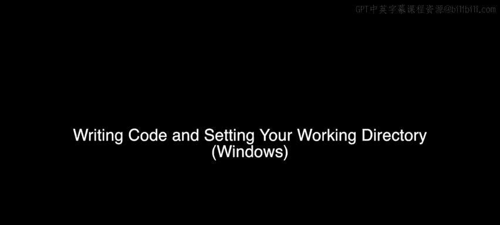
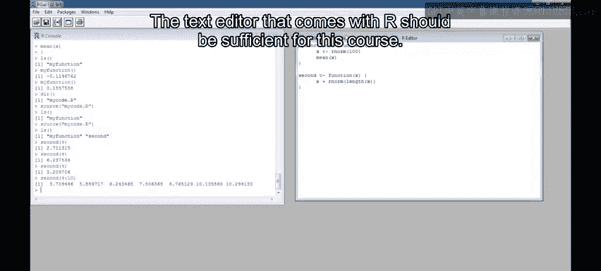

# 课程2：R编程 🖥️ | P4：在Windows中设置工作目录与编写代码



在本节课中，我们将学习两个核心操作：如何设置R的工作目录，以及如何在Windows系统中编辑和运行R代码文件。掌握这些是组织项目和管理数据文件的基础。

## 概述：工作目录与代码编辑器

开始编写R代码前，理解工作目录的概念至关重要。工作目录是R在您计算机上查找和保存文件的默认位置。同时，我们将使用R内置的文本编辑器来创建和编辑代码文件。

## 设置工作目录 📂

上一节我们介绍了工作目录的重要性，本节中我们来看看如何查看和设置它。

首先，您需要知道当前的工作目录是什么。可以使用 `getwd()` 函数来查看。

```r
getwd()
```

执行后，R会返回一个路径，例如 `C:/Users/YourName/Documents`。这个路径因您的Windows版本和用户设置而异。

设置正确的工作目录很重要，因为像 `read.csv()` 或 `write.csv()` 这样的读写函数默认在当前工作目录中寻找或保存文件。如果文件不在该目录，您会遇到错误。

例如，尝试读取一个不存在的文件：

```r
read.csv("my_data.csv")
```

您将收到一个错误，提示R在工作目录中找不到该文件。

以下是更改工作目录的步骤：

1.  在R的菜单栏中，点击 **File**。
2.  选择 **Change dir...**。
3.  在弹出的窗口中，导航到您希望设置为工作目录的文件夹（例如桌面上的一个专用文件夹），然后点击 **确定**。

为方便本课程学习，建议您创建一个专用文件夹来存放所有课程材料。这样，您只需将工作目录设置为此文件夹，即可轻松管理所有文件。

## 编写与运行R代码 📝

了解了如何管理工作目录后，接下来我们学习如何编写和运行R代码。R自带一个基础的文本编辑器，完全能满足本课程的需求。

要打开编辑器，请点击菜单栏的 **File**，然后选择 **New script**。这将打开一个空白的编辑窗口。

您可以在其中编写R代码。例如，我们编写一个简单的函数：

```r
my_function <- function() {
    x <- rnorm(100)  # 生成100个正态分布随机数
    mean(x)          # 计算这些数的平均值
}
```

编写完成后，需要将代码加载到R控制台中才能使用。有以下两种常用方法：

**方法一：复制粘贴**
对于少量代码，可以全选编辑器中的代码（`Ctrl + A`），复制（`Ctrl + C`），然后粘贴（`Ctrl + V`）到R控制台中执行。

**方法二：保存并加载文件**
对于更复杂的项目，最好将代码保存为文件。

1.  在编辑器窗口中，点击 **File** -> **Save As...**。
2.  将文件保存到您的工作目录（例如之前创建的 `Coursera` 文件夹），并命名为 `mycode.R`（`.R` 是R代码文件的常规扩展名）。
3.  在R控制台中，使用 `source()` 函数加载整个文件：

```r
source("mycode.R")
```

加载后，您就可以使用文件中定义的函数了。输入 `ls()` 可以查看当前工作空间中已加载的对象。

如果您修改了代码文件，需要先保存文件，然后再次使用 `source("mycode.R")` 重新加载，才能使更改生效。

## 管理代码文件

R编辑器允许您同时处理多个代码文件，以便更好地组织不同项目或作业的代码。

以下是相关操作：
*   **新建文件**：点击 **File** -> **New script** 可打开新的编辑窗口。
*   **打开现有文件**：点击 **File** -> **Open script...**，然后导航到您的 `.R` 文件。
*   **保存文件**：点击编辑器工具栏上的磁盘图标或使用 **File** -> **Save**。

虽然网络上有很多其他高级文本编辑器可供下载使用，但R自带的编辑器对本课程来说已经足够。

## 总结

本节课中我们一起学习了R编程的两个基础技能。
*   我们了解了**工作目录**的概念，学会了使用 `getwd()` 查看以及通过菜单更改它，并建议为课程创建一个专用文件夹来管理所有文件。
*   我们掌握了使用R内置编辑器**编写代码**的方法，学会了通过复制粘贴或使用 `source()` 函数加载 `.R` 文件来运行代码，并了解了如何保存和管理多个代码文件。



掌握这些操作将帮助您更有条理地开始R语言的数据分析之旅。