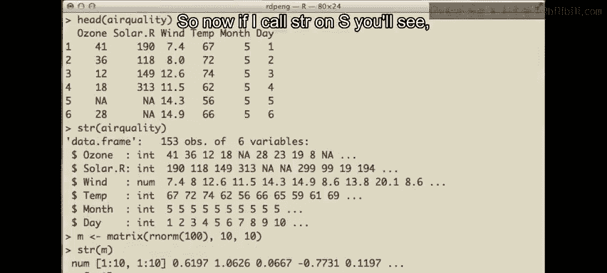

# 课程2：R编程｜P50：`str()`函数 🔍


在本节课中，我们将要学习R语言中一个极其重要的函数：`str()`函数。这个函数功能强大、用途广泛，能帮助我们快速查看任何R对象的内部结构，是数据探索和调试过程中不可或缺的工具。

## 概述


`str()`函数的核心目标是**紧凑地显示R对象的内部结构**。你可以将`str`理解为“structure”（结构）的缩写。它是一个非常简单的诊断函数，可以作为`summary()`函数的替代方案，尤其适合用于查看包含嵌套列表的大型列表对象。其设计目标是：**为每个基本对象生成大约一行的输出**。

## `str()`函数的基本用法

上一节我们介绍了`str()`函数的设计理念，本节中我们来看看它的具体应用。`str()`函数的基本作用是回答一个问题：**这个对象里有什么？**

它的调用语法非常简单：
```r
str(object)
```
其中，`object`可以是任何R对象，包括向量、矩阵、数据框、列表，甚至是函数本身。

## 查看不同类型的数据对象

以下是`str()`函数在不同类型R对象上的应用示例。

### 1. 查看函数参数
你可以对函数本身使用`str()`，来快速查看其参数结构。例如，查看线性模型函数`lm()`：
```r
str(lm)
```
输出会简洁地列出`lm`函数的主要参数，如`formula`、`data`等。

### 2. 查看数值向量
生成一个包含100个随机数的向量并查看：
```r
x <- rnorm(100, mean=2, sd=4)
str(x)
```
输出会显示：`x`是一个数值向量（`num`），包含100个元素，并列出前几个值，让你对数据有个直观感受。

### 3. 查看因子（Factor）
创建一个有40个水平的因子变量：
```r
f <- gl(40, 10) # 生成因子，每个水平重复10次
str(f)
```
输出会显示：这是一个因子（`Factor`），有40个水平，并列出前几个元素的标签。

### 4. 查看数据框（Data Frame）
加载内置数据集并查看其结构：
```r
data(airquality)
str(airquality)
```
输出会告诉你：这是一个数据框（`data.frame`），有153行观测（`obs.`）和6个变量（`variables`）。接着，它会为每个变量（如`Ozone`、`Solar.R`）提供一行摘要，包括变量类型（如`int`整数）和前几个值，并会指出是否存在`NA`（缺失值）。

### 5. 查看矩阵（Matrix）
创建一个10x10的随机数矩阵：
```r
m <- matrix(rnorm(100), 10, 10)
str(m)
```
输出会显示：这是一个二维数组（矩阵），有10行（`[，1:10]`）和10列（`[1:10， ]`），并列出第一列的前几个元素。

### 6. 查看列表（List），特别是嵌套结构
`str()`函数在处理列表时尤其强大。例如，将`airquality`数据框按月份拆分：
```r
s <- split(airquality, airquality$Month)
str(s)
```
输出会显示：这是一个包含5个元素的列表（`List of 5`），每个元素对应一个月的数据框。它会进一步简洁地展示每个子数据框的行数、变量数等信息，让你能快速理解这个复杂嵌套结构的内容。

## `str()`与`summary()`的对比

虽然`summary()`函数也常用于查看对象摘要，但两者侧重点不同：
*   **`str()`**：侧重于**结构**，输出更紧凑，旨在快速展示“里面有什么”。
*   **`summary()`**：侧重于**统计摘要**，对于数值向量会给出均值、分位数等；对于因子会给出频数计数。

你可以根据需求选择使用。当你想快速瞥一眼一个陌生对象的构成时，`str()`通常是更优的选择。

## 总结

本节课中我们一起学习了R语言中的“瑞士军刀”——`str()`函数。我们了解到：
1.  `str()`函数用于**紧凑显示任何R对象的内部结构**。
2.  它可以应用于**各种数据类型**，包括向量、因子、矩阵、数据框、列表和函数。
3.  它在探索**大型或嵌套列表**时特别有用，能提供一目了然的结构概览。
4.  它是数据导入后或遇到陌生对象时，进行**快速诊断和检查**的首选工具。



养成在查看新数据对象时首先使用`str()`的习惯，将极大地提高你的数据探索效率和代码调试能力。