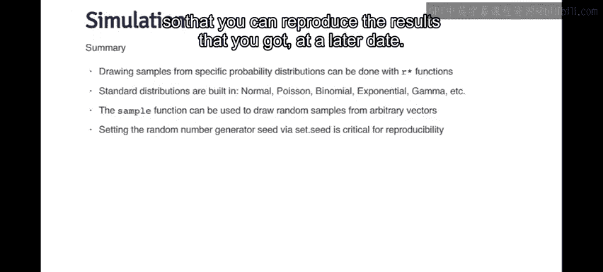

# 课程2：R编程 🧑‍💻｜第53讲：模拟与随机采样 🎲


在本节课中，我们将学习R语言中用于模拟和随机采样的核心函数。我们将重点介绍`sample()`函数，它允许你从指定的对象集合中随机抽取样本。通过本讲，你将掌握如何生成随机样本、进行有放回与无放回抽样，以及如何设置随机种子以确保结果的可重复性。

---

## 模拟函数概述 📊

上一节我们介绍了R中的基本概率分布函数。本节中，我们来看看`sample()`函数，它允许你从任意指定的向量中随机抽取样本。

`sample()`函数的基本语法如下：
```r
sample(x, size, replace = FALSE, prob = NULL)
```
其中：
*   `x`：要从中抽样的向量。
*   `size`：要抽取的样本数量。
*   `replace`：抽样是否是有放回的（`TRUE`为是，`FALSE`为否，默认是无放回）。
*   `prob`：一个可选的概率权重向量。

---

## 无放回随机抽样 🔄

以下是无放回抽样的示例。我们从整数1到10中随机抽取4个不重复的数字。

```r
# 从1:10中无放回地抽取4个样本
sample(1:10, 4)
# 输出可能是：3 4 5 7

# 再次运行会得到不同的结果
sample(1:10, 4)
# 输出可能是：3 9 8 5
```
因为是无放回抽样，所以每次抽取的4个数字都不会重复。

`sample()`函数不仅限于数字。以下是抽取字母的示例。

```r
# 从字母A-Z中无放回地抽取5个样本
sample(letters, 5)
# 输出可能是："Q" "B" "E" "X" "P"
```

---

## 生成随机排列 🔀

如果你只提供向量而不指定样本大小`size`，`sample()`函数会返回该向量的一个随机排列（即打乱顺序）。

```r
# 生成1:10的一个随机排列
sample(10)
# 输出可能是：2 8 5 10 7 3 9 1 4 6

# 再次运行会得到另一个排列
sample(10)
# 输出可能是：10 9 7 1 3 8 2 4 5 6
```

---

## 有放回随机抽样 📦

要进行有放回抽样，需要将参数`replace`设置为`TRUE`。这意味着同一个元素可以被多次抽中。

```r
# 从1:10中有放回地抽取10个样本
sample(1:10, 10, replace = TRUE)
# 输出可能是：8 3 8 9 1 3 9 8 10 5
```
从结果中可以看到，数字`8`和`3`等出现了多次。

---

## 设置随机种子以确保可重复性 🌱

在R中进行任何模拟或随机抽样时，设置随机数种子至关重要。这能确保你或他人在日后可以精确复现相同的结果。

使用`set.seed()`函数来设置种子。任何在设置种子后执行的随机操作，只要种子值相同，就会产生相同的随机序列。

```r
# 设置随机种子为1
set.seed(1)
sample(1:10, 4)
# 输出总是：3 4 5 7

set.seed(1) # 再次设置相同的种子
sample(1:10, 4)
# 输出再次是：3 4 5 7
```

---

## 核心要点总结 📝

本节课中我们一起学习了R语言中用于模拟和随机采样的关键工具：

1.  **`sample()`函数**：用于从任意指定向量中进行随机抽样。
    *   通过`size`参数控制样本量。
    *   通过`replace`参数控制是有放回（`TRUE`）还是无放回（`FALSE`）抽样。
    *   不指定`size`时，会生成向量的随机排列。

2.  **可重复性**：使用`set.seed()`函数设置随机种子，这是确保模拟结果可重现的关键步骤。

3.  **应用场景**：结合R内置的概率分布函数（如`rnorm()`, `rpois()`, `rbinom()`等），`sample()`函数为你提供了强大的工具，可以模拟各种随机过程和数据，为数据分析和统计建模奠定基础。



记住，在进行任何涉及随机性的分析之前，先设置一个随机种子，这是一个良好的编程习惯。