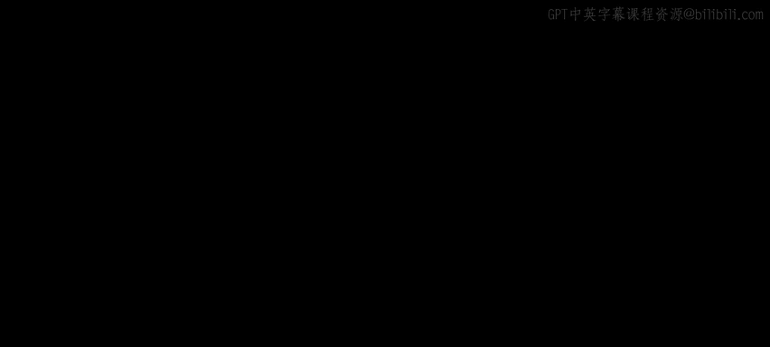
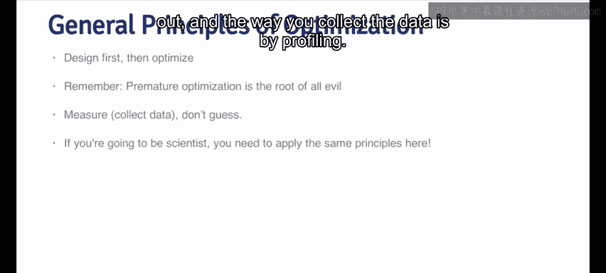
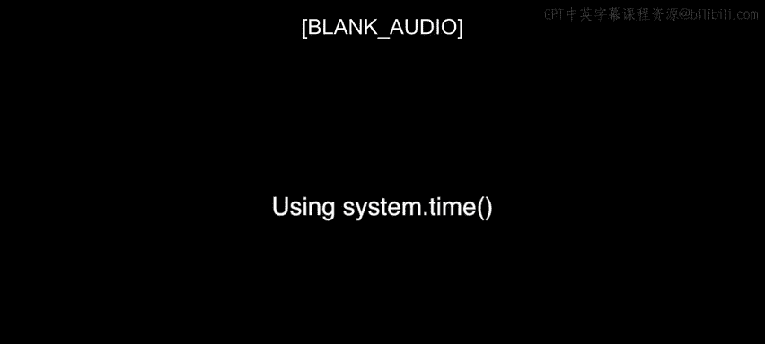
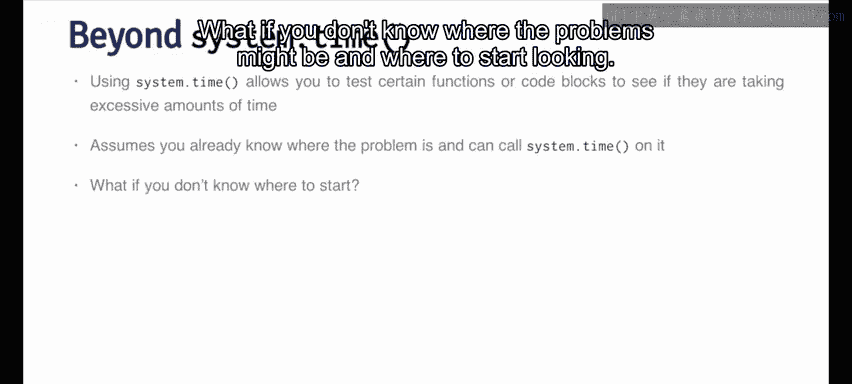

# 课程2：R编程 🛠️ - P54：R分析器（第一部分）



在本节课中，我们将要学习R语言中一个非常重要的性能分析工具——分析器（Profiler）。当您开发大型程序或进行大规模数据分析时，如果代码运行时间过长，分析器能帮助您精确找出耗时环节，并提供优化策略。我们还将介绍其他辅助工具，共同构成优化代码性能的工具箱。

## 概述：为什么需要分析代码性能？ 🤔

上一节我们介绍了R编程的基础，本节中我们来看看如何评估和优化代码性能。

在开发大型程序或进行复杂数据分析时，您可能会遇到代码运行缓慢的情况。有时，您可以运行程序后去做其他事情，但有时您需要程序快速运行。性能分析是一种系统性的方法，用于检查程序各个部分花费的时间。

当您首次编写代码时，它可能运行良好。但当这段代码被嵌入到一个更大的程序中，并被重复执行成千上万次时，原本微小的耗时就会被放大，从而拖慢整个程序。此时，您就需要让它运行得更快。

## 优化代码的基本原则 ⚖️

在深入工具之前，了解优化代码的基本原则至关重要。

关于代码优化，一个普遍的规则是：**您不应该过早进行优化**。这意味着，在初始阶段，您不应该首先考虑如何让代码运行得更快。您首先应该考虑的是如何让代码正确运行、易于阅读，并确保其他人能够理解您的意图。

原因在于，通常很难直观地理解程序究竟在哪里花费了所有时间。为了加速程序，您必须知道时间的消耗点，而这在没有进行正式的性能分析（即剖析）的情况下是很难做到的。

因此，基本思路是：**先设计代码，确保其可理解且能正常工作，然后再尝试优化**。有一句著名的格言：“过早优化是万恶之源”。如果您一开始就尝试优化，很可能在代码正常工作之前就引入了错误。

然而，一旦您决定要优化代码，就应该像科学家一样工作：**收集数据**。如果您感觉程序在某个地方卡住了或花费了大量时间，就应该通过剖析来收集数据，以找出问题所在。





## 第一个工具：`system.time()` ⏱️

在介绍分析器之前，我们先来看一个更简单的工具：`system.time()` 函数。

`system.time()` 是一个非常有用的函数，它接受一个任意的R表达式，评估该表达式，然后告诉您评估该表达式所花费的时间。这个表达式可以非常简单（如单个函数调用），也可以非常复杂（如果用花括号 `{}` 包裹，可以是一长段代码）。

其基本用法是：`system.time(expr)`，其中 `expr` 是您要计时的R表达式。如果代码在执行过程中出现错误，您将得到错误发生前所花费的时间。

### 理解两种时间概念

在计算机上执行表达式时，有两种非常重要的时间概念：

1.  **用户时间（User Time）**：这是CPU（或多个CPU）用于运行此表达式所计费的时间。粗略地说，这是计算机“感受到”的时间。
2.  **流逝时间（Elapsed Time）**：有时也称为“挂钟时间（Wall Clock Time）”。这是您实际感受到的等待时间。

这两种时间概念的重要性取决于您关心什么。通常，对于标准的计算任务，用户时间和流逝时间相对接近，因为计算机执行您的代码所花的时间大致等于您等待的时间。

然而，也存在两者不一致的情况：

*   **流逝时间 > 用户时间**：这意味着您等待的时间比计算机实际处理您代码的时间更长。这可能是因为计算机花费了大量时间等待外部事件（如网络I/O、磁盘读写），CPU并没有全力处理您的代码。
*   **流逝时间 < 用户时间**：这通常发生在您的机器有多个核心（处理器）并且程序能够利用它们时。如果程序使用了多线程库（例如某些优化的线性代数库），它可以在多个核心上并行计算，从而在更短的“挂钟时间”内，让多个CPU核心累积了更多的“用户时间”。

以下是使用 `system.time()` 的示例：

```r
# 示例1：流逝时间大于用户时间（涉及网络I/O）
system.time(readLines("http://www.jhsph.edu"))
# 输出可能类似：用户时间很小，流逝时间较大，因为大部分时间在等待网络。

# 示例2：流逝时间小于用户时间（使用多线程线性代数库）
hilbert <- function(n) {
  i <- 1:n
  1 / outer(i - 1, i, "+")
}
system.time(svd(hilbert(1000)))
# 输出可能显示用户时间大约是流逝时间的两倍，因为计算被分摊到两个CPU核心上。

# 示例3：计时较长表达式（使用花括号）
system.time({
  n <- 1000
  r <- numeric(n)
  for (i in 1:n) {
    x <- rnorm(n)
    r[i] <- mean(x)
  }
})
# 对于这种纯计算、未使用多线程的循环，用户时间和流逝时间通常很接近。
```

`system.time()` 是一个非常方便的函数，如果您只想了解一小段代码的运行时间，或者想逐段检查程序中哪些部分耗时较长，它会很有用。

### `system.time()` 的局限性

`system.time()` 的问题在于，它**假设您知道问题在哪里**。它假设您知道该对哪个表达式进行计时。这对于较小的、不太复杂的程序可能有用，因为您能很好地感知瓶颈所在。

但问题是：**如果您不知道从哪里开始查找问题呢？** 如果您不清楚问题可能出在哪里，就需要另一个工具来帮助您——这就是分析器（Profiler）。

## 总结 📝

本节课中我们一起学习了R代码性能分析的基础知识和第一个实用工具。

*   我们首先讨论了代码优化的基本原则：**避免过早优化**，应先确保代码正确和可读，再基于性能分析数据进行优化。
*   接着，我们介绍了 `system.time()` 函数，它可以用来测量特定R表达式的执行时间。
*   我们区分了 **用户时间** 和 **流逝时间** 两个关键概念，并解释了它们不一致的常见原因（如I/O等待、多核并行）。
*   最后，我们指出了 `system.time()` 的局限性：它需要您预先知道该测量哪段代码。当您面对大型复杂程序，不确定性能瓶颈所在时，就需要更强大的工具——R分析器。



在下一部分，我们将深入探讨R内置的分析器 `Rprof()`，学习如何用它来自动定位程序中耗时的部分。