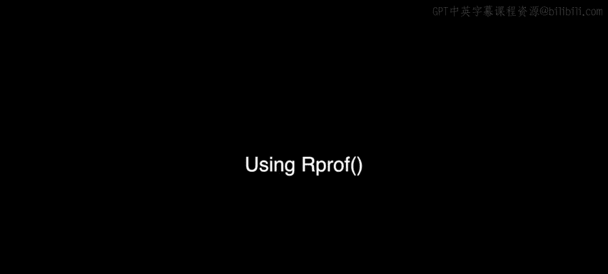
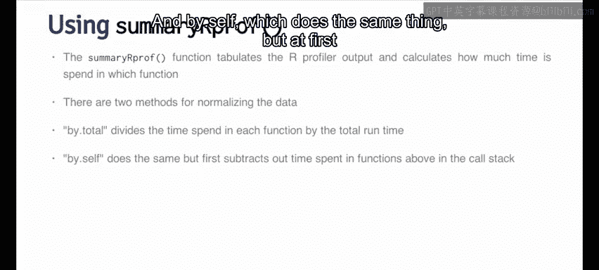
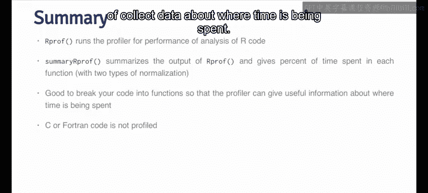

# 课程2：R编程 🧑‍💻｜第55讲：R性能分析器（第二部分）⚙️



在本节课中，我们将深入学习R语言中的性能分析工具——`Rprof`。我们将了解它的工作原理、如何解读其输出，以及如何利用它来优化代码性能。

## 概述 📋

上一节我们介绍了使用`system.time()`进行简单的性能计时。本节中，我们来看看一个更强大的工具：`Rprof`性能分析器。它能帮助我们深入理解代码在运行时，时间具体花费在了哪些函数上。

## Rprof函数简介

`Rprof`是R语言中用于启动性能分析器的函数。需要注意的是，R必须在编译时启用了分析器支持才能使用此功能。不过，在绝大多数情况下（约99.9%），你使用的R版本都支持此功能。只有在一些非常特殊的情况下，R才会被编译为不支持分析器。

另一个有用的函数是`summaryRprof`。它接收`Rprof`的原始输出，并将其汇总成一种可读性更强的格式，因为原始输出通常难以直接使用。

**重要提示**：不应同时使用`system.time()`和`Rprof()`函数。它们并非设计为协同工作，因此应只选择其中一种使用。

## Rprof的工作原理

`Rprof`函数的基本原理是：在固定的时间间隔（采样间隔）记录函数调用栈。换句话说，当你的代码运行时，分析器会定期“快照”当前正在执行的函数链。

具体来说，它大约每0.02秒打印一次函数调用栈。这意味着，如果你的函数运行时间少于0.02秒，分析器将无法捕捉到任何数据，因此变得无用。通常，分析器适用于运行时间至少为秒级的代码。如果你的代码运行很快，你一开始可能也不会想到使用分析器。

## 解读原始输出

以下是`Rprof`原始输出的一个示例。通常你不会直接使用这个输出，但了解其结构有助于理解分析过程。

```
# 示例：调用 lm(y ~ x) 函数
... 一系列函数调用栈行 ...
```




每一行输出都代表一个函数调用栈。最右侧通常是顶层函数（例如你直接调用的`lm`），向左则逐层深入被调用的子函数。例如，你可能看到`lm`调用了`eval`，`eval`又调用了`model.frame`，依此类推。通过观察调用栈的深度和变化，你可以了解程序执行时函数间的调用关系。例如，`lm.fit`是`lm`函数中进行实际计算的核心工作函数。

这种原始格式不易阅读，因此我们需要`summaryRprof`函数来整理和分析。

## 使用summaryRprof汇总数据

`summaryRprof`函数会整理`Rprof`的输出，并计算在每个函数中花费的时间比例。其核心思想是：既然每行调用栈记录间隔约0.02秒，那么通过统计每个函数在调用栈中出现的频率，就能估算其耗时。

该函数提供两种标准化数据的方法：

1.  **`by.total`**：将每个函数的耗时除以总运行时间。
    *   **公式**：`time_in_function / total_runtime`
2.  **`by.self`**：首先减去该函数所调用的下层函数花费的时间，再计算占比。
    *   **公式**：`(time_in_function - time_in_called_functions) / total_runtime`

理解这两种方式的区别至关重要。

## “总时间”与“自身时间”的区别

*   **`by.total`（总时间）**：反映了一个函数在**整个调用链**中出现的总时间占比。顶层函数（你直接调用的函数）的占比永远是100%，因为它涵盖了所有子函数的执行时间。但这通常不能揭示性能瓶颈，因为顶层函数可能只是协调者，实际工作由下层函数完成。
*   **`by.self`（自身时间）**：反映了一个函数**除去调用其他函数的时间后**，自身代码执行所花费的时间比例。这对于定位真正的性能瓶颈至关重要，因为它能告诉你时间具体消耗在哪个函数自身的计算逻辑上。

大多数情况下，`by.self`格式的输出更有用，它能更准确地指出哪些函数是真正的耗时大户，从而成为优化的重点目标。

## 输出示例分析

以下是`by.total`格式的输出示例：

```
$by.total
                    total.time total.pct self.time self.pct
"lm"                       7.41    100.00      0.30     4.05
"lm.fit"                  3.50     47.23      3.50    47.23
"model.frame"             1.55     20.92      0.66     8.91
...
```

可以看到，`lm`函数占了100%的时间（因为是顶层调用），而实际进行计算的核心函数`lm.fit`占了总时间的47.23%。

相比之下，`by.self`格式的输出更能说明问题：

```
$by.self
                    self.time self.pct total.time total.pct
"lm.fit"                  3.50    47.23       3.50     47.23
"as.list.data.frame"      0.82    11.07       0.82     11.07
"model.matrix"           0.76    10.26       1.46     19.70
...
```

这里，`lm.fit`以47.23%的“自身时间”位列第一，这符合预期。有趣的是，`as.list.data.frame`方法占了11.07%的时间，这可能与核心计算无关，更多是数据格式处理，值得进一步调查是否可以进行优化。

输出的最后部分还包含了采样间隔（例如0.02秒）和总采样时间（即表达式运行的总耗时，类似于`system.time()`中的“elapsed”时间）。

## 使用分析器的策略与注意事项

1.  **将代码模块化为函数**：为了更有效地利用分析器，建议将代码分解为多个逻辑清晰的函数。这样，在函数调用栈中，你的函数名将成为标识符，明确告诉你时间花费在哪个代码模块中。
2.  **对C/Fortran代码的分析限制**：如果你的R代码（或任何被调用的包）调用了C或Fortran编译代码，这些代码对R分析器来说是“黑盒”。分析器只会知道有段时间花在了那里，但无法提供内部详细的调用信息。
3.  **不要猜测，要测量**：与其猜测代码的瓶颈所在，不如使用分析器来收集数据。它常常能揭示一些你未曾预料到的耗时函数，这些函数可能并非核心算法部分，但却成为性能瓶颈。

## 总结 🎯

本节课我们一起学习了R性能分析器`Rprof`的核心用法。我们了解到：
*   `Rprof`通过定期采样函数调用栈来工作。
*   `summaryRprof`函数将原始数据转换为可读的摘要，特别是`by.self`格式能有效定位真正的性能瓶颈。
*   为了获得最佳分析效果，应将代码组织成良好的函数结构。
*   分析器是进行性能优化的强大数据驱动工具，应优先使用它来指导优化工作，而非依赖猜测。



通过本工具，你可以科学地诊断代码性能，并针对性地进行改进。