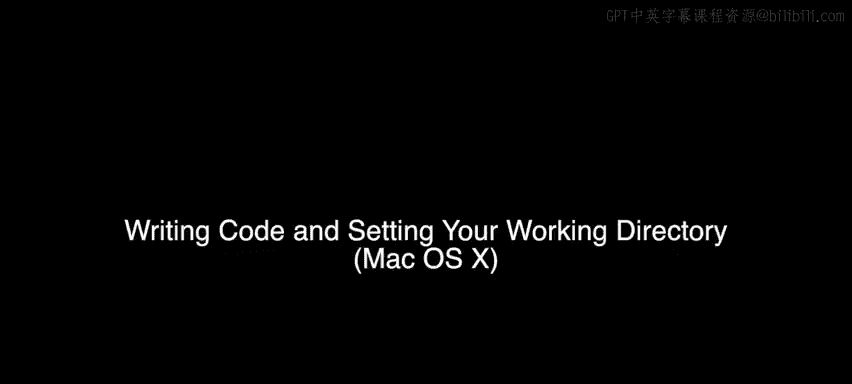
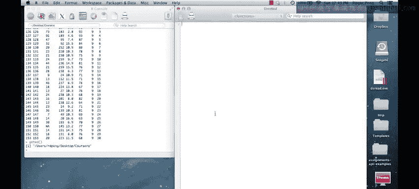
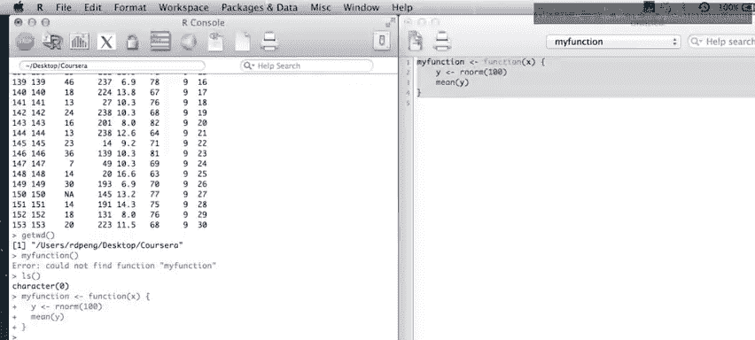
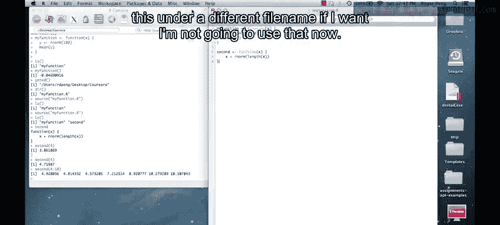

# 课程2：R编程 🖥️ - P5：设置工作目录与使用文本编辑器



在本节课中，我们将要学习两个核心操作：如何设置R的工作目录，以及如何使用R自带的文本编辑器来编写和运行代码。掌握这些是有效使用R进行数据分析和编程的基础。

## 概述：工作目录与代码编辑

开始使用R时，了解你的工作目录至关重要。工作目录是R从计算机读取文件和写入文件的位置。如果不清楚工作目录在哪里，你将无法找到保存的文件或写入的数据。同时，编写R代码需要一个编辑器，R自带的文本编辑器就是一个简单有效的工具。

## 1. 设置工作目录 📂

上一节我们介绍了工作目录的概念，本节中我们来看看如何查找和设置它。

启动R后，你可以通过输入函数 `getwd()` 来查看当前的工作目录。

```r
getwd()
```

执行此命令后，R会返回一个路径，例如在Mac系统上可能是 `/users/yourusername`，这通常是你的个人主目录。这个默认位置可能适用，但如果你将所有数据和代码文件存储在其他目录（例如一个子文件夹）中，你可能需要更改工作目录。

以下是更改工作目录的步骤：
1.  在R的菜单栏中，点击 **“Misc”** 菜单。
2.  选择 **“Change Working Directory...”**。
3.  在弹出的文件浏览器中，选择你想要设置为工作目录的文件夹。

**重要提示**：如果你想读取一个文件（例如使用 `read.csv()` 函数），该文件必须位于你的工作目录中，否则R会报错“文件未找到”。

例如，尝试读取一个不在当前工作目录中的文件：
```r
read.csv("mydata.csv") # 如果 mydata.csv 不在工作目录，此命令会出错
```
解决方法是，将工作目录更改到存放 `mydata.csv` 文件的文件夹，或者将该文件移动到当前的工作目录中。



为了方便管理，我建议你为本课程创建一个专属目录，并将所有相关文件存储在其中。这样你就不必频繁更改工作目录。例如，你可以在桌面上创建一个名为“Coursera”的文件夹，然后在R中将工作目录设置为此文件夹。

## 2. 使用R文本编辑器编写代码 ✍️

上一节我们设置了工作目录，本节中我们来看看如何使用R自带的文本编辑器来编写和运行代码。

在Mac版的R中，你可以通过点击工具栏上的编辑器按钮（通常是一个文档图标）来打开内置的文本编辑器。这会打开一个空白的编辑窗口。

在编辑器中，你可以直接编写R代码。例如，我们可以创建一个简单的函数：
```r
myfunction <- function() {
    x <- rnorm(100)
    mean(x)
}
```
编辑器会自动进行代码缩进，这有助于保持代码结构清晰。



编写完代码后，你需要将其加载到R中才能使用。有几种方法可以实现：

**方法一：复制粘贴**
对于少量代码，最简单的方法是：
1.  在编辑器中选择全部代码（`Command + A`）。
2.  复制代码（`Command + C`）。
3.  切换到R控制台窗口（Console）。
4.  粘贴并执行代码（`Command + V`，然后按回车）。

执行后，使用 `ls()` 命令可以查看工作空间中已加载的对象，此时应该能看到 `myfunction`。

**方法二：保存并加载文件**
对于更正式或更长的代码，最好将其保存为文件：
1.  在编辑器菜单中，点击 **“File” -> “Save As...”**。
2.  导航到你的工作目录（例如之前创建的“Coursera”文件夹）。
3.  为文件命名，并确保使用 `.R` 作为扩展名（例如 `myfunction.R`）。
4.  点击保存。

之后，你可以在R控制台中使用 `source()` 函数来加载并执行整个文件：
```r
source("myfunction.R")
```
这等同于将文件中的所有代码复制粘贴到控制台中。之后对代码文件所做的任何修改，都需要先保存文件（`Command + S`），然后再次使用 `source()` 命令加载，更新才会在R中生效。

你可以随时点击编辑器按钮创建新的代码文件进行编写。R自带的文本编辑器虽然简单，但对于本课程的学习完全足够，无需额外下载其他复杂的编辑器。



## 总结

本节课中我们一起学习了R编程的两个重要基础操作。首先，我们了解了工作目录的概念，并学会了如何使用 `getwd()` 查看以及通过菜单更改它，这是管理项目文件的基础。其次，我们掌握了如何使用R内置的文本编辑器编写代码，并通过复制粘贴或保存为 `.R` 文件后用 `source()` 加载的方式，将代码送入R环境执行。设置好工作目录并熟练使用编辑器，将为后续的R编程学习铺平道路。