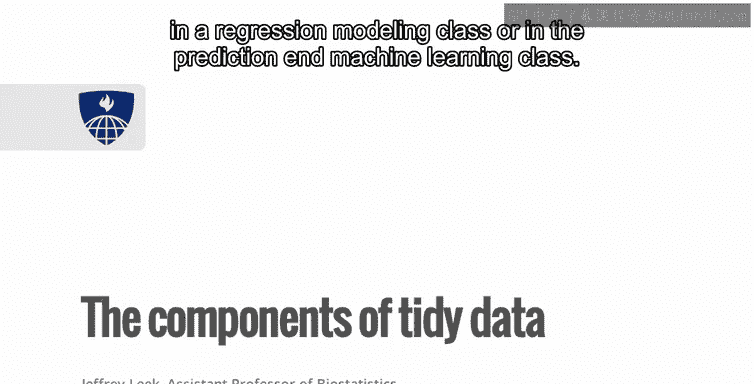
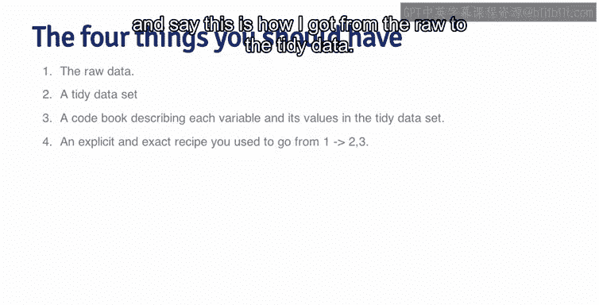
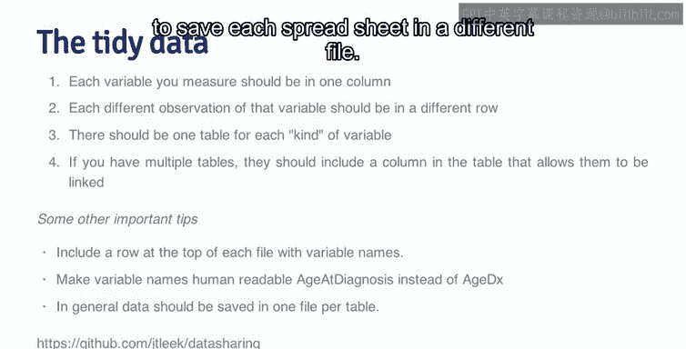
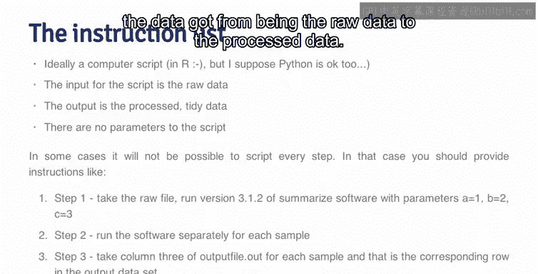

# 003：整洁数据的组成部分



在本节课中，我们将要学习如何将原始数据转化为整洁数据集，并了解构成一个完整、可重现数据分析流程的关键组成部分。

上一节我们介绍了原始数据的概念，即你最初获取的、未经处理的混乱文件。本节中我们来看看整洁数据，这是你处理原始数据后希望达成的目标。一个整洁的数据集可以用于后续的分析，例如在回归建模或机器学习课程中会用到的方法。



一个完整的数据处理流程应包含以下四个部分。

## 原始数据 📁

原始数据是你获取信息的最初文件。它可能有多种形式：
*   一个奇怪的二进制文件。
*   一个包含10个工作表的未格式化Excel文件。
*   从API抓取得到的复杂JSON数据。
*   甚至可能是你通过显微镜观察并手动计数的细胞数量。

判断数据是否为最原始格式的一个关键标准是：**你没有对数据运行任何软件**。数据在交到你手上时，未经任何软件处理，你也没有对数据中的数字进行任何操作、删除或汇总。保持原始数据的纯净是向合作者交付可靠分析结果的基础。

## 整洁数据集 🧹

整洁数据集是整个处理过程的目标或最终成果。它遵循以下原则：
*   **每个变量一列**：你测量的每个变量应恰好对应一列。
*   **每个观测一行**：每个不同的观测值应位于不同的行。例如，测量大量用户的推文数量，那么“推文数”是一列，每个用户的数据占据一行。
*   **每种变量类型一个表**：如果你从Twitter和Facebook收集数据，可以为每种数据分别建立一个表。
*   **表间可链接**：如果你有多个需要关联的表，应确保每个表都包含一个可以链接它们的列（通常是ID）。我们将在课程后期讨论数据合并。

以下是一些能避免未来麻烦的重要提示：
*   **使用可读的变量名**：在文件顶部包含变量名行，并使用人类可读的名称。例如，使用 `诊断时年龄` 而非 `AgeDX`。
*   **一个表存为一个文件**：最好将每个数据表保存在单独的文件中，而不是将多个工作表塞进一个Excel文件。



## 数据字典 📖

数据字典（或称元数据）是经常被遗漏的部分。它描述了整洁数据集中每个变量及其取值。

你可能会想知道更多关于变量的信息，例如：
*   **单位**：列标题可能是“本季度收入”，但你需要知道单位是千、百万还是其他。
*   **汇总方式**：变量测量的是月收入，你需要知道使用的是中位数还是平均数。
*   **实验设计**：你需要了解数据是如何收集的，是从数据库中提取的，还是通过随机试验、A/B测试等实验获得的。

一个常见的数据字典格式是文本文件或Markdown文件，通常包含两个部分：
1.  **研究设计**：详细描述数据收集方式，包括如何选择观测样本、从数据库提取了什么、排除了什么等。
2.  **代码簿**：描述所有变量及其单位。

## 处理指令清单 🧾

即使你拥有了整洁数据和数据字典，你还需要一份明确的指令清单。它确保你能从原始数据出发，重新处理并得到完全相同的整洁数据集。如果做不到这一点，说明你的数据处理流程存在问题。

理想情况下，这应该是一个**计算机脚本**（例如R或Python脚本）。脚本的输入是原始数据，输出是处理后的整洁数据。一个关键点是脚本**不应包含需要手动调整的参数**，确保任何用户使用相同的原始数据输入都能得到完全相同的输出。

在某些情况下，并非所有步骤都能脚本化。例如，并非所有数据处理都能在R中完成。这时，你需要一份尽可能详细的文本说明，例如：
```
对原始文件运行[软件名称]版本3.1.2，使用以下参数：[参数列表]。对每个样本单独运行该软件。
```
如果你无法编写脚本，那么在这个“食谱”中提供**过量**的细节是你能做的最佳选择。

## 一个重要的教训 ⚠️



认真对待数据处理流程并保存脚本至关重要。这里有一个著名的例子：经济学家Reinhart和Rogoff发表了一篇关于债务与增长的论文，该论文曾被许多国家用作财政紧缩政策的依据。后来，一位研究生拿到了他们使用的Excel文件，检查了其数据处理方式，发现了大量错误。对数据收集、分析和整合方式的仔细审查，导致这篇论文受到严重质疑，进而动摇了多个国家在应对经济衰退时的政治决策。这位研究生甚至因此登上了《科尔伯特报告》节目。

这个例子给我们所有人的教训是：**我们必须仔细关注并保存好将原始数据转化为分析所用数据的脚本**。


## 总结 📝


本节课我们一起学习了构成一个完整、可重现数据分析流程的四个核心部分：**原始数据**、**整洁数据集**、**数据字典**和**处理指令清单**。确保拥有这四部分，不仅能提高你自身分析的可靠性，也能让你的工作经得起他人检验，便于协作与复现。