# 005：读取本地文件 📂


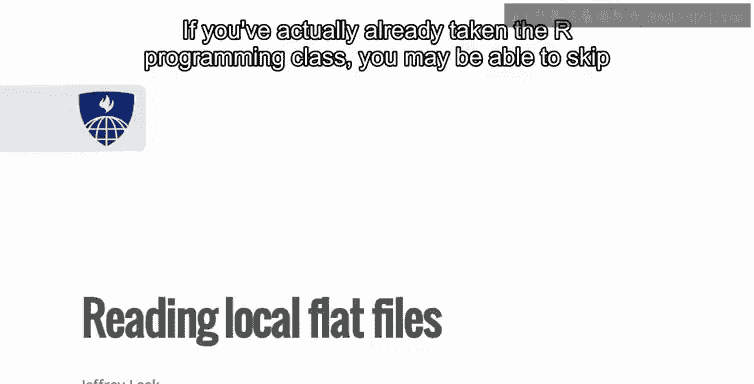

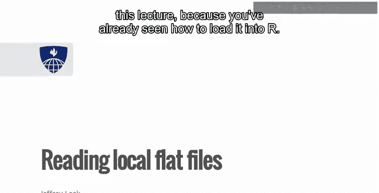

在本节课中，我们将学习如何在R中读取本地文件，特别是被称为“平面文件”的常见数据格式，例如文本文件、制表符分隔文件和逗号分隔文件。

如果你已经学习过R编程课程，可能已经掌握了如何将数据加载到R中，那么你可以选择跳过本讲。不过，复习一下核心概念和参数设置总是有益的。

---

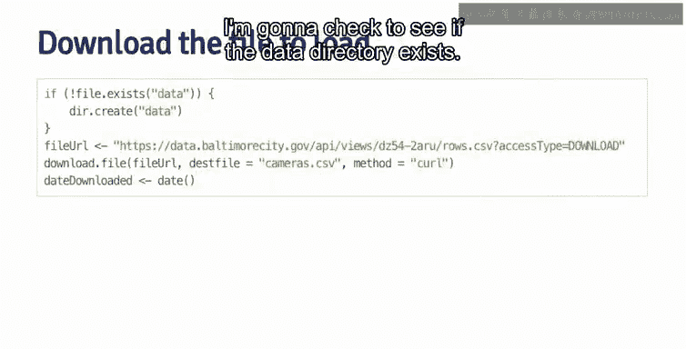

## 读取数据：`read.table`函数

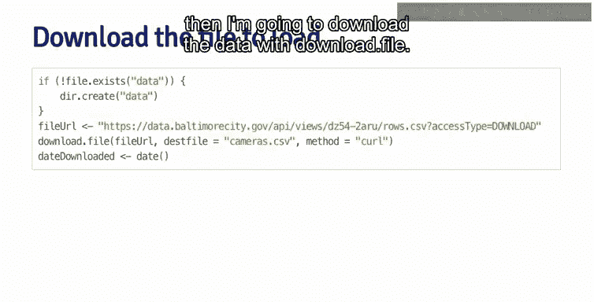

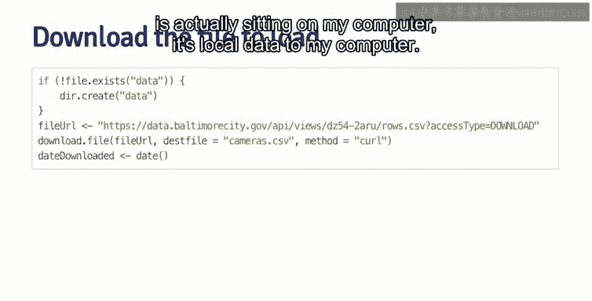

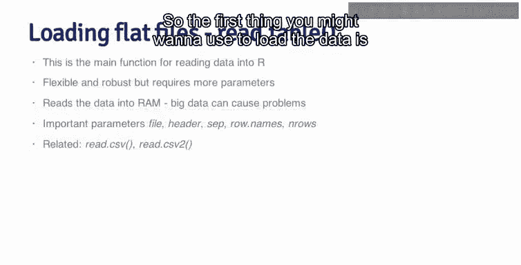

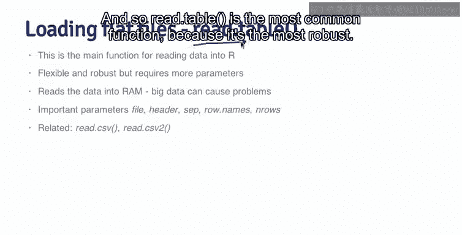

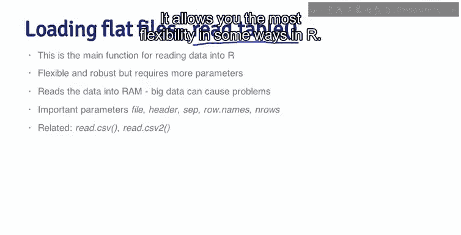

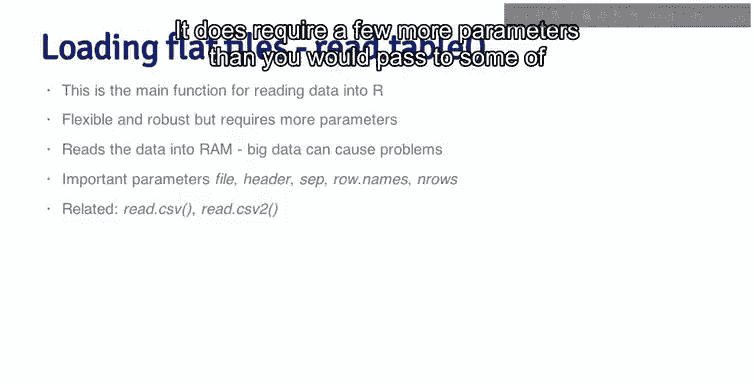

上一节我们介绍了本课程将使用的巴尔的摩固定摄像头数据集。本节中，我们来看看如何将已下载到本地的数据文件读入R环境。


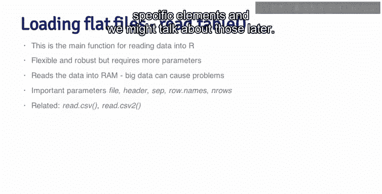

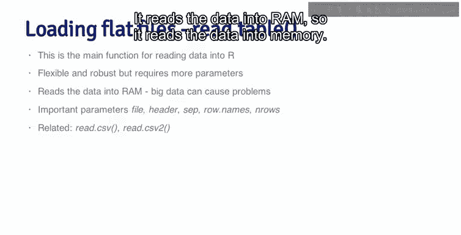

读取数据最常用、最灵活的函数是 `read.table`。它功能强大，但需要设置的参数也相对较多，并且对于大型数据集可能速度较慢。该函数会将整个数据集读入内存，因此对于非常大的数据集，可能需要分块读取。

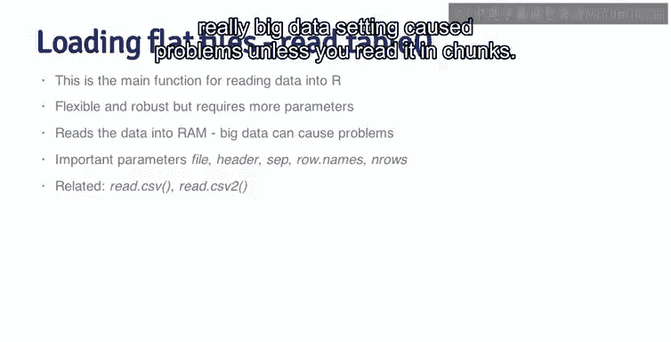

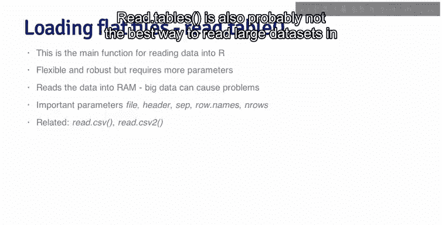

以下是 `read.table` 函数的一些重要参数：
*   **file**: 要读取的文件路径。
*   **header**: 文件第一行是否包含列名（变量名）。
*   **sep**: 文件中用于分隔不同数据元素的字符。
*   **row.names**: 指定作为行名的列。
*   **nrows**: 指定要读取的行数。

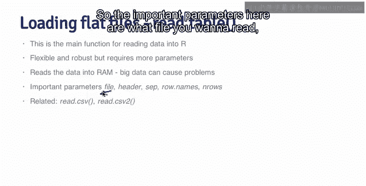

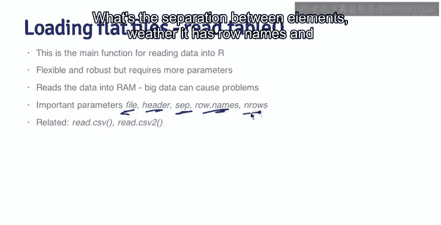

---


## 实践：读取CSV文件

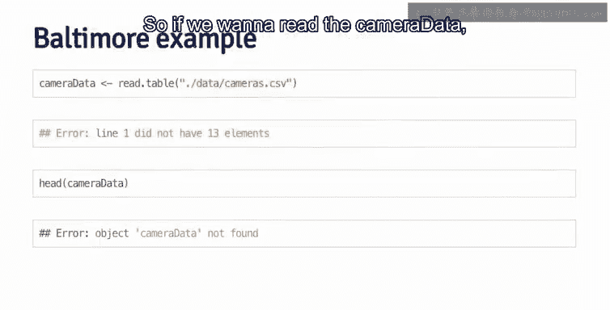

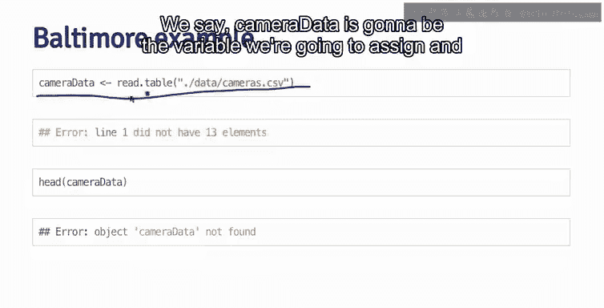

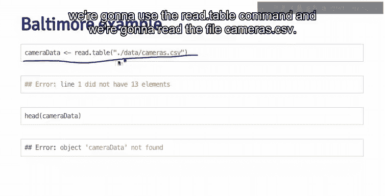

现在，我们尝试读取摄像头数据文件 `cameras.csv`。如果直接使用 `read.table` 而不指定分隔符，会遇到错误，因为该函数默认寻找制表符分隔的文件，而我们的文件是逗号分隔的。

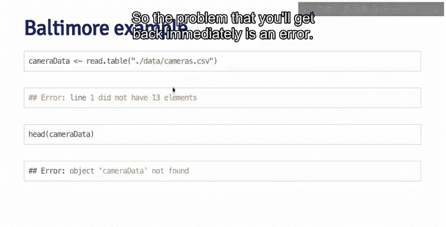

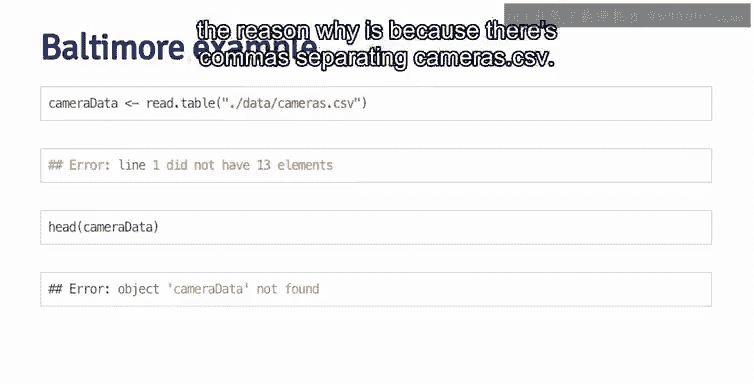

```r
# 错误的尝试：默认寻找制表符分隔
cameraData <- read.table("./data/cameras.csv")
# 这将导致错误：“line 1 did not have 13 elements”
```

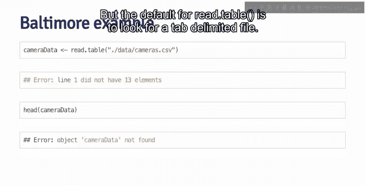

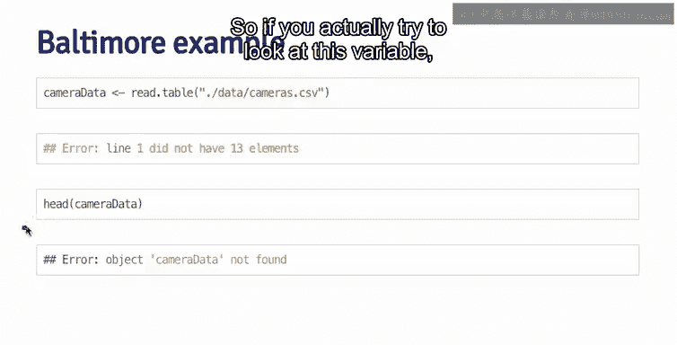

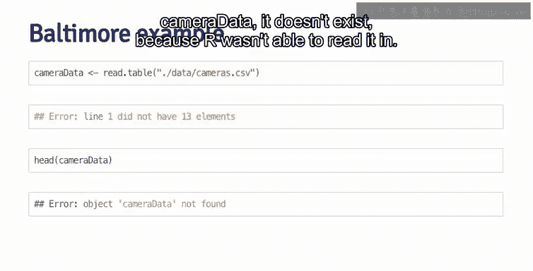

为了解决这个问题，我们需要指定 `sep`（分隔符）和 `header` 参数。

```r
# 正确的读取方式
cameraData <- read.table("./data/cameras.csv", sep=",", header=TRUE)
head(cameraData) # 查看前几行数据
```

对于CSV（逗号分隔值）这种最常见的格式，R提供了便捷函数 `read.csv`。它会自动将 `sep` 设置为逗号，并将 `header` 设置为 `TRUE`。

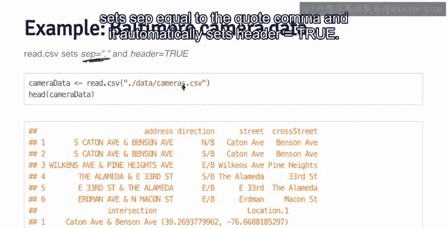

```r
# 使用 read.csv 读取CSV文件
cameraData <- read.csv("./data/cameras.csv")
```

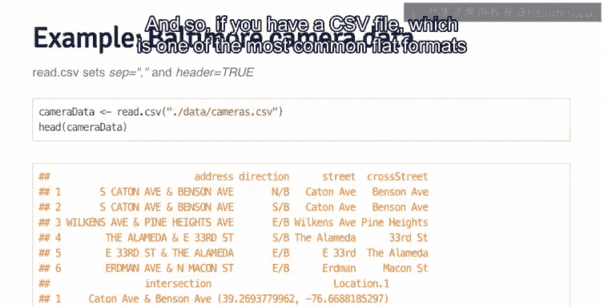

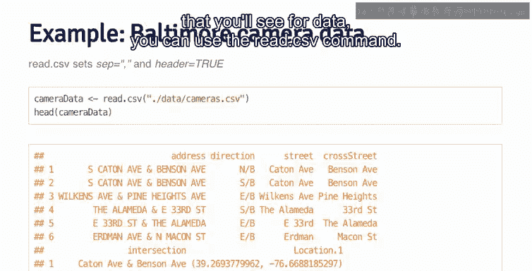

---

## 其他重要参数与技巧

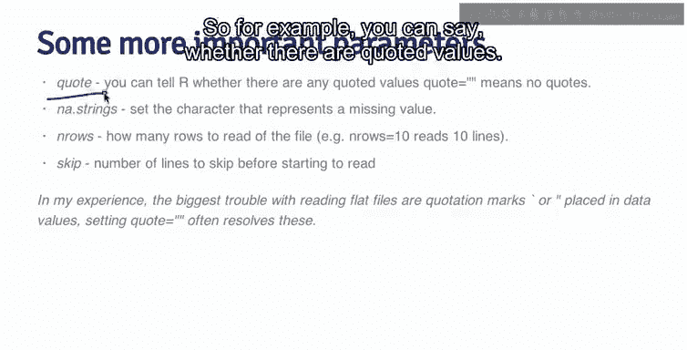

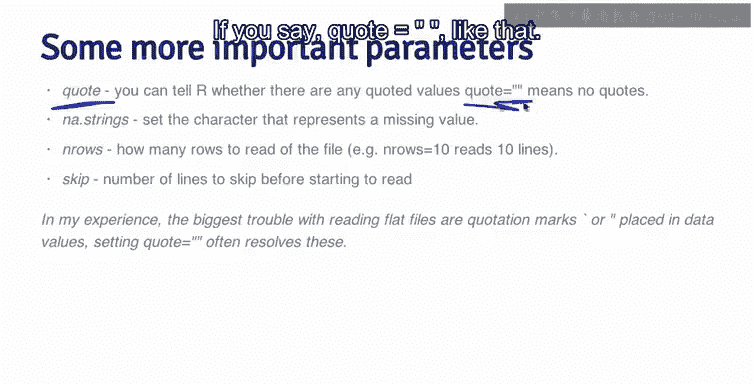

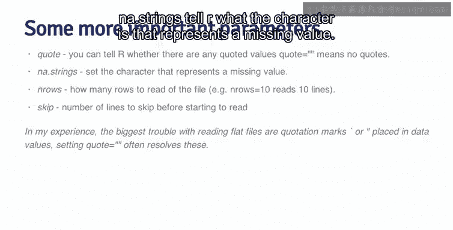

除了基本参数，`read.table` 及其相关函数（如 `read.csv`）还有其他有用的参数来处理各种情况。

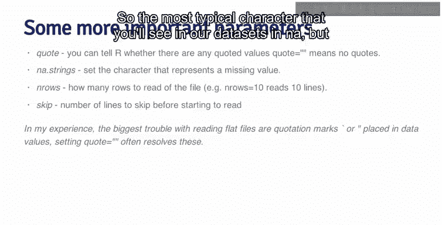


以下是几个关键参数：
*   **quote**: 指定用于包围字符型数据的引号字符。设置为 `quote=""` 可以忽略所有引号，这常能解决因数据内包含引号而导致的读取错误。
*   **na.strings**: 指定哪些字符串应被识别为缺失值（NA）。默认是 `"NA"`，但也可能是 `-1`、`999.99`等。
*   **nrows**: 如前所述，限制读取的行数。例如，`nrows=10` 只读前10行。
*   **skip**: 在开始读取数据前跳过的行数。例如，想读取第3到第13行，可以设置 `skip=2`（跳过前2行）和 `nrows=10`（读取10行）。

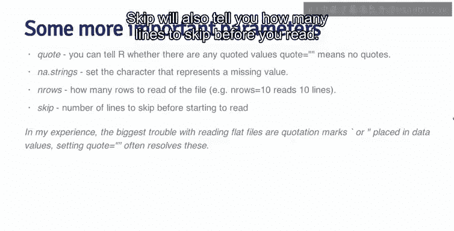


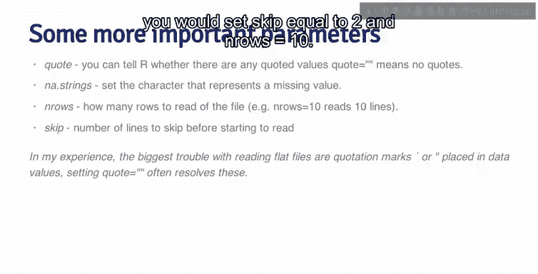

一个常见的问题是数据值中意外包含了引号，导致R解析混乱。将 `quote` 参数设置为空字符串（`quote=""`）通常是解决此类问题的有效方法。

---


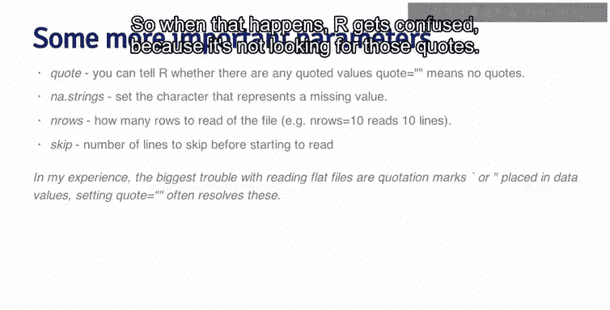

## 总结


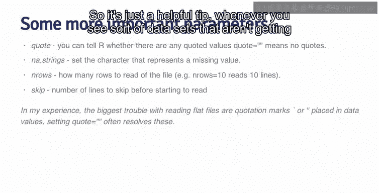

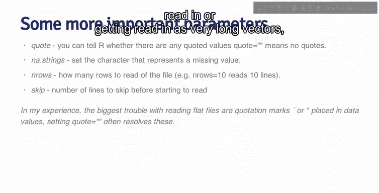

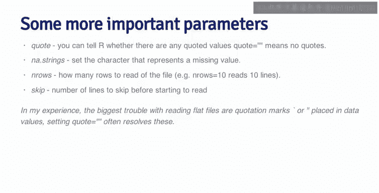

本节课中，我们一起学习了如何在R中读取本地平面文件。
我们重点介绍了 `read.table` 这个核心函数及其关键参数，如 `sep`、`header`、`quote` 和 `nrows`。
我们还了解了针对CSV文件的便捷函数 `read.csv`。
掌握这些函数和参数，能够帮助你顺利地将各种格式的本地数据加载到R中，为后续的数据清理和分析工作打下基础。