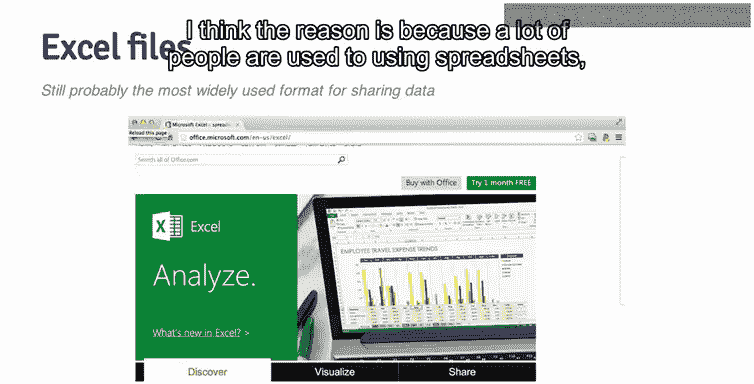
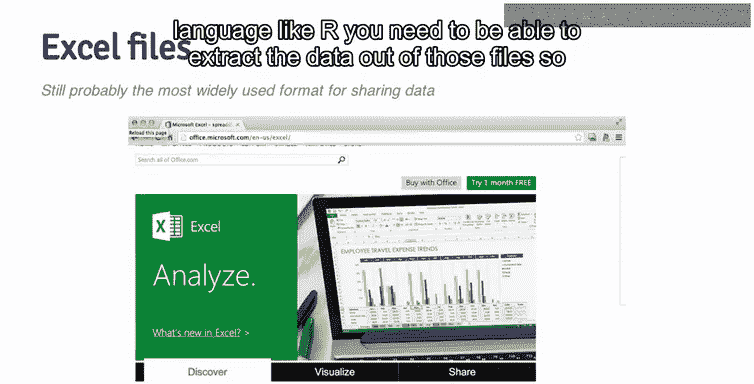
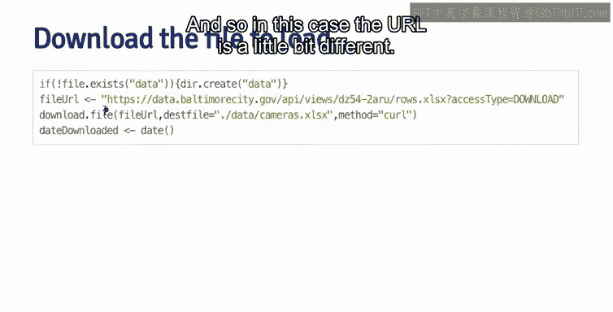
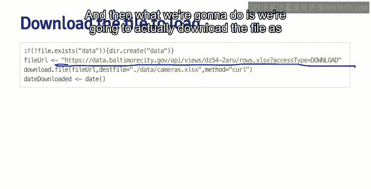
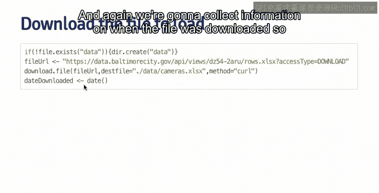
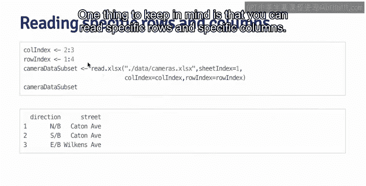
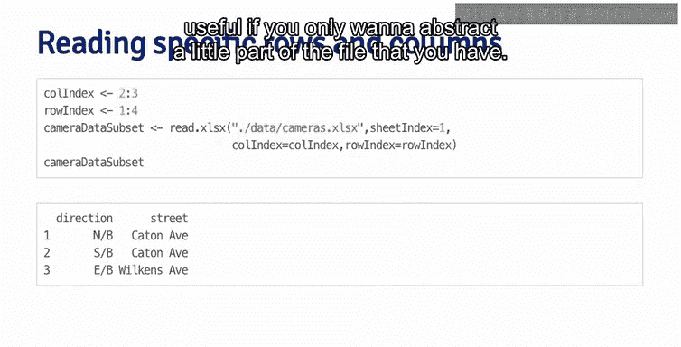

# 006：读取Excel文件 📊


在本节课中，我们将学习如何在R语言中读取和处理Excel文件。尽管一些数据科学家对Excel文件持有偏见，但Excel仍然是目前最广泛使用的数据共享格式之一。这主要是因为许多人习惯于使用电子表格来收集、录入和共享数据，无论是在商业应用还是科学研究中。随着像Google表格这类在线协作工具的出现，这一趋势更加明显。

对于使用R这类脚本语言进行数据分析的你来说，关键是要能够从这些文件中提取数据，以便进行后续的分析和处理。


## 下载Excel文件




上一节我们介绍了如何下载通用文件，本节中我们来看看如何下载一个具体的Excel文件。我们将回到巴尔的摩摄像头数据集作为例子。



首先，我们需要从指定网址下载Excel版本的数据。请注意，文件的URL可能有所不同，你需要从网站上获取正确的链接。我们将文件下载为 `.xlsx` 格式，这是Excel文件的标准扩展名。

以下是下载文件的核心代码步骤：

```r
# 设置文件URL和本地保存路径
fileUrl <- "http://example.com/data/cameras.xlsx"
download.file(fileUrl, destfile = "./data/cameras.xlsx", method = "curl")

# 记录文件下载日期，这对于追踪分析时间很重要
dateDownloaded <- date()
```

代码中，`download.file` 函数不关心文件类型，它只是将文件下载到你指定的本地文件名中。同时，记录下载时间是一个好习惯，可以让你知道分析是何时进行的。



## 使用 `xlsx` 包读取数据





文件下载完成后，我们需要将其读入R环境中进行分析。我们将使用 `xlsx` 包来完成这个任务。虽然也有其他包如 `XLConnect` 可供选择，它们可能提供更灵活的接口，但 `xlsx` 包对于基础操作来说简单易用。

以下是读取Excel文件的核心代码：

```r
# 加载xlsx包
library(xlsx)

# 读取Excel文件
cameraData <- read.xlsx("./data/cameras.xlsx", sheetIndex=1, header=TRUE)
```

在 `read.xlsx` 函数中，我们需要传递几个重要参数：
*   `sheetIndex`：指定数据存储在哪个工作表（sheet）中。
*   `header`：设置为 `TRUE`，表示第一行是列名。

读取到R后，数据看起来与之前从CSV文件中读取的几乎完全一样。

## 读取特定行与列





`read.xlsx` 函数的一个强大功能是允许你只读取文件的特定部分，这在处理大型文件或只需部分数据时非常有用。

例如，如果你只想读取第二列和第三列，以及第一到第四行的数据，可以这样做：

```r
# 只读取特定的行和列
subsetData <- read.xlsx("./data/cameras.xlsx",
                        sheetIndex=1,
                        colIndex=2:3, # 读取第2和第3列
                        rowIndex=1:4) # 读取第1到第4行
```

通过向 `colIndex` 和 `rowIndex` 参数传递数值向量，你可以精确控制导入数据的范围。

## 其他注意事项与工具

关于Excel文件处理，还有一些有用的补充信息：

以下是关于写入Excel文件和其他替代包的建议：
*   **写入Excel文件**：如果你的合作者偏好Excel，你可以使用 `write.xlsx` 函数将R中的数据框写回Excel文件，以便分享。其用法与读取类似。
    ```r
    write.xlsx(cameraData, file="./data/processed_cameras.xlsx")
    ```
*   **`read.xlsx2` 函数**：它是 `read.xlsx` 的一个变体，通常读取速度更快，但在读取数据子集时可能不太稳定（根据个人经验）。
*   **`XLConnect` 包**：如前所述，这个包在读写和操作Excel文件方面更加灵活。如果你需要进行大量复杂的Excel文件处理，`XLConnect` 可能是更好的选择。它的帮助文档（vignette）是极好的入门资料。
*   **关于文件格式的通用建议**：无论是为了本课程的学习，还是大多数数据分析场景，将数据存储为**逗号分隔（CSV）** 或**制表符分隔**的纯文本文件通常会更快捷、更容易读取。这种格式也更容易分发，因为并非所有人都安装了Excel，纯文本文件的跨平台兼容性更好。

## 总结

本节课中我们一起学习了在R中处理Excel文件的完整流程。我们从下载 `.xlsx` 文件开始，然后使用 `xlsx` 包中的 `read.xlsx` 函数将数据读入R。我们还探讨了如何只读取文件中的特定行和列以提升效率。最后，我们简要介绍了写入Excel文件的方法以及其他可选的工具包。记住，虽然Excel文件很常见，但在许多情况下，使用CSV等纯文本格式可能是更简单、兼容性更好的选择。