# 014：从其他来源读取数据 📚

在本节课中，我们将学习如何从多种非传统或特定来源读取数据。我们已经介绍了从XML、JSON、ACF5或MySQL等常见来源读取数据的方法，但R语言生态系统的强大之处在于其丰富的扩展包，几乎可以为任何数据源提供接口。本节将概述一些其他有用的R包，并指导你如何寻找适合自己需求的工具。

## 概述

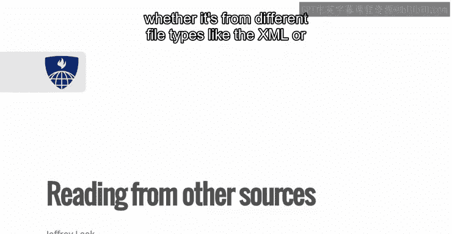

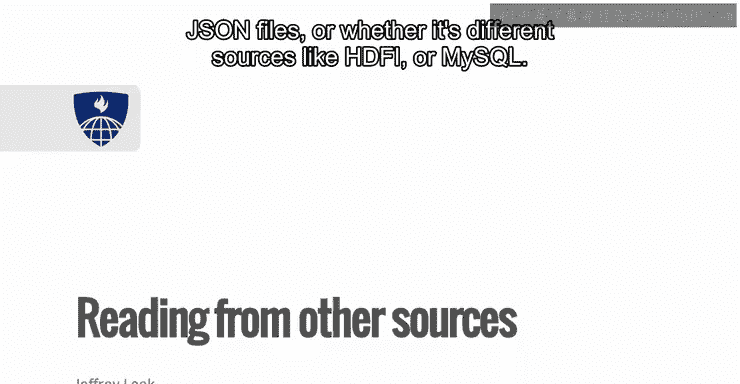

到目前为止，我们已经涵盖了从大量来源读取数据的方法，无论是来自不同文件类型（如XML或JSON文件），还是来自不同数据源（如ACF5或MySQL）。虽然我们介绍了一些重点内容，但还有很多其他你可能希望获取数据的地方，并且我们远未全面涵盖所有可用于访问这些数据的R包。

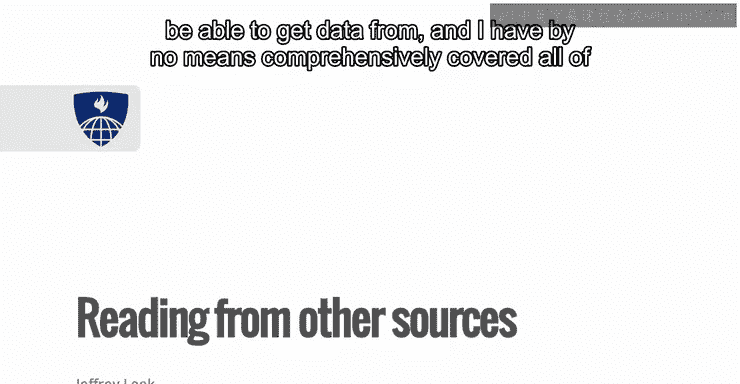

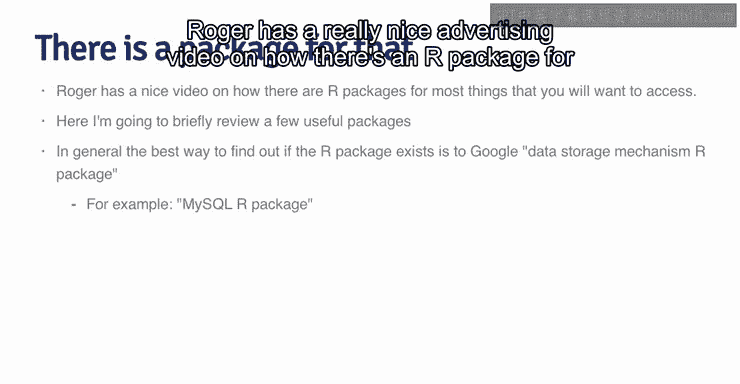

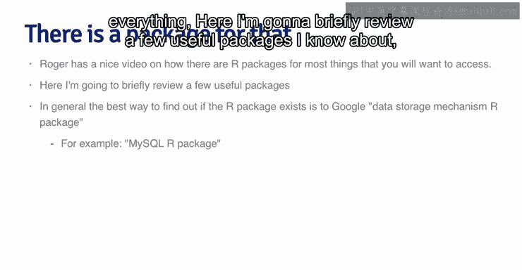

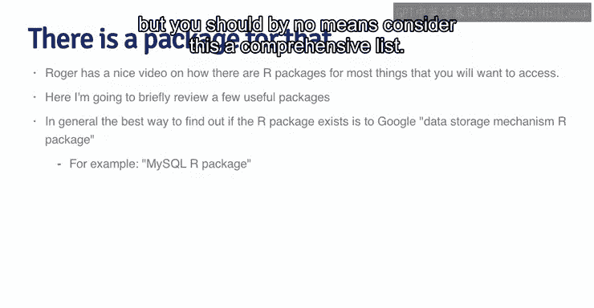

罗杰有一个非常好的广告视频，讲述了“万物皆有R包”的理念，类似于苹果的“万物皆有应用”。在这里，我将简要回顾一些我知道的有用包，但你绝不应将此视为一个全面的列表。

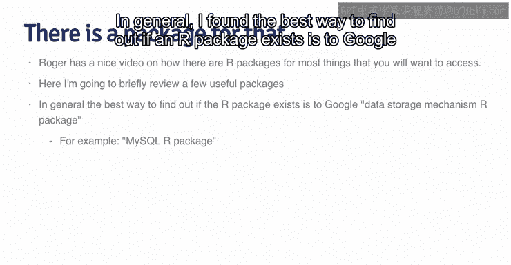

## 如何寻找R包 🔍

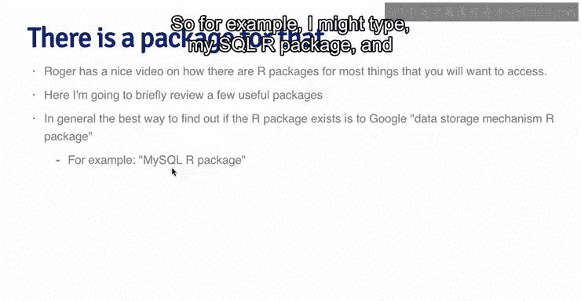

通常，我发现找出某个R包是否存在的最佳方法是，在谷歌搜索“数据存储机制”后面加上“R package”。

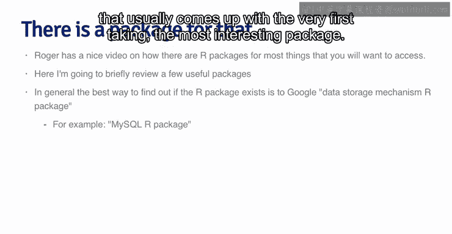

如果你只输入“R”，有时可能无法通过搜索找到它。例如，我可能会输入“MySQL R package”，通常搜索结果的第一条就是最相关的包。

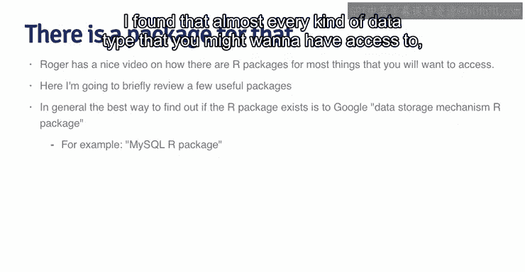

我发现，几乎每一种你可能想要访问的数据类型，只要它相对常见，就有一个R包可以用于访问该数据。

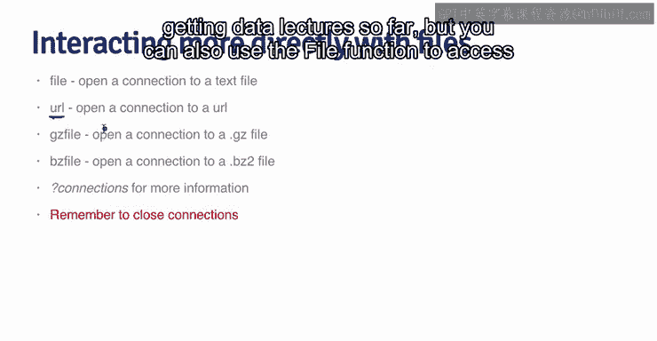

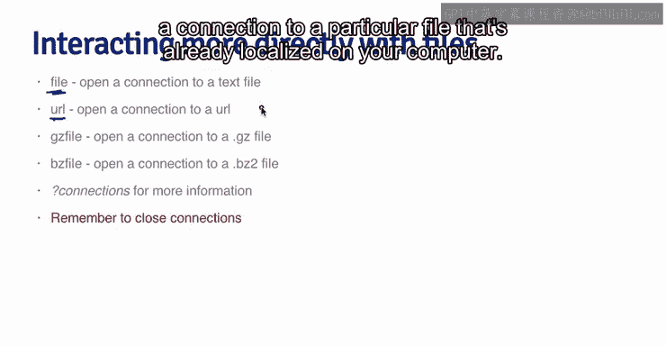

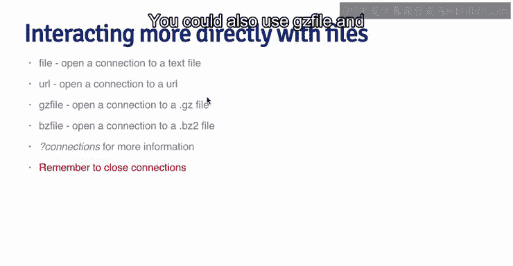

## 访问本地与远程文件 📁

如果你想直接与文件交互，我们在之前的“获取数据”讲座中已经看到了如何使用`url`函数。但你也可以使用`file`函数来访问已本地化在你计算机上的特定文件的连接。

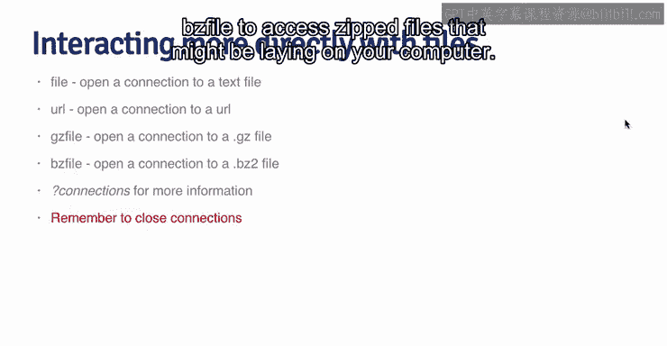

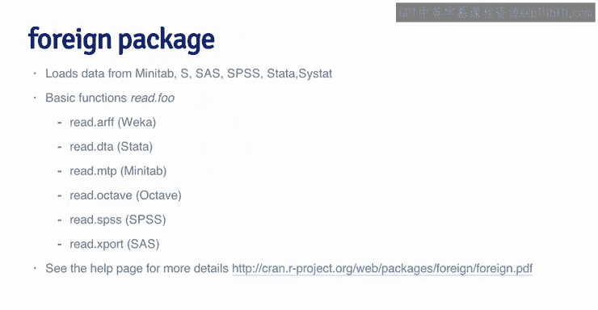

你还可以使用`gzfile`和`bzfile`来访问可能出现在你计算机上的压缩文件。然后，如果你输入`?connections`，你可以了解更多关于打开本地和远程文件连接的信息。

## 读取其他统计软件的数据 📊

`foreign`包非常有用，如果你与使用其他编程语言或其他统计编程语言的人一起工作。它可以加载来自Minitab、SPSS等一系列软件的文件数据。

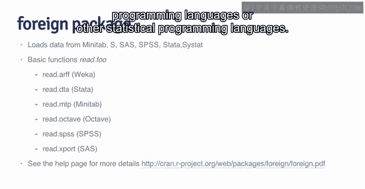

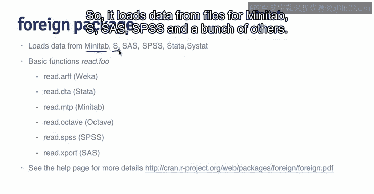

基本函数的命名类似于`read.xxx`，其中`xxx`是特定编程语言文件的扩展名。例如，Stata文件的扩展名是`.dta`，所以函数是`read.dta`；如果是Octave文件，函数是`read.octave`；如果是SPSS文件，函数是`read.spss`。你还可以读取例如SAS的`.xport`文件。

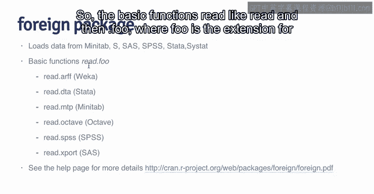

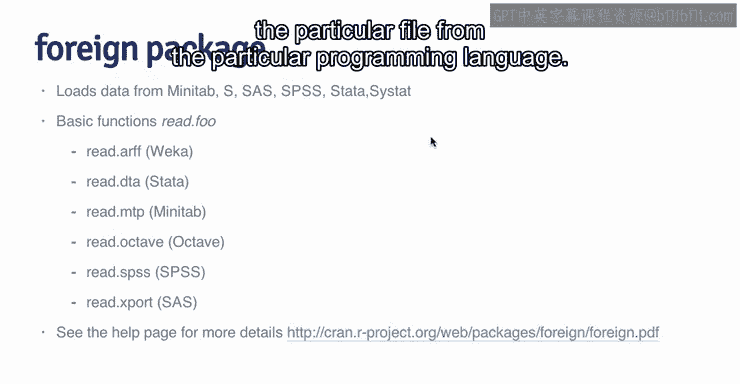

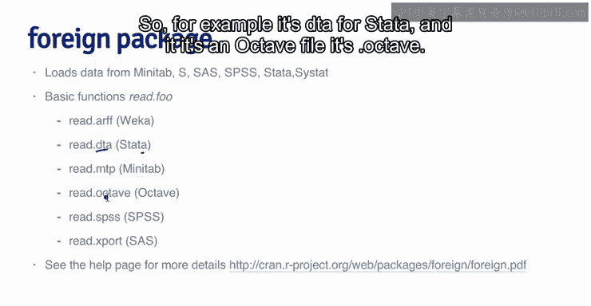

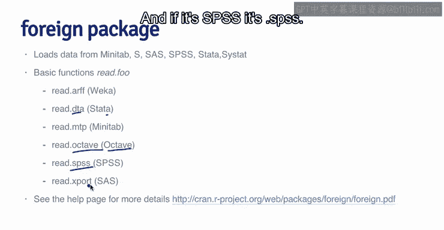

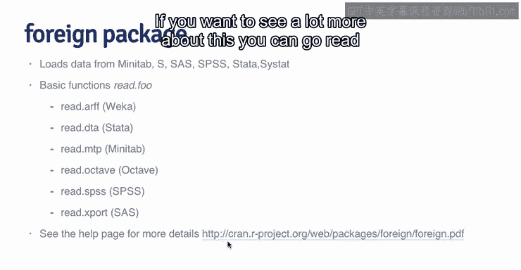

如果你想了解更多，可以阅读帮助文件中关于`foreign`包的说明，这些说明非常易于理解。我已经能够用它读取来自其他编程语言的大多数文件。

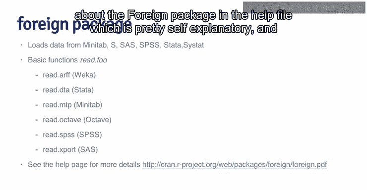

## 连接其他数据库 🗃️

还有许多其他数据库包。例如，`RPostgreSQL`包提供了从R连接到PostgreSQL数据库的功能。这里有一个教程链接，第二个链接是帮助文件。

还有`RODBC`包，它提供了到多个数据库的接口，包括PostgreSQL、MySQL、Microsoft Access和SQLite。这里也有一个非常好的教程，以及一个能引导你了解大多数函数的帮助文件。

如果你使用MongoDB，实际上有一个非常好的包叫`rmongodb`。还有另一个包`RMongo`，也可以用于与MongoDB交互并从该数据库提取数据。

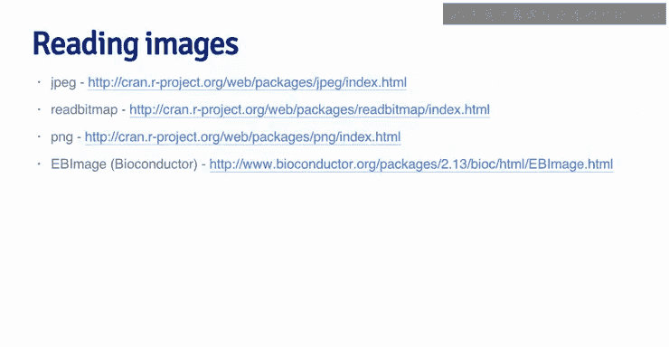

同样，你将发送查询，方式与使用`RMySQL`包时非常相似。你将使用数据库自身的语法向数据库发送查询。因此，如果你要使用R包，你必须学习一点该数据库的语法，以便能够提取数据。

## 读取非传统格式数据 🖼️🎵

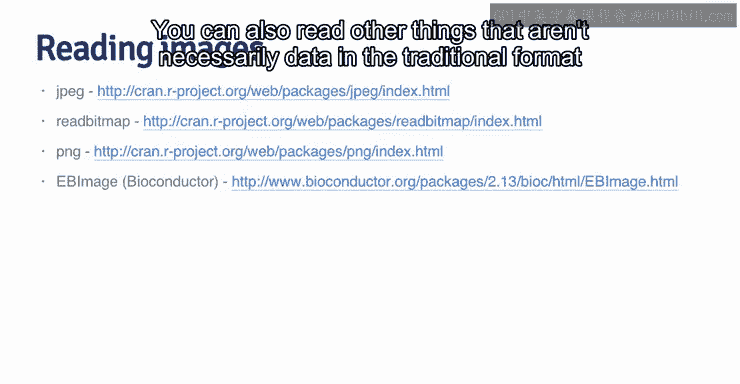

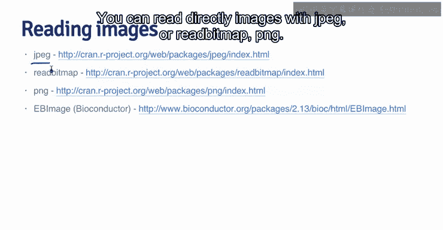

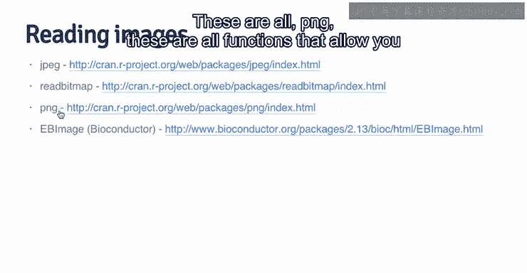

你还可以读取不一定是传统文本文件格式的数据。你可以使用`jpeg`、`readbitmap`、`png`等包直接读取图像。这些函数允许你访问图像文件并将其直接加载到R中进行操作。

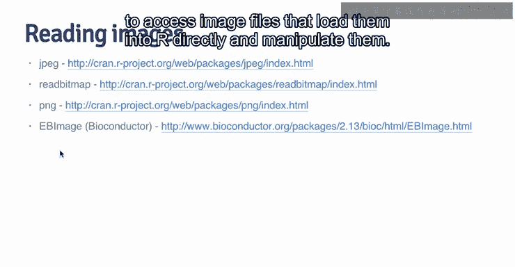

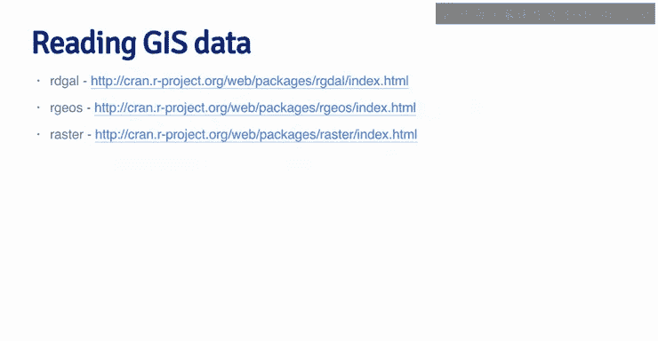

Bioconductor中的`EBImage`包也非常适合分析和操作图像数据。

你可以读取GIS数据，即地理信息系统数据。你可以使用多种不同的包来读取它，这些包允许你访问和使用由专有及非专有软件导出的各种GIS数据。

另一个很酷的功能是你可以直接从MP3文件读取数据。你可以使用`tuneR`或`seewave`包来读取音乐数据并进行分析。R中有很多优秀的音乐处理软件，你可以用来分析这些数据并进行有趣的新分析。

## 总结

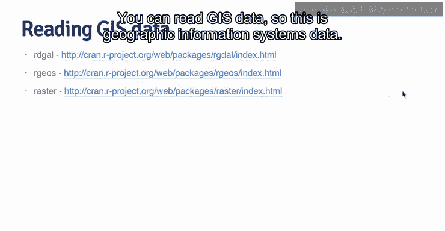

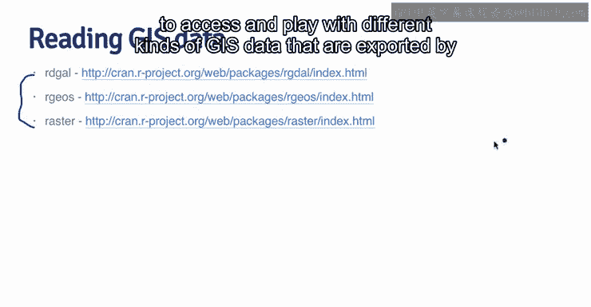

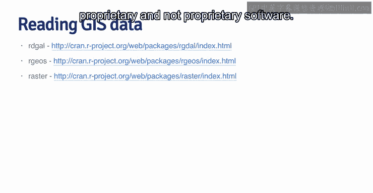

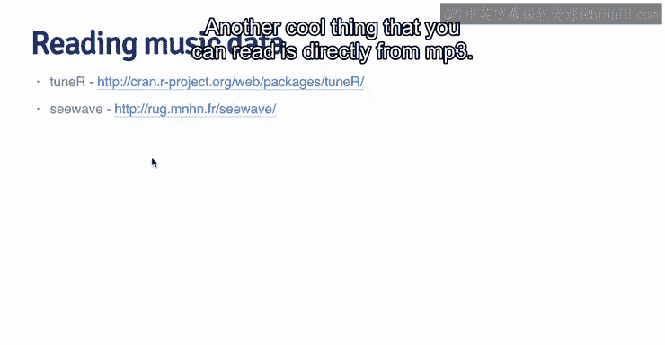

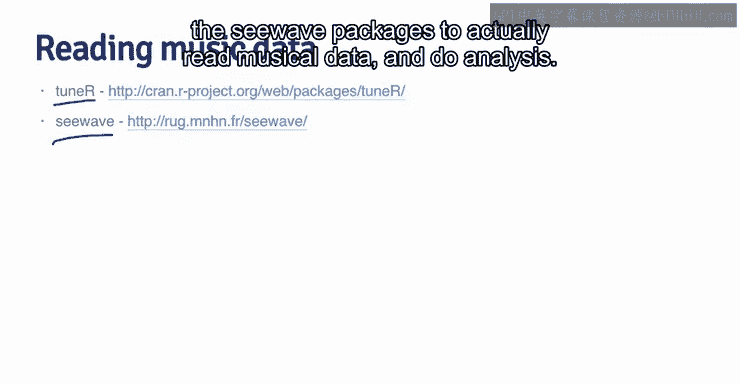

就像我说的，这只是我凭记忆列出的一些包。但无论你的应用是什么，你都可以直接谷歌搜索能让你访问该数据的R包。总有一个R包适合你。

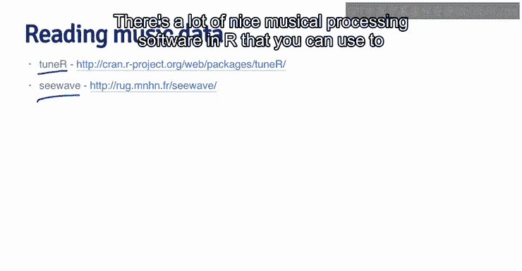

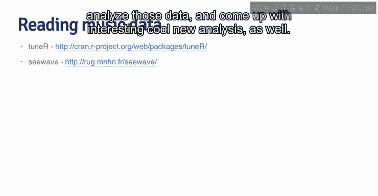

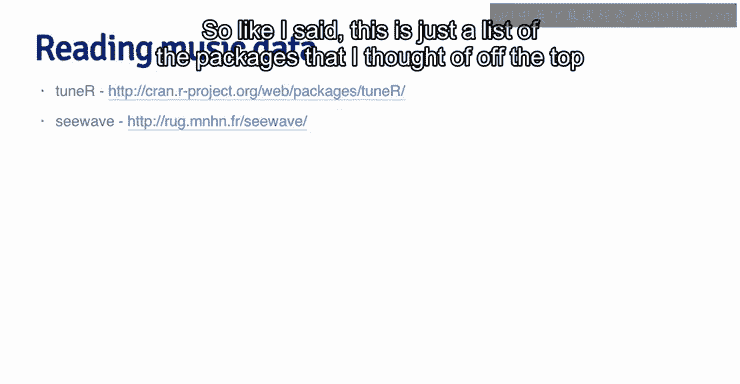

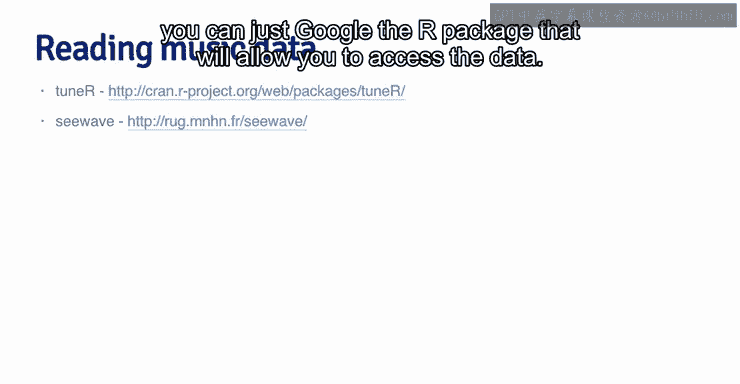

本节课中，我们一起学习了如何利用R丰富的包生态系统从各种特定来源读取数据，包括其他统计软件格式、多种数据库、图像文件、地理信息系统数据乃至音乐文件。关键在于知道如何搜索（例如“数据源名称 + R package”）并利用`foreign`、`RPostgreSQL`、`RODBC`、`rmongodb`、`jpeg`、`EBImage`、`tuneR`等包来建立连接。记住，对于几乎任何常见的数据源，很可能都存在一个对应的R包来帮助你获取数据。