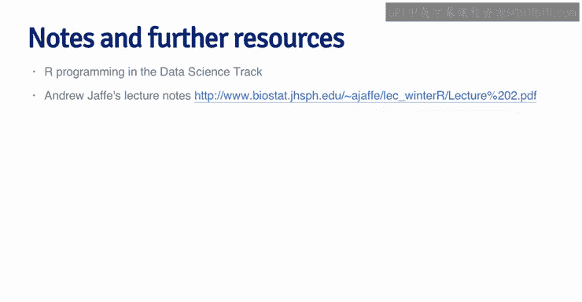

# 015：数据子集化与排序


在本节课中，我们将学习如何对R语言中的数据框进行子集化（筛选）和排序操作。这是数据清理和准备过程中的关键步骤，能帮助我们提取出需要分析的数据，并将其整理成整洁的格式。

将数据加载到R中后，你可能需要对其进行操作，以将其整理为整洁数据。这意味着变量在列中，观测值在行中，并且只包含你想要分析的观测值。

## 回顾：数据子集化基础


上一节我们介绍了数据清理的目标。本节中，我们来看看如何从数据框中提取特定部分。首先，我们将回顾一些你可能在编程课上学过的子集化知识。


假设我们创建了一个名为 `x` 的数据框，它包含三个变量：`var1`、`var2` 和 `var3`。这些变量的值被打乱，并且部分值被设置为缺失值（`NA`）。


```r
# 创建示例数据框
set.seed(13435)
X <- data.frame("var1"=sample(1:5), "var2"=sample(6:10), "var3"=sample(11:15))
X <- X[sample(1:5),]; X$var2[c(1,3)] = NA
X
```

以下是几种基本的子集化方法：


*   **按列索引提取**：使用 `x[, 1]` 可以提取数据框 `x` 的第一列。
*   **按列名提取**：使用 `x[, "var2"]` 可以提取名为 `"var2"` 的列。
*   **同时按行和列提取**：使用 `x[1:2, "var2"]` 可以提取前两行中 `"var2"` 列的数据。


## 使用逻辑语句进行子集化


除了按位置提取，我们还可以根据条件来筛选数据行。


以下是使用逻辑运算符进行子集化的例子：


*   **逻辑与（AND）**：`x[(x$var1 <= 3 & x$var3 > 11),]` 会返回所有满足 `var1` 小于等于3 **并且** `var3` 大于11的行。
*   **逻辑或（OR）**：`x[(x$var1 <= 3 | x$var3 > 15),]` 会返回所有满足 `var1` 小于等于3 **或者** `var3` 大于15的行。


## 处理缺失值（NA）的子集化

直接对包含 `NA` 的变量进行逻辑判断会产生问题，因为 `NA` 的运算结果也是 `NA`。


处理这种情况的方法是使用 `which()` 函数。例如，`x[which(x$var2 > 8),]` 会先找出 `var2` 大于8的行索引（自动忽略 `NA`），然后用这些索引来提取数据行，从而避免 `NA` 的干扰。


## 对数据进行排序


对数据进行排序是另一种常见操作。


以下是排序操作的方法：

*   **对单个向量排序**：`sort(x$var1)` 会将 `var1` 的值按升序排列。添加参数 `decreasing=TRUE` 可以降序排列。
*   **处理排序中的NA**：`sort(x$var2, na.last=TRUE)` 会将 `NA` 值放在排序结果的末尾。


## 对整个数据框进行排序


我们经常需要根据某一列的值来对整个数据框的行进行重排。


这可以通过 `order()` 函数实现。例如，`x[order(x$var1),]` 会根据 `var1` 的升序来重新排列数据框 `x` 的所有行。


你还可以根据多个变量排序：`x[order(x$var1, x$var3),]`。它会先按 `var1` 排序，对于 `var1` 值相同的行，再按 `var3` 排序。


## 使用 `plyr` 包进行排序

`plyr` 包（由 Hadley Wickham 编写）提供了更直观的排序函数 `arrange()`。


使用前需要加载包：`library(plyr)`。


以下是 `arrange()` 函数的用法：


*   **升序排列**：`arrange(x, var1)` 会根据 `var1` 升序排列数据框。
*   **降序排列**：`arrange(x, desc(var1))` 会根据 `var1` 降序排列数据框。


## 为数据框添加行和列


在数据准备过程中，有时需要添加新的行或列。


以下是添加行和列的方法：


*   **添加新列（方法一）**：直接赋值，如 `x$var4 <- rnorm(5)`，会创建一个名为 `var4` 的新列。
*   **添加新列（方法二）**：使用 `cbind()` 函数。`cbind(x, rnorm(5))` 会将一个随机向量作为新列添加到 `x` 的右侧。参数顺序决定了新列的位置。
*   **添加新行**：使用 `rbind()` 函数。`rbind(x, rnorm(3))` 会将一个向量作为新行添加到 `x` 的底部。同样，参数顺序决定新行的位置。

## 总结与扩展资源


本节课中，我们一起学习了数据子集化、排序以及添加行列的基本操作。这些是数据整理的核心技能。

关于R语言子集化、重排序和排序的更多细节，可以参考数据科学系列课程中的《R编程》课程。本讲部分内容参考了约翰霍普金斯大学彭博公共卫生学院讲师 Andrew Jaffe 的优秀讲义，你可以查阅他的讲义以获得更多信息。




通过掌握这些技巧，你可以更灵活地操控数据，为后续的分析和可视化做好准备。