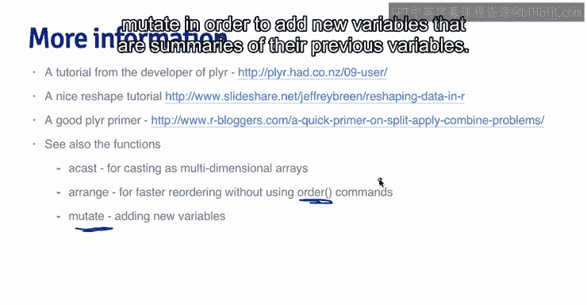

# 018：重塑数据 📊


在本节课中，我们将要学习如何重塑数据。数据在导入R语言后，其格式往往并非我们直接需要的“整洁数据”格式。变量可能分布在行中，或者存在其他不规则的排列方式。因此，数据重塑是数据清理过程中的一个关键步骤，旨在将数据转换为易于分析的“整洁”格式。


## 什么是整洁数据？ 🎯


上一节我们提到了数据重塑的目标。本节中，我们来看看“整洁数据”的核心原则。整洁数据遵循几个基本原则：
*   每个变量构成一列。
*   每个观测构成一行。
*   每个表格或文件只存储一种观测类型的数据。

在进行数据重塑时，我们将重点关注前两个原则。


## 数据重塑实践：以 `mtcars` 数据集为例 🚗


为了理解数据重塑，我们将从一个具体的例子开始。我们将使用R语言内置的标准数据集 `mtcars`。这个数据集包含多款汽车的信息，每一行代表一辆车，每一列代表一个观测变量，例如每加仑英里数（mpg）、气缸数（cyl）和马力（hp）等。接下来，我们将对这个数据集进行重塑操作。


### 融化数据：从宽格式到长格式


数据重塑的第一步通常是“融化”数据。融化操作可以将数据从“宽”格式转换为“长”格式。

以下是使用 `reshape2` 包中 `melt` 函数融化 `mtcars` 数据的核心代码：
```r
library(reshape2)
carMelt <- melt(mtcars, id=c("car_name", "gear", "cyl"), measure.vars=c("mpg", "hp"))
```
在这段代码中，我们指定了哪些是标识变量（ID variables），哪些是度量变量（measure variables）。函数会为每个标识变量组合（如车名、档位、气缸数）创建一行，并将所有度量变量（如mpg和hp）的值“堆叠”成一列。结果是一个“高瘦”的数据框，其中每个mpg值和每个hp值都独占一行。


### 重铸数据：从长格式到新宽格式


一旦数据被融化成长格式，我们就可以使用 `dcast` 函数将其“重铸”成各种新的宽格式，以满足不同的分析需求。


以下是使用 `dcast` 函数重铸数据的示例：
```r
cylData <- dcast(carMelt, cyl ~ variable)
```
这段代码将气缸数（cyl）放在行中，将变量类型（variable，即mpg和hp）放在列中。默认情况下，`dcast` 会使用 `length` 函数汇总数据，计算每个气缸数下，mpg和hp的观测数量。


我们也可以指定其他汇总函数，例如计算均值：
```r
cylData <- dcast(carMelt, cyl ~ variable, mean)
```
现在，输出结果展示的是不同气缸数汽车的平均mpg和平均马力。这本质上是在以不同的方式重新组织和汇总数据。


## 按因子汇总数据：`split-apply-combine` 策略 🧩

数据重塑的另一个常见需求是按某个因子（如分组）对值进行汇总。我们将以 `InsectSprays` 数据集为例，该数据集记录了不同杀虫剂（spray）对应的昆虫数量（count）。


### 使用 `tapply` 快速汇总


一个快速计算各喷雾剂昆虫总数的方法是使用 `tapply` 函数：
```r
tapply(InsectSprays$count, InsectSprays$spray, sum)
```
`tapply` 函数沿着索引（此处为spray）应用一个函数（此处为sum），直接返回每个喷雾剂的总数。


### 分步实现：拆分-应用-合并


更通用和清晰的方法是遵循“拆分-应用-合并”的策略。


**1. 拆分**
首先，使用 `split` 函数按喷雾剂拆分数据：
```r
spIns <- split(InsectSprays$count, InsectSprays$spray)
```
这会生成一个列表，列表中的每个元素对应一个喷雾剂的所有昆虫数量值。


**2. 应用**
然后，使用 `lapply` 函数对列表中的每个元素应用 `sum` 函数：
```r
sprCount <- lapply(spIns, sum)
```


**3. 合并**
最后，使用 `unlist` 函数将列表转换回向量，便于后续操作：
```r
unlist(sprCount)
```
`plyr` 包中的 `sapply` 函数可以合并“应用”和“合并”两步：
```r
sapply(spIns, sum)
```


### 使用 `plyr` 包一步完成


`plyr` 包提供了更优雅的接口来一步完成“拆分-应用-合并”操作。


以下是使用 `ddply` 函数计算各喷雾剂总数的代码：
```r
library(plyr)
ddply(InsectSprays, .(spray), summarise, sum=sum(count))
```
这段代码的含义是：对 `InsectSprays` 数据框，按 `spray` 分组，然后汇总，创建一个名为 `sum` 的新列，其值为 `count` 的总和。

`ddply` 的一个强大之处在于，它可以生成与原始数据长度相同的新变量。例如，计算每个观测值所属喷雾剂的总数，并将该总数作为新列添加到数据集中：
```r
spraySums <- ddply(InsectSprays, .(spray), summarise, sum=ave(count, FUN=sum))
```
这样，`spraySums` 中的 `sum` 列会为每个喷雾剂A的观测重复显示喷雾剂A的总数，方便进行后续如“计算每个观测值与组均值的差值”等分析。


## 更多资源与函数 🔧


关于数据重塑的更多信息，可以参考 `plyr` 包的教程。网络上也有许多优秀的 `reshape2` 教程和 `plyr` 入门指南。


此外，还有一些其他有用的函数需要了解：
*   **`acast`**：与 `dcast` 类似，但将融化后的数据重铸为数组（可能为多维）。
*   **`arrange`**：用于对数据集进行重新排序，可以替代之前课程中提到的 `order` 命令。
*   **`mutate`**：用于添加新变量。可以结合 `ddply` 和 `mutate` 来添加基于现有变量的汇总新变量。

## 总结 📝




本节课中我们一起学习了数据重塑的核心技术。我们首先理解了“整洁数据”的原则，然后通过 `mtcars` 数据集实践了使用 `melt` 和 `dcast` 函数在宽格式与长格式之间转换数据。接着，我们探讨了按因子汇总数据的“拆分-应用-合并”策略，并介绍了使用 `tapply`、`sapply` 以及 `plyr` 包中的 `ddply` 函数来实现这一过程。掌握这些技能，能够帮助你有效地将原始数据整理成适合进行分析的格式。