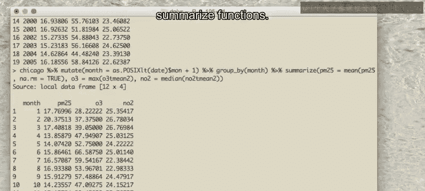
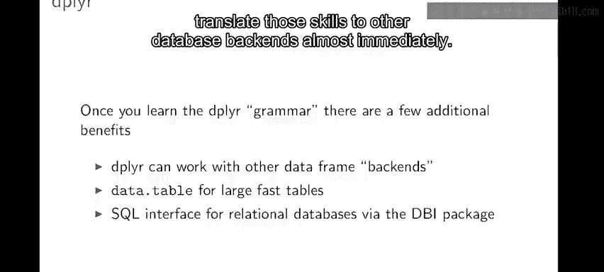

# 020：使用dplyr基本工具管理数据框


在本节课中，我们将学习如何使用`dplyr`包中的核心函数来高效地管理和操作数据框。`dplyr`提供了一套直观且功能强大的工具，可以简化数据筛选、排序、重命名、变换和汇总等常见任务。

---

## 1️⃣ 加载dplyr包与数据

首先，需要加载`dplyr`包。加载时可能会看到一些警告信息，这是因为有其他函数与`dplyr`中的函数同名，但这暂时无需担心。

接下来，我们加载一个示例数据集。这个数据集包含了芝加哥市从1987年到2005年间的空气污染和天气变量日度数据。

```r
library(dplyr)
chicago <- readRDS("chicago_data.rds")
```

查看数据维度，可以看到它有6940行和8列。

```r
dim(chicago)
```

查看前几行数据。

```r
head(chicago)
```

使用`names`函数查看数据框的变量名。

```r
names(chicago)
```

---

## 2️⃣ 选择列：`select`函数

`select`函数用于选择数据框中的特定列。它的优势在于可以直接使用列名，而无需依赖列索引。

以下是使用`select`函数的一些方法。

### 按名称范围选择列
你可以使用`:`操作符来选择一系列连续的列。

```r
subset <- select(chicago, city:dptp)
head(subset)
```
这段代码选择了从`city`列到`dptp`列（包含两端）之间的所有列。

### 排除特定列
使用`-`符号可以排除指定的列。

```r
subset_exclude <- select(chicago, -(city:dptp))
head(subset_exclude)
```
这段代码选择了除`city`到`dptp`列之外的所有列。

在基础R中实现相同的功能需要更多步骤，可读性也不如`select`函数。

---

## 3️⃣ 筛选行：`filter`函数

上一节我们介绍了如何选择列，本节中我们来看看如何筛选行。`filter`函数用于根据条件筛选数据框的行。

### 基于单一条件筛选
例如，筛选出PM2.5大于30的所有行。

```r
chic_fil <- filter(chicago, pm25tmean2 > 30)
head(chic_fil)
```

### 基于多个条件筛选
你可以组合多个条件进行更复杂的筛选。

```r
chic_fil_multi <- filter(chicago, pm25tmean2 > 30 & tmpd > 80)
head(chic_fil_multi)
```
这段代码筛选出同时满足PM2.5大于30且温度高于80度的行。

与`select`函数一样，`filter`也允许直接使用列名，无需复杂的子集操作符。

---

## 4️⃣ 排列行：`arrange`函数

`arrange`函数用于根据一列或多列的值对数据框的行进行重新排序。

### 升序排列
例如，按日期升序排列数据。

```r
chicago_asc <- arrange(chicago, date)
head(chicago_asc)
tail(chicago_asc)
```
排序后，最早的数据（1987年）位于顶部，最晚的数据（2005年）位于底部。

### 降序排列
使用`desc()`函数可以进行降序排列。

```r
chicago_desc <- arrange(chicago, desc(date))
head(chicago_desc)
tail(chicago_desc)
```
现在，2005年的数据位于顶部，1987年的数据位于底部。

---

## 5️⃣ 重命名列：`rename`函数

`rename`函数可以方便地修改变量名。在基础R中重命名变量相对繁琐，而`rename`函数使其变得简单。

以下是重命名变量的方法。

```r
chicago <- rename(chicago, dewpoint = dptp, pm25 = pm25tmean2)
head(chicago)
```
这段代码将`dptp`列重命名为`dewpoint`，将`pm25tmean2`列重命名为`pm25`。其他列保持不变。

---

## 6️⃣ 创建新变量：`mutate`函数

`mutate`函数用于创建新的变量或转换现有变量。

例如，我们创建一个新的变量`pm25detrend`，它是PM2.5值减去其均值后的结果（即中心化处理）。

```r
chicago <- mutate(chicago, pm25detrend = pm25 - mean(pm25, na.rm = TRUE))
head(select(chicago, pm25, pm25detrend))
```
新变量`pm25detrend`显示了每个观测值相对于均值的偏离。

---

## 7️⃣ 分组与汇总：`group_by`与`summarize`函数

`group_by`和`summarize`函数通常结合使用，用于对分组数据进行汇总统计。

### 创建分组变量
首先，我们创建一个分类变量`tempcat`，根据温度是否超过80华氏度将日期分为“热”和“冷”。

```r
chicago <- mutate(chicago, tempcat = factor(tmpd > 80, labels = c("cold", "hot")))
```

### 分组并汇总
接着，按`tempcat`分组，并计算每组中PM2.5的均值、臭氧的最大值和二氧化氮的中位数。

```r
hotcold <- group_by(chicago, tempcat)
summarize(hotcold,
          pm25 = mean(pm25, na.rm = TRUE),
          o3 = max(o3tmean2, na.rm = TRUE),
          no2 = median(no2tmean2, na.rm = TRUE)
)
```
输出结果显示了“冷”、“热”以及缺失值类别下各污染物的汇总统计量。注意，处理缺失值时需要设置`na.rm = TRUE`。

### 按年份汇总
我们也可以按年份进行分组汇总。首先使用`mutate`从日期中提取年份。

```r
chicago <- mutate(chicago, year = as.POSIXlt(date)$year + 1900)
chicago_by_year <- group_by(chicago, year)
summarize(chicago_by_year,
          pm25 = mean(pm25, na.rm = TRUE),
          o3 = max(o3tmean2, na.rm = TRUE),
          no2 = median(no2tmean2, na.rm = TRUE)
)
```
输出显示了每年各污染物的统计量，从中可以观察到PM2.5随时间呈下降趋势。

---

## 8️⃣ 管道操作符：`%>%`

管道操作符`%>%`允许你将多个操作连接成一个清晰的序列，无需创建中间变量。

它的工作原理是：将左侧的结果作为右侧函数的第一个参数传递。

以下是一个使用管道操作符的示例，它完成了创建月份变量、按月份分组并汇总统计的操作。

```r
chicago %>%
  mutate(month = as.POSIXlt(date)$mon + 1) %>%
  group_by(month) %>%
  summarize(pm25 = mean(pm25, na.rm = TRUE),
            o3 = max(o3tmean2, na.rm = TRUE),
            no2 = median(no2tmean2, na.rm = TRUE))
```
这段代码生成了一个数据框，显示了全年12个月中每个污染物的汇总统计量。管道操作使代码更易读、更紧凑。

---

## 9️⃣ dplyr的其他优势



`dplyr`的设计使其不仅能处理标准的R数据框，还能与其他数据后端无缝协作。

*   **data.table**：对于需要处理超大型、高性能表格的场景，可以使用`data.table`包作为后端。
*   **数据库**：通过`DBI`包，`dplyr`可以连接并操作SQL关系型数据库中的数据。

这意味着，一旦你熟练掌握了`dplyr`的语法，就可以将相同的技能几乎立即应用到这些不同的数据存储系统上，无需重新学习一套新工具。

---

## 📝 总结

本节课中我们一起学习了`dplyr`包的核心功能：
1.  **`select`**：按名称选择或排除列。
2.  **`filter`**：根据条件筛选行。
3.  **`arrange`**：对行进行排序。
4.  **`rename`**：重命名变量。
5.  **`mutate`**：创建或转换变量。
6.  **`group_by`** 与 **`summarize`**：对数据进行分组和汇总计算。
7.  **管道操作符 `%>%`**：将多个操作流畅地连接起来，提高代码可读性。



`dplyr`通过提供一套一致且直观的动词，极大地简化了数据操作过程，是数据清洗和整理中不可或缺的工具。