# 026：数据资源指南

在本节课中，我们将学习如何寻找和获取免费的数据资源，以便进行数据分析。无论你身处何种组织，都可以利用这些公开的数据集来启动你的项目。

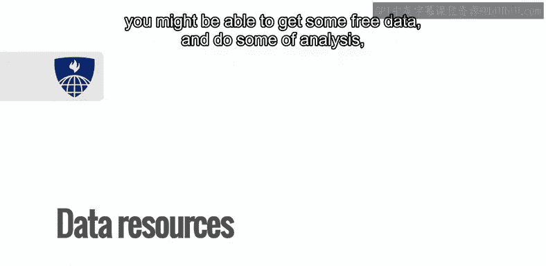

---

## 概述

本节课旨在为你指明一系列公开的数据资源。如果你所在的组织没有现成的数据，这些资源可以帮助你获取免费数据并进行分析。

---

## 政府与公共数据门户

上一节我们介绍了课程目标，本节中我们来看看最权威的数据来源之一：政府与公共机构的开放数据。

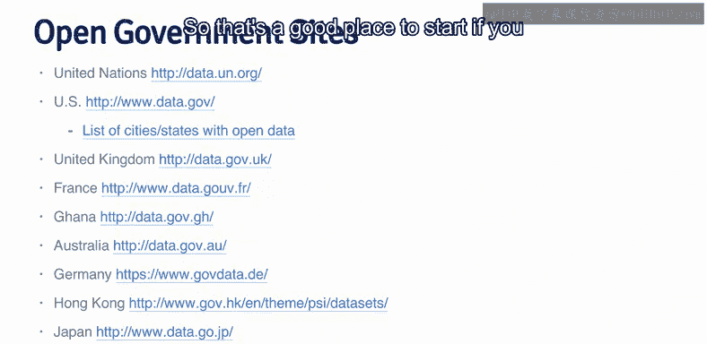

一个名为 `data.gov` 的网站汇集了来自美国联邦政府各部门的公开数据。此外，通过一篇相关的博客文章，你还可以找到美国许多其他城市和州的开放数据门户。

对于全球范围的数据，`data.gov/open-data-sites` 这个网站提供了世界各国政府开放数据站点的信息。如果你不确定自己的国家是否有此类网站，这里是一个很好的起点。

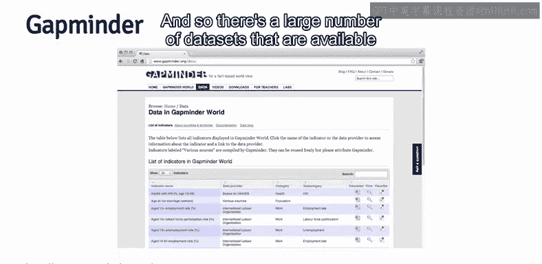

以下是几个关键的政府数据资源：
*   **联合国数据**：可通过其官方网站获取。
*   **美国数据**：核心门户是 `data.gov`。
*   **全球数据**：参考 `data.gov/open-data-sites` 以查找其他国家的数据站点。

---

## 专题数据网站：Gapminder

除了政府数据，还有许多专注于特定领域的优秀数据平台。接下来，我们介绍一个关注人类发展的重要资源。

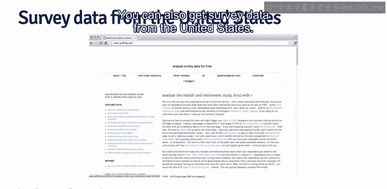

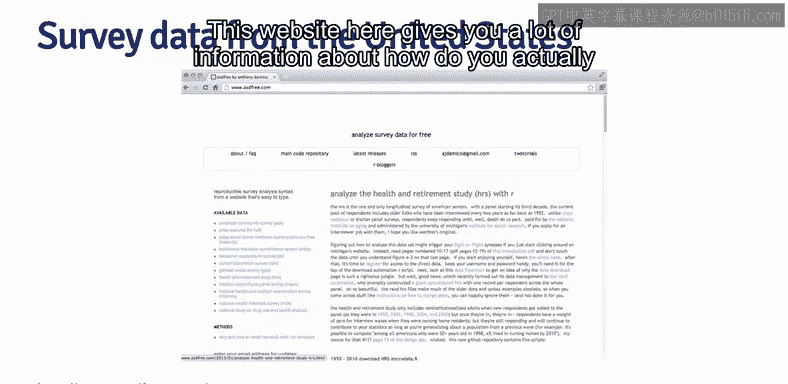

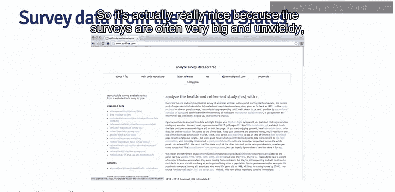

Gapminder 是一个专注于全球发展，特别是人类健康数据的网站。该网站（`gapminder.org`）提供了大量关于各国社会经济指标的数据集，非常适合进行跨国比较研究。

---

## 调查数据与R语言处理

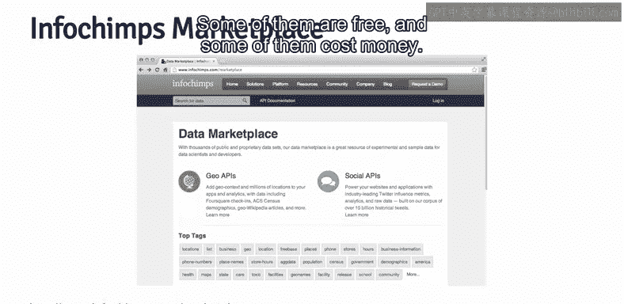

在实际分析中，调查数据是常见且重要的数据类型。然而，处理大型调查数据集可能颇具挑战。

对于美国的调查数据，有一个专门的网站提供了详细的指南，教你如何访问这些数据并在R语言中处理它们。由于这些调查数据集通常非常庞大且结构复杂，该网站提供的处理信息非常实用。

---

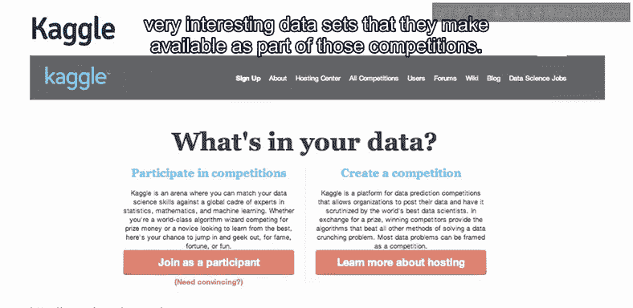

## 数据市场与竞赛平台

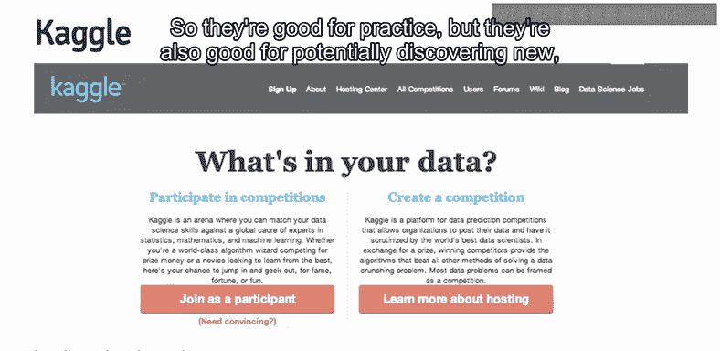

如果你想探索更商业或更具挑战性的数据集，可以转向数据市场和竞赛平台。

InfoChimps Marketplace 是一个数据市场，汇集了多种数据集。你可以根据不同的标签进行筛选，找到感兴趣的数据。需要注意的是，其中部分数据集是免费的，部分则需要付费。

Kaggle 是另一个著名的数据科学平台。它通过举办数据科学竞赛来提供数据集。这些数据集通常非常有趣，不仅适合练习数据分析技能，也可能帮助你发现新的见解，以解决实际的公司问题。

---

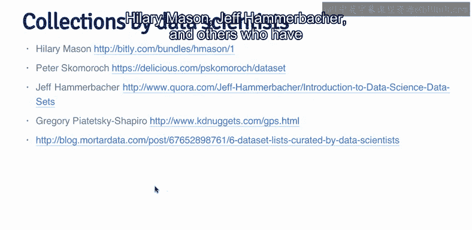

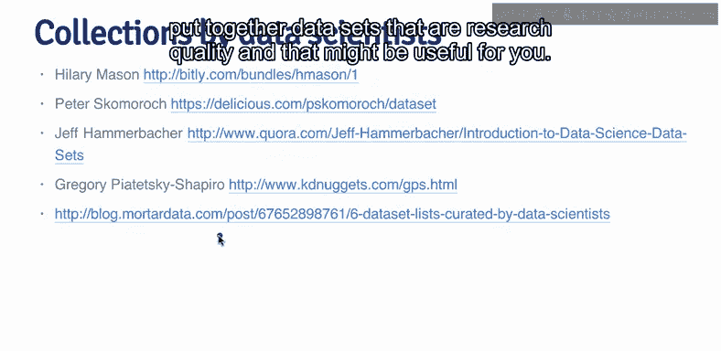

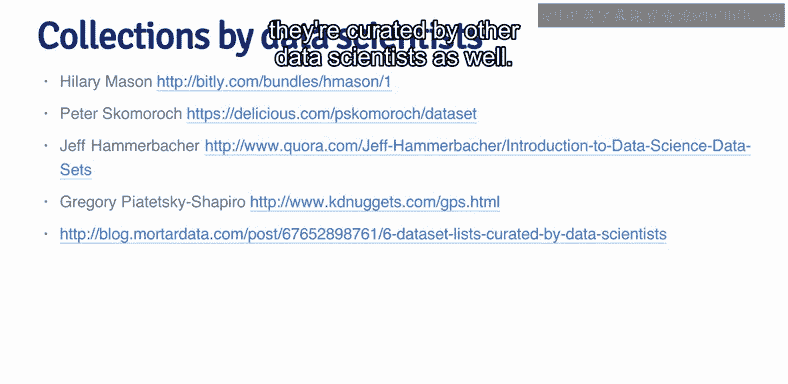

## 数据科学家整理的精选集

除了大型平台，一些知名的数据科学家也亲自整理并分享了高质量的数据集。

例如，Hillary Mason、Jeff Hammerbacker 等数据科学家整理了一批研究级别的数据集，对公众非常有用。这些资源通常来源于他们发布的博客文章，文中也会提及其他数据科学家整理的数据集。

---

## 专业领域数据档案库

对于有特定研究方向的学习者，还有许多专注于专业领域的数据库。

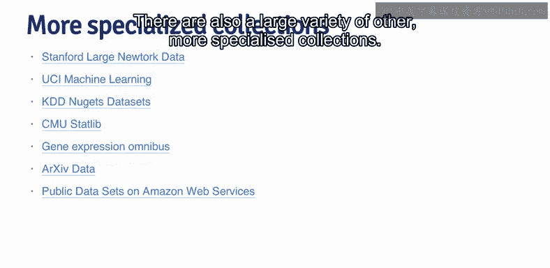

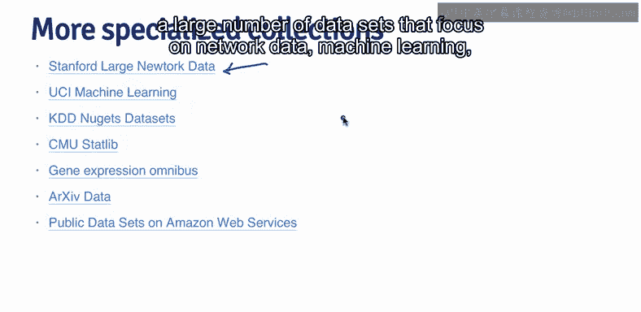

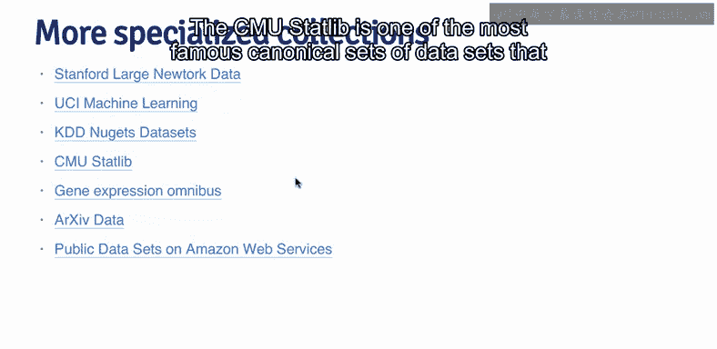

以下是几个重要的专业数据档案库：
*   **斯坦福大型网络数据集档案库**：专注于网络关系数据。
*   **UCI机器学习仓库**：提供各种用于分类或预测练习的数据集。
*   **CMU StatLib**：统计学领域最著名、最经典的数据集集合之一。
*   **基因表达综合数据库**：专注于来自人类基因组实验或其他生物体基因组实验的数据集。

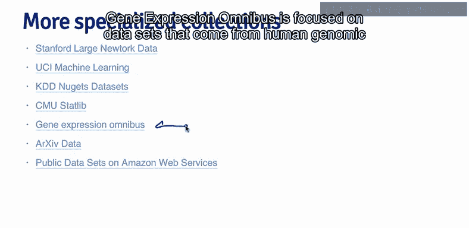

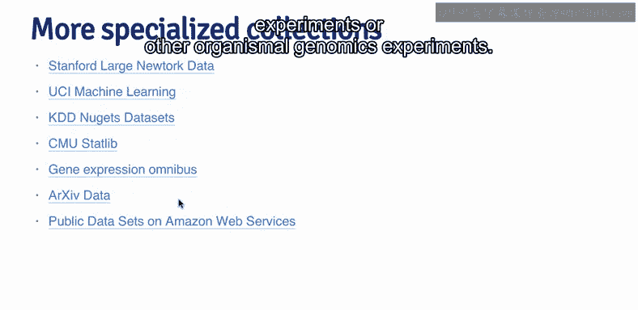

---

## 云平台数据与API接口

随着云计算的发展，数据也越来越多地存储在云端。此外，通过API（应用程序编程接口）获取实时数据是现代数据分析的关键技能。

亚马逊AWS提供了一系列公共数据集存档，可供研究使用。

更重要的是，在本课程中，你已经学习了如何使用API。现在有许多R语言包可以简化API调用过程：
*   **`twitteR`包**：用于更便捷地访问Twitter API。
*   **`rfigshare`包**：用于获取Figshare平台上的数据。
*   **`rplos`包**：来自Public Library of Science，可以获取学术出版物的数据。
*   此外，还有专门用于访问Facebook和Google Maps数据的R包。

掌握这些工具意味着，对于任何你感兴趣的项目，你都能找到真实的数据进行分析，没有任何借口。

---

## 总结

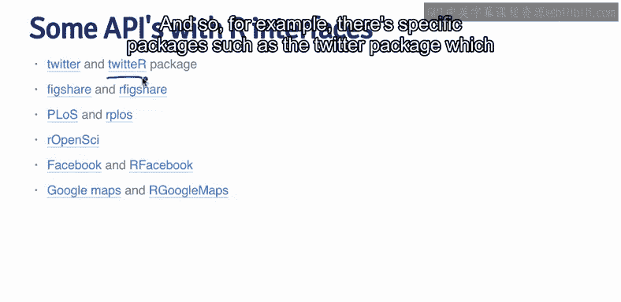

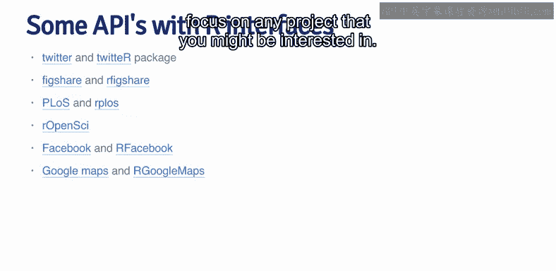

本节课我们一起学习了多种获取免费数据的途径。我们从政府开放数据门户开始，介绍了如Gapminder这样的专题数据库，探讨了调查数据的处理方法，并了解了Kaggle等数据竞赛平台。我们还看到了由数据科学家整理的精选集、各专业领域的档案库，以及如何利用云平台数据和API接口来获取动态数据。这些资源为你进行数据分析项目提供了丰富的起点。