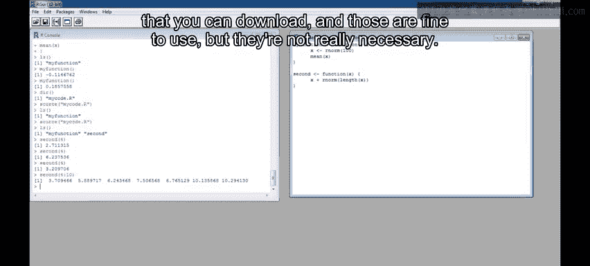

# 005：在Windows中设置工作目录 🖥️


在本节课中，我们将学习如何在Windows系统中设置R的工作目录，以及如何编辑和运行R代码文件。掌握这些基本操作是进行数据分析和编写R程序的第一步。

## 理解工作目录 📂

首先，我们需要理解什么是工作目录。工作目录是R在计算机上查找和保存文件的默认位置。当你使用如 `read.csv` 或 `write.csv` 这类函数读取或写入数据时，R默认会在工作目录中寻找或创建文件。

你可以使用 `getwd()` 函数来查看当前的工作目录设置。

```r
getwd()
```

执行上述代码后，你可能会看到类似 `C:/Users/YourName/Documents` 的路径。这个路径因你的Windows版本和硬件配置而异，但通常位于C盘。

## 设置工作目录 🔧

了解并正确设置工作目录非常重要。如果数据文件不在当前工作目录中，R将无法找到它并报错。

例如，尝试读取一个不存在的文件：

```r
read.csv("my_data.csv")
```

如果 `my_data.csv` 不在工作目录中，你会收到一个错误提示。

有两种方法解决这个问题：
1.  将数据文件移动到当前工作目录。
2.  将工作目录更改到数据文件所在的文件夹。

在R的图形界面中，你可以通过菜单轻松更改工作目录：点击 **File** -> **Change dir...**，然后导航到你希望设置为工作目录的文件夹。

为了本课程学习方便，建议你创建一个专用文件夹（例如命名为 `Coursera`）来存放所有课程相关的材料。这样，你可以将工作目录永久设置为此文件夹，避免频繁切换。

设置完成后，再次使用 `getwd()` 确认工作目录已更改。

## 编辑与运行R代码 ✍️

在本课程中，你需要编写大量R代码。R自带一个基础的文本编辑器，完全满足本课程的需求。

要打开编辑器，请点击 **File** -> **New script**。这将打开一个空白窗口供你编写代码。

例如，我们编写一个简单的函数：

```r
my_function <- function() {
    x <- rnorm(100)
    mean(x)
}
```

现在，我们需要将这段代码加载到R控制台中才能使用它。有以下两种常用方法：

**方法一：复制粘贴**
在编辑器窗口中全选代码（`Ctrl+A`），复制（`Ctrl+C`），然后切换到控制台窗口粘贴（`Ctrl+V`）。代码会立即执行。

**方法二：保存并加载文件**
1.  在编辑器窗口中，点击 **File** -> **Save As...**。
2.  将文件保存到你的工作目录（例如 `Coursera` 文件夹），并命名为 `mycode.R`（`.R` 是R代码文件的常规扩展名）。
3.  在控制台中使用 `source()` 函数加载该文件：

```r
source("mycode.R")
```

加载后，使用 `ls()` 可以查看当前环境中已定义的函数，然后你就可以调用 `my_function()` 了。

每次在编辑器中修改代码后，都需要保存文件。如果希望修改后的代码在R中生效，必须再次使用 `source()` 函数重新加载该文件。

你可以创建多个R脚本文件来管理不同项目或作业的代码。通过点击 **File** -> **Open script...** 可以重新打开已保存的文件。

网络上有很多其他高级文本编辑器可供下载使用，但对于本课程而言，R自带的编辑器已经足够。

## 总结 📝

本节课我们一起学习了R编程的两个基础但至关重要的操作：设置工作目录和编辑代码文件。

我们了解到，工作目录是R读写文件的默认位置，可以使用 `getwd()` 查看，并通过图形界面或 `setwd()` 函数进行设置。创建一个专用的课程文件夹来管理所有材料是一个好习惯。

在代码编辑方面，我们学会了使用R内置的编辑器编写脚本，并通过复制粘贴或 `source()` 函数将代码加载到R环境中运行。记住，修改代码后需要保存并重新加载才能生效。

掌握这些技能将为后续的数据探索和分析工作打下坚实的基础。



