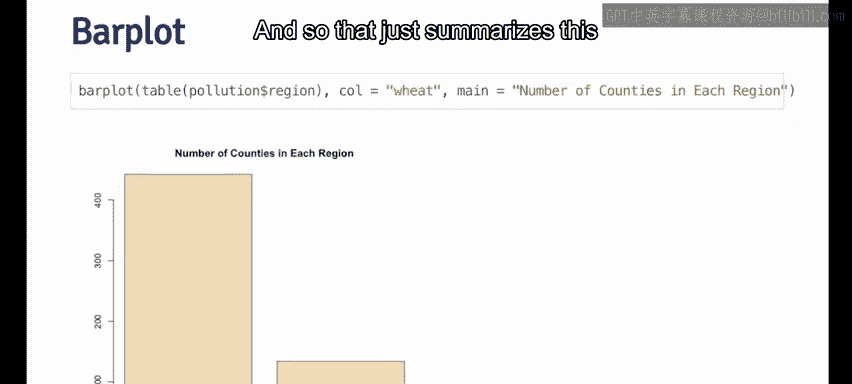

# 008：《探索性数据分析》｜探索图1 📊


## 概述

在本节课中，我们将学习如何构建探索性图表。探索性图表是数据分析师为了理解数据、发现模式、提出建模策略以及调试分析而为自己创建的图表。我们将通过一个关于美国细颗粒物（PM2.5）污染的真实数据集，来演示几种常见的一维数据探索图表的制作方法。

---

## 为什么使用图表进行数据分析？

在数据分析中，使用图表主要为了达成以下几个目标：
*   **理解数据属性**：了解数据的基本分布和特征。
*   **发现数据模式**：识别数据中潜在的趋势、异常或规律。
*   **提出建模策略**：根据数据特征，初步判断适合的模型类型（例如线性或非线性模型）。
*   **调试分析过程**：在分析过程中，通过图表检查问题或验证假设。
*   **传达分析结果**：以图形化的方式向他人展示研究发现。

探索性图表主要服务于前四个目标，即帮助分析师个人深入理解数据。在本讲中，我们将重点讨论如何为探索目的构建图表，关于如何为展示结果而优化图表，我们将在后续课程中涉及。

---

## 探索性图表的特点

探索性图表通常具有以下特点：
*   **快速生成**：在浏览数据时即时创建。
*   **数量众多**：为了从不同角度审视数据，需要制作大量图表。
*   **个人理解**：其核心目标是帮助分析师个人形成对数据集的直观感受，了解其样貌、属性、存在的问题以及需要进一步探究的方向。

探索性数据分析的核心问题可以归结为：**我的数据看起来是什么样子？** 因此，在制作探索性图表时，我们暂时无需过多关注图表的最终呈现细节（如坐标轴、图例的精美程度），颜色和尺寸也主要用于区分信息，而非美化。

---

## 案例：美国PM2.5污染数据

为了具体说明，我们将使用一个关于美国环境细颗粒物（PM2.5）污染的数据集。该数据来自美国环境保护署（EPA），其中规定了室外空气污染的国家环境空气质量标准。

**核心概念**：
*   **PM2.5**：指空气中直径小于或等于2.5微米的颗粒物。
*   **国家标准**：美国规定，任一监测点连续三年的PM2.5年平均浓度不得超过 **12 微克/立方米**。超过此标准的地区被视为未达标。

**分析目标**：探索美国是否有县区的PM2.5水平超过了上述国家标准。

以下是读取数据后数据框的前几行示例：

```r
# 读取数据示例代码
pollution <- read.csv("data/pm25_data.csv")
head(pollution)
```

数据包含以下列：
*   `pm25`: 2008-2010年PM2.5的三年平均浓度。
*   `fips`: 县区标识码。
*   `region`: 所属区域（东部或西部）。
*   `longitude` / `latitude`: 监测点的经纬度坐标。

---

## 一维数据摘要与图表

在探索数据时，我们常常从单个变量（一维）的摘要和可视化开始。以下是几种常用的一维探索方法。

### 五数摘要

五数摘要（实际上常包含六个数，即加上均值）是对一个变量关键统计量的快速概括。

```r
# 生成摘要
summary(pollution$pm25)
```

输出结果包含了最小值、第一四分位数、中位数、均值、第三四分位数和最大值。从摘要中我们可以快速看到，PM2.5浓度的中位数为10微克/立方米（低于标准），而最大值为18.4微克/立方米（高于标准），这初步提示有部分县区可能超标。

### 箱线图

箱线图直观地展示了五数摘要。箱体代表了中间50%的数据范围，中位线在箱体内部。

```r
# 绘制箱线图
boxplot(pollution$pm25, col = "blue", main = "PM2.5 Concentration Distribution")
# 添加国家标准线
abline(h = 12, lwd = 2)
```

通过添加一条代表国家标准（12微克/立方米）的水平线，我们可以清晰地看到大部分数据（整个箱体）位于标准线以下，但确实存在一些异常值点超过了标准。

### 直方图与密度图

直方图能更细致地展示数据的分布形状。我们可以在直方图下方添加“地毯图”（rug plot）来显示每个实际数据点的位置。

```r
# 绘制带地毯图的直方图
hist(pollution$pm25, col = "green", breaks = 30, main = "Histogram of PM2.5")
rug(pollution$pm25)
# 添加标准线和中位线
abline(v = 12, lwd = 2)
abline(v = median(pollution$pm25), col = "magenta", lwd = 2)
```

通过调整 `breaks` 参数，可以改变直方图的组距（条形数量），从而获得更平滑或更精细的分布视图。关键在于找到一个平衡点，既能揭示分布形状，又不会因条形过多而显得杂乱。

### 条形图

条形图适用于展示分类变量（如区域）的分布情况。

```r
# 绘制区域分布条形图
barplot(table(pollution$region), col = "wheat",
        main = "Number of Counties in Each Region")
```

从图中可以一目了然地看出，数据集中东部的县区数量远多于西部。

---

## 总结

本节课我们一起学习了探索性图表的基本概念和目的。我们了解到，探索性图表是数据分析师用于快速理解数据、发现模式、构思后续分析步骤的重要工具。通过美国PM2.5污染数据的实例，我们实践了几种核心的一维探索性图表：
1.  **五数摘要**和**箱线图**用于快速把握数据的集中趋势、离散程度和异常值。
2.  **直方图**（配合地毯图）用于深入观察数据的分布形状。
3.  **条形图**用于总结分类变量的分布。



这些图表帮助我们初步回答了“数据看起来是什么样子”以及“是否有县区超标”的问题，为更深入的分析奠定了基础。记住，在探索阶段，制作图表的重点是速度和信息量，而非美观。