# 015：R中的图形设备（第二部分）📊

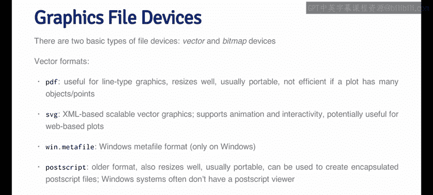

在本节课中，我们将要学习R语言中图形设备的第二部分内容，重点介绍不同的图形文件格式、如何管理多个图形设备以及如何在不同设备间复制图形。

## 概述：图形文件设备的两大类别

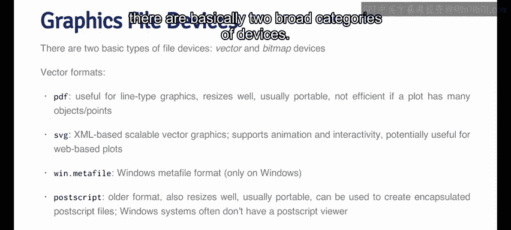


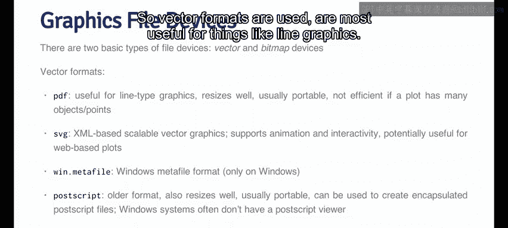

上一节我们介绍了图形设备的基本概念。本节中，我们来看看图形文件设备的两大主要类别。


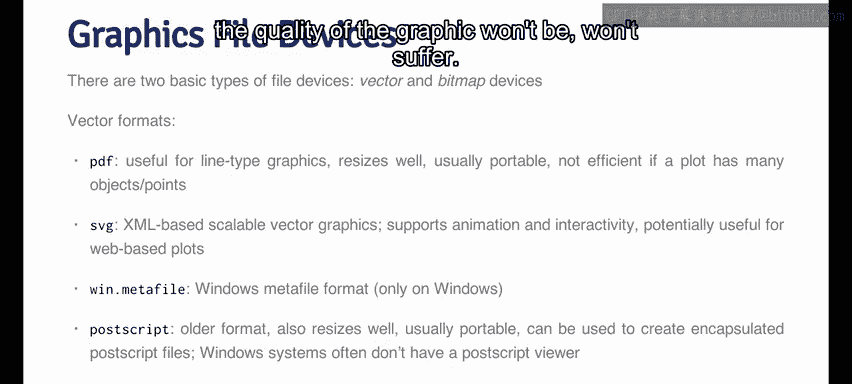

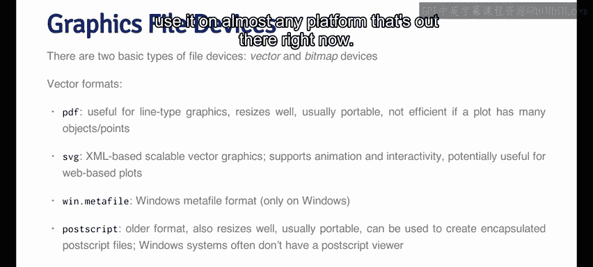

图形文件设备主要分为两大类：**矢量设备（或矢量格式）** 和 **位图设备（或位图格式）**。

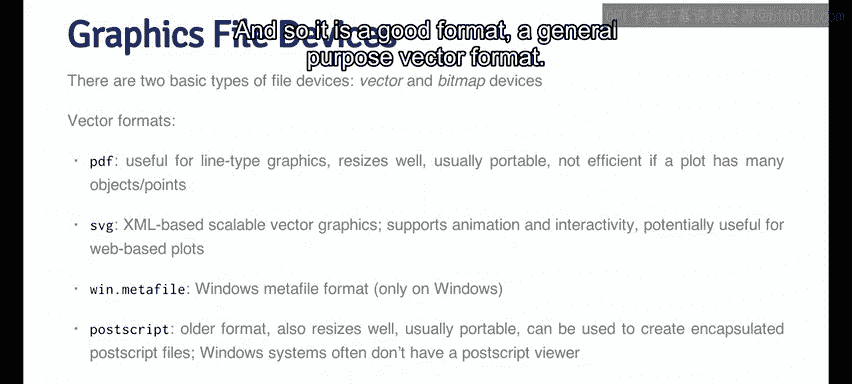

## 矢量格式 🖋️

矢量格式通常最适合用于**线形图形**，例如散点图或带有回归线的图表。这类图形不是自然场景或照片图像。使用矢量格式生成的图形在调整大小时不会失真，图形质量不会受损。

以下是矢量格式的主要特点和应用：

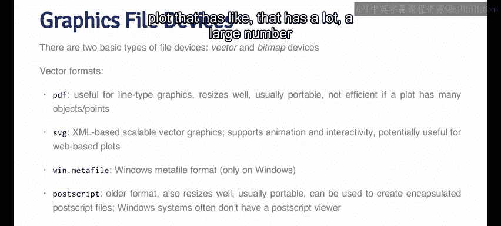

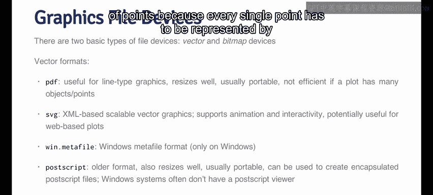


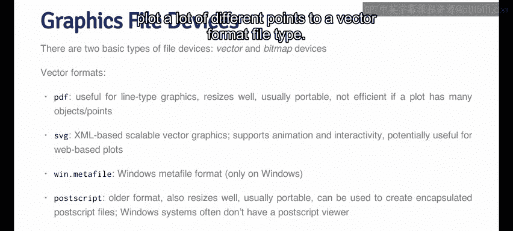

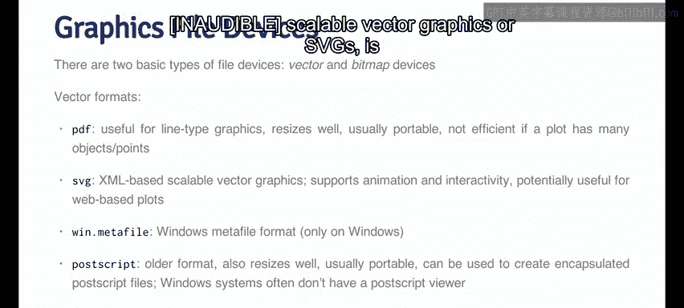

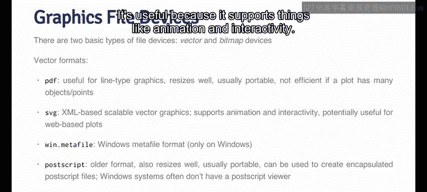

*   **PDF格式**：这是一种非常通用的矢量格式，具有很好的可移植性，几乎可以在所有平台上使用。
*   **SVG格式**：即可缩放矢量图形，是网络绘图的流行格式。它支持动画和交互性，并且几乎所有网络浏览器都支持SVG格式。
*   **Windows Metafile格式**：这是一种仅在Windows系统上可用的矢量格式。
*   **PostScript格式**：这是PDF格式的前身，现在已不常用，但偶尔仍能看到。


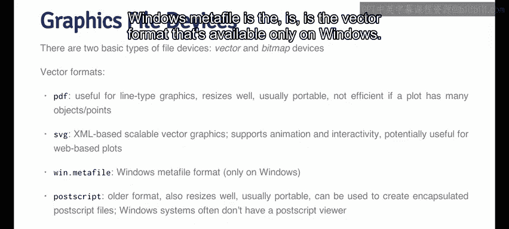


矢量格式的局限性在于，当图表包含大量数据点时，每个点都需要在文件中用信息表示，这可能导致文件体积非常庞大。

## 位图格式 🖼️

位图格式将图形或图像表示为一系列像素。对于包含大量数据点的图表，位图格式能非常高效地进行表示。

以下是几种常见的位图格式：

*   **PNG格式**：即可移植网络图形。它特别适合线条图或纯色图像，采用无损压缩算法，文件体积较小，且几乎所有网络浏览器都支持。
*   **JPEG格式**：如果你有数码相机，可能对此很熟悉。它非常适合自然场景（没有纯色，而是颜色渐变），采用有损压缩算法，文件体积非常小且高效。任何计算机和网络浏览器都能读取JPEG文件。
*   **TIFF格式**：这是一种较旧的位图格式，支持无损压缩，目前仍被广泛使用。
*   **BMP格式**：这是Windows系统的原生位图格式，常用于图标等。

位图格式的缺点是调整大小效果不佳。生成后尝试放大或缩小可能会导致图像质量下降和失真。此外，JPEG格式不适合线条图，因为线条可能会出现锯齿状边缘。

## 管理多个图形设备 🔄

上一节我们了解了不同格式的图形设备。本节中，我们来看看如何同时打开和管理多个图形设备。

有时你可能希望同时查看三到四个不同的图表。实现方法是打开多个屏幕图形设备。你可以通过显式调用函数来启动图形设备，例如在Mac系统上多次调用`quartz()`函数来打开多个屏幕图形设备。


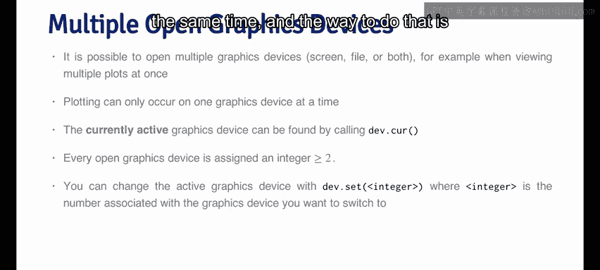

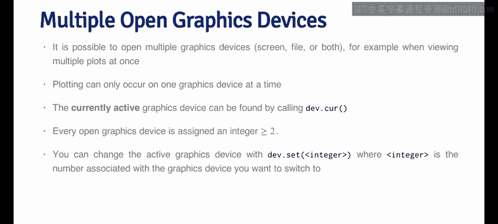


然而，你一次只能向一个设备绘图。当前正在接收绘图指令的设备称为**活动图形设备**。你可以通过调用`dev.cur()`函数来查看哪个设备是活动设备，该函数会返回一个代表当前活动设备的整数。

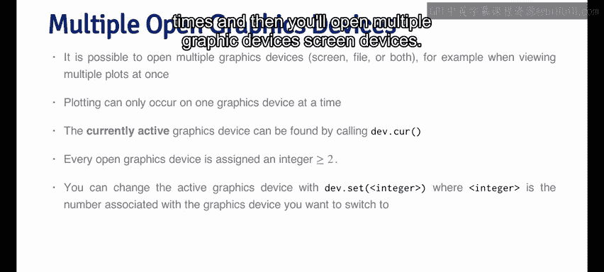


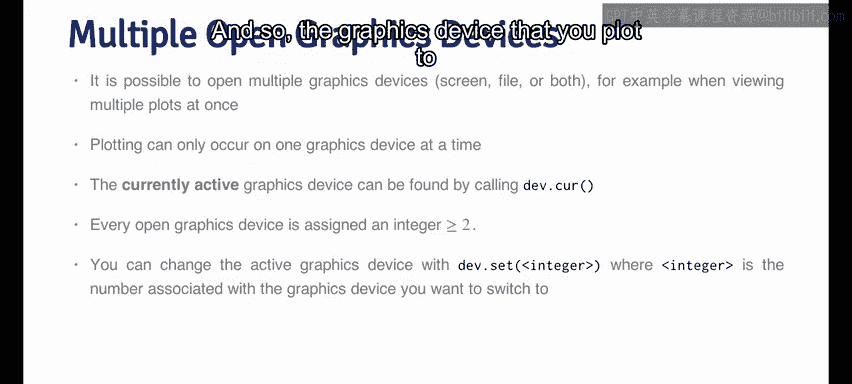

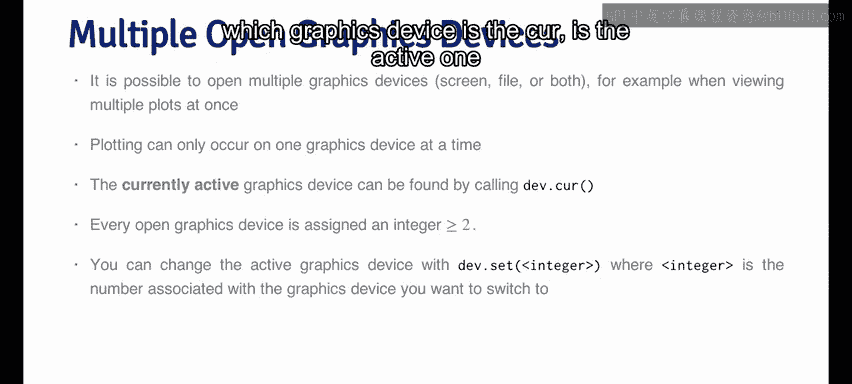

每个图形设备都会被分配一个整数编号（通常从2开始，没有编号为1的设备）。你可以使用`dev.set()`函数来更改活动图形设备，该函数接受一个整数参数，将活动设备切换为对应编号的设备。这样，你就可以使用`dev.set()`函数在不同的图形设备之间来回切换。

## 在不同设备间复制图形 📋

最后，我们来看看如何将图形从一个设备复制到另一个设备。这在以下场景中非常有用：你在屏幕上创建了一个满意的图形，并希望将其保存到文件中。


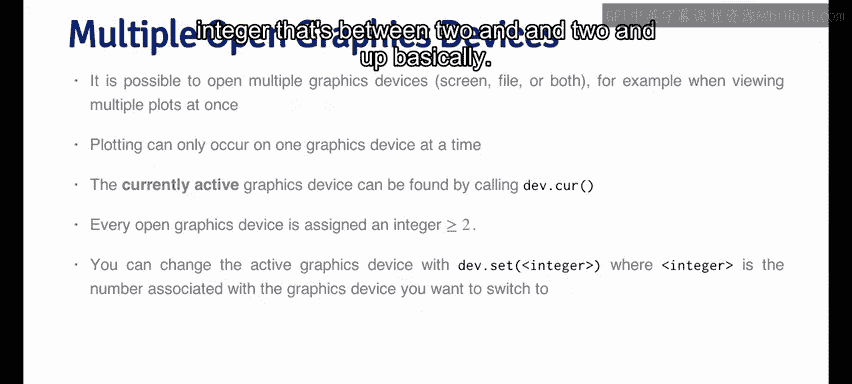

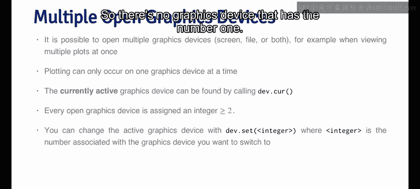

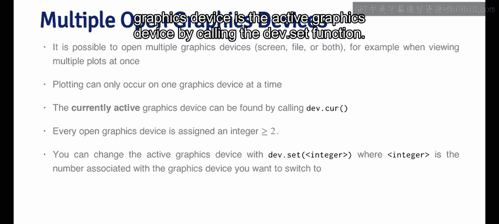

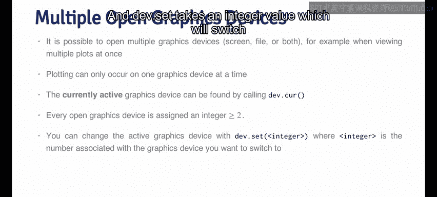

有两种方法可以实现：

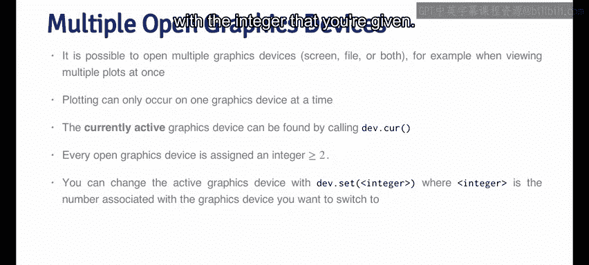

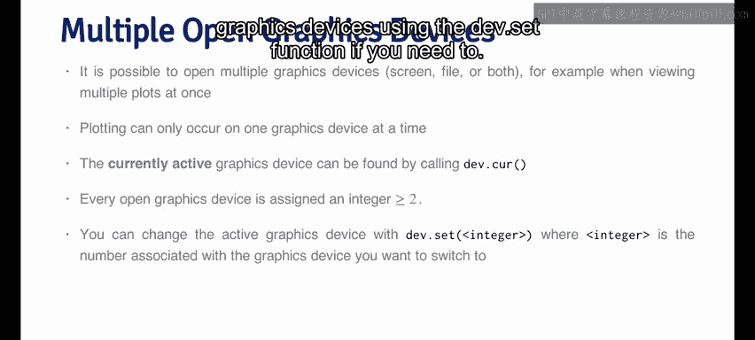

1.  如果你保存了在屏幕上创建该图形的代码，可以打开一个文件设备，然后将代码复制粘贴到R中执行，最后关闭文件设备。这样图形就保存在文件中了。
2.  一个更快、有时也更方便的方法是，直接从屏幕设备复制图形到文件设备。

你可以使用`dev.copy()`函数将图形从任何设备复制到任何其他设备。如果你特别想要一个PDF文件，可以使用`dev.copy2pdf()`函数，它能直接将屏幕设备上的图形复制到PDF文件中。

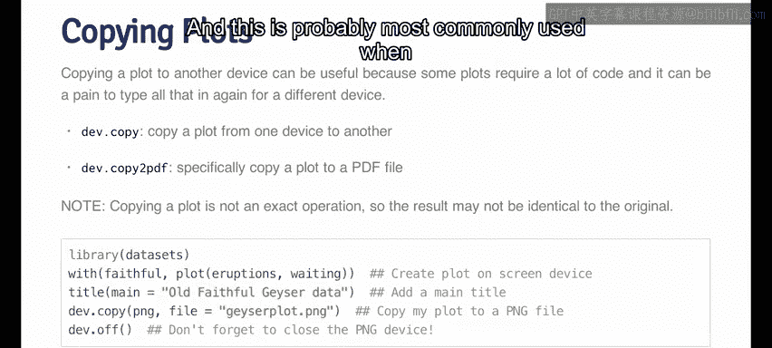

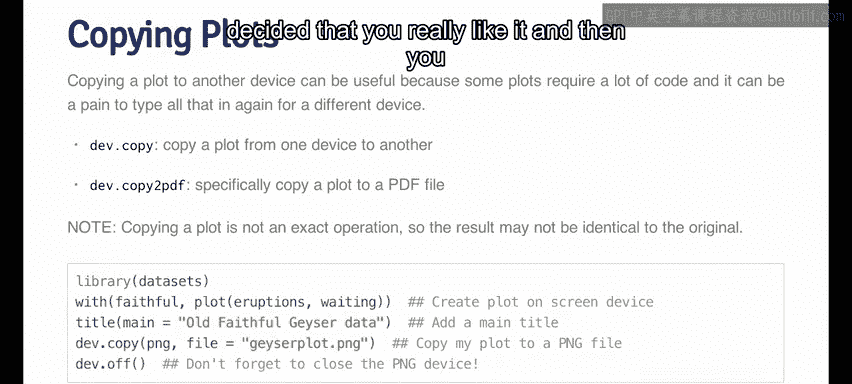

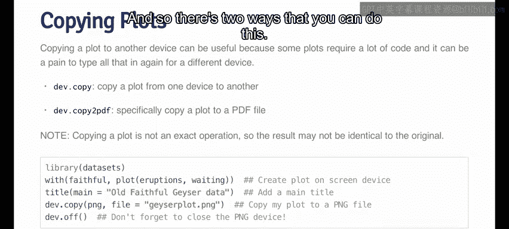

需要注意的是，复制图形并非精确操作。最终文件中的图形可能与屏幕上看到的图形不完全一致，可能需要进行一些调整。

以下是一个示例代码，演示如何将屏幕上的图形复制到PNG文件中：

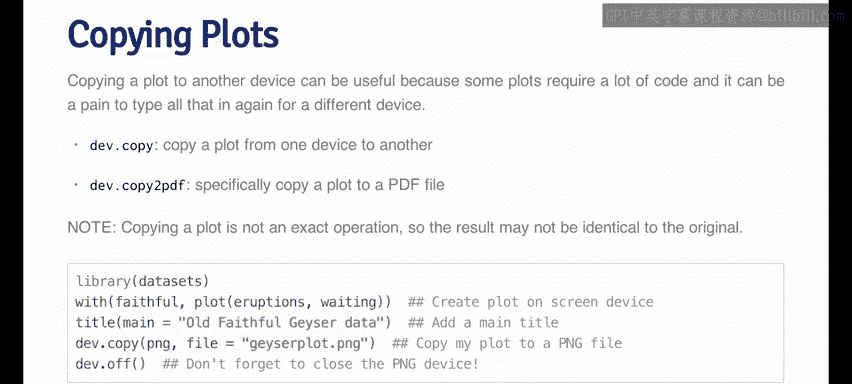

```r
# 在屏幕上创建一个图形（使用R自带的Old Faithful间歇泉数据）
with(faithful, plot(eruptions, waiting))
title(main = "Old Faithful Geyser Data")

# 将图形复制到PNG文件
dev.copy(png, file = "geyserplot.png")
# 关闭PNG设备，完成文件保存
dev.off()
```

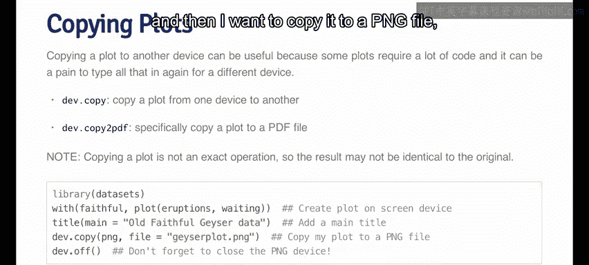

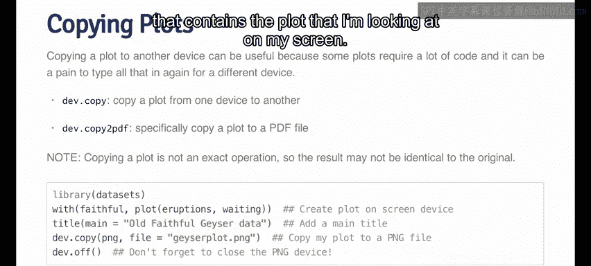

这段代码首先在屏幕上绘制了一个图形，然后使用`dev.copy()`函数将其复制到一个名为“geyserplot.png”的PNG文件中。最后，调用`dev.off()`关闭PNG设备，完成文件的保存。之后，你就可以在计算机上找到这个PNG文件，用于分享或插入演示文稿。

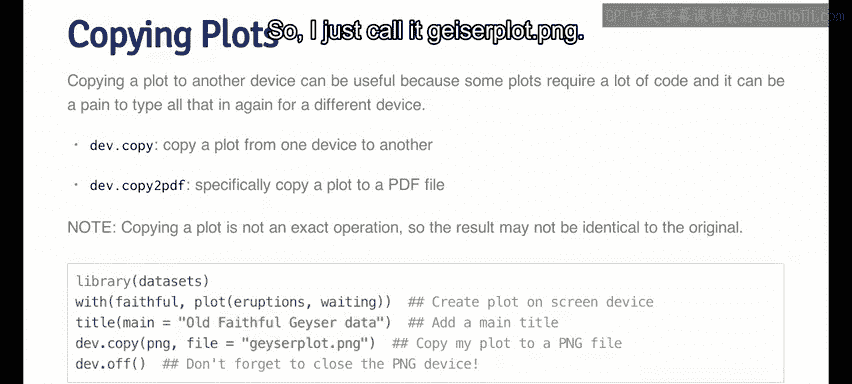

## 总结 📝

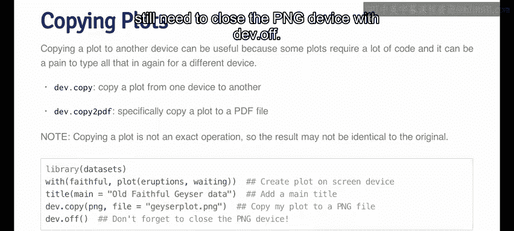

本节课中，我们一起学习了R语言中图形设备的进阶知识。

*   我们了解到图形文件设备主要分为**矢量格式**（如PDF、SVG）和**位图格式**（如PNG、JPEG）两大类，它们各有其适用的场景和优缺点。
*   我们学习了如何通过`dev.cur()`和`dev.set()`等函数来**管理多个图形设备**，并在它们之间切换。
*   最后，我们掌握了使用`dev.copy()`和`dev.copy2pdf()`等函数**在不同图形设备间复制图形**的方法，以便将屏幕上满意的图表保存为文件。

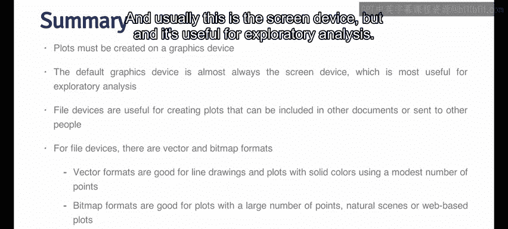

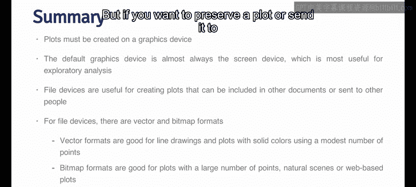

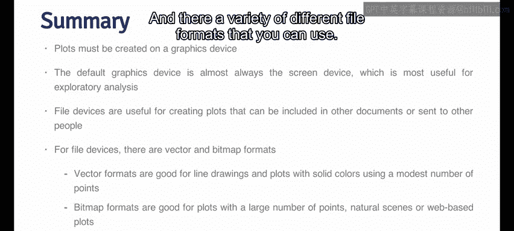

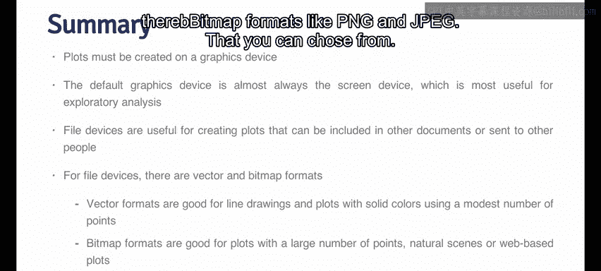

核心要点是：所有图形都必须在某个图形设备上创建。虽然屏幕设备常用于探索性分析，但若想保存或分享图形，则必须使用文件设备。你可以根据需求从多种矢量或位图格式中进行选择。