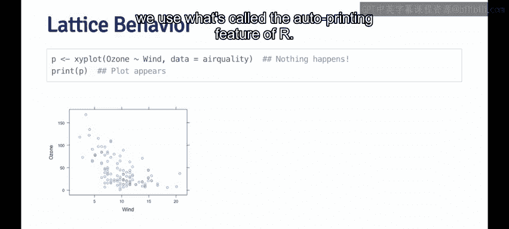

# 016：网格绘图系统（第一部分）📊


在本节课中，我们将要学习R语言中的网格绘图系统。这是一个与基础绘图系统不同的绘图系统，其工作原理也大相径庭。网格绘图系统尤其适用于绘制高维数据，以及一次性创建大量图形。

## 概述

上一节我们介绍了基础绘图系统，本节中我们来看看网格绘图系统。网格绘图系统通过`lattice`包实现，它构建在底层的`grid`包之上，专门用于高效创建多面板图形，以便同时观察数据的多个维度或分组。

## 网格绘图系统简介

网格绘图系统与基础绘图系统的一个关键区别在于，它没有“两阶段”的绘图过程。在基础系统中，你可以先创建一个基础图形，然后使用其他函数逐步添加注释。而在网格系统中，你必须通过**单次函数调用**来创建完整的图形，所有细节都需要在调用时指定，因为之后通常没有机会再进行注释。

以下是网格绘图系统中一些主要的函数：

*   **`xyplot`**: 这是最重要的函数，用于创建散点图。
*   **`bwplot`**: 用于创建箱线图。
*   **`histogram`**: 用于创建直方图。
*   **`stripplot`**: 类似于箱线图，但使用点来表示。
*   **`dotplot`**: 绘制点图，其形状类似小提琴弦。
*   **`splom`**: 创建散点图矩阵，类似于基础系统中的`pairs`函数。
*   **`levelplot`** 和 **`contourplot`**: 用于绘制图像数据。

## 核心函数：`xyplot`

`xyplot`函数是网格系统中最核心的函数，其基本调用格式如下：

```r
xyplot(y ~ x | f * g, data)
```

*   **`y ~ x`**: 这是一个公式表示法，`y`对应Y轴变量，`x`对应X轴变量。
*   **`|`**: 竖线用于分隔条件变量。
*   **`f * g`**: `f`和`g`是分类变量（因子），图形将根据这些变量的不同水平（组合）来分别绘制子面板。你可以使用一个或多个条件变量。
*   **`data`**: 指定包含上述变量的数据框。如果未指定，函数将在当前工作空间中查找变量。

这个函数调用的含义是：**为`f`和`g`的每一个水平（组合），绘制`y`对`x`的散点图。**

### 简单示例

首先加载必要的包和数据：

```r
library(lattice)
library(datasets)
```

绘制一个基本的散点图，展示风速（wind）与臭氧浓度（ozone）的关系：

```r
xyplot(Ozone ~ Wind, data = airquality)
```

这个图形看起来与基础绘图系统的散点图相似，但默认使用蓝色空心圆点。

### 多面板示例

现在，我们创建一个更复杂的图形，按月份（Month）来分别观察风速与臭氧的关系。首先将月份转换为因子：

```r
airquality$Month <- factor(airquality$Month)
```

然后使用`xyplot`并添加条件变量：

```r
xyplot(Ozone ~ Wind | Month, data = airquality, layout = c(5, 1))
```

通过这个简单的函数调用，我们得到了5个子面板（对应5月至9月）。可以观察到，臭氧与风速的关系在不同月份间有所变化：在5月和6月关系较弱，而在7月和8月呈现较强的负相关关系（风速越大，臭氧越少），到9月这种关系又开始减弱。

**网格绘图系统的强大之处在于，仅用一次函数调用，就能轻松创建这种多维度的多面板图形**。相比之下，在基础绘图系统中实现同样的效果需要多次函数调用。

## 网格系统的行为特点

网格函数的行为与基础图形函数有所不同，这一点值得注意：

*   **基础图形函数**：直接将数据绘制到图形设备上（如屏幕、PDF文件）。
*   **网格函数**：并不直接绘图。它们会返回一个**`trellis`类**的对象。这个对象必须被**打印（print）** 后，图形才会被发送到图形设备。

不过，这个过程对用户通常是透明的。因为当你调用`xyplot`这类函数时，R的**自动打印（auto-printing）** 特性会使得返回的`trellis`对象被自动打印出来，图形也就立即显示。所以大多数时候，你无需担心这个两步过程。

你可以通过以下代码观察这个行为：

```r
p <- xyplot(Ozone ~ Wind, data = airquality) # 此时图形不会显示
print(p) # 调用print后，图形显示
```

第一行代码执行后，图形不会出现，因为结果被保存到了对象`p`中。第二行打印`p`时，图形才被绘制出来。如果直接运行`xyplot(...)`而不赋值，则会触发自动打印，图形会立即显示。

## 总结



本节课中我们一起学习了R语言中网格绘图系统的基础知识。我们了解到网格系统通过`lattice`包实现，擅长用简洁的公式语法创建复杂的多面板图形，尤其适合探索高维数据。我们重点掌握了核心函数`xyplot`的公式语法（`y ~ x | f`）及其在条件绘图中的应用。最后，我们明白了网格函数返回`trellis`对象并由打印机制驱动的特点，尽管这一过程通常由R自动处理。掌握网格系统能为你的数据探索提供强大而高效的可视化工具。