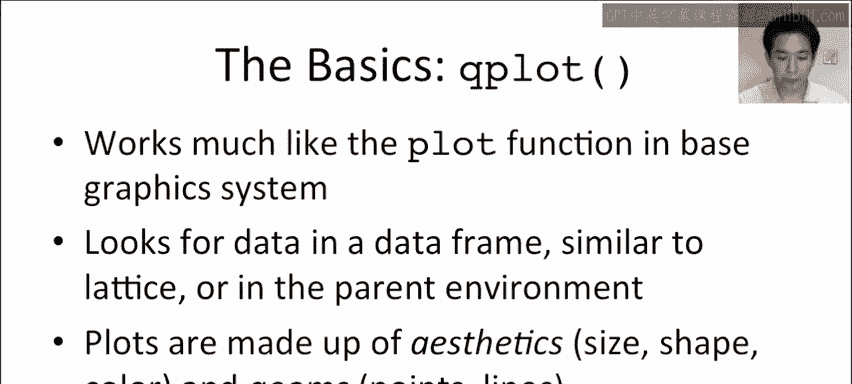

# 018：ggplot2 第一部分 🎨

在本节课中，我们将学习如何使用R语言中的`ggplot2`包进行基本绘图。`ggplot2`是一个基于“图形语法”理论构建的强大绘图系统，它允许我们通过组合不同的抽象元素来创建丰富多样的数据图形。

## 什么是ggplot2？ 🤔

`ggplot2`是一个可以从CRAN下载的R包。它实现了由Leland Wilkinson在其著作《图形语法》中提出的“图形语法”理论。

图形语法将图形分解为抽象概念，类似于语言中的动词、名词和形容词。这套理论描述了数据图形的基本构成元素，使我们能够像组合词语造句一样，将这些元素组合起来，创造出前所未有的新图形。这是一个用于组织各类数据图形的强大概念。

直到最近，R语言中还没有该理论的具体实现。Hadley Wickham在爱荷华州立大学攻读研究生时，将图形语法实现为一个名为`ggplot`的R包，其当前版本称为`ggplot2`。尽管它建立在R自带的`grid`图形系统之上，但`ggplot2`几乎可以被视为R中的第三种图形系统，并且已变得非常流行。

我们可以将第一种绘图模式视为使用`plot`、`hist`、`boxplot`等函数的基础绘图系统。第二种模式是使用`xyplot`等函数的`lattice`绘图系统。第三种模式就是`ggplot2`。你可以从CRAN获取这个包，它几乎可以在所有系统上安装。你也可以访问`ggplot2`的官方网站：`ggplot2.org`。

`ggplot2`的优点在于它基于图形语法理论。从某种意义上说，这为图形提供了一套理论，你可以利用这套理论重新组合不同的部分来创建新型图形。正如Hadley Wickham在其书中所说，其基本理念是缩短“从想法到图形”的距离。当你观察数据并想到一种可视化方式时，你希望能够迅速将这些想法转化为屏幕上的图像。

## 图形语法的核心理念 📊

从`ggplot2`的书中，下面这句话概括了其基本理念：

> 图形语法告诉我们，一个统计图形是**从数据到美学属性**（如颜色、形状、大小）的映射，这些属性属于**几何对象**（如点、线、条）。图形还可能包含数据的**统计变换**，并绘制在特定的**坐标系**上。

因此，我们拥有从数据到美学属性的映射、几何对象、统计变换以及坐标系。

## 初识qplot函数 🚀

在本讲中，我们将重点介绍`qplot`函数。这是最基本的一个函数，对于从基础绘图系统过渡过来的用户来说，可能是最好的起点。

在基础绘图系统中，核心函数是`plot`。`qplot`（可以理解为“快速绘图”）是`ggplot2`中的核心函数，类似于基础系统中的`plot`函数。

使用`ggplot2`时，一个需要适应的关键区别是：当你创建图形并向`qplot`函数传递数据时，通常需要告诉它数据来自哪里，并且数据**总是来自一个数据框**。因此，你的数据必须组织在数据框中，然后绘图时使用的变量将来自这个数据框。

当然，你也可以不指定数据框。如果不指定，`qplot`函数（以及所有绘图函数）会在你的工作空间中寻找数据。但通常，指定数据框是一个好习惯，这样当你阅读生成图形的代码时，就能清楚地知道数据来自何处。

因此，在开始绘图之前，用数据框组织好数据非常重要。一旦开始绘图，图形将由**美学属性**和**几何对象**构成。

*   **美学属性**指的是点等对象的大小、形状和颜色。
*   **几何对象**指的是你正在绘制的对象类型，例如是点、线还是条形图等。

## 因子变量的重要性 🔢

对于`qplot`函数（以及在使用`lattice`函数时同样重要）的一个关键方面是**因子变量**的使用。

因子非常重要，因为它们指示了数据的子集。想象你有一个数据框，其中包含一个Y变量、一个X变量和一个因子变量。这个因子将指示数据框中的数据子集。例如，你可能有一个表示性别的因子，包含一批男性和一批女性，这些就是你的数据子集。你可能希望按不同子集绘制某种关系图，或者根据点是男性还是女性来着色。因此，由各种因子变量指示的类别对于标注图形非常有用。

关于这个特性，重要的一点是：当数据集中存在因子变量时，你需要确保它们被正确标记。通常，将因子变量标记为1、2、3（即使你有三个类别）并不十分有用，因为信息量不足。通常，你希望用更具信息量的标签来标记它们，以便了解这些因子变量试图编码什么信息。

## qplot与ggplot函数 📈

`qplot`函数使用起来相当直接，我认为它很容易上手。它在底层隐藏了许多`ggplot2`正在执行的细节，这在许多情况下是没问题的。

然而，`ggplot`函数才是该系统的核心函数。它非常灵活，可以与许多`qplot`无法做到的功能结合使用。

---

**本节课总结**

在本节课中，我们一起学习了`ggplot2`绘图系统的基础知识。我们了解到`ggplot2`基于“图形语法”理论，允许通过组合数据、美学映射、几何对象、统计变换和坐标系来构建图形。我们重点介绍了入门函数`qplot`，它类似于基础绘图中的`plot`函数，但要求数据组织在数据框中，并强调了因子变量在数据子集分组和图形标注中的重要性。最后，我们提到`ggplot`函数是更灵活、功能更强大的核心函数，为后续深入学习奠定了基础。