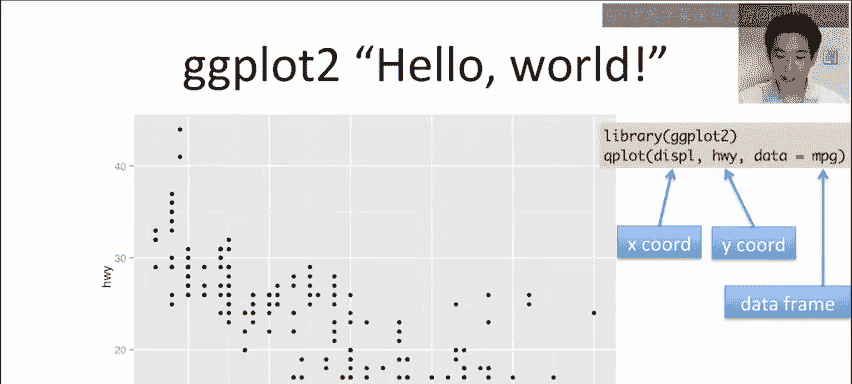
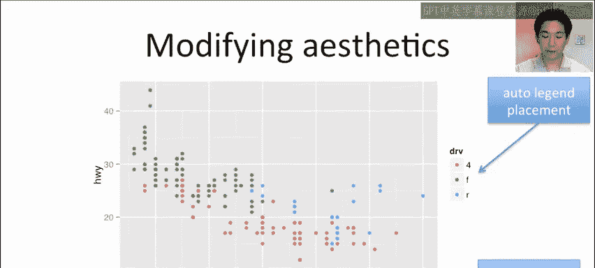
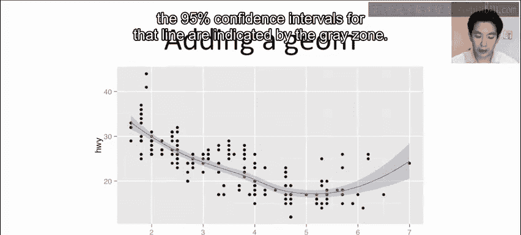
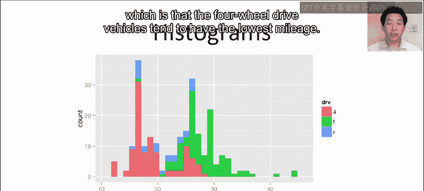
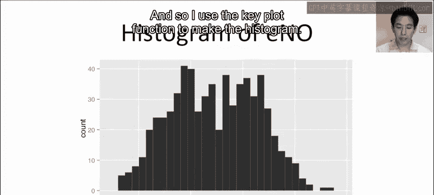
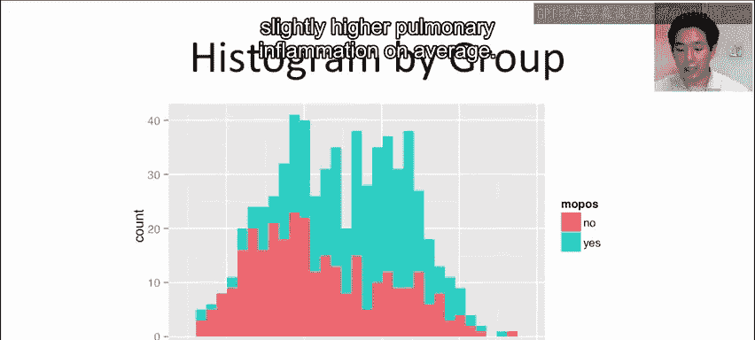
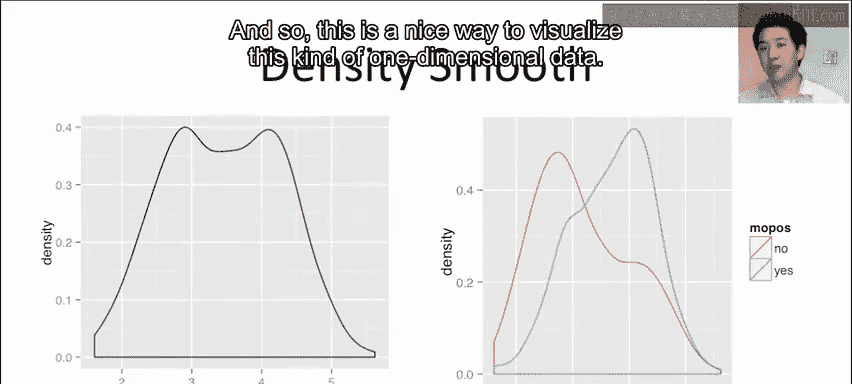
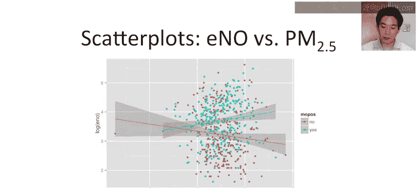
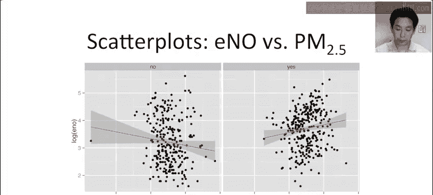

# 019：ggplot2 第2部分 📊

在本节课中，我们将学习如何使用 `ggplot2` 包的 `qplot` 函数进行快速绘图。我们将通过两个数据集示例，了解如何创建散点图、直方图，以及如何通过颜色、形状和分面来展示数据的不同子组。

---

## 概述

`qplot` 是 `ggplot2` 包中的一个快速绘图函数，它语法简洁，能快速生成美观的图形。本节我们将使用内置的 `mpg` 数据集和一个来自约翰霍普金斯大学的研究数据集，演示 `qplot` 的核心功能。

---

## 示例1：汽车油耗数据

首先，我们使用 `ggplot2` 包自带的 `mpg` 数据集。这个数据集包含234种不同汽车的11个变量，记录了每加仑行驶英里数等信息。

我们将重点关注以下几个变量：
*   **`displ`**: 发动机排量（引擎大小）。
*   **`hwy`**: 高速公路油耗（英里/加仑）。
*   **`drv`**: 驱动类型（前驱`f`、后驱`r`、四驱`4`）。



### 基础散点图

我们可以用 `qplot` 创建一个简单的散点图，观察发动机大小与高速油耗的关系。

```r
qplot(x = displ, y = hwy, data = mpg)
```

生成的图形与基础绘图系统不同：它有灰色背景和白色网格线，数据点是实心圆，并且坐标轴带有自动标签。


### 按子组着色

上一节我们绘制了基础图形，本节中我们来看看如何通过颜色区分数据中的不同子组。我们可以根据汽车的驱动类型（`drv`）为数据点着色。



```r
qplot(x = displ, y = hwy, data = mpg, color = drv)
```

代码中，`color = drv` 表示将 `drv` 变量的不同水平映射为不同颜色。图形会自动为前驱（绿色）、后驱（蓝色）和四驱（红色）分配颜色并添加图例。从图中可以看出，前驱车油耗最高，四驱车最低。




### 添加平滑曲线

除了展示原始数据点，我们还可以添加统计摘要来观察整体趋势。以下是添加平滑曲线（LOESS）的方法。

```r
qplot(x = displ, y = hwy, data = mpg, geom = c("point", "smooth"))
```

参数 `geom = c("point", "smooth")` 表示在图形上同时添加点和平滑线。图中的蓝色曲线展示了整体趋势，灰色阴影区域代表其95%的置信区间。




### 分组直方图

`qplot` 也可以轻松创建直方图。以下是如何创建按驱动类型填充颜色的高速公路油耗直方图。

```r
qplot(x = hwy, data = mpg, fill = drv)
```

当只指定一个变量（`x = hwy`）时，`qplot` 默认生成直方图。`fill = drv` 参数会根据 `drv` 变量用不同颜色填充直方图的各个部分，从而直观地比较不同驱动类型的油耗分布。


### 使用分面

当数据点较多或分组重叠时，用颜色区分可能不够清晰。这时，分面功能可以将不同子组的数据绘制在独立的面板中，便于比较。以下是创建分面图的方法。

```r
# 散点图分面：按 drv 分列
qplot(x = displ, y = hwy, data = mpg, facets = . ~ drv)

# 直方图分面：按 drv 分行
qplot(x = hwy, data = mpg, facets = drv ~ .)
```

分面语法使用波浪号 `~`：
*   `facets = . ~ drv`：右侧变量决定列数。这里 `.` 表示只有一行，`drv` 有三个水平，因此生成一行三列的散点图。
*   `facets = drv ~ .`：左侧变量决定行数。这里 `drv` 决定有三行，`.` 表示只有一列，因此生成三行一列的直方图。


---

## 示例2：哮喘研究数据

接下来，我们使用一个更复杂的真实数据集，它来自约翰霍普金斯大学的“室内过敏原与哮喘队列研究”。该研究调查了巴尔的摩地区5-17岁患有持续性哮喘的儿童，探索室内环境与哮喘发病率的关系。

数据集包含750个观测，我们关注以下变量：
*   **`logeno`**: 呼出一氧化氮（ENO）的对数值，反映肺部炎症水平。
*   **`logpm25`**: 细颗粒物（PM2.5）的对数值，即直径小于2.5微米的室内灰尘。
*   **`mopos`**: 小鼠过敏原皮肤测试结果（阳性/阴性）。

### 基础直方图

首先，我们查看呼出一氧化氮（`logeno`）的分布情况。

```r
qplot(x = logeno, data = maacs)
```

从直方图可以看出，`logeno` 的分布似乎存在两个甚至三个峰值。




### 按过敏状态分组

我们可以根据儿童是否对小鼠过敏（`mopos`）来对直方图进行颜色填充，比较两组的分布差异。

```r
qplot(x = logeno, data = maacs, fill = mopos)
```



图中蓝色（过敏阳性）的条形整体略高于红色（过敏阴性），这表明对小鼠过敏的儿童平均肺部炎症水平可能更高。


### 密度平滑曲线



另一种可视化一维数据分布的方法是使用密度平滑曲线。以下是分别绘制整体和按组划分的密度曲线的方法。

```r
# 整体密度曲线
qplot(x = logeno, data = maacs, geom = "density")
# 按组着色的密度曲线
qplot(x = logeno, data = maacs, geom = "density", color = mopos)
```

在按组着色的图中，可以清晰地看到两个峰值大致对应了过敏阳性和阴性两组儿童，这比直方图更直观地揭示了双峰结构与过敏状态的关系。


### 散点图与分组

现在，我们研究室内PM2.5水平（`logpm25`）与肺部炎症（`logeno`）的关系，并考虑过敏状态的影响。

以下是三种不同的可视化方式：
1.  **基础散点图**：观察整体关系。
2.  **按形状分组**：用不同形状区分过敏状态。
3.  **按颜色分组**：用不同颜色区分过敏状态（通常比形状更清晰）。

```r
# 1. 基础散点图
qplot(x = logpm25, y = logeno, data = maacs)
# 2. 按形状分组
qplot(x = logpm25, y = logeno, data = maacs, shape = mopos)
# 3. 按颜色分组
qplot(x = logpm25, y = logeno, data = maacs, color = mopos)
```




### 添加线性趋势线并分面

为了更精确地分析两组中PM2.5与ENO的关系，我们可以在散点图上添加线性回归线，并使用分面将两组完全分开。

```r
# 在同一图中，按颜色分组并添加线性平滑
qplot(x = logpm25, y = logeno, data = maacs, color = mopos, geom = c("point", "smooth"), method = "lm")

# 使用分面创建两个独立面板
qplot(x = logpm25, y = logeno, data = maacs, facets = . ~ mopos, geom = c("point", "smooth"), method = "lm")
```



在代码中，`method = "lm"` 指定使用线性模型进行平滑。从结果可以看出，在不过敏的儿童中（红色/左侧面板），两者关系微弱且可能为负相关；而在过敏的儿童中（蓝色/右侧面板），则呈现轻微的上升趋势。


---

## 总结

本节课中我们一起学习了 `ggplot2` 包中 `qplot` 函数的核心用法。`qplot` 是一个强大而快捷的绘图工具，其语法介于基础绘图和 `lattice` 包之间。我们掌握了如何：
*   创建散点图、直方图和密度图。
*   使用 `color`、`fill`、`shape` 参数根据因子变量对数据进行视觉分组。
*   使用 `geom` 参数添加平滑曲线等统计摘要。
*   利用 `facets` 参数创建多面板图形，以清晰展示不同子组的数据。

`qplot` 适合快速探索数据并生成具有统一美观风格的图形。如果需要进行更深层次的定制，则需要使用更底层的 `ggplot()` 函数，这将在下一讲中介绍。