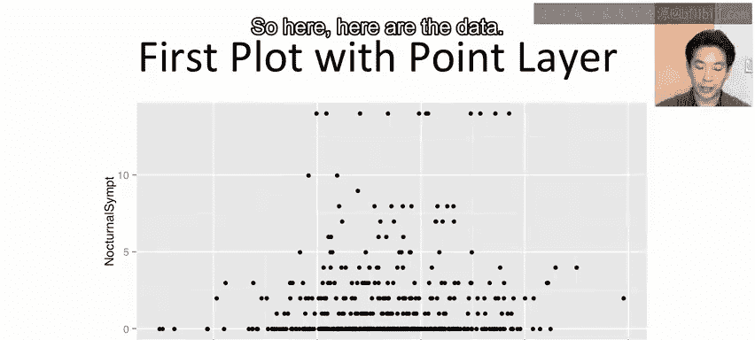

# 020：ggplot2 第3部分 📊


## 概述

在本节课中，我们将深入学习 `ggplot2` 包的核心构建原理。上一节我们介绍了 `qplot` 函数，它适合快速创建基础图形。本节中，我们将探讨 `ggplot2` 的底层语法结构，学习如何通过分层叠加的方式，从零开始构建和自定义更复杂的图形。

## 什么是ggplot2？

`ggplot2` 是“图形语法”理论在R语言中的实现。该理论由Leland Wilkinson提出，它将图形视为由数据、美学映射、几何对象等多个组件构成的抽象结构。这为我们提供了一套系统化的“语言”来思考和构建图形。

## 图形的基本组件

一个 `ggplot2` 图形通常包含以下几个核心组件：

*   **数据**：这是图形的基础，必须是一个数据框。
*   **美学映射**：这定义了数据中的变量如何映射到图形的视觉属性上，例如点的x轴位置、y轴位置、颜色、大小等。
*   **几何对象**：这是你在图形上实际看到的元素，例如点、线、条形、多边形等。
*   **分面**：用于创建条件图，即根据某个变量的不同水平，将数据拆分到多个子图中展示。
*   **统计变换**：对数据进行统计汇总，例如平滑、分箱、计算分位数或拟合回归线。
*   **标度**：控制美学映射的具体呈现方式。例如，将一个分类变量映射为红色和蓝色。
*   **坐标系**：定义数据点如何映射到绘图区域的坐标上。

## 分层构建模型

与 `lattice` 系统一次性指定所有图形参数不同，`ggplot2` 采用类似艺术家调色板的分层构建模型。你可以从一个基础图层开始，然后逐步添加新的图层或修改现有属性。

以下是构建一个图形的典型分层步骤：

1.  **数据层**：首先指定数据和基本的美学映射。
2.  **几何对象层**：添加一个或多个几何对象层（如点、线）来展示数据。
3.  **统计/注释层**：可以叠加统计汇总层（如平滑线）或额外的注释信息。

## 案例：空气质量与哮喘症状研究

我们将使用一个关于儿童哮喘的研究数据作为示例。该研究探讨了室内空气污染物（PM2.5）与夜间哮喘症状的关系，并考察了体重指数（BMI）是否会影响这种关系。

### 初始数据与图形

首先，我们使用 `qplot` 快速生成一个探索性图形，观察不同BMI组别下，PM2.5与夜间症状天数的关系。

```r
# 使用qplot快速绘图
qplot(log(pm25), nocturnalsympt, data = maacs, facets = . ~ bmicat,
      geom = c("point", "smooth"), method = "lm")
```


上图初步显示，在超重/肥胖儿童中，PM2.5与症状似乎存在正相关，而在正常体重儿童中则不明显。这提示BMI可能是一个效应修饰因子。

### 使用底层语法重建图形

现在，我们放弃 `qplot`，使用 `ggplot2` 的底层语法一步步重建这个图形。

**第一步：初始化与数据映射**

我们首先调用 `ggplot()` 函数，并传入数据和基本的美学映射（aesthetic mapping）。这里，我们将 `log(pm25)` 映射到x轴，将 `nocturnalsympt` 映射到y轴。

```r
library(ggplot2)
g <- ggplot(maacs, aes(x = log(pm25), y = nocturnalsympt))
summary(g) # 查看图形对象摘要
```

此时，对象 `g` 包含了数据和映射信息，但还没有任何几何对象来“绘制”数据。如果直接打印 `g`，你会得到一个错误，因为图形缺少图层。

**第二步：添加几何对象层**

我们使用 `+` 运算符为图形添加一个几何对象层。要绘制散点图，我们添加 `geom_point()` 层。

```r
# 方法一：创建新对象并打印
p <- g + geom_point()
print(p)

# 方法二：直接运行，利用自动打印
g + geom_point()
```



现在，图形成功显示在屏幕上。注意，`geom_point()` 函数无需再次指定数据和映射，因为它会自动从上一层的 `ggplot` 对象中继承。

## 总结


本节课中我们一起学习了 `ggplot2` 图形语法的核心思想。我们了解到图形是由数据、映射、几何对象等多个组件分层构建而成的。通过 `ggplot()` 初始化图形并定义美学映射，再使用 `+` 运算符逐步添加 `geom_*` 图层，我们可以从零开始，灵活地创建和定制复杂的统计图形。这种模块化的方法为深入的数据可视化提供了强大的基础。在接下来的课程中，我们将学习如何添加更丰富的图层，如平滑线、分面以及如何自定义图形的外观。