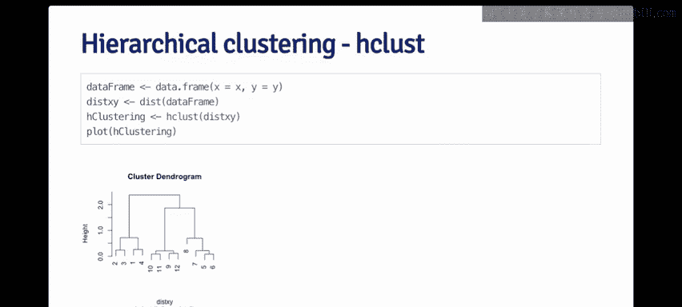

# 024：层次聚类（第二部分）🔬


在本节课中，我们将通过一个简单的模拟数据集，详细演示层次聚类算法的工作流程。我们将从计算数据点之间的距离开始，逐步展示数据点如何被合并，最终形成树状图（系统树图），并学习如何通过“切割”树状图来确定最终的聚类数量。


---


## 概述与数据准备

为了清晰地展示层次聚类的工作原理，我们将模拟一个简单的数据集。首先设置随机种子以确保结果可重现，这样您就可以运行相同的代码来复现数据。


以下是生成并绘制数据点的代码：


```r
set.seed(1234)
par(mar = c(0, 0, 0, 0))
x <- rnorm(12, mean = rep(1:3, each = 4), sd = 0.2)
y <- rnorm(12, mean = rep(c(1, 2, 1), each = 4), sd = 0.2)
plot(x, y, col = "blue", pch = 19, cex = 2)
text(x + 0.05, y + 0.05, labels = as.character(1:12))
```

这段代码生成了12个数据点，从图中可以清晰地看到它们大致分为三个簇。我们使用 `text` 函数为每个点添加了标签，以便于后续追踪。


## 计算距离矩阵

运行层次聚类算法的第一步是计算所有数据点两两之间的距离，以确定哪些点彼此最接近。


在R语言中，最简便的方法是使用 `dist` 函数。该函数接受一个矩阵或数据框作为输入（本例中数据框有两列，分别代表X和Y坐标），并计算所有行之间的距离，返回一个**距离矩阵**。


以下是计算距离矩阵的代码：


```r
dataFrame <- data.frame(x = x, y = y)
dist(dataFrame)
```


默认情况下，`dist` 函数使用**欧几里得距离**，但也可以通过参数指定其他距离度量方式。输出的距离矩阵是一个下三角矩阵，展示了所有点对之间的距离。例如，点1和点2之间的距离是0.34。虽然模拟数据的数值本身没有特定含义，但我们可以通过比较距离值看出哪些点更接近。

## 层次聚类的合并过程


层次聚类算法的核心思想是：从距离最近的两个点开始，逐步将它们合并。


观察距离矩阵，我们发现点5和点6的距离最近。因此，算法首先将这两个点合并为一个簇，并用一个新的“超级点”来代表它们，这个超级点的位置通常是这两个点连线的中点（或根据连接方法计算得出）。


合并后，我们继续在剩余的点（包括新生成的超级点）中寻找距离最近的两个点。接下来，点10和点11（位于右下角的红色区域）被合并。


这个过程不断重复，每次都将当前距离最近的两个点（或簇）合并，直到所有点都连接在一起。


## 理解树状图（系统树图）

上述合并过程的最终结果会以**树状图**的形式可视化出来。树状图展示了所有数据点是如何被逐步聚类在一起的。


在树状图中：
*   最右侧的叶子节点代表原始数据点。
*   位置越低的连接，代表越早被合并（例如点5和点6）。
*   位置越高的连接，代表越晚被合并。


您可以看到，点5和6首先合并，然后这个簇与点7合并，之后再与点8合并，依此类推。树状图清晰地记录了整个层次化的合并历史。

## 确定聚类数量：切割树状图


树状图本身并不直接告诉我们数据中有多少个簇。我们需要通过“切割”树状图来决定最终的聚类数量。


具体方法是：在树状图的纵轴（代表距离或高度）上选择一个阈值，画一条水平线。这条水平线穿过的分支数量，就对应了我们得到的簇的数量。

例如：
*   如果在高度为 **2.0** 的位置画水平线，会与大约两个分支相交，这表明数据中大致有 **2个簇**。
*   如果在高度为 **1.0** 的位置画水平线，会与三个分支相交，这表明数据中大致有 **3个簇**。

切割的位置越高，得到的簇越少；切割的位置越低，得到的簇越多。极端情况下，如果在最底部切割，每个数据点都会成为一个独立的簇（即12个簇）。选择在何处切割树状图，通常需要结合具体问题和领域知识来判断。


一旦确定了切割高度，我们就可以从层次聚类的结果中提取出每个数据点所属的簇的标签。


---


## 总结




本节课我们一起学习了层次聚类算法的后半部分流程。我们从一个模拟数据集出发，演示了如何计算距离矩阵、如何从最近的点开始逐步合并、以及如何生成和解读展示这一过程的树状图。最关键的是，我们了解到树状图需要通过“切割”来最终确定聚类数量，切割高度的选择直接影响聚类的结果。层次聚类提供了一种层次化的、可视化的数据分组视角，是探索性数据分析中非常有用的工具。