# 033：在R绘图中使用颜色（第三部分）🎨

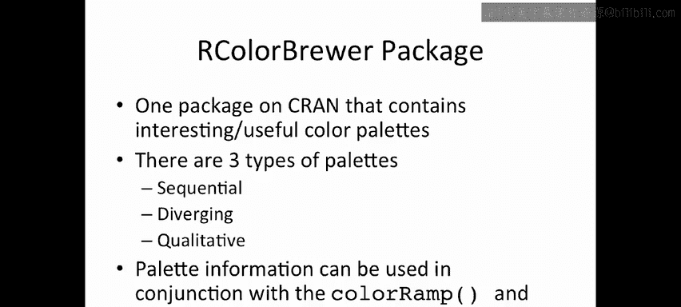

在本节课中，我们将学习如何为R图形寻找和创建更有趣的颜色方案。我们将重点介绍一个名为`RColorBrewer`的R包，它提供了一系列精心设计的调色板，适用于不同类型的数据可视化。

## 寻找有趣的调色板


你可能会思考，如何找到或创建有趣的调色板。虽然你可以像之前课程中那样，通过`colors()`函数获取颜色名称（如“red”、“yellow”）来自定义调色板，但有时你可能希望使用更专业、更美观的颜色方案。


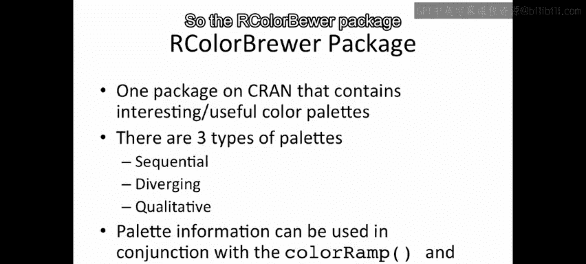

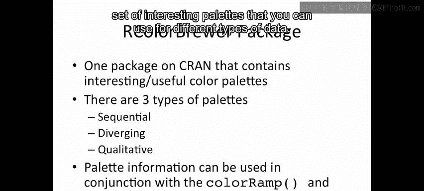


这可以通过R中的`RColorBrewer`包来实现。该包在CRAN上可用，它提供了一系列适用于不同类型数据的、经过精心设计的调色板。这个包是基于宾夕法尼亚州立大学的Cynthia Brewer的研究工作创建的，她在为地图和数据映射选择合适颜色方面做了大量研究。


虽然这些调色板最初是为地图设计的，但它们对于其他非地图类型的数据可视化同样非常有用。


## RColorBrewer包中的调色板类型

`RColorBrewer`包主要提供三种类型的调色板，每种都针对特定类型的数据。

以下是三种主要调色板类型：


1.  **顺序调色板**：用于**有序数据**。你可以将其理解为用于数值型或连续型数据（不一定严格连续）。核心思想是数据从低到高排序。这类调色板的颜色通常从浅到深渐变。
2.  **发散调色板**：用于**偏离某个中心点的数据**。例如，如果你有一组数据，想要展示它们与均值的偏差，就可能用到这种调色板。数据可以有正值和负值，并且它们会从中心点（比如零）向两个方向（正和负）扩展。发散调色板用两种不同的颜色来代表这两个方向。
3.  **定性调色板**：用于**无序数据**。这适用于因子或分类数据，这些数据没有特定的顺序，只是具有不同的类别值。

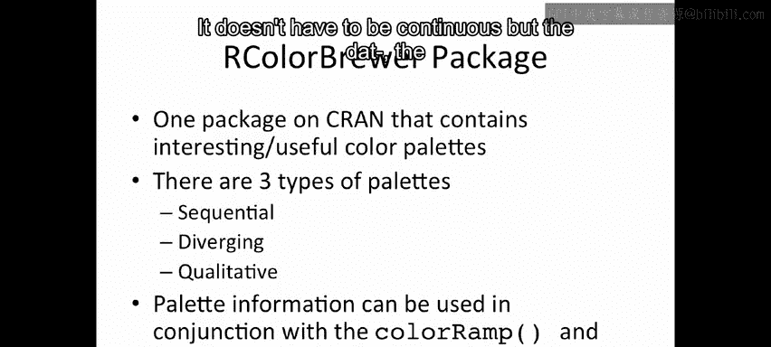


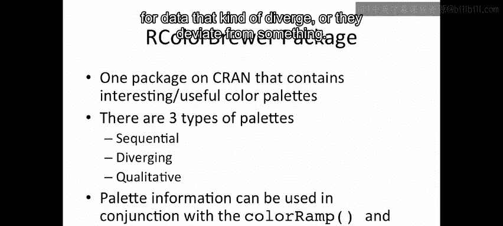


## 调色板详解与可视化


上一节我们介绍了调色板的三种基本类型，本节中我们来看看它们在`RColorBrewer`包中的具体呈现。

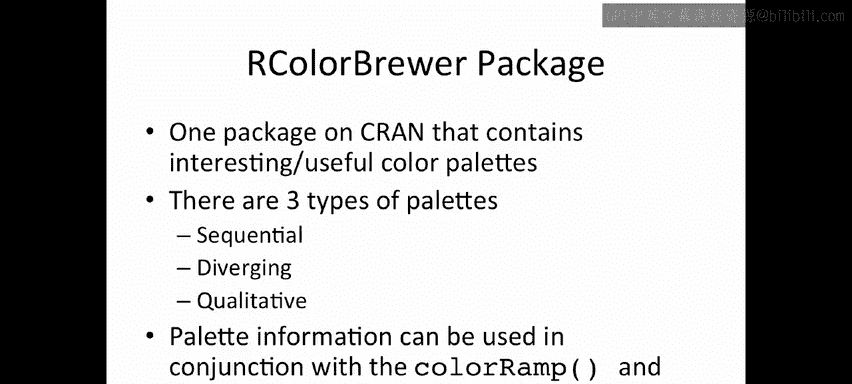


这些是`RColorBrewer`包中提供的各种调色板。


*   **顶部的第一组是顺序调色板**。你可以看到，从左到右，它们的颜色基本上是从浅到深变化的，但每个调色板会经过不同的颜色序列。例如，最上面的调色板从黄色、橙色过渡到红色；最下面的“Blues”调色板则从浅蓝过渡到深蓝。这些用于具有低值和高值的数值型有序数据。
*   **第二组是定性调色板**，用于表示分类数据。你可以看到，这些调色板中的颜色没有特定的顺序，它们既不从浅到深，也没有任何特定的排列。每个调色板都有一套相关联的颜色，并且基本上有一个主题。有些调色板颜色更鲜艳，有些则更柔和。
*   **最后一组颜色是发散调色板**。你可以看到，这种调色板的颜色在中间较浅，从左到右，它们在不同的颜色范围内变得更暗。你可以将左边视为负值，右边视为正值，这就是它们“发散”的方式。同样，它们也经过不同的颜色组合。例如，最上面的调色板从左边的红色一直过渡到右边的紫蓝色；最下面的调色板则从左边的棕色过渡到右边的蓝绿色。你可以根据自己偏好的配色方案来选择调色板。

## 在R中使用RColorBrewer

了解了调色板的种类后，我们来看看如何在R中实际使用`RColorBrewer`包。

首先，你需要使用`install.packages()`函数安装该包，然后通过`library(RColorBrewer)`加载。

该包中真正有用的函数是`brewer.pal()`。它接受两个参数：
1.  `n`：你希望调色板包含的颜色数量。这个数字通常较小，比如2、3或4。对于主要颜色，你不需要太多。
2.  `name`：调色板的名称。这些名称不容易记住，你需要查阅`brewer.pal`的帮助页面来查看所有可用的调色板名称。

以下是一个使用示例代码：

```r
# 安装并加载包
# install.packages("RColorBrewer")
library(RColorBrewer)

# 使用 brewer.pal 函数获取调色板
my_palette <- brewer.pal(n = 3, name = "BuGn")
print(my_palette)
```

这段代码使用了一个蓝绿色系的调色板（“BuGn”），并指定需要3种不同的颜色。函数返回一个包含三个颜色的字符向量，每个颜色以RGB十六进制值表示（如`#E5F5F9`）。你不需要精确知道这些值代表什么颜色，屏幕上会显示出来。

## 将调色板应用于绘图函数

现在，我们学习如何将从`RColorBrewer`获取的调色板信息传递给`colorRamp()`或`colorRampPalette()`等函数，以便在R的绘图函数中使用。


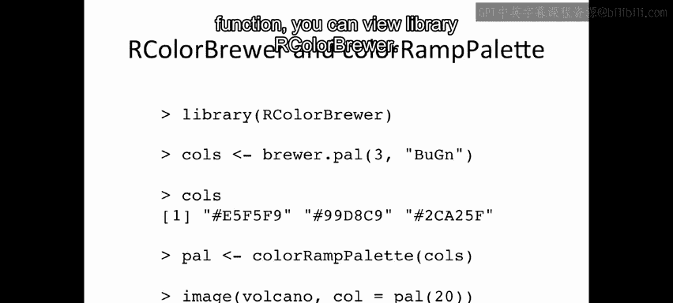

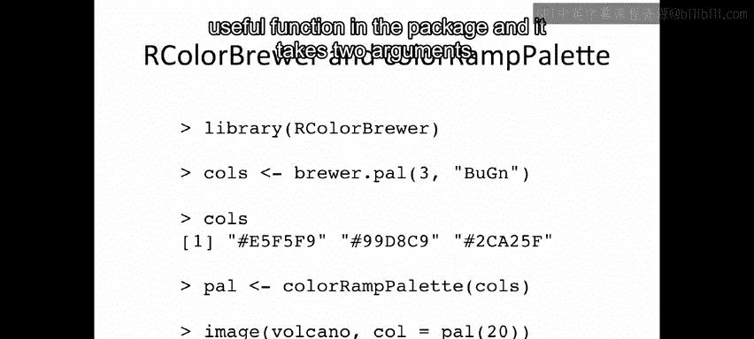

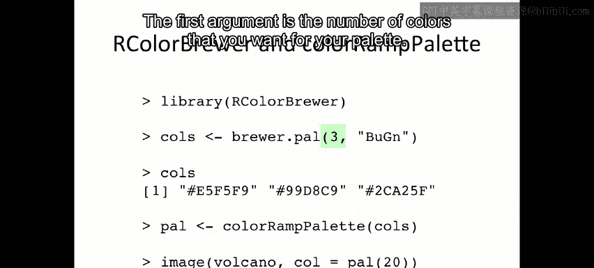

我将把这个调色板传递给`colorRampPalette()`函数，它会返回一个函数，我将其命名为`pal`。

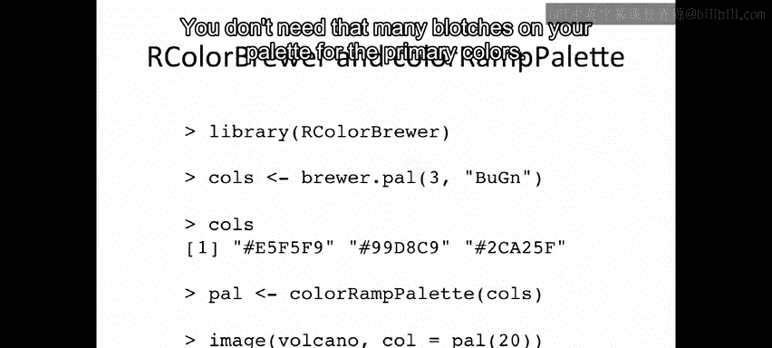

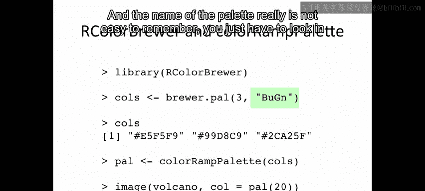

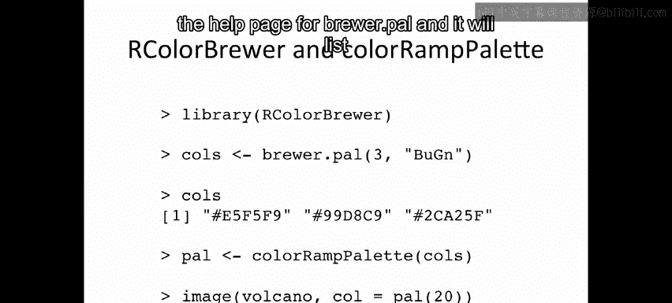

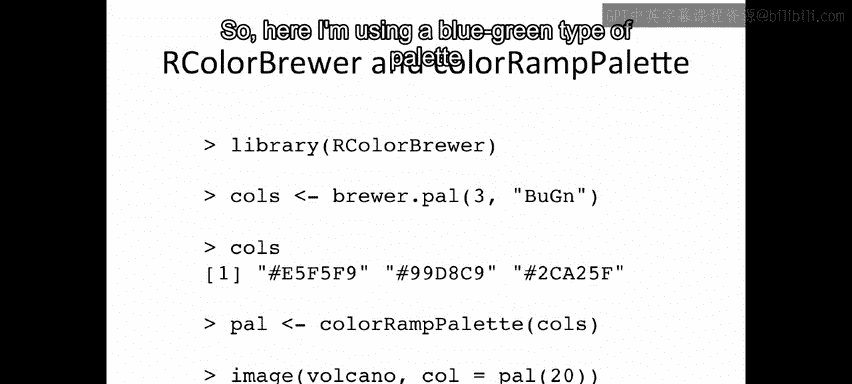


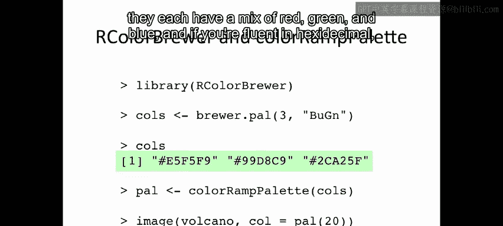

```r
# 基于 brewer.pal 的输出创建颜色渐变函数
pal <- colorRampPalette(my_palette)
```


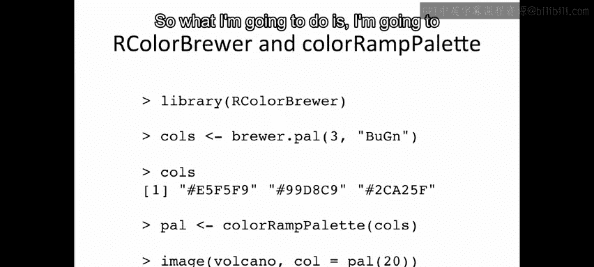

接下来，我将使用`image()`函数创建火山的图像。但这次，我不使用`heat.colors`或`topo.colors`调色板，而是使用从`RColorBrewer`包获得的这个调色板。我指定希望在这个图像中呈现20种不同的颜色。

```r
# 使用自定义调色板绘制图像
image(volcano, col = pal(20))
```


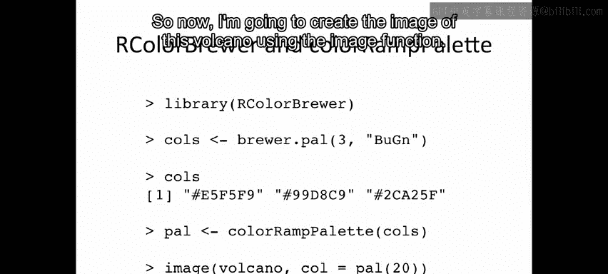

这20种颜色将从“BuGn”调色板中插值生成。


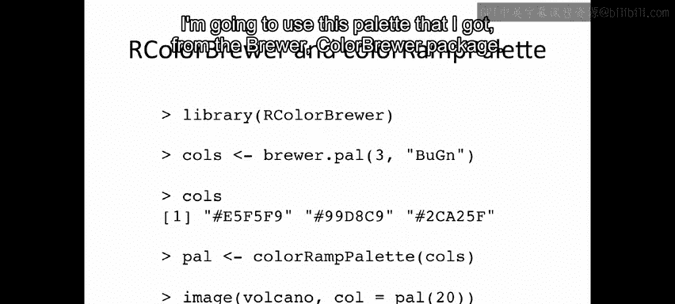


生成的图像如下所示。你可以看到，随着海拔升高，颜色变得更深、更绿；而在海拔较低处，颜色更浅、更蓝。


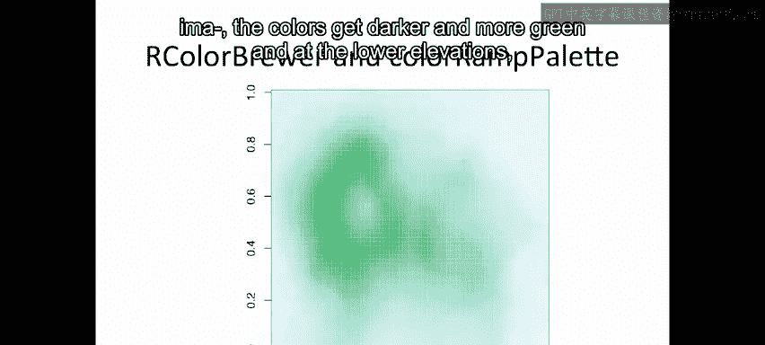

## 使用smoothScatter函数

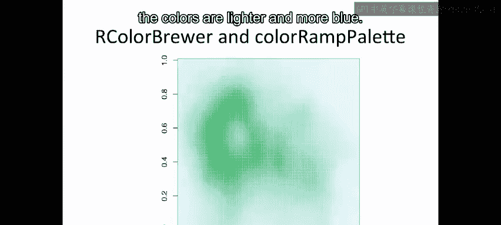

另一个使用`RColorBrewer`调色板的函数是R自带的`smoothScatter()`函数。这个函数在你需要绘制大量数据点的散点图时特别有用，因为你不希望屏幕上只是一堆相互重叠的点。

这里我绘制了10,000个点。如果我使用普通的`plot()`函数在屏幕上绘制，会得到一堆重叠的点，很难看清细节。

`smoothScatter()`函数的作用是：它为图中的点创建一个二维直方图，并使用一组特定的颜色来绘制这个直方图。它默认使用的颜色集是`RColorBrewer`包中的“Blues”顺序调色板。

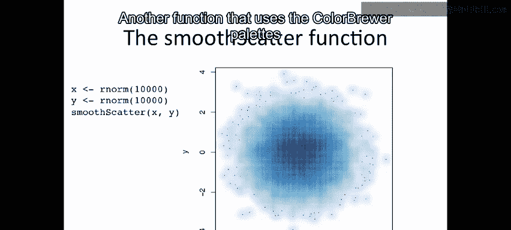

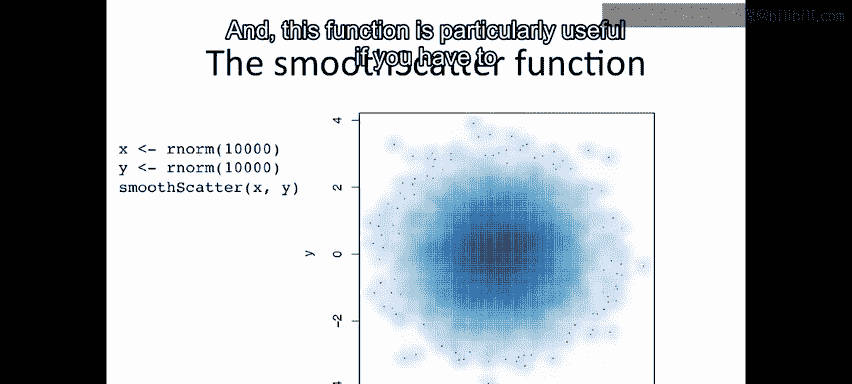

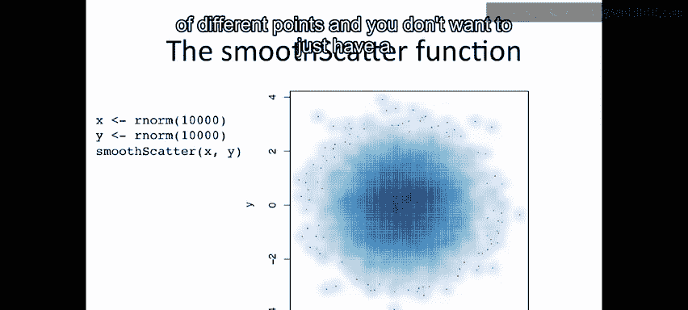

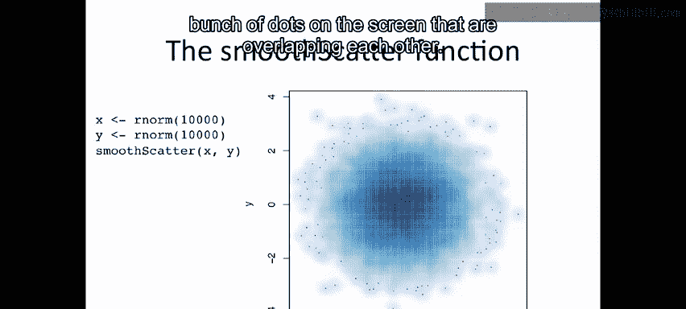


```r
# 使用 smoothScatter 绘制高密度散点图
set.seed(123)
x <- rnorm(10000)
y <- rnorm(10000)
smoothScatter(x, y)
```

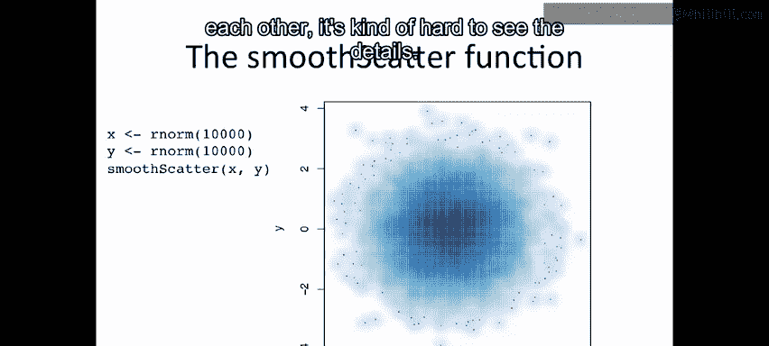

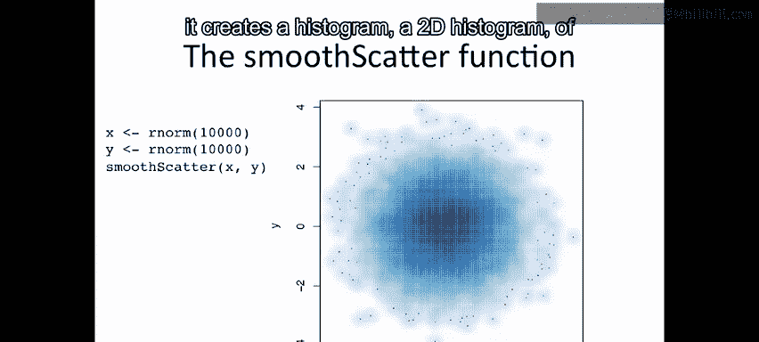


随着密度增高，蓝色会变得更深。因此，图中深蓝色的区域是高密度区，即大多数点所在的区域；而图中浅蓝色的部分则是图的低密度区域。

## 总结

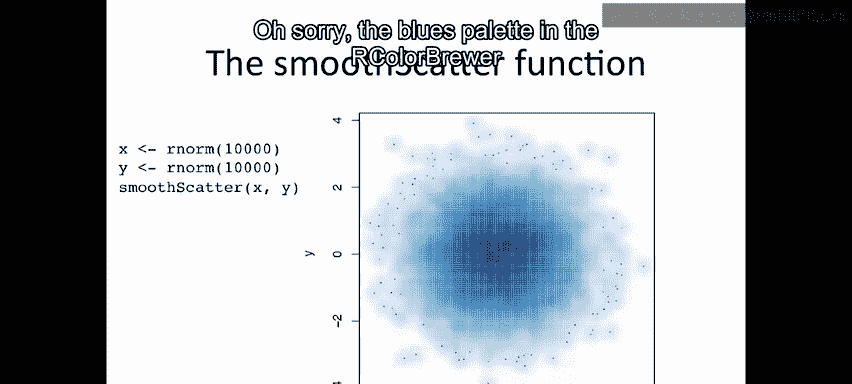

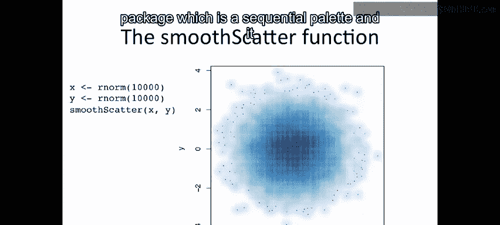

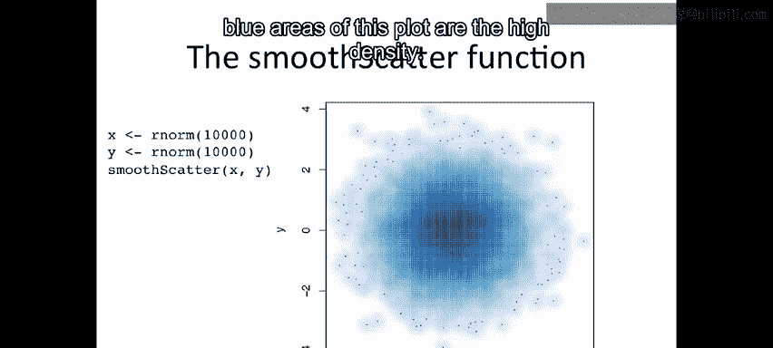

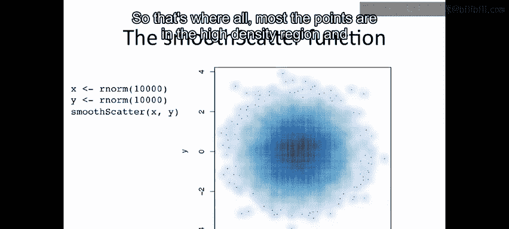

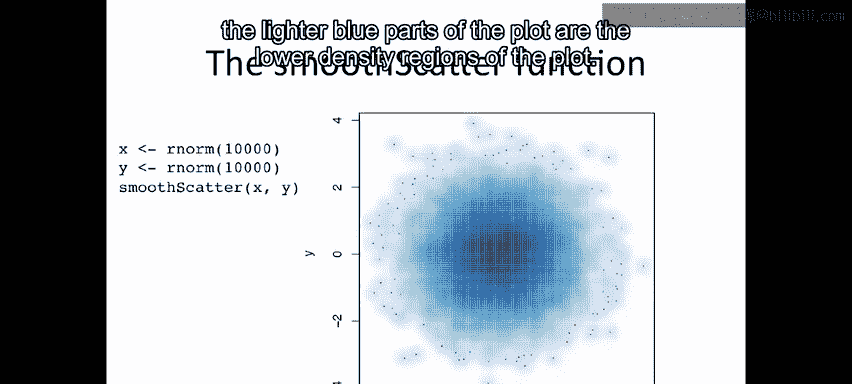

本节课中，我们一起学习了如何利用`RColorBrewer`包来增强R图形的色彩表现。我们了解了顺序、发散和定性三种调色板类型及其适用场景，掌握了使用`brewer.pal()`函数获取调色板，并通过`colorRampPalette()`将其应用到`image()`等绘图函数中的方法。最后，我们还介绍了`smoothScatter()`函数如何利用这些调色板来优雅地展示高密度散点数据。合理运用这些工具，可以让你的数据可视化更加专业、清晰和美观。