# 035：聚类案例研究 📊


在本节课中，我们将通过一个具体案例，学习如何运用探索性数据分析技术。我们将使用一个涉及智能手机预测人类活动的数据集，演示如何通过初步分析来理解数据、发现模式，并为后续的正式分析指明方向。

探索性数据分析的核心在于，你需要对数据中可能蕴含的信息和关键点有一个初步的感知。这将指导你查看哪些内容以及如何进行分析。其基本思想是，为你最终可能进行的分析提供一个“粗略的版本”。这个版本可能不完美，也不具备所有精细的修饰，但它能让你大致了解能从数据中提取何种信息，哪些问题可以实际解答，以及哪些问题在现有数据集下可能无法回答。

因此，探索性分析非常重要，因为它能排除某些问题，并将你推向其他分析方向。它为你提供了进入下一步所需的初步分析框架。接下来，让我们通过这个案例中的三星数据集，看看我们能发现什么。

---


## 数据集介绍 📱

这里的数据来自加州大学欧文分校的UCI机器学习存档库。它基于使用三星Galaxy手机预测人体运动。下图是三星Galaxy S3，实际数据由Galaxy S2产生，但基本理念相同。这些手机内置了加速度计和陀螺仪，有助于理解在假设人们手持手机的情况下，其三维位置和加速度。


数据来源于UCI机器学习知识库。你可以访问链接以了解更多关于数据收集方式以及网站上可获取的信息。为了本次讲座，我下载了数据的一个子集，即训练数据。


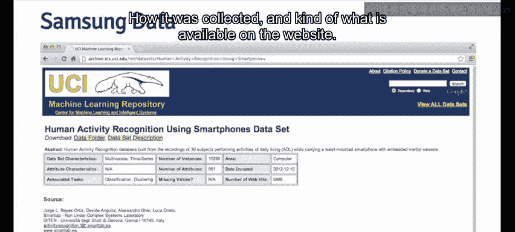


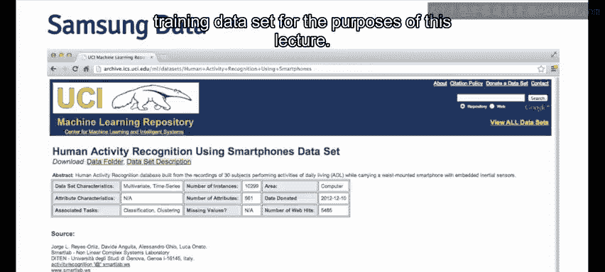

数据经过了一些处理以使其更易于使用。基本上，你得到一个矩阵，其中行代表观测值，列代表各种特征。在底部，你可以看到活动标签，它告诉你每个人在每一行对应的时间正在做什么。

例如，有六种可能的活动：躺下、坐下、站立、行走、下楼梯和上楼梯。目标是根据加速度计和陀螺仪收集的众多特征，能够区分这六种活动。

我在这里列出了前12个特征。你可以看到，它们包括身体加速度的平均值、标准差、平均绝对差和每个特征的最大值。

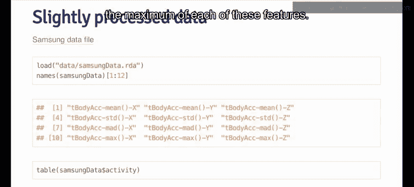

---

## 初步数据观察 🔍

我们可以快速查看第一位受试者的平均加速度。首先，我将活动变量转换为因子变量，然后使用`transform`函数。接着，我将筛选出第一位受试者的数据（即subject等于1）。在接下来的演示中，我将暂时忽略其他受试者。

```r
# 示例代码：转换活动变量并筛选第一位受试者
data$activity <- as.factor(data$activity)
subject1_data <- subset(data, subject == 1)
```

如果我绘制第一位受试者的数据，可以查看第一列，即X方向的平均身体加速度。加速度分为三个维度：X、Y和Z。这里的第二个图将是Y方向的平均身体加速度。我用不同颜色编码了每种活动。

在左侧图中，有绿色、红色、黑色、蓝色等，对应不同的活动。左侧图的一个问题是无法分辨哪种颜色对应哪种活动。因此，在右侧图中，我使用`legend`函数添加了图例，以便你能弄清楚哪种活动对应哪种颜色。

你可以看到，绿色代表站立，红色代表坐下，黑色代表躺下等。例如，对于站立、坐下和躺下等活动，X方向的平均身体加速度相对而言没有太多变化。但对于行走、下楼梯和上楼梯，X方向的平均身体加速度则有更多的变异性。

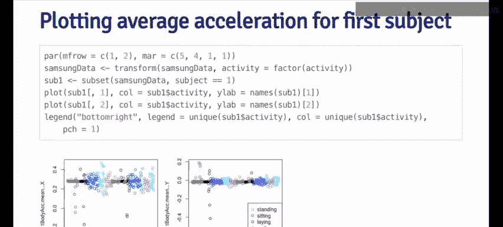

---

## 基于平均加速度的聚类尝试 🧩

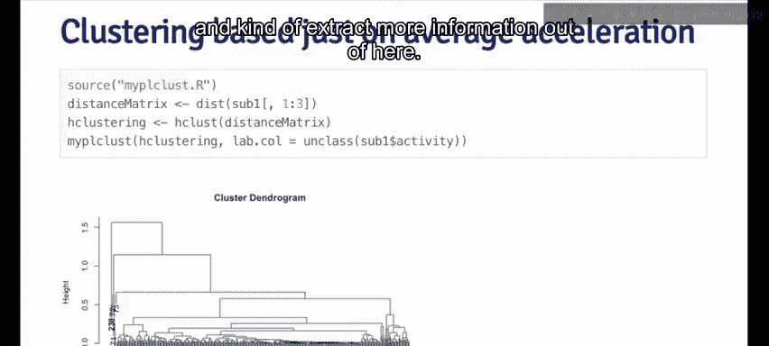

我们可以尝试仅基于平均加速度对数据进行聚类。我提取了这个矩阵的前三列，并使用`dist`函数计算了一个距离矩阵，默认使用欧几里得距离。然后，我调用`hclust`函数对这些数据进行层次聚类。

```r
# 示例代码：基于平均加速度进行层次聚类
avg_accel <- subject1_data[, 1:3]
dist_matrix <- dist(avg_accel)
hclust_result <- hclust(dist_matrix)
plot(hclust_result)
```

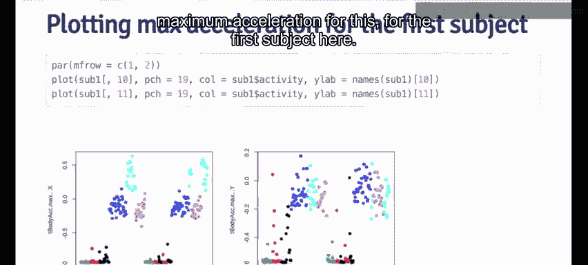

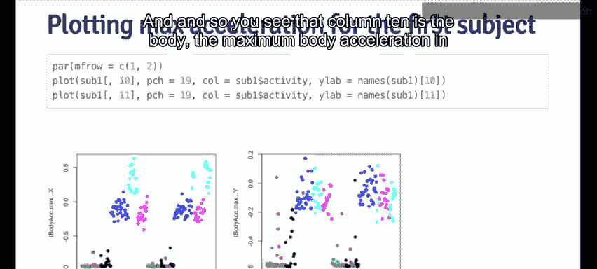

我调用`myPL`聚类函数来可视化它，可以看到聚类结果有些混乱，底部所有颜色都混杂在一起，没有清晰的模式。因此，我们可能需要进一步观察，尝试从这里提取更多信息。

---

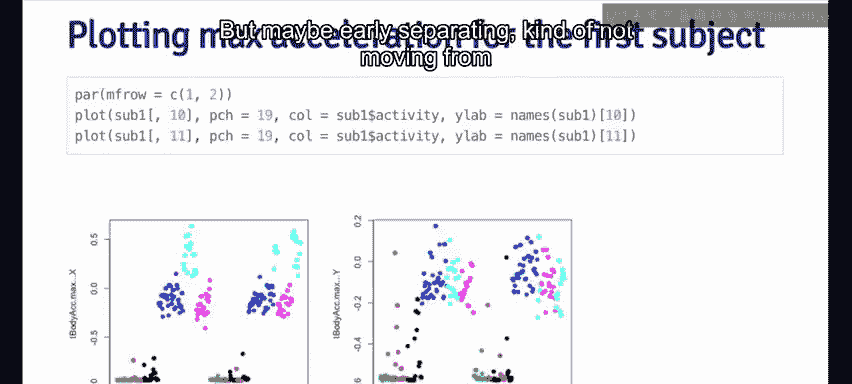

## 观察最大加速度 📈

我们可以查看第一位受试者的最大加速度。这里我绘制了第10列和第11列。第10列是X方向的最大身体加速度，第11列是Y方向的最大身体加速度。

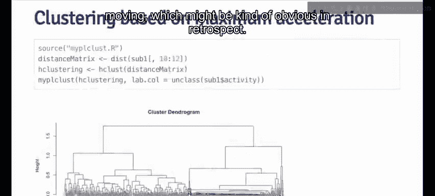


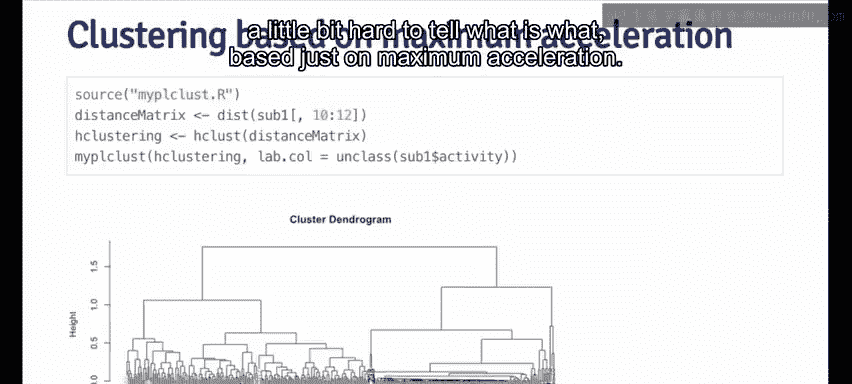

再次可以看到，对于躺下、站立和坐下等活动，没有太多有趣的变化。但对于行走、上楼梯和下楼梯，最大加速度显示出很大的变异性。因此，这可能是预测这些类型活动的一个指标，或者至少能区分移动和非移动状态——回想起来这可能很明显。

---

## 基于最大加速度的聚类 🔄

如果基于最大加速度对数据进行聚类，你可以看到左侧有两个非常清晰的簇。左侧是各种行走活动，右侧是各种非移动活动（躺下、站立、坐下）。但除此之外，情况有些混杂。你可以看到左侧有很多青绿色，这显然是一种活动，但蓝色和品红色则混合在一起。


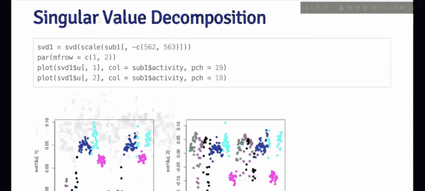

因此，基于最大加速度的聚类似乎能区分移动和非移动。但一旦你进入这些簇内部，例如在移动簇或非移动簇内，仅凭最大加速度就很难分辨具体是什么活动。

---

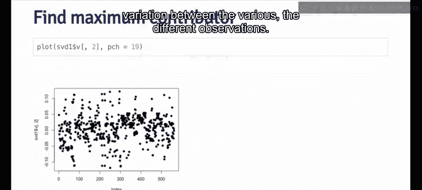

## 尝试奇异值分解（SVD） 📉

我们可以尝试对数据进行奇异值分解，以探索其中的结构。在进行SVD之前，我将对整个矩阵（共560多列）进行操作，但会移除最后两列，因为最后两列只是活动标识符和受试者标识符，并非有趣的数据。因此，我去掉了第562和563列，然后对数据运行SVD。

```r
# 示例代码：进行奇异值分解
data_for_svd <- subject1_data[, -c(562, 563)]
svd_result <- svd(data_for_svd)
```

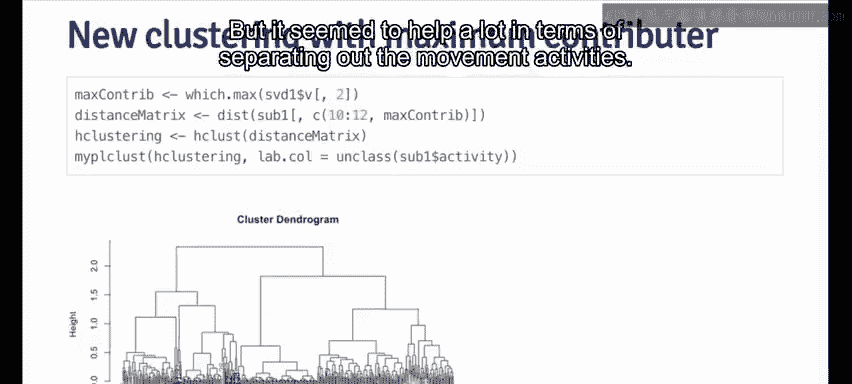

然后，我查看第一和第二左奇异向量，并按活动进行颜色编码。再次可以看到类似的模式：第一奇异向量似乎真正区分了移动和非移动。你可以看到底部有绿色、红色、黑色，顶部有蓝色、青绿色、品红色。第二奇异向量则有些模糊，它似乎在将品红色与其他簇分开。我认为这是下楼梯或上楼梯中的一种，但尚不清楚是什么差异在此被凸显出来。

---


## 寻找最大贡献特征 🎯

我们可以尝试找出在第二右奇异向量中，哪些特征对观测值之间的差异贡献最大。我们可以使用`which.max`函数来确定500多个特征中，哪个特征对应最大的变异贡献。

```r
# 示例代码：找出最大贡献特征
max_contrib_index <- which.max(abs(svd_result$v[, 2]))
max_contrib_feature <- colnames(data_for_svd)[max_contrib_index]
```

我将这个特征保存到一个名为`max_contrib`的对象中。然后，我基于最大加速度加上这个额外特征进行聚类。我计算距离矩阵并调用`hclust`函数。现在，各种活动似乎被区分得更开一些，至少三种移动活动被清晰地区分开来：品红色、深蓝色和青绿色都分开了。各种非移动活动似乎仍然混合在一起。因此，无论这个最大贡献特征是什么，它并没有帮助区分非移动活动，但在区分移动活动方面似乎有很大帮助。

这个最大贡献特征是Z方向频域中的平均身体加速度。这是他们对Z方向的身体加速度应用快速傅里叶变换后，给出的频率分量。这很有趣。

---

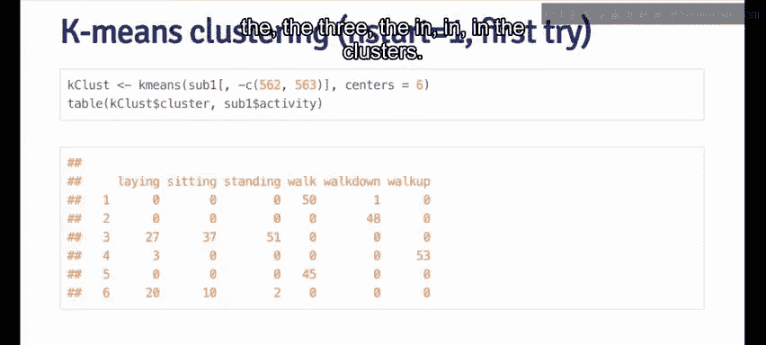

## 尝试K均值聚类 🎲

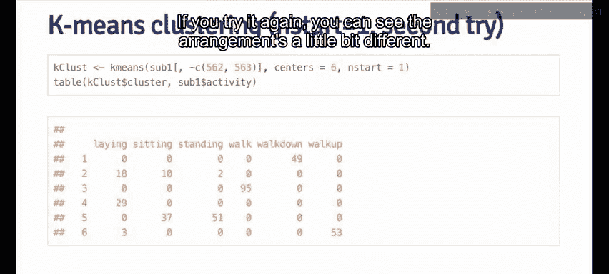

我们可以在这里尝试另一种聚类技术：K均值聚类。关于K均值聚类，需要注意的一点是，根据你尝试的起始值次数和运行频率，你可能会得到不同的答案。每当启动K均值时，它必须选择聚类中心的起始点。大多数算法通常只是随机选择一个起始点。因此，如果你选择一个随机起始点，可能会得到一个次优解。如果你选择不同的起始点，可能会得到更好的解。因此，通常最好将`nstart`参数设置为大于1，以便尝试多个不同的起始点，从而获得更优的解。

以下是我们用K均值进行的一次聚类。我指定了六个中心，因为我知道有六个簇。你可以看到一些簇混杂在一起：例如，簇3是躺下、坐下和站立的组合，而簇1显然是行走，簇2是下楼梯，簇4是上楼梯，簇5又是行走，簇6是躺下、坐下和站立的混合物。因此，这里的K均值在区分躺下、坐下和站立这三个非移动活动时也遇到了一些困难。

如果我们再试一次，你可以看到排列有些不同，但例如簇2仍然是躺下、坐下和站立的混合物，簇5类似地是坐下和站立的混合物。但其他活动似乎很容易就被聚类出来。

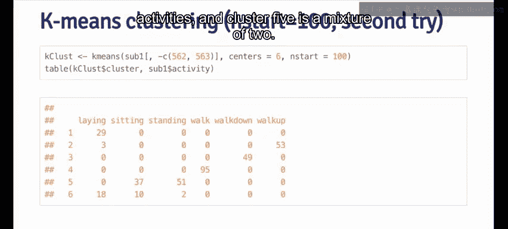

现在，如果我们尝试100个不同的起始值，并从这一百次中选取最优解，你会发现情况似乎区分得更好一些，但比上次好不了太多。你可以看到簇1仍然是躺下、坐下和站立的混合物，簇2显然是躺下，簇3显然是行走，簇4是下楼梯等。你可以看到这些是如何聚集在一起的。我们用100个起始值进行第二次尝试，这可能是我们最好的努力了，但簇6仍然是三种活动的混合物，簇5是两种活动的混合物。

---

## 查看聚类中心 🎪

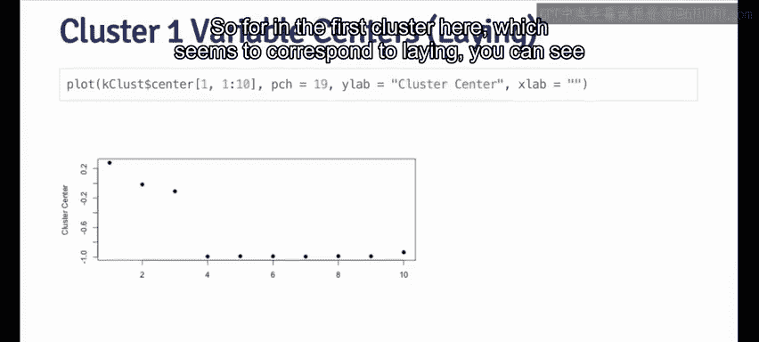

你可以看到每个簇在500维空间中都有一个均值或中心。我们可以查看这500个特征中，哪些特征似乎驱动了特定簇中心的位置。这将帮助我们了解哪些特征对于将该簇中的人或观测值分类很重要。

例如，对于这里的第一个簇（似乎对应躺下），你可以看到该中心对于前三个特征（即平均身体加速度）具有相对较高的正值，而对于其他一些特征（第4到第10个特征，这里我只绘制了大约500个特征中的前10个）则具有较低的值。

第二个簇在其他一些特征上具有更有趣的值。除了平均加速度，还有最大加速度，这些似乎具有一些有趣的值。因此，通过查看聚类中心，你可以发现哪些特征具有有趣的值，从而驱动该中心的位置，并为你提示哪些特征对于预测该活动最有用。

---

## 总结与后续方向 🚀

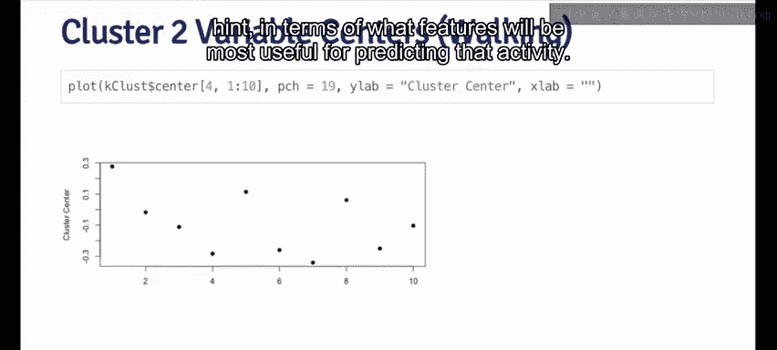

本节课中，我们一起学习了如何对一个具有大量特征和观测值的数据集进行初步探索。我们使用了层次聚类、K均值聚类和奇异值分解来查看这个数据集的各种特征。

根据我们在这里的发现，我们可能对后续如何区分各种非移动活动（即躺下、坐下和站立）感兴趣。至少在初步观察中，区分这三种活动有些困难。对于移动活动（行走、上楼梯和下楼梯），我们似乎能够仅用几个变量（主要是最大加速度变量）将它们区分到不同的簇中。但非移动活动似乎更难区分。

探索性数据分析的好处在于，它提供了这个“粗略的版本”，告诉你应该将精力集中在何处。因此，我们可能不需要在移动活动上花费太多精力，但可能需要更深入地挖掘非移动活动。

我希望这个案例对你有用，能帮助你开始使用聚类技术，并指导你如何查看数据以进一步推进分析，为更正式的分析做好准备。