# 课程4：《探索性数据分析》｜P14：R中的图形设备（第一部分）📊


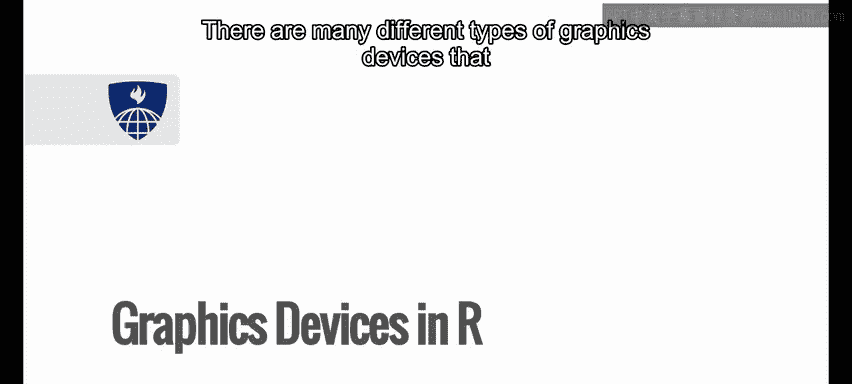

在本节课中，我们将要学习R语言中图形设备的基础知识。图形设备是生成和显示图形的关键，理解它们对于创建和保存图表至关重要。

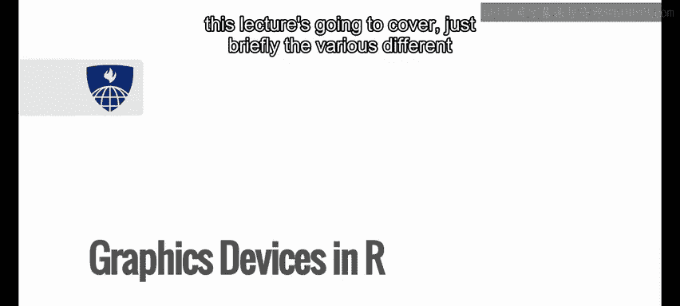

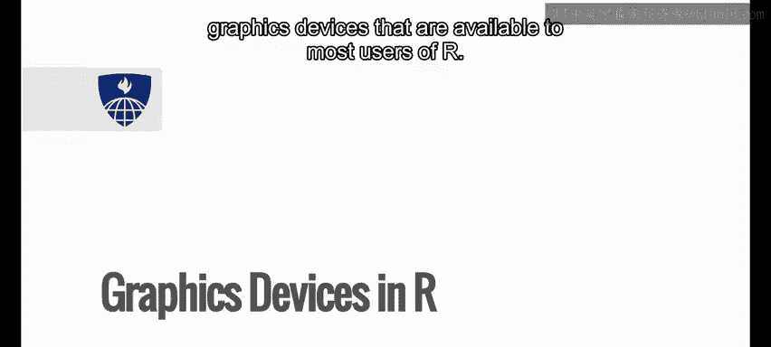

## 概述

R中的图形设备非常重要，因为我们需要它们来制作图表。有许多不同类型的图形设备可供我们使用，本讲将简要介绍大多数R用户可用的各种图形设备。

## 什么是图形设备？🤔

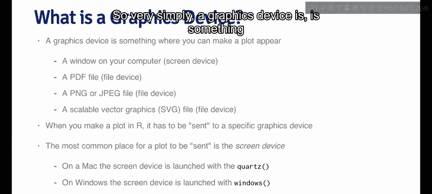

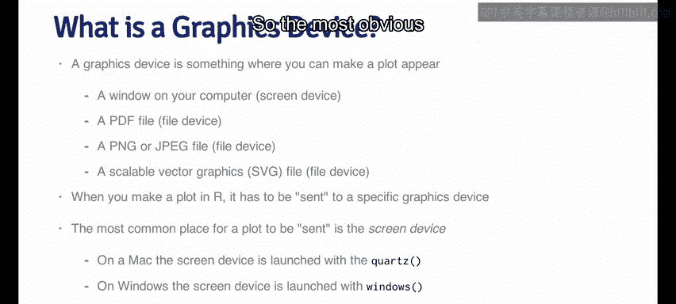

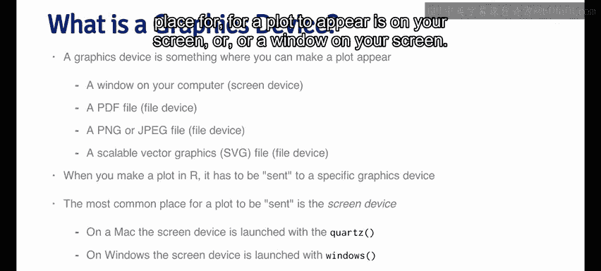

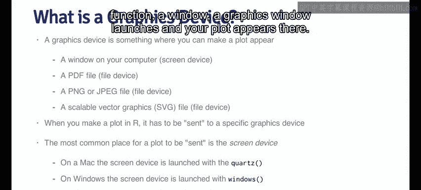

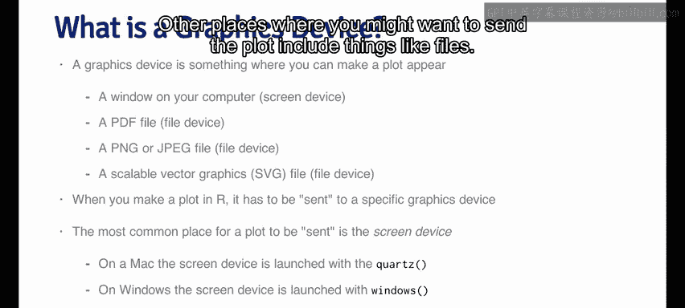

简单来说，图形设备是图表可以显示的地方或媒介。图表最常出现的地方是屏幕或屏幕上的一个窗口。当你打开R并调用绘图函数时，会启动一个图形窗口，你的图表就显示在那里，这被称为**屏幕设备**。

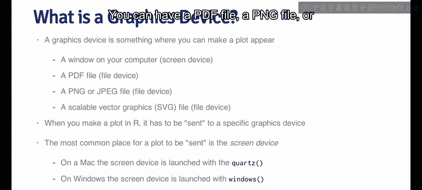

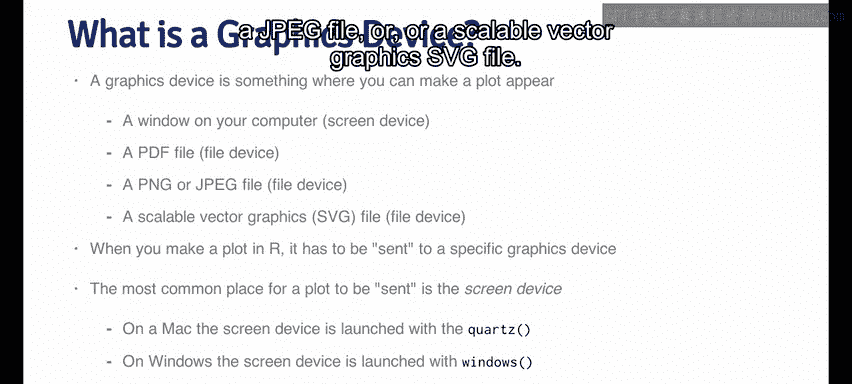


除了屏幕，你可能还想将图表发送到其他地方，例如文件。文件有多种格式，如PDF、PNG、JPEG或可缩放矢量图形（SVG）文件。因此，你可以选择多种不同的**文件设备**来发送图表。

## 图形设备如何工作？⚙️

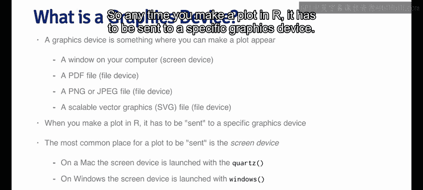

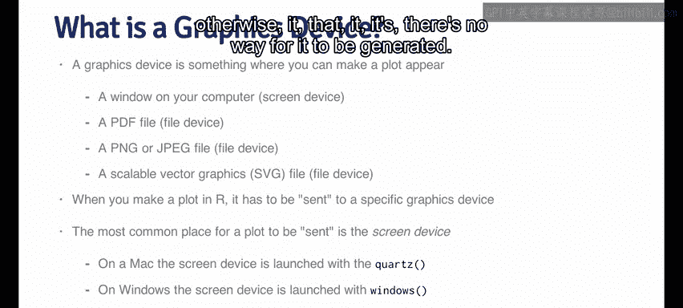


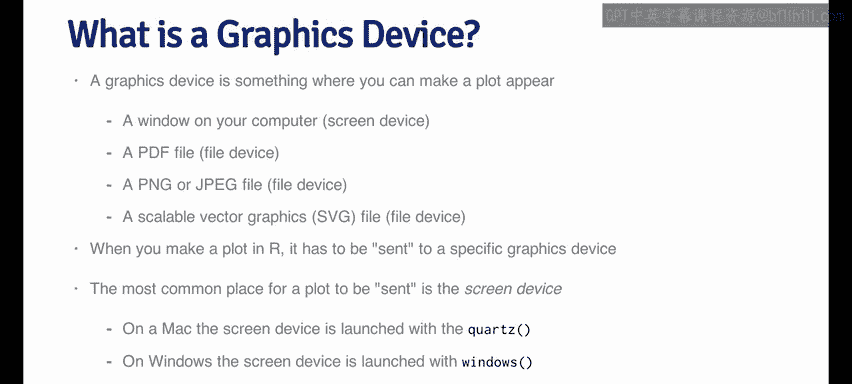

在R中，每当你制作一个图表时，它都必须被发送到一个特定的图形设备，否则无法生成。图表最常被发送到的地方是屏幕设备。

不同操作系统上的屏幕设备名称不同：
*   在Mac上称为 **`quartz`**。
*   在Windows上称为 **`windows`**。
*   在Unix/Linux系统上称为 **`x11`**。

当你制作图表时，首先需要考虑这个图表将显示在哪里。你可以通过 `?Devices` 命令查看所有可用设备的完整列表。此外，CRAN上也有用户创建的图形设备包，安装后即可使用。本节课我们主要关注R自带的设备。

在进行数据可视化和探索性分析时，通常最直接的方式是将图表发送到屏幕设备。你调用如 `plot`、`xyplot` 或 `qplot`、`ggplot` 等函数，图表就会显示在屏幕设备上，你可以快速查看数据并决定下一步操作。

在任何给定的平台（Mac、Windows或Unix）上，都只有一个屏幕设备，因此你无需选择要将图表发送到哪个屏幕设备，只有一个去处，所以不必担心。

然而，通常在完成探索性分析并确定了想要保留或包含的图表后，你可能需要将图表发送给他人。这时，你就需要在另一种类型的设备（例如文件设备）上制作图表。将图表制作成文件后，你可以将其包含在报告、演示文稿中，或通过电子邮件发送给他人。文件设备对于这类用途更为实用。与屏幕设备不同，文件设备有多种选择，我们将在后面讨论其中一些。

需要注意的是，本讲座中讨论的每个图形设备并非在所有平台上都可用。例如，Mac或Unix系统上没有Windows设备，同样，Windows系统上也没有quartz设备。因此，你无法在每个平台上打开每一个图形设备。

## 如何创建图表？🎨

图表创建的方式不止一种，这可能看起来有点复杂。

### 方法一：直接绘图（屏幕设备）

第一种是最简单的方法，可能也是你已经熟悉的方法：直接调用绘图函数（如 `plot`、`xyplot` 或 `qplot`），图表就会出现在屏幕设备上。

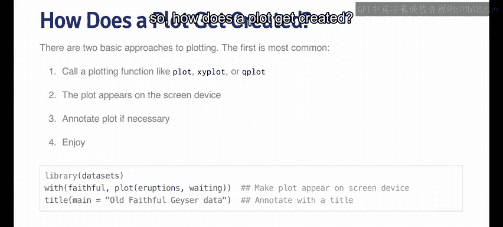

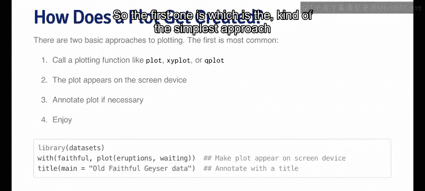

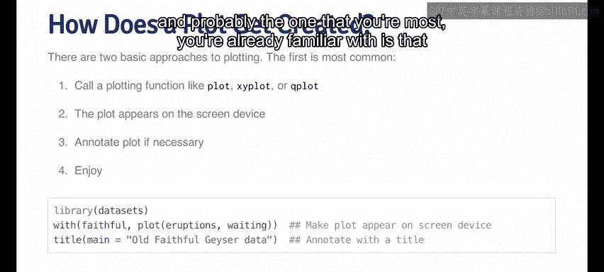

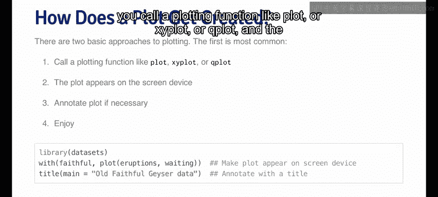

然后，你可以使用 `text`、`title` 等函数为图表添加注释。


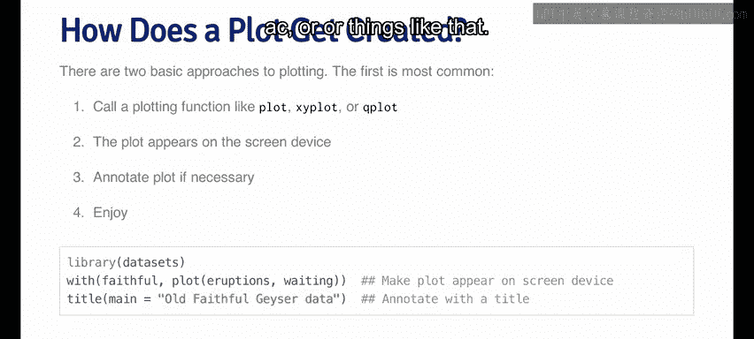

一旦你完成注释并且图表看起来符合你的要求，就完成了。图表显示在屏幕上，你可以查看它，也可以展示给他人。

以下是一个简单的代码示例，它加载一个数据集，使用 `plot` 函数创建图表，然后在图表顶部添加标题。

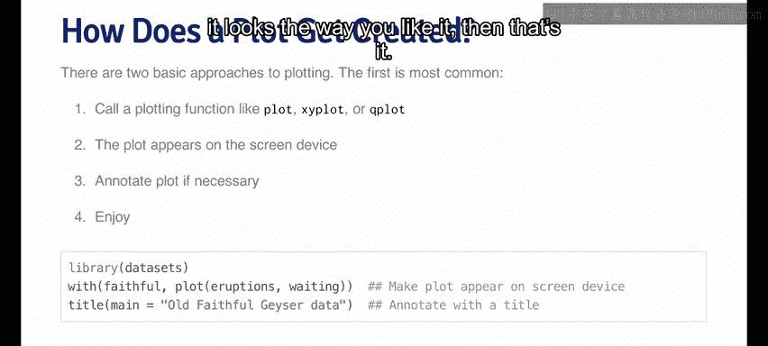

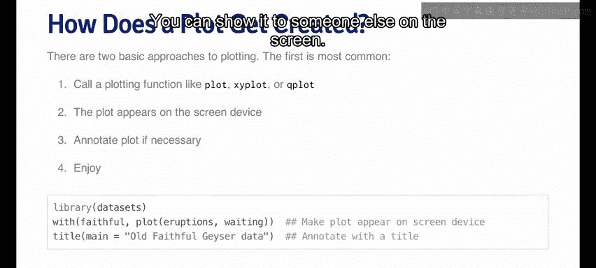

```r
# 加载数据
data(mtcars)
# 创建散点图
plot(mtcars$wt, mtcars$mpg)
# 添加标题
title("汽车重量与油耗关系图")
```

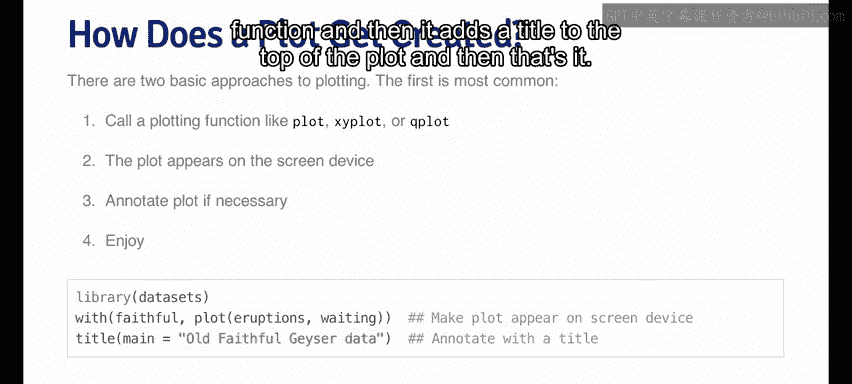

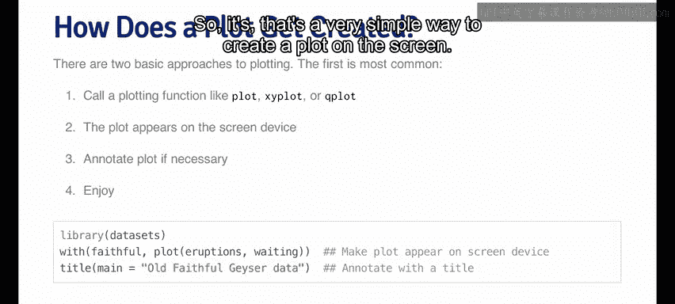

### 方法二：显式启动设备（常用于文件）

第二种方法最常用于文件设备，它涉及显式启动一个图形设备。你可能需要先打开一个文件设备，然后使用绘图函数创建图表。

使用文件设备时有点棘手，因为图表实际上不会出现在屏幕上，所有的绘图信息都进入了文件。因此，在向文件创建图表时，你必须确切知道自己在做什么，因为你无法在屏幕上看到它。

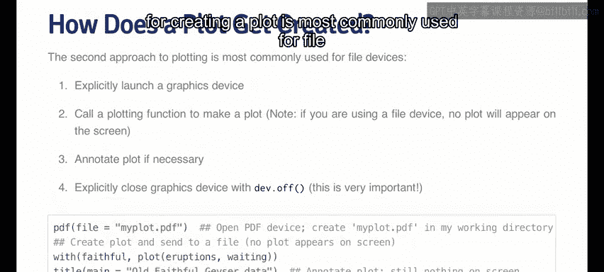

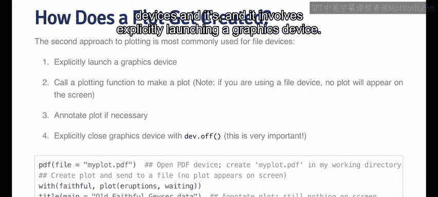

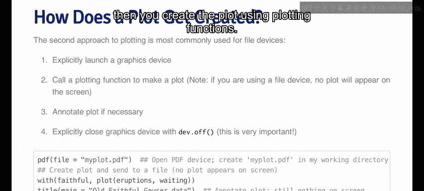

通常，最好的做法是将你的绘图代码保存在一个单独的文件中，这样你就可以直接将代码复制粘贴到R中，而不必担心在输入代码时出错。

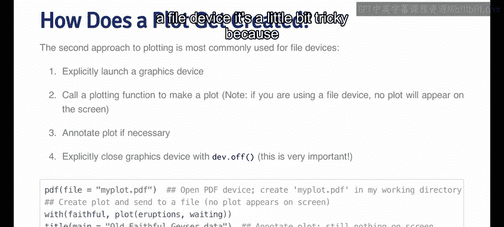

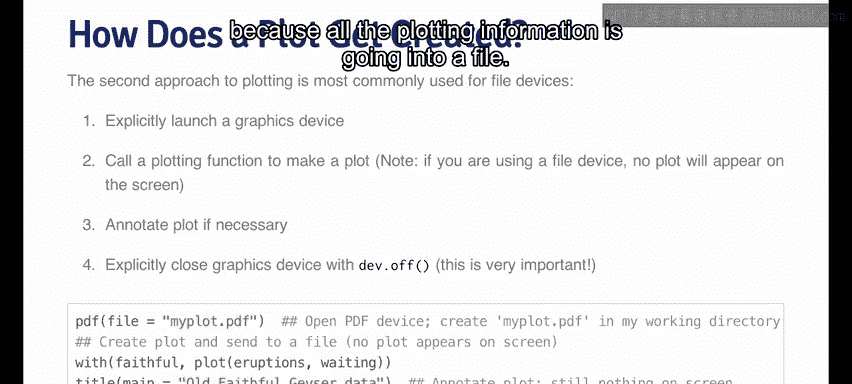

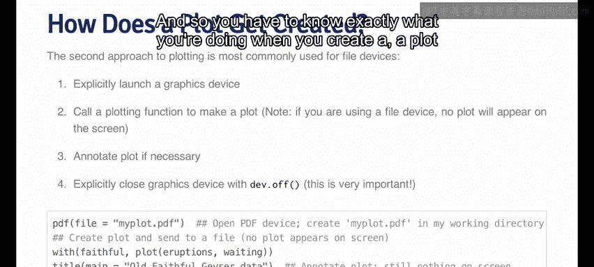

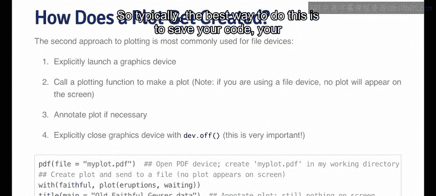


创建图表并完成必要的注释后，你必须使用 `dev.off()` 函数关闭图形设备。关闭设备后，图表就完成了。如果你将其发送到文件，就可以在计算机上打开该文件查看，或将其包含在演示文稿中，或通过电子邮件发送给他人。

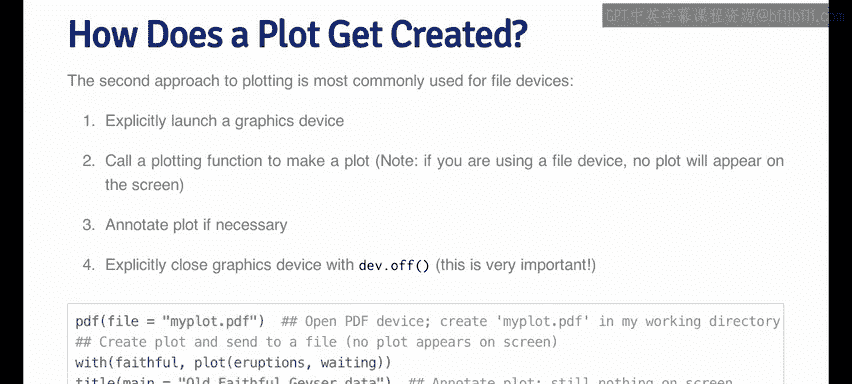

以下是一个代码示例，它使用 `pdf()` 函数打开PDF设备，创建一个图表，添加注释，然后使用 `dev.off()` 关闭设备。

```r
# 打开PDF图形设备，指定文件名
pdf("myplot.pdf")
# 创建图表
plot(mtcars$wt, mtcars$mpg)
# 添加标题
title("汽车重量与油耗关系图")
# 关闭图形设备，完成文件写入
dev.off()
```


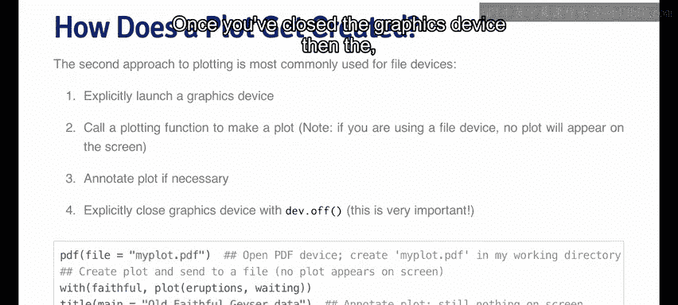

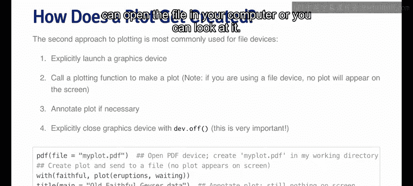

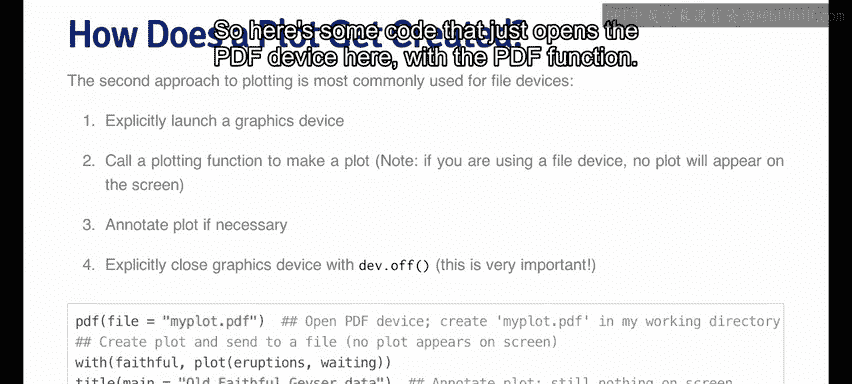

一旦调用了 `dev.off()`，你的工作目录中应该会有一个名为 `myplot.pdf` 的文件，你可以用任何PDF查看器打开它。


## 总结

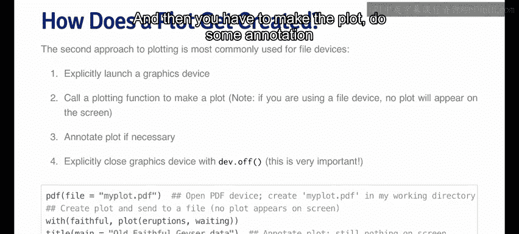


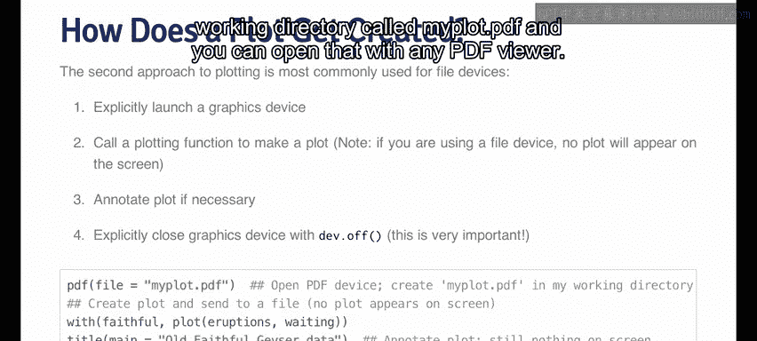

本节课我们一起学习了R语言中图形设备的基础知识。我们了解到图形设备是图表输出的目标，主要分为**屏幕设备**（如quartz, windows, x11）和**文件设备**（如PDF, PNG）。创建图表有两种主要方式：一种是直接在屏幕设备上绘图并即时查看；另一种是显式打开一个文件设备（如PDF），将图表输出到文件，最后必须用 `dev.off()` 关闭设备以完成文件保存。理解这些概念是有效进行数据可视化和分享分析结果的第一步。