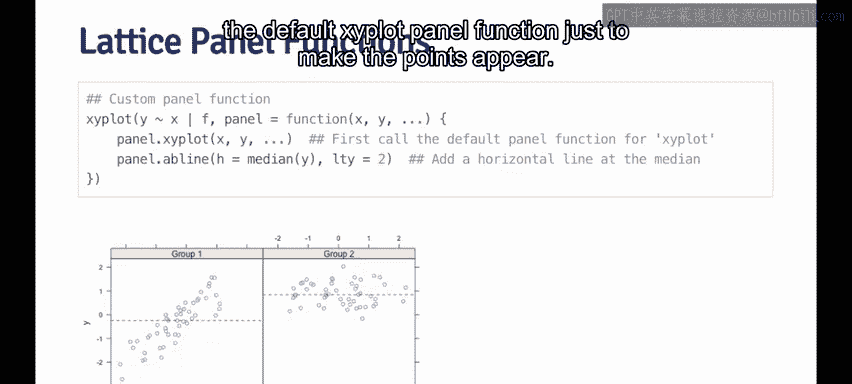

# 约翰霍普金斯大学数据科学课程4：《探索性数据分析》｜P17：网格绘图系统（第二部分）📊


在本节课中，我们将深入学习Lattice绘图系统的核心功能，特别是如何通过自定义面板函数来增强多面板图表的表达能力。我们将了解面板函数的工作原理，并通过实际案例演示如何为图表添加自定义元素，如中位线或回归线。

---


## 面板函数与自定义绘图 🎨


上一节我们介绍了Lattice系统的基础。本节中我们来看看其核心机制之一：面板函数。


Lattice系统拥有所谓的“面板函数”。当您创建多面板图时，会有一个函数被调用来绘制每个面板中的数据，这个函数控制着每个面板内发生的一切。Lattice包自带了许多默认的面板函数，但如果您想自定义每个面板的显示内容，也可以提供自己的函数。

基本上，每个面板函数会接收该特定面板内数据点的X和Y坐标。请记住，每个面板代表数据的一个子集，这个子集由您提供的条件变量定义。


因此，对于每一个面板，面板函数都会获取该面板内所有点的X、Y坐标。

---

## 自定义面板函数示例：添加中位线 📈


以下是自定义面板函数的一个简单示例。我们首先生成一些模拟数据。





```r
# 生成模拟数据
set.seed(123)
x <- rnorm(100)
y <- x + rnorm(100, sd = 0.5)
group <- factor(rep(c("Group 1", "Group 2"), each = 50))
# 修改第二组数据，使其无线性关系
y[51:100] <- rnorm(50, mean = 0, sd = 0.5)


# 使用xyplot创建基础多面板图
library(lattice)
xyplot(y ~ x | group)
```

现在，我们想为每个面板添加一条水平线，标示Y值的中位数。这可以通过自定义面板函数实现。


```r
# 自定义面板函数，添加中位线
my_panel <- function(x, y, ...) {
  # 首先调用默认的xyplot面板函数绘制点
  panel.xyplot(x, y, ...)
  # 然后添加一条水平虚线，表示y的中位数
  panel.abline(h = median(y, na.rm = TRUE), lty = 2, col = "red")
}


# 应用自定义面板函数
xyplot(y ~ x | group, panel = my_panel)
```


在这段代码中：
1.  我们定义了一个名为`my_panel`的函数，其前两个参数是`x`和`y`，`...`表示可能传入的其他参数。
2.  函数内首先调用`panel.xyplot(x, y, ...)`来绘制原始数据点。
3.  接着调用`panel.abline()`添加一条水平线，其位置由`median(y)`计算得出。


运行后，您将在每个面板中看到一条红色的虚线，精确地标出了该面板内Y坐标的中位数位置。

---

## 进阶自定义：添加回归线 🔍


一个更实用的自定义是添加回归线，以可视化每个面板内X和Y之间的线性关系。

以下是实现方法：


```r
# 自定义面板函数，添加回归线
my_lm_panel <- function(x, y, ...) {
  # 绘制数据点
  panel.xyplot(x, y, ...)
  # 添加线性回归线
  panel.lmline(x, y, col = "blue")
}

# 应用自定义面板函数
xyplot(y ~ x | group, panel = my_lm_panel)
```

在这段代码中：
1.  我们同样先调用`panel.xyplot`绘制点。
2.  然后调用Lattice系统内置的`panel.lmline()`函数来添加回归线。

**一个重要注意事项是：您不能在Lattice系统中使用基础绘图系统的任何注释函数（如`abline()`、`lines()`等）。** 作为通用规则，不同绘图系统的函数不能混用。您必须使用与当前绘图系统（此处为Lattice）相关的所有函数。

---


## 实战案例：分析哮喘研究数据 🏥


为了展示Lattice系统处理大规模数据的能力，我们来看一个真实的研究案例。

该数据来自巴尔的摩市进行的“小鼠过敏原与哮喘队列研究”。这项观察性研究旨在了解哮喘儿童室内环境的情况，许多儿童对小鼠过敏原过敏。研究包括一次基线家访，之后每三个月进行一次随访，持续一年，共五次访问。

一个可能的研究问题是：室内空气中小鼠过敏原的水平如何随时间变化，以及在受试者之间存在何种差异？我们希望绘制每个受试者在每次访问时的空气中小鼠过敏原水平图。

数据集中有150名受试者，每人有最多5次访问数据，因此我们共有约750个数据点需要观察。

使用Lattice的`xyplot`可以非常紧凑地展示所有这些数据：

```r
# 假设数据框为maacs，包含变量：subjectid, visit, logpm25
# xyplot(公式， 数据)
xyplot(logpm25 ~ visit | subjectid, data = maacs,
       xlab = "Visit Number",
       ylab = expression(log[2](Airborne Mouse Allergen)),
       layout = c(5, 5)) # 调整布局，每行5个面板
```

通过这个图，我们可以观察到：
*   **个体内变异**：在每个面板（代表一个受试者）内，可以看到过敏原水平随访问次数上升、下降或波动。
*   **个体间变异**：不同面板之间比较，可以看到有些人水平普遍较高，有些人则较低。
*   **缺失数据**：并非所有人都有5个值，有些人只有2个或1个值，这可能提示需要跟进。
*   **变异程度**：有些受试者的水平在不同访问间变化很大，有些则几乎不变。


通过一两个函数调用，就能生成这样一个包含大量信息的图表，而无需编写冗长的代码。这正是Lattice系统的强大之处——只要数据以特定方式组织，它就能让您快速浏览大量数据。此图紧凑地总结了整个研究中访问编号与对数化小鼠过敏原水平按受试者分组的关系。


---


## 课程总结 📝


本节课我们一起学习了Lattice绘图系统的高级功能。

*   **核心特点**：Lattice图通过调用`xyplot`等核心函数一次性构建。其优点在于边距、间距、标签等元素会自动处理，无需像基础绘图系统那样频繁手动设置`par`选项。
*   **适用场景**：当您需要基于某些变量（条件变量）对数据进行分组，并查看同一关系在不同组别下的表现时，Lattice系统是理想选择。它适合观察“相同类型的图表，但在多种不同条件下”的数据模式。
*   **自定义能力**：通过自定义面板函数，您可以精细控制每个绘图面板中的内容，这为定制图表外观提供了强大灵活性。


Lattice系统对于快速浏览大量结构化数据非常有用。鼓励您尝试使用它，并探索其他函数如`bwplot`（箱线图）和`splom`（散点图矩阵），看看它们如何为您的数据分析工作服务。