# 课程4：《探索性数据分析》｜P21：ggplot2 第4部分 📊

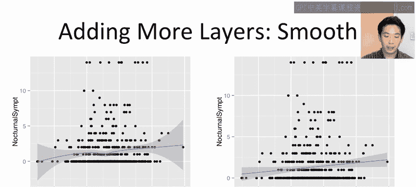

在本节课中，我们将学习如何为 `ggplot2` 图形添加平滑曲线、分面以及如何自定义图形的各种元素，如颜色、标签和主题。这些技巧能帮助你更清晰地展示数据中的模式和关系。

## 添加平滑曲线 📈

上一节我们介绍了如何创建散点图。本节中，我们来看看如何为散点图添加平滑曲线，以帮助我们观察数据的整体趋势。

你可以使用 `geom_smooth()` 图层为图形添加平滑器。默认情况下，它会添加一条蓝色的平滑曲线和灰色的置信带。以下代码展示了如何添加默认的 `loess` 平滑器：

```r
g + geom_point() + geom_smooth()
```

然而，`loess` 平滑器在数据边界处可能因数据稀疏而产生较大的置信区间。如果你希望使用更简单、更稳定的趋势线，可以指定使用线性回归模型。

以下是使用线性回归模型（`method = "lm"`）的代码示例：

```r
g + geom_point() + geom_smooth(method = "lm")
```

使用线性模型后，置信区间的宽度在边界处会显著减小，能更清晰地展示 PM2.5 与夜间症状之间是否存在增长趋势。

## 使用分面进行比较 🔍

分面功能允许我们根据某个分类变量（如BMI类别）将数据拆分到多个子图中进行比较。这有助于观察不同组别间的关系是否一致。

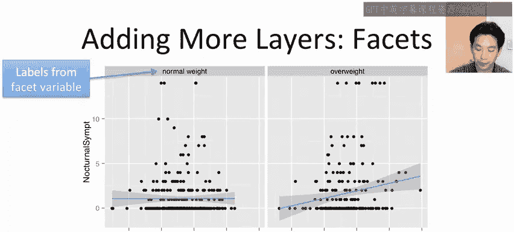

要添加分面，可以使用 `facet_grid()` 函数。其基本语法使用波浪号 `~` 来分隔变量，格式为 `facet_grid(行变量 ~ 列变量)`。

以下是根据BMI类别（正常体重和超重）创建分面图的代码：

```r
g + geom_point() + geom_smooth(method = "lm") + facet_grid(. ~ bmicat)
```

在这段代码中，`bmicat` 是分类变量。因为我们在波浪号右侧指定了它，所以图形会水平排列。如果变量有两个水平（如“正常”和“超重”），就会生成两个并排的子图。

分面图清晰地显示，对于正常体重的儿童，PM2.5与夜间症状似乎没有明显关系；而对于超重儿童，则呈现较强的正相关关系。

**重要提示**：每个子图的标签自动来自你所依据的分类变量的因子水平。因此，在绘图前确保你的数据已正确转换为因子并具有清晰的标签，可以大大简化后续工作。

## 自定义图形元素 🎨

创建基本图形后，我们通常需要修改坐标轴标签、标题、颜色和主题等元素，使图形更美观、信息更明确。

### 修改标签和标题

以下是修改图形标签和标题的方法：

*   使用 `xlab()`、`ylab()` 和 `ggtitle()` 函数分别设置X轴标签、Y轴标签和主标题。
*   或者，使用更通用的 `labs()` 函数一次性设置多个标签。

例如，以下代码使用 `labs()` 函数进行设置：

```r
g + geom_point(aes(color = bmicat)) +
    labs(title = "MAACS Cohort",
         x = expression(log(PM[2.5])),
         y = "Nocturnal Symptoms")
```

### 修改点的美学属性

在 `geom_point()` 函数中，你可以修改点的颜色、大小和透明度等属性。这里有一个关键区别：

*   **设置为常量**：如果你希望所有点具有相同的属性（如统一的蓝色），可以直接在 `geom_point()` 中指定，例如 `color = "steelblue"`。
*   **映射到变量**：如果你希望点的属性根据数据中的变量而变化（如按BMI类别着色），则必须将该属性包裹在 `aes()` 函数内，例如 `aes(color = bmicat)`。

以下代码对比了这两种方式：
```r
# 方式一：颜色设为常量（所有点为钢蓝色）
g + geom_point(color = "steelblue", size = 4, alpha = 0.5)

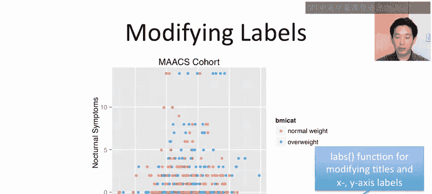


# 方式二：颜色映射到变量（按bmicat着色）
g + geom_point(aes(color = bmicat), size = 4, alpha = 0.5)
```

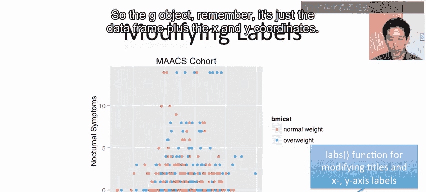

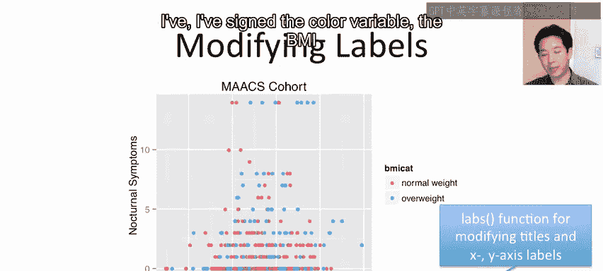


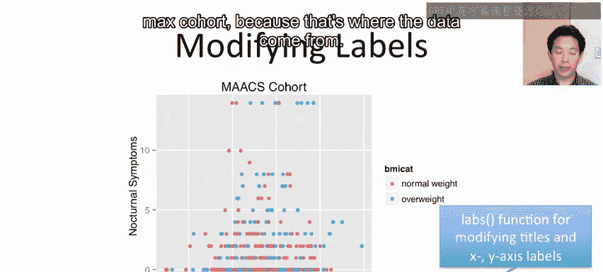

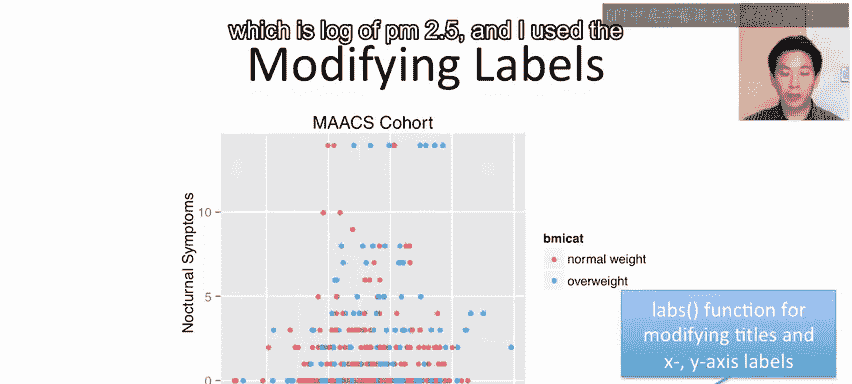


### 自定义平滑曲线

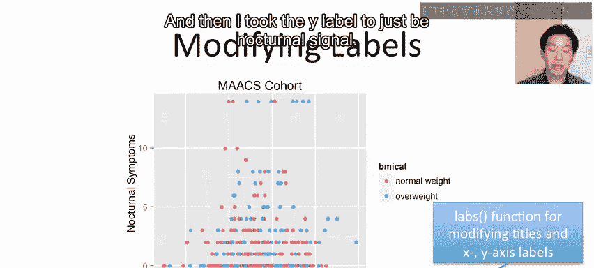

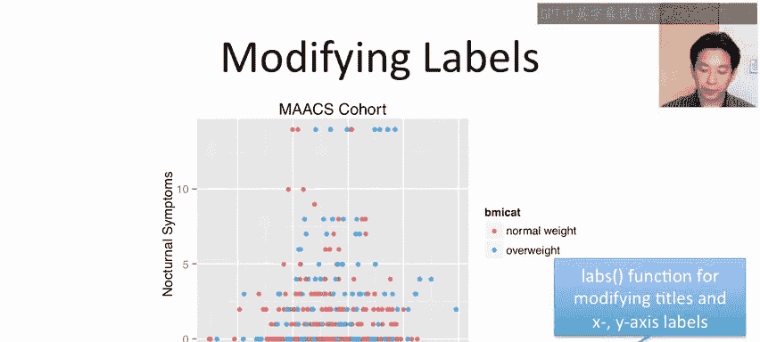

你也可以自定义平滑曲线的外观。在 `geom_smooth()` 函数中，可以调整线条粗细、线型和是否显示置信区间。

以下代码将回归线改为更粗的虚线，并隐藏了置信区间：
```r
g + geom_point() + geom_smooth(method = "lm", size = 2, linetype = 3, se = FALSE)
```
其中，`se = FALSE` 表示不绘制置信区间。


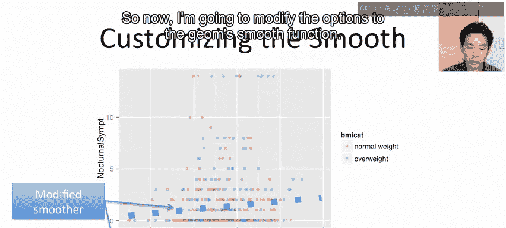

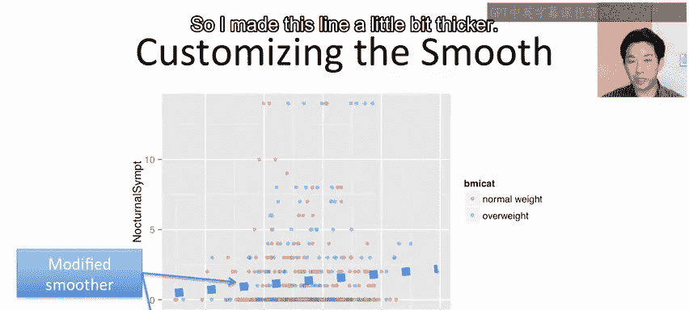


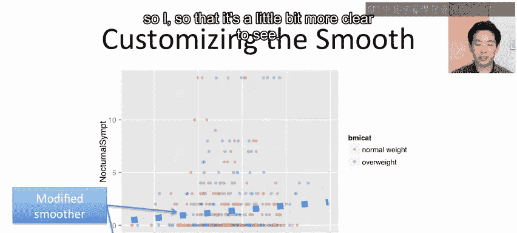

### 更改整体主题

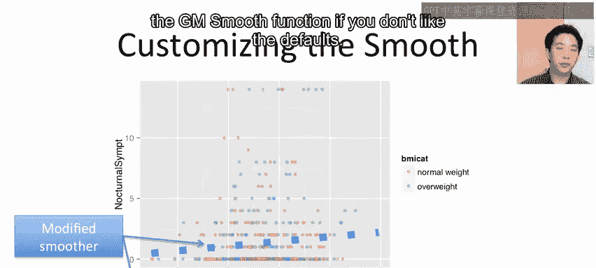

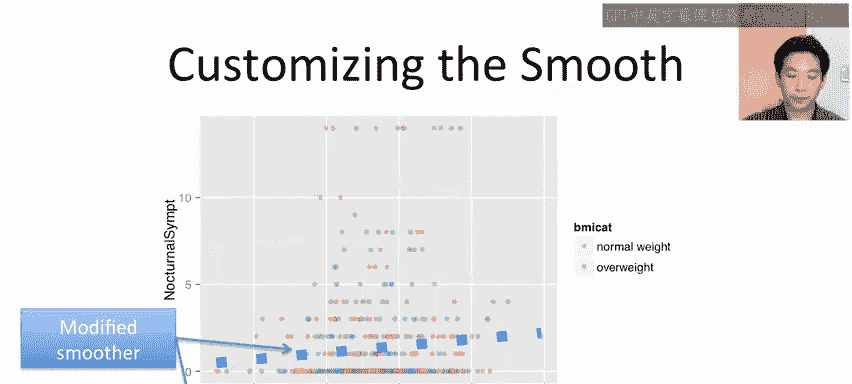

`ggplot2` 提供了预设主题来快速改变图形的整体风格。默认主题是 `theme_gray()`（灰色背景）。如果你偏好更简洁的风格，可以使用 `theme_bw()`（黑白主题）。

此外，你还可以通过 `theme()` 函数精细调整字体等元素。以下代码将图形改为黑白主题，并将字体设置为 Times New Roman：
```r
g + geom_point() + geom_smooth(method = "lm") + theme_bw(base_family = "Times")
```

## 总结 📝

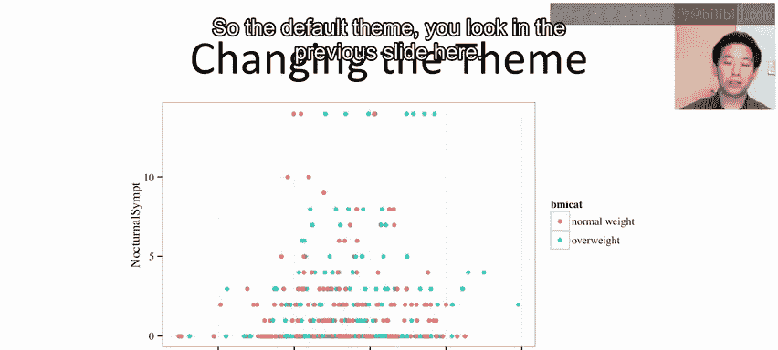

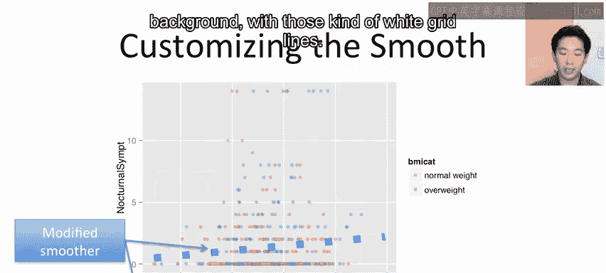


本节课中我们一起学习了 `ggplot2` 的几个高级功能：
1.  使用 `geom_smooth()` 添加平滑曲线来揭示数据趋势，并可以选择 `loess` 或线性回归模型。
2.  利用 `facet_grid()` 创建分面图，以便基于分类变量比较不同子组的数据关系。
3.  掌握了多种自定义图形的方法，包括：
    *   使用 `labs()`、`xlab()`、`ylab()` 和 `ggtitle()` 修改标签和标题。
    *   在 `geom_point()` 中区分将美学属性设置为常量与映射到数据变量。
    *   在 `geom_smooth()` 中自定义线条外观。
    *   使用 `theme_bw()` 等预设主题或 `theme()` 函数来改变图形的整体样式。

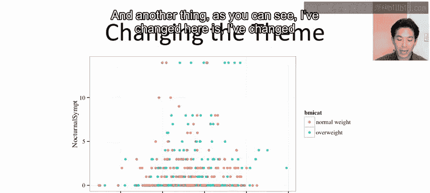


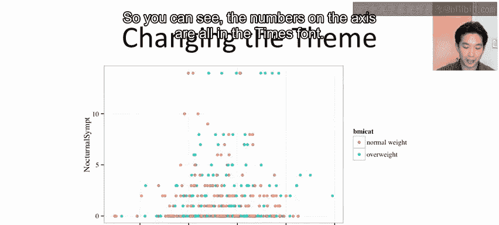

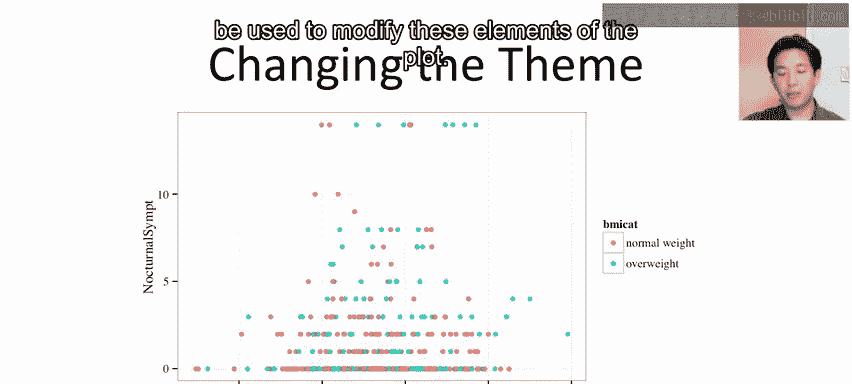

记住，在绘图前整理好数据并设置恰当的因子标签，往往比事后修改图形更高效。现在，你可以尝试将这些图层和自定义选项组合起来，创建出信息丰富且美观的图形了。