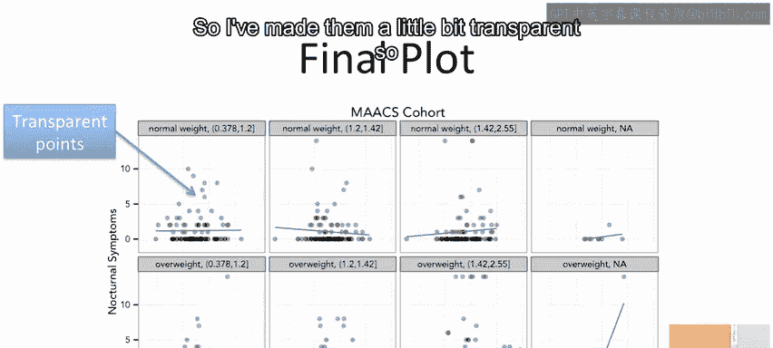

# 课程4：《探索性数据分析》｜第22课：ggplot2 第五部分 📊

在本节课中，我们将学习ggplot2绘图系统中的一个重要特性：如何处理超出绘图区域的数据点。我们还将通过一个更复杂的多变量关系图示例，了解如何通过添加不同图层和调整参数来构建丰富的可视化图表。

---

## 处理超出绘图区域的数据点

上一节我们介绍了ggplot2的基本语法和图层叠加。本节中我们来看看ggplot2与基础绘图系统在处理超出绘图区域的数据时的一个关键区别。

在基础绘图系统中，如果数据点超出了通过`ylim`或`xlim`设置的坐标轴范围，这些点仍然会被绘制，只是其连接线会延伸到绘图区域之外。

```r
# 基础绘图示例
plot(x, y, type = "l", ylim = c(-3, 3))
```

然而，在ggplot2中，如果使用`scale_y_continuous(limits = c(-3, 3))`来设置Y轴范围，系统会默认**裁剪**数据，即只绘制Y值在-3到3之间的点。这会导致超出范围的数据点完全消失，连接线也会因此断开。

为了在ggplot2中重现基础绘图的行为，即绘制所有数据点但仅显示指定范围内的区域，我们需要使用`coord_cartesian()`函数来设置坐标轴范围。

```r
# ggplot2 正确示例
ggplot(data, aes(x = x, y = y)) +
  geom_line() +
  coord_cartesian(ylim = c(-3, 3))
```

`coord_cartesian(ylim = c(-3, 3))`会缩放视图，但保留所有数据用于计算和绘制，因此超出范围的线会延伸到绘图区域外，这与基础绘图的行为一致。

---

## 构建复杂多变量关系图

现在，让我们通过一个更复杂的科学问题，来实践如何一步步构建一个包含多个条件的面板图。

假设我们想探究PM2.5与夜间症状的关系，如何同时受到BMI（身体质量指数）和二氧化氮（NO2）水平的影响。这里的一个挑战是，NO2是一个连续变量，我们需要将其分类以便于绘图。

以下是处理连续变量并构建最终图表的关键步骤：

### 1. 使用`cut`函数分类连续变量

我们无法在绘图中直接“基于”一个连续变量进行条件筛选，因为那会产生无限个图。因此，我们需要将连续的NO2值分成几个有意义的区间（例如三分位数）。

```r
# 计算NO2的三分位点
cutpoints <- quantile(data$logNO2, c(0, 0.33, 0.66, 1), na.rm = TRUE)

# 使用cut函数将数据分类
data$NO2_tertile <- cut(data$logNO2, cutpoints)
```

`cut`函数会返回一个因子变量，将每个原始数据点替换为其所属的区间类别（如“低”、“中”、“高”三分位）。

### 2. 绘制最终图表

我们的目标是创建一个面板图：
*   **行**：基于BMI分类（正常体重 vs. 超重）。
*   **列**：基于NO2的三分位分类（低、中、高），并额外包含NO2数据缺失的组。
*   **每个子图内**：展示PM2.5与夜间症状的散点图，并添加一条线性回归平滑线。

以下是构建该图表的代码分解：

```r
# 初始化ggplot对象并设置基本美学映射
p <- ggplot(data, aes(x = pm25, y = nocturnalsympt))



# 添加散点图层，并设置透明度以观察点密度
p <- p + geom_point(alpha = 0.3)

# 添加分面图层，按BMI和NO2三分位创建面板
p <- p + facet_grid(bmi_cat ~ NO2_tertile)

# 添加平滑曲线图层，使用线性模型，并关闭置信区间
p <- p + geom_smooth(method = "lm", se = FALSE)

# 更改主题为黑白，并修改字体
p <- p + theme_bw(base_family = "Avenir", base_size = 10)

# 修改坐标轴标签和标题
p <- p + labs(x = "PM2.5 Level",
              y = "Nocturnal Symptom Score",
              title = "PM2.5 Effect by BMI and NO2 Level")
```

通过以上步骤，我们逐步添加了**点**、**分面**、**平滑线**，并调整了**主题**和**标签**，最终构建出一个信息丰富且美观的图表。ggplot2的模块化特性允许我们轻松保存中间对象（如`p`），并随时向其添加新的图层或修改现有设置。

---

## 总结

本节课中我们一起学习了ggplot2的两个高级技巧。

首先，我们了解了`coord_cartesian()`与`scale_*_continuous(limits=)`在处理坐标轴范围时的区别，这对于控制绘图数据的显示至关重要。

其次，我们通过一个多变量关系图的实例，完整演练了使用ggplot2进行复杂数据可视化的流程：从使用`cut()`函数处理连续变量，到利用`+`运算符依次叠加`geom_point()`、`facet_grid()`、`geom_smooth()`等图层，再到最后使用`theme()`和`labs()`函数美化图表。


ggplot2的强大之处在于其一致的语法和极高的灵活性。掌握其核心的“图形语法”，你就能通过组合不同的组件，为你的数据量身定制出清晰、有效的可视化作品。最好的学习方式就是多动手实践，并参考相关的文档和书籍。