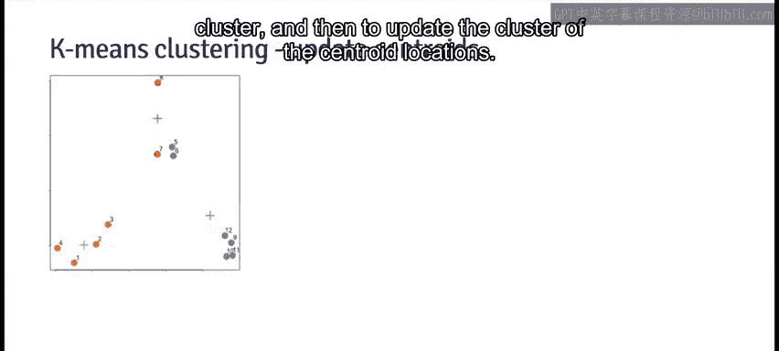

# 课程4：《探索性数据分析》｜P26：K均值聚类（第一部分）🔍

在本节课中，我们将要学习K均值聚类的基本原理和算法步骤。这是一种用于将数据点分组到指定数量簇中的经典方法，有助于我们理解数据中的模式和相似性。

## 概述

K均值聚类是一种相对古老但至今仍非常有效的技术，用于总结高维数据并发现数据中的模式。它能帮助我们识别哪些观测值彼此相似，哪些彼此不同。本节将介绍K均值的工作原理及其应用。

## 定义“相似性”与距离度量

上一节我们介绍了K均值聚类的目标，本节中我们来看看如何定义“相似性”。K均值聚类的基本原理是，首先需要定义事物之间“相似”和“不同”的含义。换句话说，我们需要定义“接近”意味着什么，如何将事物分组，以及如何可视化和解释这种分组。

因此，最重要的一步是定义“接近”的含义。我们需要一个距离度量来定义两个事物是否接近。因为在不同的背景下，“距离”的含义可能完全不同。如果这一步做得不好，最终可能会得到无意义的结果，即“垃圾进，垃圾出”。

以下是几种传统的距离度量：

*   **欧几里得距离**：这是一种连续距离度量，类似于两点之间的直线距离。
    *   **公式**：`d(p, q) = sqrt((q1 - p1)^2 + (q2 - p2)^2 + ... + (qn - pn)^2)`
*   **相关性相似度**：用于衡量两个变量之间的相关性或相似性。高度相关的点被视为非常相似。
*   **曼哈顿距离**：我们将在后面更详细地讨论这种距离。

你需要为你的问题选择一个有意义的距离或相似性度量。

## K均值聚类算法原理

在定义了距离之后，我们来看看K均值是如何工作的。K均值聚类是一种将一组观测值划分为固定数量簇的方法。其核心思想是，你必须事先指定数据中存在多少个簇。

例如，如果你的数据中有大约100个观测值，你可能认为它们可以整齐地划分为四个不同的组。因此，你首先需要对簇的数量有一个大致的判断。然后，每个组都会有一个**质心**，就像是一个重心，组内的点都围绕它聚集。

一旦确定了这些质心，我们就可以将每个观测值分配到最近的质心，从而完成分组。基本的算法步骤如下：

1.  指定簇的数量 `K`。
2.  随机初始化 `K` 个质心的位置。
3.  将每个数据点分配到距离它最近的质心所属的簇。
4.  根据当前簇内所有点的位置，重新计算每个簇的质心（通常是计算均值）。
5.  重复步骤3和步骤4，直到质心的位置不再发生显著变化，或者达到预定的迭代次数。

因此，运行K均值算法需要三样东西：一个距离度量、一个需要事先指定的固定簇数量 `K`，以及对质心位置的初始猜测（通常随机选择一些点作为起点）。算法最终会输出每个簇质心的最终估计位置，以及每个观测值被分配到了哪个质心（即哪个簇）。

## 算法步骤示例

为了更直观地理解，让我们通过一个快速示例来看看K均值聚类算法的运行过程。这里我生成了一些二维的随机数据以便可视化。X坐标和Y坐标均来自具有不同均值的正态分布。我特意为这12个观测值创建了三个不同的簇，每个簇包含4个观测点。当我绘制数据时，可以很明显地看出存在三个簇，并且我为每个点添加了标签。

以下是算法的迭代过程：

首先，我们随机选择三个点作为初始质心（图中用红色、紫色和橙色的“+”表示）。

**第一步：分配点**
我们将每个数据点分配给距离它最近的质心。例如，顶部的点8距离左上角的红色“+”最近，因此它被分配到红色簇。左下角的点4也被分配到红色簇。点1、2、3距离橙色“+”最近，因此被分配到橙色簇。其余的点则最接近紫色的“+”，被分配到紫色簇。这样就完成了点到三个不同簇的初始分组。

**第二步：重新计算质心**
现在每个点都被分配到了一个簇，我们可以重新计算每个簇的质心（通常是取簇内所有点的均值）。如图所示，紫色的“+”稍微移动到了该簇的中心，红色的“+”也移动到了红色簇的中心，橙色的“+”则移动到了三个橙色点的中心。这样，簇质心就被重新计算了。

**第三步：重复分配与更新**
然后我们重复这个过程：再次将每个数据点分配到当前距离它最近的质心。例如，点4原本在红色簇，但现在它更接近橙色质心，因此被重新分配到橙色簇。点7现在更接近红色质心，因此被分配到红色簇。接着，根据新的分组再次重新计算质心。可以看到，质心继续朝着各自簇内点的中心移动。

如此迭代，这两个核心步骤——**将点分配到最近的簇**和**根据新分配的点更新簇质心位置**——不断重复，直到质心稳定不变，最终形成清晰的簇结构。

## 总结

本节课中，我们一起学习了K均值聚类的基础知识。我们首先了解了定义数据点间“距离”或“相似性”的重要性，并介绍了几种常见的距离度量。接着，我们详细讲解了K均值算法的核心思想：通过指定簇的数量 `K`，迭代地进行“分配点”和“更新质心”两个步骤，最终将数据划分成不同的组。通过一个二维数据的可视化示例，我们直观地看到了算法从随机初始化到逐步收敛形成簇的完整过程。理解这些基本原理是后续应用和解释K均值聚类结果的关键。