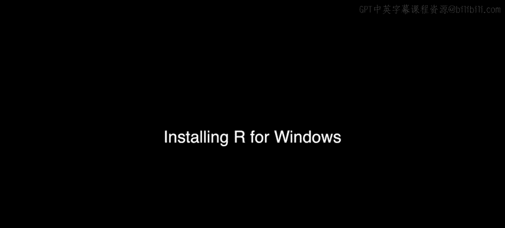
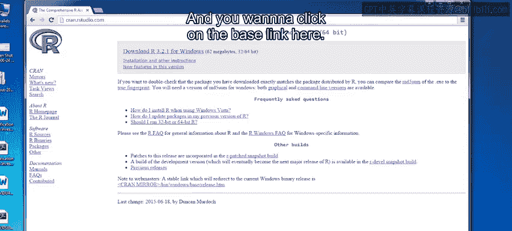
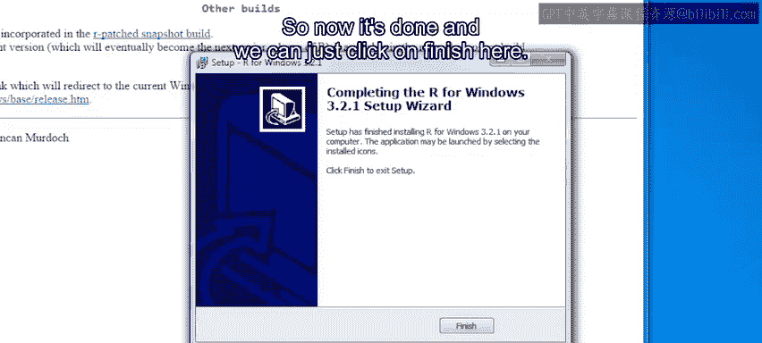
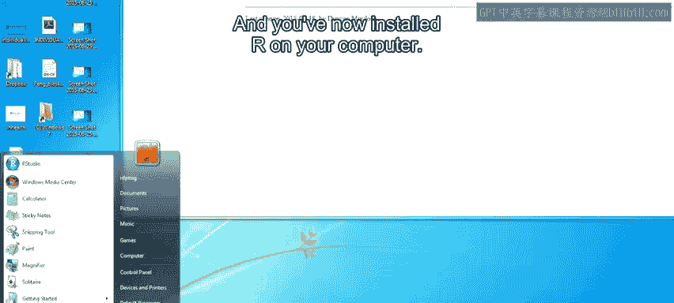
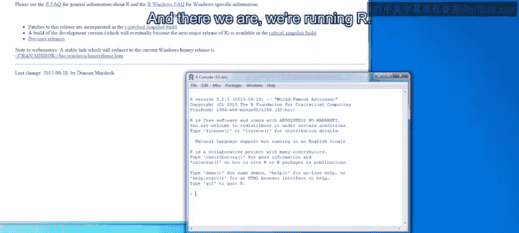

# 课程4：《探索性数据分析》｜P2：在Windows系统上安装R 🖥️

在本节课中，我们将学习如何在Windows操作系统上安装R语言环境。R是进行数据分析和探索性数据分析（EDA）的核心工具之一。我们将分步完成从下载到启动的完整安装过程。

## 概述

安装R是开始数据分析工作的第一步。本节教程将引导你访问官方资源，下载安装程序，并通过安装向导完成配置，最终成功运行R。

## 安装步骤

以下是详细的安装步骤。

### 1. 启动浏览器并访问CRAN

首先，需要启动你的网页浏览器（例如Chrome、Edge等）。在浏览器地址栏中输入R项目的综合归档网络（CRAN）的官方网址。

### 2. 选择Windows版本并下载

进入CRAN网站后，页面顶部会显示三个主要操作系统的选项：Linux、Mac和Windows。请点击“Windows”链接。在新页面中，点击“base”子目录下的链接，即可开始下载R的Windows安装程序。下载速度取决于你的网络连接状况。

### 3. 运行安装程序

下载完成后，找到并双击运行下载的安装文件（通常为 `.exe` 格式）。安装向导将启动。

### 4. 选择安装语言与同意许可

安装程序首先会提示选择安装语言。你可以从提供的多种语言翻译中选择，例如选择“English”。阅读并同意GNU通用公共许可证（GPL）后，点击“Next”继续。

### 5. 选择安装位置

安装程序会建议一个默认的安装目录。对于大多数用户，接受此默认路径即可。点击“Next”继续。

### 6. 选择安装组件

接下来，你需要选择安装组件。默认设置会同时安装32位和64位版本，这适用于绝大多数现代计算机。除非你使用的是较旧的纯32位机器，否则建议保持默认选项，然后点击“Next”。

### 7. 自定义启动选项

此步骤允许你自定义R的启动方式。主要选项包括：
*   **界面类型**：选择MDI（多文档界面，所有窗口在一个主窗口内）或SDI（单文档界面，控制台和图形窗口等分开显示）。教程中选择了SDI模式，因为它更易于窗口管理。
*   **帮助文件格式**：选择以HTML格式（更美观）还是纯文本格式查看帮助文档。
*   **网络访问**：通常无需更改，保持默认的“Standard”设置即可。

完成选择后，点击“Next”。

### 8. 创建快捷方式

安装程序会询问是否在开始菜单创建快捷方式，建议创建。你还可以选择是否在桌面创建图标。根据你的偏好进行选择，然后点击“Next”。

### 9. 开始安装并完成

确认所有设置后，点击“Next”开始将文件复制到你的计算机。安装完成后，点击“Finish”退出向导。

### 10. 启动R

安装完成后，你可以在桌面找到R的快捷方式图标（如果之前选择了创建）。双击该图标即可启动R语言环境。

## 总结

本节课中，我们一起完成了在Windows系统上安装R语言环境的全过程。我们学习了如何从CRAN官网下载安装程序，逐步完成了安装向导中的各项设置，并最终成功启动了R。现在，你的计算机已经具备了运行R代码、进行数据探索和分析的基础环境。在接下来的课程中，我们将开始学习如何使用R进行实际的探索性数据分析。