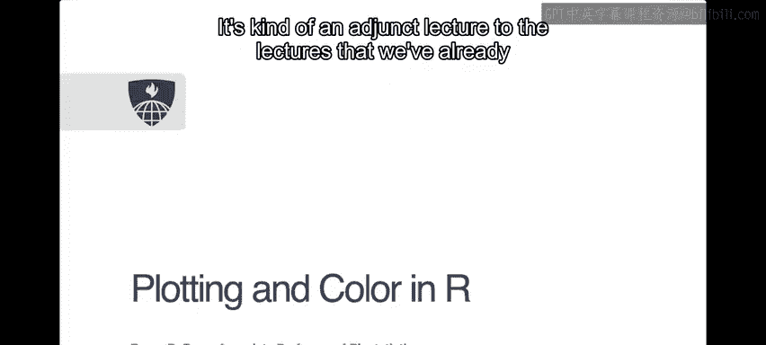
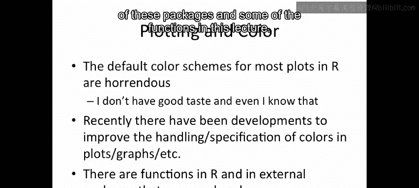
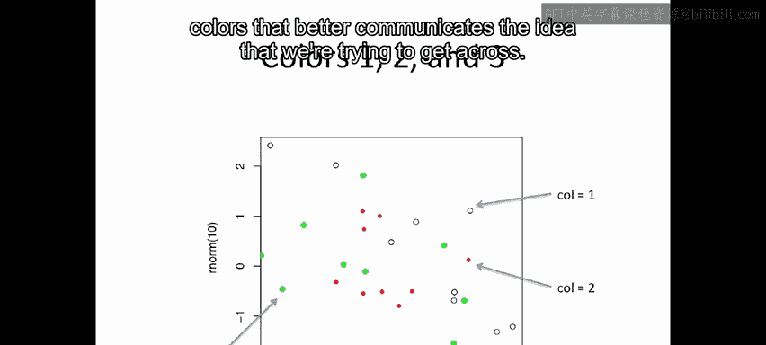

# 课程4：《探索性数据分析》｜第31讲：在R绘图中使用颜色（第一部分）🎨

在本节课中，我们将要学习如何在R语言绘图中使用颜色。颜色选择虽然看似次要，但恰当的颜色运用能有效揭示数据关系，并突出数据的多个维度。

上一节我们介绍了R中的基础绘图系统，本节中我们来看看如何通过颜色提升图表的表现力。

## 默认颜色方案的问题

R中大多数绘图函数的默认颜色方案效果不佳。即使不是设计专家，也能看出这些默认颜色通常不适合展示不同类型的数据。

不过，通过R的核心系统及扩展包，我们可以更好地处理和指定绘图中的颜色。本节课将介绍其中一个包及其相关函数。

## 标准颜色索引的局限性

以下是R中一个相当标准的绘图示例，图中包含用三种颜色绘制的随机点。

黑色圆圈对应黑色，部分点为红色，另一些点为绿色。这是因为在大多数绘图函数中，有一个 `col` 参数。其标准索引对应的颜色如下：

*   `col = 1` 对应黑色。
*   `col = 2` 对应红色。
*   `col = 3` 对应绿色。
*   `col = 4` 对应蓝色。
*   `col = 5` 对应洋红色。

如果简单地使用 `col = c(1, 2, 3)` 来指定三种颜色，就会得到黑、红、绿的组合。这些颜色在多数情况下对数据表达并无特殊意义，且从设计角度看，频繁使用此配色会使所有图表看起来千篇一律。

核心问题在于，我们能否选择一组更好的颜色，以更有效地传达我们想要表达的信息。

## 内置调色板示例

R内置了一些调色板。以下是使用 `volcano` 数据集（展示火山不同海拔高度）的示例。

左侧图像使用了 `heat.colors` 调色板。该调色板的颜色从表示低值的红色过渡到表示高值的黄色或白色。

右侧图像使用了 `topo.colors`（地形色）调色板。该调色板的颜色从表示低值的蓝色过渡到表示高值的棕色或白色。

对于 `heat.colors`，如果我们了解火焰，可能较容易理解低值和高值的对应关系。但对于 `topo.colors`，蓝色代表低值、绿色代表较高值的关系对部分人而言可能并不直观。

---

本节课中我们一起学习了R绘图中的颜色基础，包括默认颜色索引的局限性和两个内置调色板（`heat.colors` 与 `topo.colors`）的应用。理解这些是选择更佳配色方案的第一步。