# 约翰霍普金斯大学数据科学课程4：《探索性数据分析》｜P34：在R绘图中使用颜色（第四部分）🎨

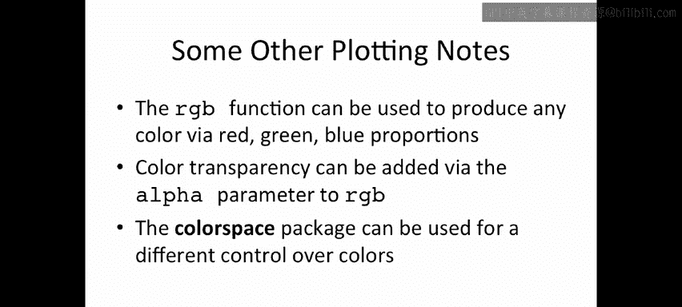

在本节课中，我们将要学习在R语言绘图中使用颜色的最后几个实用功能，包括`rgb()`函数和透明度参数`alpha`的应用。这些工具能帮助你创建更具信息量和视觉吸引力的图表。

上一节我们介绍了`RColorBrewer`包和颜色插值，本节中我们来看看如何直接通过RGB值定义颜色，以及如何为颜色添加透明度效果。

## 使用`rgb()`函数定义颜色

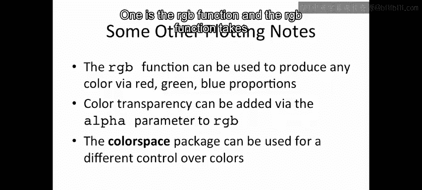

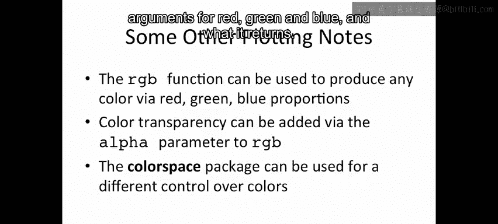

`rgb()`函数允许你通过红、绿、蓝三原色的数值来定义颜色。该函数接收三个介于0到1之间的参数，分别代表红色、绿色和蓝色的强度，并返回一个十六进制的颜色字符串。这个字符串可以直接传递给`image()`或`plot()`等绘图函数。

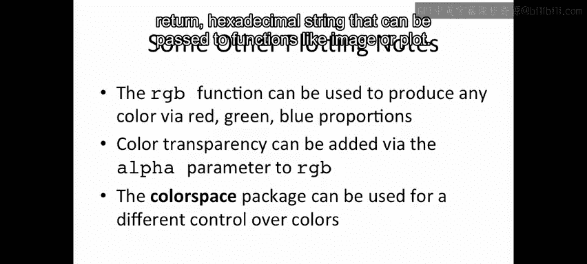

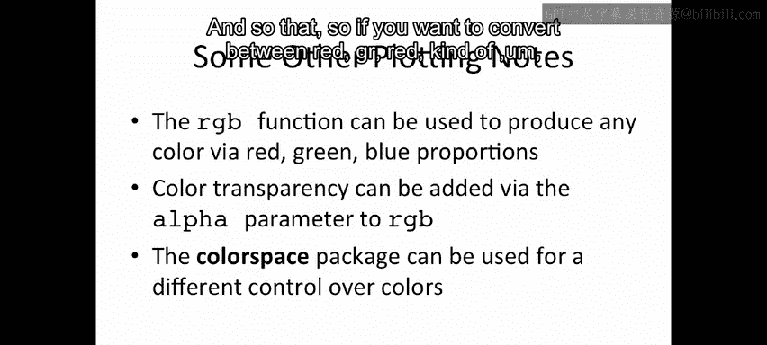


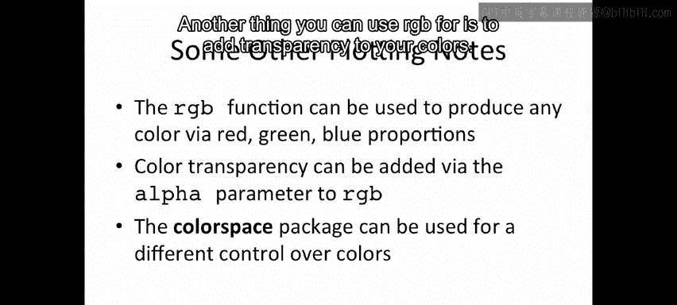

其基本公式如下：
```
颜色代码 <- rgb(red, green, blue)
```
其中，`red`、`green`、`blue`的取值范围是0到1。

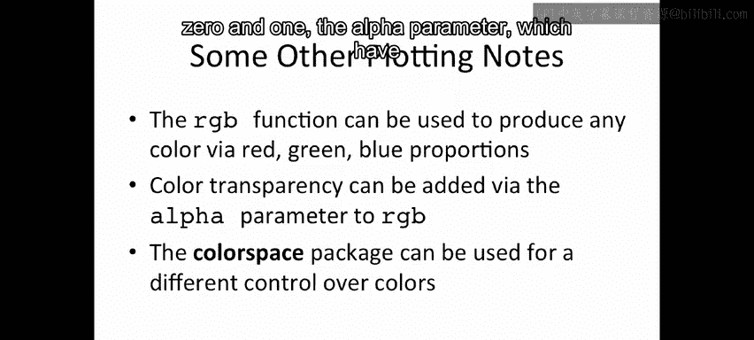

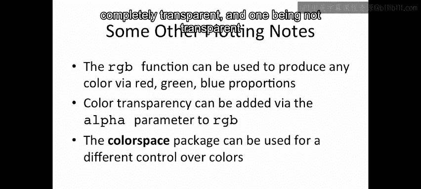


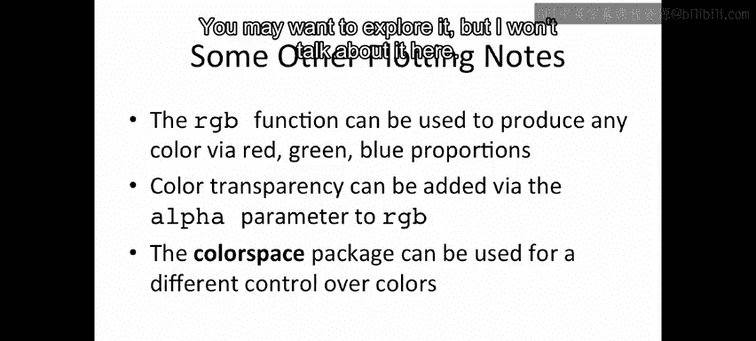

以下是`rgb()`函数的一个关键用途：
*   **颜色转换**：如果你有十进制的RGB颜色表示，可以使用`rgb()`函数将其转换为绘图函数所需的十六进制字符串。

## 为颜色添加透明度

`rgb()`函数还有一个第四参数`alpha`，用于控制颜色的透明度（或称不透明度）。`alpha`参数同样是一个介于0到1的值。

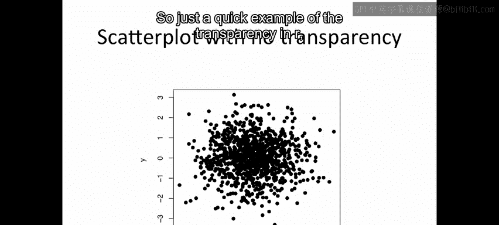


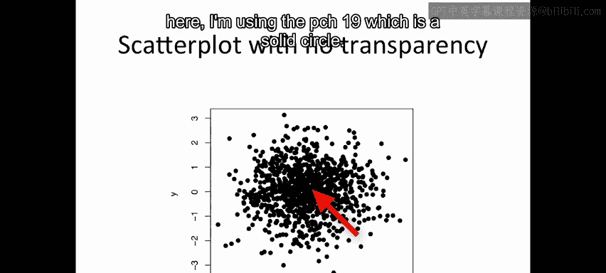

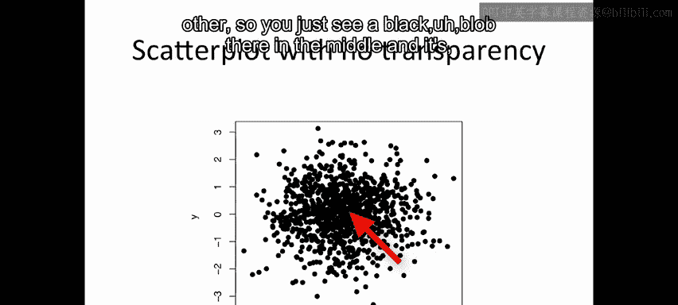

其扩展公式如下：
```
带透明度的颜色代码 <- rgb(red, green, blue, alpha)
```
*   `alpha = 0` 表示完全透明。
*   `alpha = 1` 表示完全不透明。


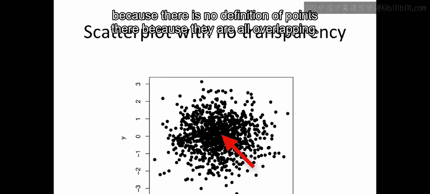

通过调整`alpha`值，你可以让颜色变得半透明，这在处理数据点重叠的图表时特别有用。

## 透明度应用实例

让我们通过一个例子来理解透明度的作用。假设我们绘制了大约1000个数据点，使用实心圆（`pch = 19`）作为点形状。在高密度区域，所有点会相互重叠，最终在图表中间形成一团黑色的斑块，难以分辨单个数据点。

如果为这些点添加一些透明度，情况就会改变。当圆点变得半透明并相互重叠时，我们可以“看穿”它们。重叠越多的区域颜色会越深，重叠越少的区域则显示为较浅的半透明圆形。

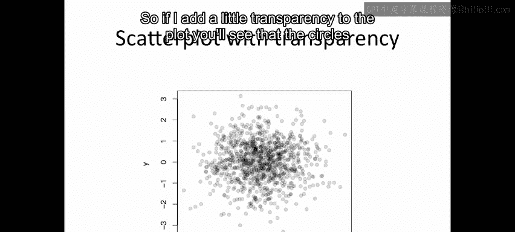

以下是为绘图添加透明度的示例代码：
```r
# 创建带透明度的黑色（RGB均为0，alpha=0.2）
my_color <- rgb(0, 0, 0, alpha = 0.2)
# 使用该颜色绘图
plot(x, y, pch = 19, col = my_color)
```
在这段代码中，`alpha`参数被设置为0.2，这意味着颜色有80%的透明度。虽然红、绿、蓝值均为0（代表黑色），但由于高透明度，实际呈现效果很浅。

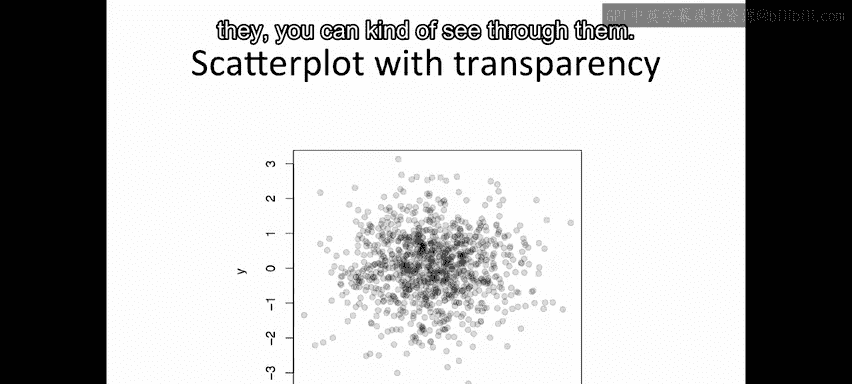


这种使用透明度的方法是一种简单有效的“廉价密度估计器”。图中颜色较深的区域代表了数据点的高密度区，颜色较浅的区域则代表了低密度区。因此，在面对包含大量数据点的图表时，添加一点透明度可以帮助读者看到更多信息。


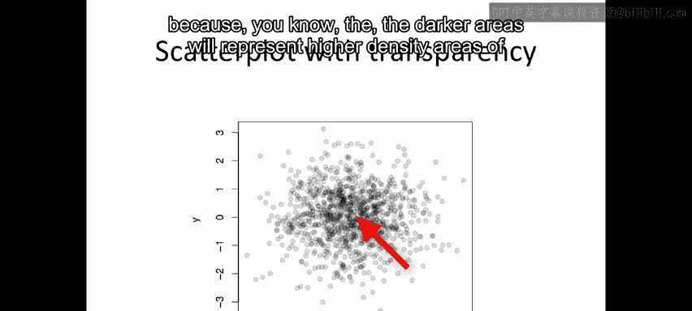

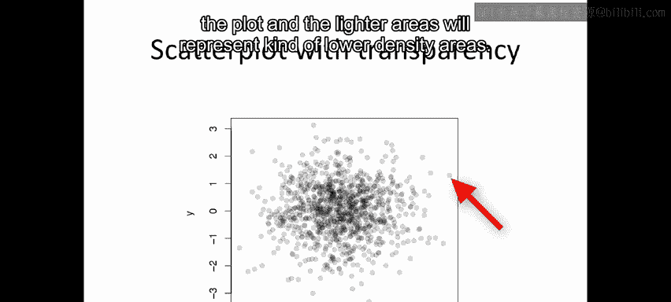

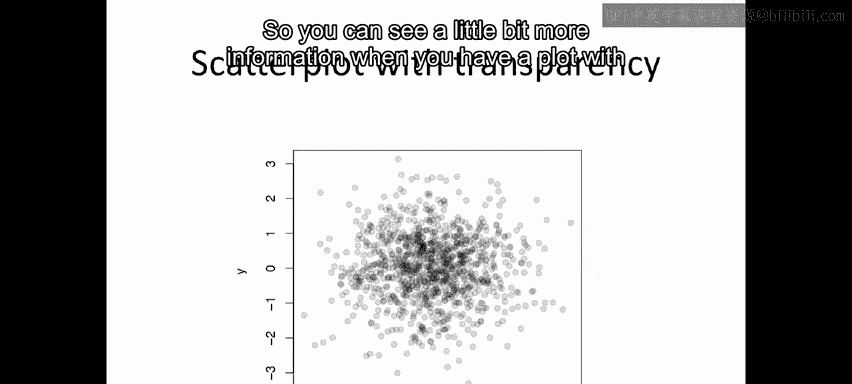

## 其他工具简介

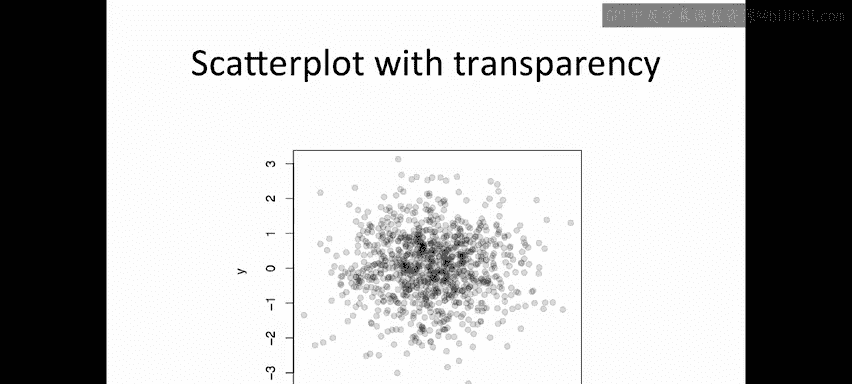

最后简要提及`colorspace`包，它提供了另一种控制颜色的方式，允许你以不同的色彩空间模型来操作颜色。你可以自行探索这个包的功能，但本课程不做深入讨论。

## 课程总结

本节课中我们一起学习了在R绘图中使用颜色的进阶技巧。

*   我们介绍了`rgb()`函数，它可以通过红、绿、蓝数值直接创建颜色，并能够通过`alpha`参数添加透明度。
*   我们通过实例看到了为绘图添加透明度如何帮助澄清数据点密集的图表，让重叠区域的数据密度分布一目了然。
*   我们还提到了`colorspace`包作为扩展工具。

在图表、地图中审慎地使用颜色和透明度，能使读者更容易理解你想要表达的重点或进行的比较。为顺序型数据匹配顺序型色板，为发散型数据匹配发散型色板是非常有用的实践。`RColorBrewer`包提供了这些现成的优秀色板，而`colorRamp()`和`colorRampPalette()`函数则在需要进行颜色插值时至关重要。最后，透明度是一个强大的工具，它能通过让颜色半透明重叠，来澄清包含大量数据点的图表。