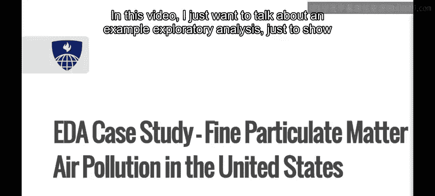
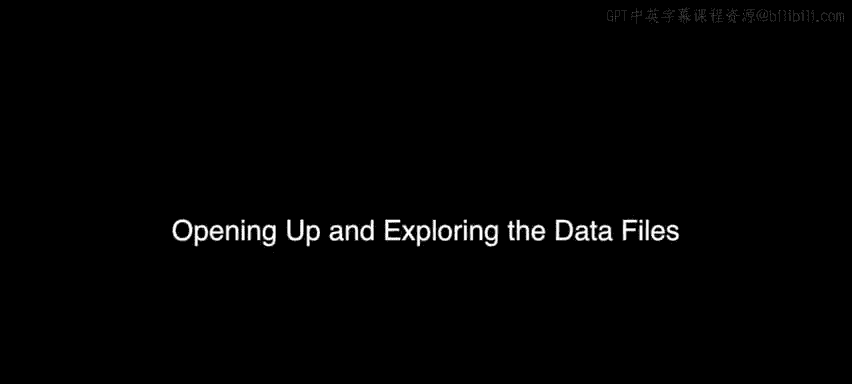
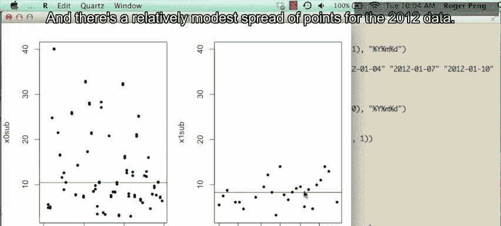
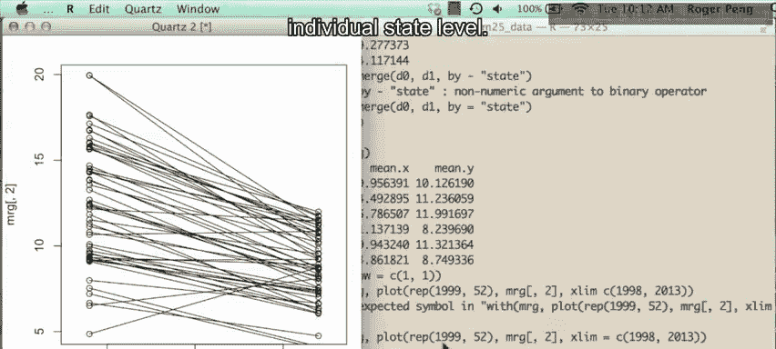

# 课程4：《探索性数据分析》｜P36：空气污染案例研究 📊



在本节课中，我们将通过一个具体的案例——分析美国PM2.5空气污染数据，来学习如何进行探索性数据分析。我们将使用一系列基础工具，如一维/二维图表、基本统计摘要等，来初步了解数据并回答一个核心问题：从1999年到2012年，美国的PM2.5污染水平是否有所下降？

---

## 1. 明确分析目标与数据来源 🎯



在开始分析任何数据之前，我们首先需要明确想要回答的问题。这可以是一个具体的假设，也可以是一个宽泛的疑问。

我们本次分析的核心问题是：**2012年的PM2.5平均污染水平是否低于1999年？**

我们将使用美国环境保护署（EPA）公开的空气质量监测数据。这些数据记录了全美各地空气中细颗粒物（PM2.5）的浓度，单位为微克/立方米。PM2.5是影响公众健康的重要污染物，因此其长期趋势备受关注。

---

## 2. 初步查看与读取数据 📂

数据以压缩文件形式提供，包含`.txt`数据文件和`.pdf`说明文档。原始数据文件每行是一条记录，各列由竖线 `|` 分隔。第一行是列名标题。

以下是读取1999年数据的步骤：

```r
# 读取1999年数据
pm0 <- read.table("1999.txt", comment.char = "#", header = FALSE, sep = "|", na.strings = "")

# 从文件第一行获取列名
cnames <- readLines("1999.txt", 1)
cnames <- strsplit(cnames, "|", fixed = TRUE)[[1]]

# 将列名赋予数据框，并确保其为有效名称
names(pm0) <- make.names(cnames)
```

我们提取出核心的PM2.5浓度数据列 `Sample.Value`。

```r
x0 <- pm0$Sample.Value
```

对2012年的数据，我们重复同样的读取和列名处理过程。

---

## 3. 数据概览与缺失值分析 🔍

在深入分析前，我们先对数据进行整体了解。

首先，查看数据的基本规模和摘要：

```r
# 查看数据维度
dim(pm0)

# 对PM2.5浓度进行五数概括
summary(x0)
```

我们发现，1999年的数据约有11.7万条记录，其中约11%的PM2.5值为缺失值（NA）。2012年的数据量更大，约有130万条记录，但缺失值比例降至约5%。

**关于缺失值的思考**：对于“全国平均水平是否下降”这个宏观问题，少量、随机的缺失值通常不会对结论产生决定性影响。但我们需要留意缺失值是否集中在特定时间或地区，这可能暗示系统性问题。

---

## 4. 整体趋势的初步观察 📉

我们通过统计摘要和箱线图来直观比较两个年份的整体差异。

```r
# 比较两个年份的统计摘要
summary(x0) # 1999年
summary(x1) # 2012年

# 绘制箱线图比较（由于数据右偏，使用对数变换）
boxplot(log10(x0), log10(x1))
```

**初步发现**：
*   2012年的PM2.5浓度中位数（约7.3）明显低于1999年（约11.5）。
*   数据呈现右偏分布，即存在少数极高的浓度值。
*   2012年数据的离散程度似乎更大。

我们还注意到2012年数据中存在少量负值，这在物理意义上（污染物质量）是不可能的。通过检查，这些负值约占2%，且多出现在冬季。这可能是低浓度时的测量误差，鉴于比例较小，在本次宏观分析中暂不深究。

---

## 5. 深入分析：单个监测点的变化 📍

全国平均水平的变化可能受到监测网络扩大的影响。为了更精确地评估变化，我们选择一个在1999年和2012年都持续运行的监测点进行对比。

我们以纽约州（州代码36）为例，找出在两个年份数据集中都存在的监测点。

```r
# 提取纽约州的监测点信息
site0 <- unique(subset(pm0, State.Code == 36, c(County.Code, Site.ID)))
site1 <- unique(subset(pm1, State.Code == 36, c(County.Code, Site.ID)))

# 创建监测点唯一标识符
site0 <- paste(site0[,1], site0[,2], sep = ".")
site1 <- paste(site1[,1], site1[,2], sep = ".")

# 找出两个年份共有的监测点
both <- intersect(site0, site1)
```

我们选择了纽约州一个特定监测点（County 63, Site 2008），分别提取其两个年份的数据，并绘制时间序列图进行对比。

```r
# 设置画布为1行2列
par(mfrow = c(1, 2))

# 计算统一的Y轴范围
rng <- range(x0sub, x1sub, na.rm = TRUE)

# 绘制1999年该监测点数据
plot(dates0, x0sub, pch = 20, ylim = rng, main = "1999")
abline(h = median(x0sub, na.rm = TRUE))

# 绘制2012年该监测点数据
plot(dates1, x1sub, pch = 20, ylim = rng, main = "2012")
abline(h = median(x1sub, na.rm = TRUE))
```

**关键发现**：
*   在**同一监测点**，2012年的PM2.5浓度中位数确实低于1999年。
*   更值得注意的是，1999年的数据波动极大，存在许多异常高值（峰值），而2012年的数据波动范围明显收窄。
*   这意味着，不仅长期平均暴露水平下降了，短期极端污染事件也显著减少，这对公共健康具有双重积极意义。

---



## 6. 州级层面的趋势分析 🗺️


全国和单个监测点的分析各有价值，而州级分析能提供一个折中的视角。各州在落实联邦环保政策方面扮演关键角色，因此观察州级趋势非常重要。

我们计算每个州在两个年份的平均PM2.5浓度，并绘制连接图。

```r
# 计算各州1999年的平均浓度
mn0 <- with(pm0, tapply(Sample.Value, State.Code, mean, na.rm = TRUE))

# 计算各州2012年的平均浓度
mn1 <- with(pm1, tapply(Sample.Value, State.Code, mean, na.rm = TRUE))

# 构建用于合并的数据框
d0 <- data.frame(state = names(mn0), mean = mn0)
d1 <- data.frame(state = names(mn1), mean = mn1)
mrg <- merge(d0, d1, by = "state")

# 绘制州平均值的连接图
par(mfrow = c(1,1))
with(mrg, plot(rep(1999, nrow(mrg)), mrg[,2], xlim = c(1998, 2013)))
with(mrg, points(rep(2012, nrow(mrg)), mrg[,3]))
segments(rep(1999, nrow(mrg)), mrg[,2], rep(2012, nrow(mrg)), mrg[,3])
```

**结论**：从连接图可以清晰看到，绝大多数州的平均PM2.5浓度在1999年至2012年间呈下降趋势，尽管下降幅度各不相同。这从州一级的层面印证了污染水平整体改善的结论。

---

## 总结 📝

本节课中，我们一起完成了一个完整的探索性数据分析案例。我们围绕“美国PM2.5污染水平是否从1999年到2012年有所下降”这个核心问题，由浅入深地展开了分析：



1.  **全国层面**：通过统计摘要和箱线图，发现2012年的中位数浓度显著低于1999年。
2.  **监测点层面**：通过控制变量（同一监测点），确认了浓度下降的趋势，并进一步发现极端高值事件减少。
3.  **州级层面**：通过计算各州平均值并绘制连接图，可视化地展示了绝大多数州的污染水平都在改善。

我们运用了数据读取、清洗（处理列名）、摘要统计、可视化（箱线图、散点图、连接图）以及数据子集操作等多种基础技能。这个案例展示了如何通过系统的探索性分析，逐步从数据中获取信息、验证想法，并为后续更深入的分析奠定基础。