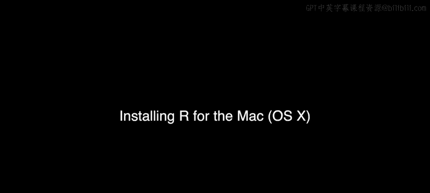
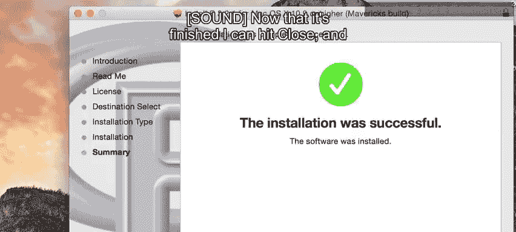

# 课程4：《探索性数据分析》｜P3：在Mac上安装R 🍎

## 概述

在本节课程中，我们将学习如何在Mac电脑上安装R语言环境。R是进行探索性数据分析的核心工具之一，安装过程简单快捷。

## 安装步骤

以下是安装R的具体步骤，整个过程仅需几分钟即可完成。

1.  打开您的网页浏览器。
2.  访问CRAN（The Comprehensive R Archive Network）网站。这是R语言的综合归档网络。
3.  在下载页面中，您会看到为不同操作系统提供的选项。请选择适用于Mac平台的版本。
4.  点击下载链接，获取Mac平台的R安装包文件（通常为`.pkg`格式）。
5.  等待下载完成。下载时间取决于您的网络连接速度。

## 运行安装程序

下载完成后，即可开始安装过程。

1.  打开下载好的安装包文件。
2.  安装向导将自动启动，并引导您完成所有步骤。点击“继续”按钮。
3.  阅读即将安装的组件描述，然后再次点击“继续”。
4.  阅读软件许可协议（GNU通用公共许可证第2版）。在阅读后，同意该许可协议。
5.  点击“安装”按钮。
6.  系统可能会提示您输入管理员密码以授权安装。请输入密码并继续。
7.  安装程序将开始把必要的文件复制到您的计算机上。

## 完成安装与启动

上一节我们完成了文件的安装，本节我们来看看如何找到并启动R。

1.  安装完成后，点击“关闭”按钮退出安装程序。
2.  安装好的R应用程序位于您的“应用程序”文件夹中。
3.  打开“应用程序”文件夹，按字母顺序找到“R”并点击它。
4.  现在，您已成功在电脑上安装了R，可以直接使用它。

此外，如果您希望获得更丰富的开发体验，也可以选择安装RStudio这类集成开发环境（IDE）。

## 总结

本节课中，我们一起学习了在Mac操作系统上安装R语言环境的完整流程。您掌握了从访问CRAN官网下载安装包，到运行安装程序并最终启动R的全部步骤。拥有R环境是开始进行探索性数据分析的第一步。