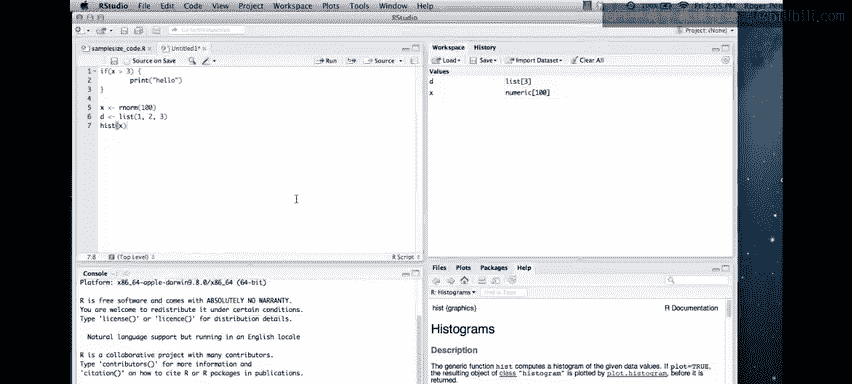

# 课程4：《探索性数据分析》｜P4：在Mac上安装RStudio 🍎

## 概述

在本节课中，我们将学习如何为R语言安装一个名为RStudio的集成开发环境（IDE）。RStudio能显著提升使用R语言的体验，提供许多基础R系统不具备的便利功能。我们将一步步完成在Mac电脑上的下载和安装过程，并简要介绍RStudio的基本界面布局。

---

## 安装R语言

安装RStudio的前提是您的电脑上已经安装了R语言。请确保您已完成此步骤。

## 下载RStudio

接下来，我们需要下载RStudio桌面版。

1.  打开您的网页浏览器。
2.  访问RStudio官方网站：`rstudio.org`。
3.  在网站上找到并点击“Download RStudio”按钮。
4.  选择下载“RStudio Desktop”版本。网站通常会自动识别您的操作系统（例如Mac），并推荐相应的版本。RStudio也支持Windows XP、Vista、7以及多种Linux系统。

## 安装RStudio

下载完成后，即可开始安装。

1.  打开下载好的安装文件（通常是一个`.dmg`文件）。
2.  在弹出的窗口中，将RStudio图标拖拽到“Applications”（应用程序）文件夹中。
3.  如果系统提示是否替换旧版本，请选择“替换”。至此，安装完成。

## 启动与界面介绍

现在，让我们打开RStudio并认识它的界面。

1.  进入“应用程序”文件夹，找到并启动RStudio。
2.  RStudio主界面默认包含四个窗口。

为了更清晰地展示，我们先关闭所有已打开的项目。以下是四个核心窗口的功能：

*   **左下角：控制台 (Console)**
    这是R语言运行的地方。您可以在这里直接输入并执行R代码。例如，输入 `x <- rnorm(100)` 并按 `Command + Enter` 执行，即可创建一个名为`x`、包含100个随机数的对象。
*   **左上角：脚本编辑器 (Script Editor)**
    您可以在这里编写和编辑R脚本文件。编写的代码可以通过 `Command + Enter` 发送到控制台执行。
*   **右上角：工作环境 (Environment/History)**
    “Environment”标签页显示当前已创建的所有R对象（例如我们刚才创建的`x`）及其简要信息。“History”标签页则记录所有执行过的命令。
*   **右下角：多功能面板 (Multi-purpose Pane)**
    这个区域包含多个标签页，功能丰富：
    *   **Files**: 浏览和管理您的文件系统。
    *   **Plots**: 显示生成的图形。例如，执行 `hist(x)` 后，直方图将在此处显示。
    *   **Packages**: 管理已安装和已加载的R包。
    *   **Help**: 查看帮助文档。例如，输入 `help(hist)` 或 `?hist`，关于`hist`函数的帮助页面就会在此打开。

## 总结

本节课我们一起学习了如何在Mac系统上安装和初步设置RStudio。我们了解了RStudio作为一个集成开发环境，如何通过其四个主要窗口——控制台、脚本编辑器、工作环境和多功能面板——来组织代码编写、对象管理、图形展示和帮助查询，从而让R语言的数据分析工作变得更加高效和直观。推荐在本课程中使用RStudio来辅助学习。