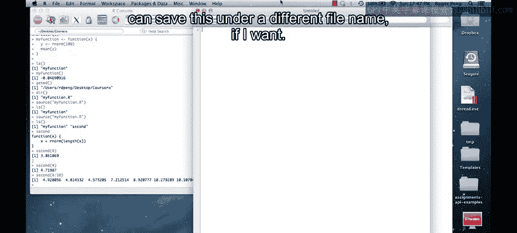

# 课程4：《探索性数据分析》｜P6：设置工作目录与使用文本编辑器 🖥️


## 概述

在本节课中，我们将学习两个核心操作：如何设置R的工作目录，以及如何使用R自带的文本编辑器编写和运行代码。掌握这些基础技能对于后续的数据分析和代码管理至关重要。

## 设置工作目录 📂

上一节我们介绍了课程的整体框架，本节中我们来看看如何管理R的工作环境。工作目录是R读取和写入文件的默认位置。如果不清楚当前的工作目录，你将难以找到保存的文件或加载的数据。

启动R后，你可以通过输入以下函数来查看当前的工作目录：

```r
getwd()
```

例如，在Mac系统上，初始工作目录通常是用户的主目录（如 `/users/yourname`）。如果你的所有文件都存储在主目录，这没有问题。但如果你将数据和代码文件存放在其他文件夹（例如一个子目录），你可能需要更改工作目录。

你可以通过菜单栏的“Misc” -> “Change Working Directory…”来更改目录。选择你存放文件的文件夹即可。

**核心概念**：要读取一个文件，该文件必须位于当前工作目录中，否则R会报错。

例如，尝试读取一个不在当前目录的文件 `mydata.csv`：

```r
read.csv("mydata.csv")
```

如果文件不存在，你会收到错误提示。此时，你需要将工作目录切换到该文件所在的文件夹，或者将文件移动到当前工作目录。

对于本课程，建议你创建一个专属目录来存放所有相关文件。例如，在桌面上创建一个名为“Coursera”的文件夹，然后在R中将工作目录更改至此。这样，你保存和读取文件都会非常方便。

以下是设置工作目录的步骤总结：
1.  使用 `getwd()` 确认当前目录。
2.  通过菜单或 `setwd(“路径”)` 函数更改目录。
3.  将课程所需的所有文件集中存放在该目录下。

## 使用R文本编辑器编写代码 ✍️

了解了如何管理工作目录后，我们来看看如何编写R代码。在本课程中，你需要频繁地编写代码，因此一个趁手的编辑器非常重要。

R（Mac版）自带了一个简单的文本编辑器，完全能够满足本课程的需求。你可以通过点击工具栏上的编辑器按钮来打开它。

打开后，你会看到一个空白的编辑窗口。现在，你可以开始编写代码了。例如，我们创建一个简单的函数：

```r
myfunction <- function() {
    x <- rnorm(100)
    mean(x)
}
```

编写完代码后，你需要将其加载到R中才能使用。有几种方法可以实现：

**方法一：复制粘贴**
对于少量代码，你可以全选编辑器中的代码（`Command + A`），复制（`Command + C`），然后粘贴（`Command + V`）到R控制台并执行。

**方法二：保存并加载文件**
更规范的做法是将代码保存为 `.R` 文件，然后使用 `source()` 函数加载。
1.  在编辑器中，点击“File” -> “Save As…”。
2.  导航到你的工作目录（例如“Coursera”文件夹）。
3.  将文件命名为 `myfunction.R` 并保存。
4.  在R控制台中，运行 `source(“myfunction.R”)`。

之后，你就可以在R中使用 `myfunction()` 这个函数了。如果你修改了 `.R` 文件中的代码，只需再次保存文件，并重新运行 `source()` 命令即可更新。

以下是使用文本编辑器的关键操作列表：
*   **新建文件**：点击编辑器按钮。
*   **编写代码**：在编辑窗口中直接输入。
*   **保存文件**：使用 `Command + S` 或通过“File”菜单保存，建议使用 `.R` 后缀。
*   **加载代码**：在R控制台使用 `source(“文件名.R”)`。
*   **关闭窗口**：完成编辑后直接关闭编辑器窗口即可。

R自带的文本编辑器虽然简单，但功能完备，足以应对本课程的所有编程任务。你无需额外下载其他复杂的编辑器。



## 总结

本节课中我们一起学习了R编程的两项基础技能。首先，我们了解了工作目录的概念及其重要性，并学会了如何使用 `getwd()` 和 `setwd()` 来查看和设置它。其次，我们掌握了如何使用R内置的文本编辑器来编写、保存和加载R代码文件。熟练运用这些方法，将为后续的数据探索和分析打下坚实的基础。