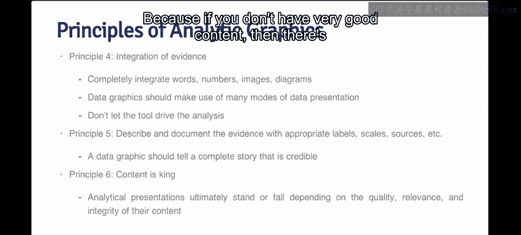
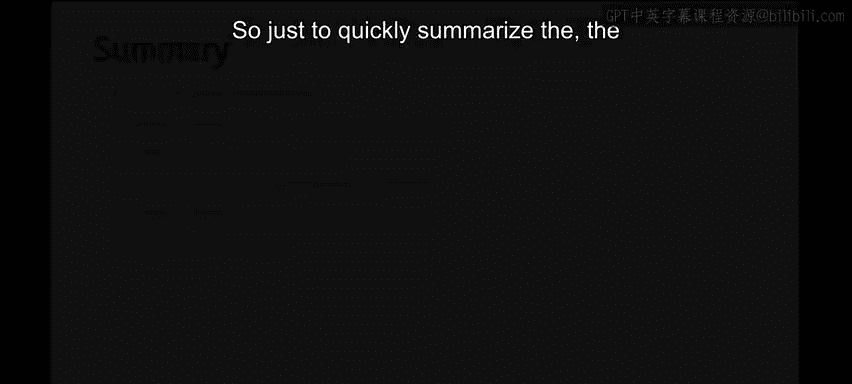
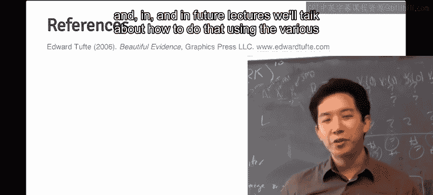
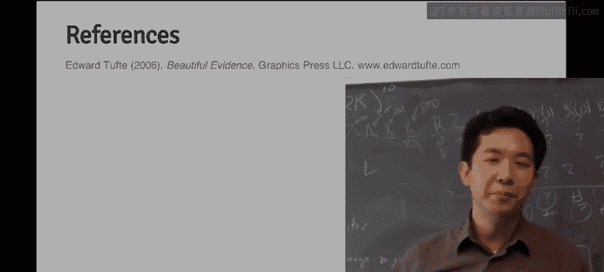

# 📊 约翰霍普金斯大学数据科学课程4：《探索性数据分析》｜P7：分析图形原理

在本节课中，我们将学习构建分析图形的一些基本原则。这些原则能帮助我们在用数据讲述故事时，制作出更有效、更具说服力的图形。

---

## 🎯 概述

分析图形的核心目标是清晰地传达数据背后的信息与故事。为了达到这一目标，我们可以遵循一系列经过验证的设计原则。本节课将介绍六个关键原则，它们改编自爱德华·塔夫特（Edward Tufte）的著作。掌握这些原则，能让你在创建任何数据图形时都更有章法。

---

## 1️⃣ 展示对比

在科学研究中，证据总是相对的。任何一个假设或观点的证据，都需要与另一个假设进行对比。因此，当你基于数据呈现证据时，必须回答一个根本问题：“与什么相比？”

以下是展示对比的一个例子。

*   **研究背景**：一项研究调查了空气净化器对儿童哮喘症状的影响。
*   **图形展示**：使用箱线图比较两组儿童的症状无碍天数（数值越高越好）。
*   **对比结果**：
    *   **实验组**（安装了空气净化器）：症状无碍天数的中位数增加了约1天/两周。
    *   **对照组**（未安装任何设备）：症状无碍天数几乎没有变化。
*   **结论**：通过与“不做任何处理”的对照组对比，我们才能得出“空气净化器可能改善了症状”的结论。没有对比，单独的“改善”数据是缺乏意义的。

**公式表示对比**：`效果 = 实验组结果 - 对照组结果`

上一节我们强调了展示对比的重要性，它为数据提供了参照系。接下来，我们将探讨如何通过图形揭示数据背后的机制。

---

## 2️⃣ 展示因果关系或机制

在展示数据时，应尝试解释你所认为的系统运作方式，即“为什么会这样”。这有助于观众理解现象背后的逻辑。

让我们延续空气净化器的例子。

*   **已知现象**：安装空气净化器后，儿童症状改善。
*   **假设机制**：净化器通过降低室内空气中的颗粒物（PM）浓度来起效。
*   **图形验证**：可以绘制另一组图形进行佐证。
    *   **左图**：展示空气净化器对症状无碍天数的影响（同原则一）。
    *   **右图**：展示空气净化器对室内颗粒物浓度的影响。
*   **数据呈现**：数据显示，实验组家庭的颗粒物浓度显著下降，而对照组则变化不大。
*   **推论**：图形同时呈现了“症状改善”和“颗粒物减少”这两个结果，为“净化器通过净化空气起效”的假设提供了支持性证据，从而揭示了可能的因果机制。

展示机制能让你的分析更具深度。然而，现实世界是复杂的，往往涉及多个变量。下面我们来看看如何处理多变量数据。

---

## 3️⃣ 展示多变量数据

世界本质上是多变量的，同时发生着许多事情。如果图形只展示两个变量，可能无法反映真实的全貌。因此，应尽可能在单张图形中整合更多数据，以讲述更丰富的故事。

以下是一个多变量分析的例子。

*   **初始观察**：分析纽约市1987-2000年间每日PM10（空气动力学直径小于10微米的颗粒物）浓度与每日死亡率的关系。散点图加回归线显示，两者呈微弱的**负相关**（PM10越高，死亡率越低），这与“污染加重健康风险”的常识假设相悖。
*   **引入第三变量**：考虑到“季节”可能是一个混杂因素。
*   **多变量图形**：将数据按**季节**（冬、春、夏、秋）分层，绘制四个子图。
*   **新发现**：在每个季节内部，PM10与死亡率都呈现**正相关**。
*   **结论**：这就是“辛普森悖论”的一个实例。忽略“季节”这个变量时，我们看到了虚假的负相关；当在图形中整合进“季节”变量后，真实的（正相关）关系才得以显现。这强调了展示多变量的重要性。

**代码示意分层**：
```r
# 使用ggplot2按季节分面绘图
ggplot(data, aes(x=PM10, y=Mortality)) +
  geom_point() +
  geom_smooth(method="lm") +
  facet_wrap(~Season)
```

通过整合多变量，我们获得了更清晰的图景。接下来，我们将学习如何整合不同形式的证据来强化你的图形。

---

## 4️⃣ 整合多种证据形式

不要让你使用的工具限制你呈现证据的方式。应该根据需求，将图表、文字、表格等多种证据模式整合到一个展示中，使其信息量最大化。

例如，在一篇关于粗颗粒物与老年人住院率关系的学术论文中，一张图形可能包含以下元素：
*   **点估计图**：用实心圆点表示效应估计值。
*   **置信区间**：用穿过圆点的线段表示估计的不确定性。
*   **文本补充**：在图形右侧添加一列“后验概率”，以文字形式量化“效应大于零”的证据强度。

这样，一张图同时传达了效应大小、精确度和统计显著性，信息高度集成，避免了读者在不同页面或表格间来回查找的麻烦。

整合证据能让图形更强大，但我们必须确保这些证据是可信的。这就引出了下一个原则。

---

## 5️⃣ 描述和记录证据

为你呈现的证据提供充分的描述和文档，以增加其可信度。这包括：
*   **数据来源**：明确标注数据出自何处。
*   **图形制作方法**：特别是使用R等编程语言时，**务必保存并可能共享生成图形的计算机代码**。这保证了分析的可重复性，是科学研究的基本准则。

内容为王，但若没有清晰的记录，再好的内容也可能失去说服力。然而，所有原则都服务于一个最核心的要素。

---

## 6️⃣ 内容至上

最终，**内容才是核心**。如果你没有有趣的故事要讲，或者数据本身平淡无奇，那么任何华丽的呈现技巧都无法使其变得有趣。
在动手绘图之前，首先思考：
*   我想传达的核心内容是什么？
*   我的数据讲述了什么故事？
*   我拥有哪些数据？

先确定“要说什么”，再决定“怎么说”和“画成什么样”。优秀的内容是任何出色图形的基石。

---



## 📝 总结

本节课我们一起学习了构建分析图形的六项基本原则：
1.  **展示对比**：证据总是相对的，需提供参照系。
2.  **展示因果关系或机制**：尝试解释系统如何运作。
3.  **展示多变量数据**：世界是复杂的，尽可能在图形中整合更多变量。
4.  **整合多种证据形式**：混合使用图表、文字、表格等，使信息呈现更丰富。
5.  **描述和记录证据**：注明来源和代码，确保可重复性与可信度。
6.  **内容至上**：深刻的故事和扎实的数据是任何图形的根本。

这些原则改编自爱德华·塔夫特的经典著作《Beautiful Evidence》，是设计高效分析图形的宝贵指南。在后续课程中，我们将学习如何运用R语言中的各种绘图系统来实践这些原则。



---





**参考**：Edward Tufte. *Beautiful Evidence*. Graphics Press, 2006.