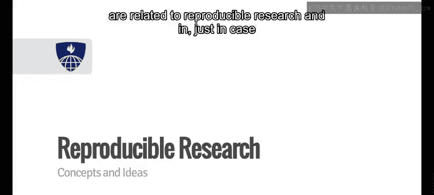
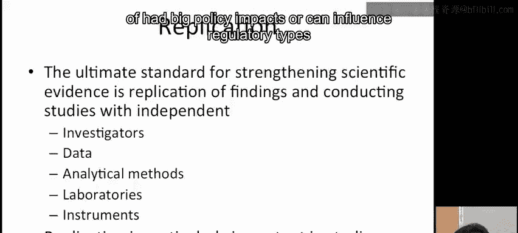
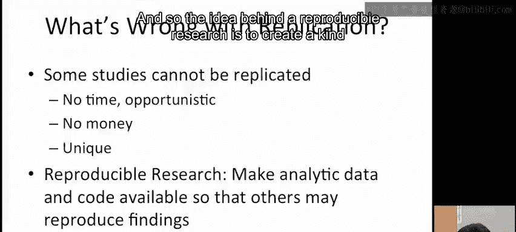
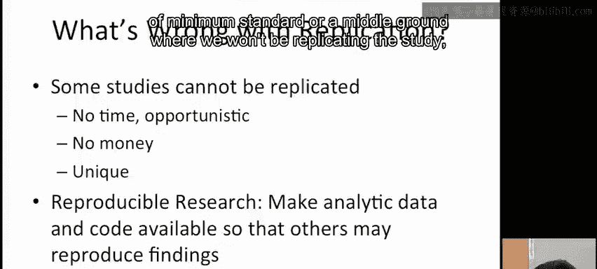
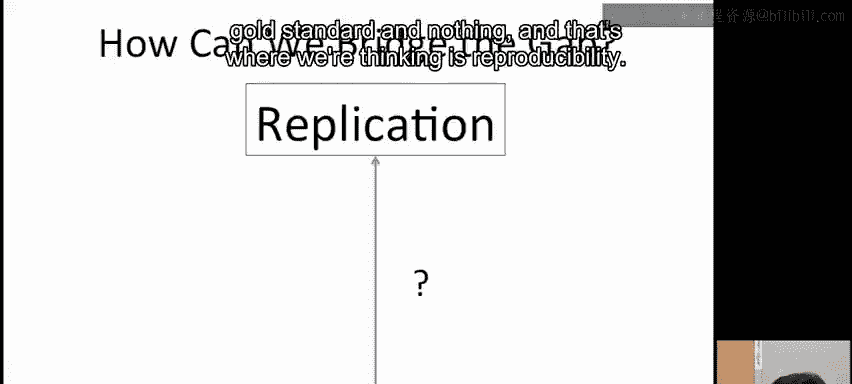
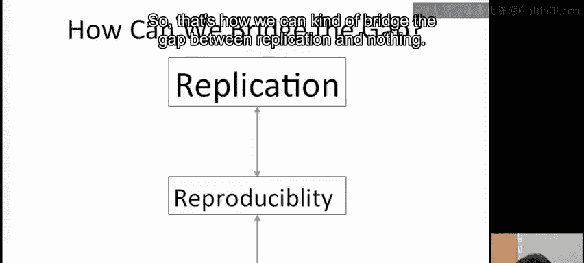
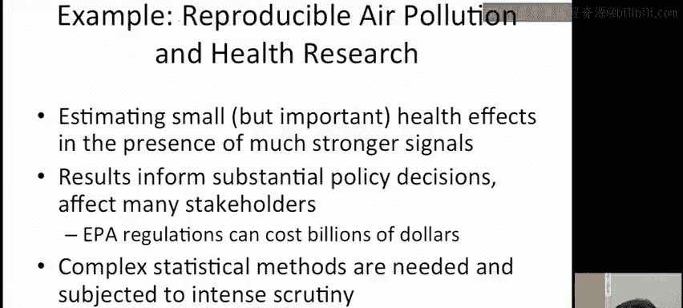
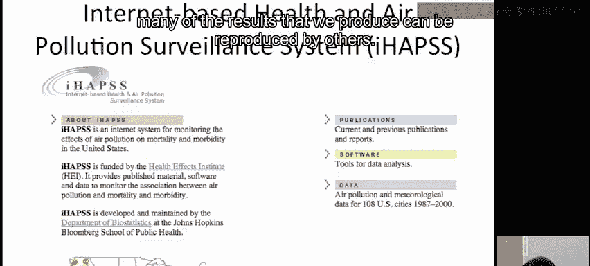

# 003：可重复研究概念与想法（第1部分）🔬

## 概述

在本节课中，我们将学习可重复研究的基本概念与核心理念。我们将探讨为什么在科学研究中，复制是验证发现的金标准，以及当完全复制研究面临挑战时，可重复性如何作为一种重要的中间标准出现。课程将解释驱动可重复研究需求的技术趋势，并通过一个空气污染与健康研究的实例来说明其重要性。

---

## 科学证据的黄金标准：复制 🔑

在科学领域，**复制**是验证和确认科学家发现的最重要环节。其基本理念是：如果你声称X导致Y，或维生素C改善疾病，那么独立于原始研究人员的其他科学家会尝试调查同一个问题，看是否能得出相同的结果。如果许多不同的人都得出相同结果并复制了原始发现，那么我们就有理由认为原始发现可能是真实的，这是一个真实的关系或发现。

因此，强化科学证据的终极标准是**复制**。其目标是让独立的研究人员使用**不同的数据**、**不同的方法**和**在不同的实验室**进行独立研究，看是否能得到相同的结果。如果一个发现能经受住所有这些不同条件的考验，那么它就更可能是真实的，支持它的证据也就更强。

复制在那些具有重大政策影响或影响监管决策的研究中尤为重要。

## 复制面临的挑战 🧩

复制本身没有问题。这是科学数百年来一直在做的事情，今天也没有错。但问题是，进行复制或复制其他研究正变得越来越具有挑战性。

部分原因在于研究规模越来越大。进行大规模研究需要大量资金。如果你想对同一项研究进行10次复制，就需要10倍的资金，而现在的资金并不像过去那样充裕。有时，复制研究很困难，因为如果原始研究花了20年时间，就很难再等20年来进行复制。有些研究本身就是独一无二的，例如观察特定时间点的独特情况或独特人群，你无法轻易复制那种情境。

因此，存在许多无法复制研究的合理原因。那么问题是，如果无法复制，替代方案就是什么都不做，让那项研究独自成立吗？

## 可重复研究：连接复制与“不作为”的桥梁 🌉

可重复研究的理念，就是建立一种最低标准或中间地带。我们虽然不复制整个研究，但也许可以做些介于两者之间的事情。

基本问题是：一方面有黄金标准——**复制**，另一方面有最差的标准——**不作为**。那么，我们能在黄金标准和“不作为”之间做些什么呢？这就是我们所思考的**可重复性**。它帮助我们弥合复制与“不作为”之间的鸿沟。

## 为什么需要这个中间地带？🤔

这个中间地带的基本理念是：你公开原始研究的数据，并公开计算方法，以便其他人可以查看你的数据，运行你所做的分析，并得出与你相同的发现。因此，可重复研究在很大程度上是关于**数据分析的验证**。

因为你并非使用独立的方法收集独立的数据，所以验证你所提出的问题本身会稍微困难一些。但如果你能获取某人的数据和代码（因为分析很可能是在计算机上使用某种编程语言如R完成的），并重现他们得出的发现，那么你至少可以确信分析是恰当进行的，并且使用了正确的方法。

## 驱动可重复性需求的趋势 📈

那么，是什么驱动了对这种介于复制和“不作为”之间的可重复性中间地带的需求呢？

在许多不同领域，包括生物学、化学、环境科学等，出现了大量新技术。这些技术使我们能够以更高的通量收集数据，从而几乎即时地获得非常复杂且高维度的数据集，这与仅仅10年前相比都是巨大的进步。技术使我们能够通过按下一个按钮就创建庞大的数据集。

此外，计算能力使我们能够将现有的数据库合并成更大、更大的数据库。我们可以获取以前可能无法访问的数据，并从中创建新的数据集。这些新数据集现在非常庞大。

除了允许我们创建新的数据集，计算能力还使我们能够进行更复杂的分析。我们拟合的模型和编写的算法本身比过去要复杂得多。即使是经验丰富的人，要基本理解这些算法也很困难。因此，理解某人在数据分析中做了什么，需要查看代码，查看人们使用的计算机程序。

所有这些不同趋势的最终结果是：对于每个领域X，现在都有一个**计算X**，比如计算生物学、计算天文学等等。

## 实例：空气污染与健康研究 🌍

以下是我所进行的研究领域中的一个例子：空气污染与健康。这是一个庞大的领域，它汇集了使可重复性在该领域变得非常重要的几个特点。

首先，我们在存在更强信号的情况下，估计非常微小但非常重要的公共卫生效应。你可以将空气污染视为可能有害的东西，但即使它有害，还有许多其他更值得你担忧的有害因素。因此，污染不会是对你危害最大的因素。

其次，许多空气污染研究的结果以及实质性的政策决策、法规都将基于该领域的科学研究。这些法规可能影响许多利益相关者，并且实施起来可能耗资数十亿美元。

最后，我们使用许多复杂的统计方法来进行这些研究，而这些统计方法受到严格的审查。

因此，**固有的微弱信号**、**巨大的影响**和**复杂的统计方法**这三者的结合，几乎要求我们所做的研究必须是可重复的。

为此，我们在约翰霍普金斯大学创建了“基于互联网的健康与空气污染监测系统”。我们公开了大量数据，并以代码形式公开了许多统计方法，以便他人审查。我们所做的分析和产生的许多结果，都可以被他人重现。

---

## 总结

本节课中，我们一起学习了可重复研究的基本概念。我们了解到**复制**是科学验证的黄金标准，但由于资金、时间、研究独特性等挑战，完全复制有时并不可行。因此，**可重复研究**作为一种重要的中间标准应运而生，它通过公开**数据**和**分析代码**，允许他人验证数据分析过程，从而增强科学发现的可靠性和透明度。我们还探讨了大数据和复杂计算分析如何驱动了对可重复性的需求，并通过空气污染研究的实例，看到了可重复性在具有重大公共政策影响的研究中的关键作用。