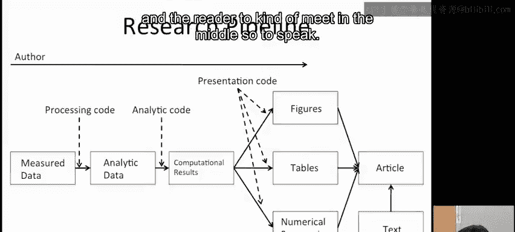
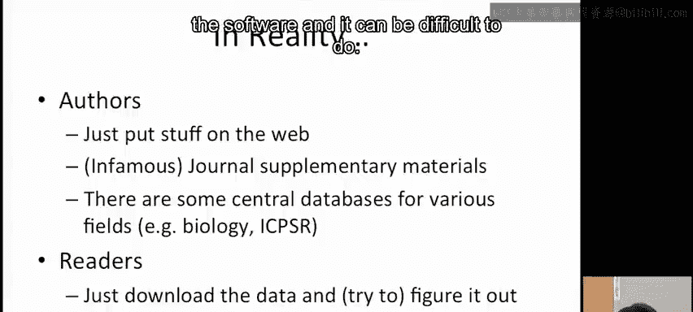

# 004：可重复研究概念与想法（第二部分）🔬

在本节课中，我们将深入探讨可重复研究的基本概念、其重要性以及实现可重复性所需的关键要素。我们将了解研究流程中作者与读者的互动，分析当前面临的挑战，并明确可重复研究的核心组成部分。

***

## 研究流程与可重复性的核心

上一节我们介绍了可重复研究的基本背景，本节中我们来看看研究的具体流程以及可重复性在其中扮演的角色。

当你阅读文献中的研究文章时，你通常只能看到最终的论文。然而，在这篇文章背后，存在一个完整的“研究流程”。作者沿着这个流程从左向右推进工作，而读者则试图从右向左追溯，通过文章去了解数据来源和分析过程。

可重复研究的基本理念，就是聚焦于“分析数据”和“计算结果”这两个核心环节。其目标是让作者和读者能在中间环节“相遇”，即读者能够基于作者提供的材料，重现其分析过程与结果。

***

## 可重复研究的重要性与现状

可重复性在媒体和科学文献中引发了广泛讨论。例如，《科学》杂志曾出版关于数据复现的专刊，电视节目《60分钟》也曾报道杜克大学因多项研究结果无法复现而引发的争议事件，这直接导致多项临床试验中止，并引发了持续调查。

作为回应，美国医学研究所针对此类事件发布了一份报告，旨在为促进和鼓励可重复研究（尤其是在基因组学、蛋白质组学等组学领域）制定最佳实践标准。这份报告非常重要，其中包含多项关键建议。

以下是该报告的部分核心建议：
*   **数据与元数据应公开可用。**
*   **计算机代码应完全公开**，以便他人审查分析过程。
*   **计算分析的所有步骤都应被详细描述**，使他人能够研究和复现。

***

## 实现可重复研究的要素

那么，实现可重复研究具体需要什么呢？首先，我们需要一个明确的定义。

一个基本的定义包含以下几个关键组成部分：
1.  **可用的分析数据**：即研究中实际用于分析并呈现结果的数据。这通常不同于原始数据，因为分析可能只使用了原始数据的一个子集。虽然原始数据可能具有参考价值，但分析数据是检验数据分析的核心。
2.  **可用的分析代码**：这是应用于分析数据并产生关键结果的代码，例如回归建模代码等。
3.  **代码与数据的文档**：对代码和数据进行充分的说明至关重要。
4.  **标准的传播方式**：所有数据和代码必须能够被轻松获取。

用公式来概括，可重复研究 ≈ **分析数据 + 分析代码 + 文档 + 可访问的传播渠道**。

***

## 相关方与当前挑战

在讨论可重复性时，涉及多个利益相关方，他们各有不同的需求和挑战。

大致可以分为两类：
*   **作者**：他们生产研究，并希望使其工作可重复，因此需要工具来简化这一过程。
*   **读者**：他们阅读研究，并希望复现该工作，同样需要工具来降低复现难度。

当前面临的主要挑战包括：
*   作者需要付出相当大的努力才能在网络上公开其数据和代码，这并非一项简单的任务。
*   即使材料已公开，读者也需要手动下载数据、代码和结果，并费力地将它们拼凑起来，这个过程通常很繁琐。
*   读者可能不具备与原作者相同的计算资源（例如大型计算集群），因此难以完全复现相同结果。
*   尽管正在增长，但用于进行可重复研究的工具箱仍然有限。

现实中，作者可能只是将材料随意发布在网上，或依赖于著名的杂乱无章的期刊补充材料。仅有少数中心数据库可供作者发布数据。如果你的研究领域有一个公认的核心数据库，那很幸运；否则，情况会困难得多。而读者最终往往只能手动下载和组装代码与数据，整合软件环境也可能非常困难。

***

## 总结

本节课中，我们一起学习了可重复研究在研究流程中的定位，了解了其受到广泛关注的原因及相关权威建议。我们明确了构成可重复研究的四个核心要素：**分析数据**、**分析代码**、**完备文档**和**标准传播**。同时，我们也认识到，无论是作者还是读者，在实现和验证可重复性时都面临着工具、资源和流程上的诸多现实挑战。理解这些概念和挑战是迈向更好研究实践的第一步。