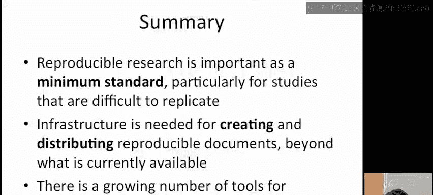

# 005：可重复研究概念与想法（第三部分）📚

在本节课中，我们将学习一种使研究更易复现的基本工具——**文学化统计编程**。我们将了解其核心概念、历史背景，以及现代工具如何改进这一理念。

---

## 文学化统计编程的基本理念 🧩

上一节我们讨论了数据与代码管理的重要性。本节中，我们来看看如何将分析与文档自然地结合起来。

文学化统计编程源于计算机科学中的“文学化编程”思想。其核心是将一篇**文章、出版物或报告**视为**文本流与代码流**的结合体。

*   **文本部分**：供人阅读，解释分析的背景、步骤与结果。
*   **代码部分**：供计算机执行，用于加载数据、计算和生成结果。

分析过程由一系列**文本块**和**代码块**共同描述。代码块执行具体操作（如计算），文本块则以人类可读的语言阐述上下文。其中可能包含用于格式化表格和图形的**呈现代码**，以及解释代码逻辑的**文章文本**。这种文本与代码的混合体，就构成了一个**文学化统计程序**或**文学化统计分析**。

这些程序可以通过“编织”生成人类可读的文档（如PDF或HTML网页），也可以通过“缠绕”生成机器可读的代码文档。

文学化编程的基本思想是，你需要一种**人类可读的文档语言**和一种**机器可读的编程语言**。

---

## 早期工具：Sweave及其局限 ⚙️

在R语言中，实现这一理念的原始系统叫做 **Sweave**。它由R核心成员Friedrich Leisch开发，目前仍由R核心团队维护。

Sweave的结构如下：
*   **文档语言**：LaTeX
*   **编程语言**：R

然而，原始的Sweave系统存在许多局限：
*   **学习曲线陡峭**：它主要依赖LaTeX，这是一种许多人并不熟悉的标记语言。
*   **功能有限**：缺乏缓存、每页多图、混合编程语言等现代需求的功能。
*   **开发活跃度低**：更新和维护不够频繁。

---

## 现代替代方案：knitr 🚀

近年来，一个重要的替代工具出现了，那就是 **knitr** 包。它由谢益辉在爱荷华州立大学攻读研究生时开发，现已成为一个非常流行的文学化统计编程工具。

knitr在Sweave原始概念的基础上进行了大量改进和功能增强：
*   **灵活的编程语言**：虽然仍以R为主要语言，但允许混合使用其他编程语言。
*   **多样的文档语言**：不仅支持LaTeX，还支持更易上手的 **Markdown** 和 **HTML**。

这使得创建可重复文档的门槛大大降低，功能也更加丰富。

---

## 总结与展望 📝

本节课我们一起学习了可重复研究的核心实践工具——文学化统计编程。

**总结来说**，对于计算密集型的分析，**可重复研究**是一项重要的最低标准，尤其是在复制研究非常困难甚至不可能的情况下。虽然我们仍需要更多的基础设施和工具来创建和分发可重复文档，但这一领域每天都在进步，新工具不断涌现。

在下一讲中，我将详细介绍一些这样的工具，特别是 **knitr**，并向大家展示如何用它来生成可重复的研究文档。