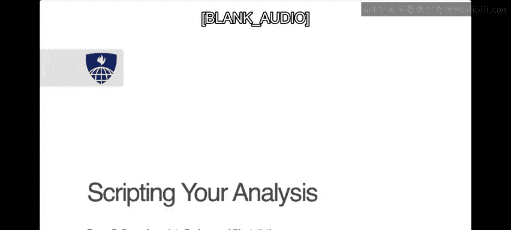
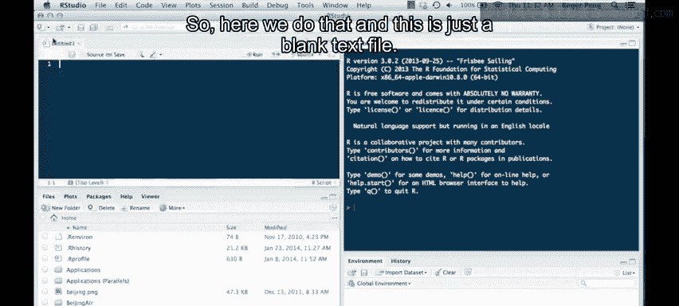
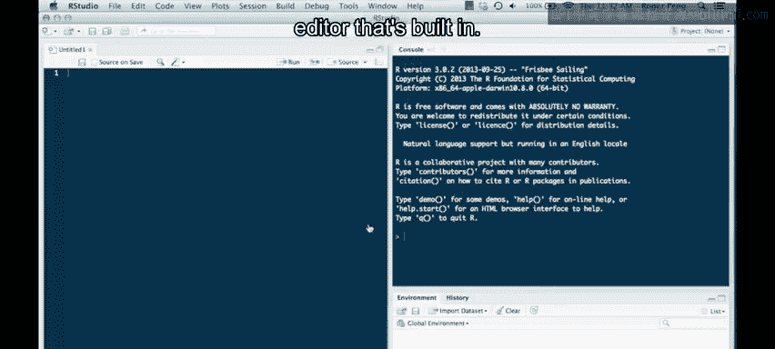

# 006：脚本化你的分析 📜

在本节课中，我们将探讨如何通过脚本化你的分析工作来确保其可重复性。我们将从核心原则开始，解释为什么脚本化至关重要，并通过一个生动的类比帮助你理解其价值。最后，我们将介绍如何开始编写你的第一个脚本。

## 核心原则：脚本化一切

在深入探讨各种工具和技术之前，我们首先需要明确贯穿整个课程的基本原则。我认为，如果你想尽可能地使你的工作可重复，有一条最重要的规则需要遵守：**你应该将一切都脚本化**。

脚本化非常重要，其基本理念是将所有事情都记录下来。在过去，你可能需要将事情写在纸上或实验笔记本中。但现在，我们拥有更精密的计算机，并且可以对其进行编程，因此你可以将事情写成脚本或程序。

## 一个生动的类比：音乐与乐谱

为了帮助你理解，我们可以做一个类比。想象一首伟大的交响乐或音乐作品。如果你只听到一段旋律，那会很有趣，也可能非常优美。但通常，一部交响乐背后有整个管弦乐队和一系列音乐家在支撑着旋律，完成大量工作。所有这些工作都非常重要，它们构成了音乐的质感和整体感觉。

如果你只是听一场交响乐，即使你能雇佣自己的乐队，你也很难重现那个声音。因为你不知道所有音符的位置，也不知道在特定时刻各种乐器在演奏什么。即使你听了几遍，可能仍然无法做到。特别是，如果你只听到旋律，你肯定无法重现那个声音。

## 研究与分析中的“旋律”与“乐谱”

将研究或分析报告想象成只听到旋律。旋律本身很好、很重要，但所有幕后的支持材料——你做的所有分析、探索性工作、走过的弯路、在分析中做出的但未在最终论文或口头报告中呈现的所有决定——都非常重要。这些就是“支持者”。

就像在音乐中一样，在研究中，我们需要一种方法来记录我们所做的一切、正在发生的一切。在音乐中，这通常被称为**乐谱**。乐谱是一种用音乐符号记录所有正在演奏的不同内容、所有音符、节奏、时间、乐器等一切的方式。这样，有人就可以看着乐谱说：“好的，我需要整合所有这些内容，人们需要在不同的时间、不同的位置进行演奏。” 这是一种尽可能准确地重现一首音乐作品的方式。音乐家们已经就记录音乐的标准方式和标准符号达成了一致。

## 数据分析的“乐谱”：脚本

本课程本质上就是关于定义和开发用于指定研究项目或数据分析的“符号”。我们如何记录我们所做的事情？我们如何准确地讨论分析了什么、做了什么？我们实现这一点的基本方式就是通过**脚本化**。

我们编写计算机程序，向计算机发出指令，告诉它在任何给定时间对什么类型的数据做什么。因此，对于你在数据分析中所做的任何事情，主要规则就是**编写一个脚本**。你越多地这样做，越少地手动操作而不做记录，你的工作就会越好、越可重复。

我们编写的这些计算机程序、这些脚本，就像是你的数据分析的**乐谱**。它们告诉试图重现你工作的其他人，到底发生了什么以及该做什么。

## 如何开始编写脚本

如果你想了解脚本化某事的含义，可以打开RStudio。当你打开它时，你会看到首先可以做的就是打开一个R脚本。我们在这里操作，这只是一个空白的文本文件。然后你可以开始在这里编写R代码，你将进行编程，用编码语言告诉R该做什么。这是开始脚本化最简单的方式：加载像RStudio这样的工具，并使用其内置的文本编辑器。

在本课程中，我们将讨论一系列其他工具，比如knitr、Markdown，它们将帮助你组织分析。但归根结底，核心是**记录下来**：编写脚本，编写程序，让你的工作可重复。

## 总结

本节课中，我们一起学习了可重复研究的核心理念：**脚本化一切**。我们通过音乐与乐谱的类比，理解了脚本作为数据分析“乐谱”的重要性，它完整记录了分析过程的所有细节，使他人的复现成为可能。最后，我们了解了使用RStudio等工具开始编写脚本的基本步骤。记住，将你的分析过程转化为代码脚本，是迈向严谨、可重复科学研究的关键一步。