# 008：数据分析结构（第2部分）📊

在本节课中，我们将继续学习数据分析的完整流程。上一节我们介绍了数据分析的前半部分步骤，本节我们将探讨剩余的关键环节，包括探索性数据分析、统计建模、结果解释与挑战、成果综合与撰写，以及如何创建可重复的代码。

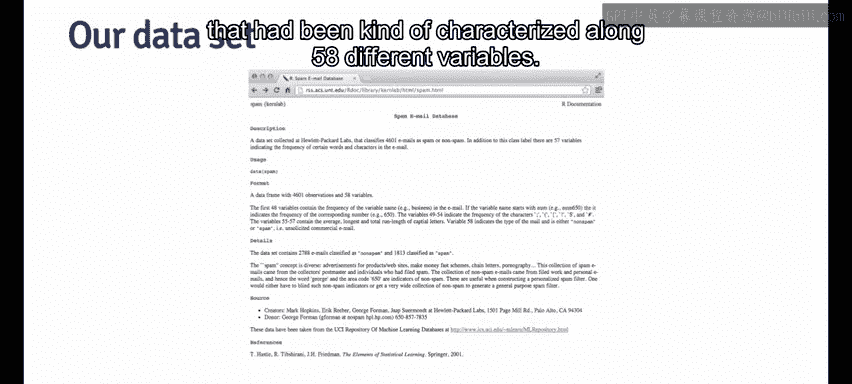

## 探索性数据分析 🔍

上一节我们介绍了数据准备和问题定义。本节中，我们来看看如何通过探索性数据分析来初步了解数据。

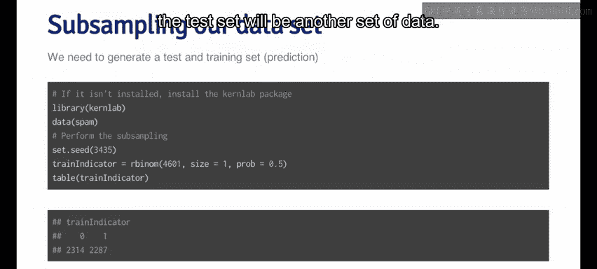

我们的目标是：能否根据电子邮件的量化特征，自动将其分类为垃圾邮件（spam）或正常邮件（ham）？我们使用的数据集来自UCI机器学习仓库，包含4600个观测值（邮件）和58个不同的变量（特征）。

首先，我们需要将数据集分割为训练集和测试集。我们使用训练集构建模型，使用独立的测试集评估模型性能。以下代码通过随机抽样将数据分为两半：

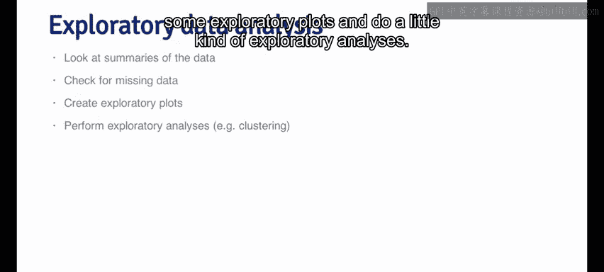

```r
set.seed(123) # 设置随机种子以确保结果可重复
split <- rbinom(nrow(data), 1, 0.5)
training_set <- data[split == 1, ]
test_set <- data[split == 0, ]
```

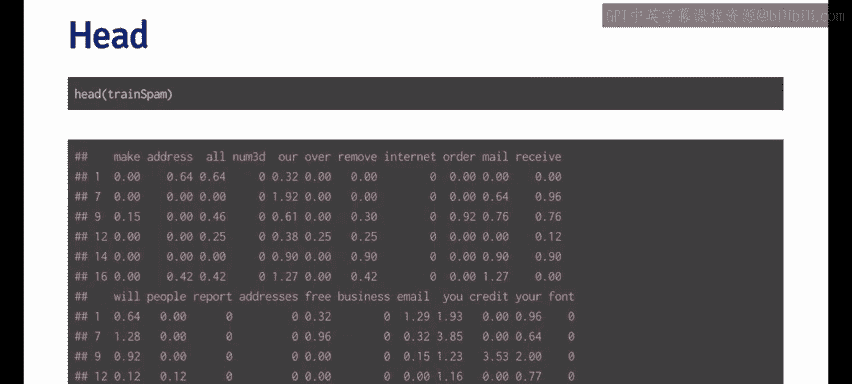

以下是探索性数据分析的几个关键步骤：

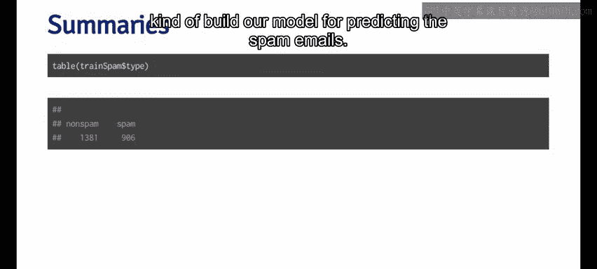

*   **查看基本摘要**：检查数据的维度、变量类型和基本统计量。
*   **检查缺失数据**：确认数据集中是否存在缺失值，并思考其原因。
*   **创建探索性图表**：通过可视化了解单个变量的分布以及变量之间的关系。

例如，我们可以比较垃圾邮件和正常邮件中“大写字母平均数量”这个变量的分布。由于数据高度偏斜，我们通常查看其对数变换后的结果（为避免对0取对数，先给变量值加1）：

```r
# 绘制对数变换后的分布图
library(ggplot2)
data$log_capital_avg <- log10(data$capital_avg + 1)
ggplot(data, aes(x=type, y=log_capital_avg)) + geom_boxplot()
```

图表显示，垃圾邮件通常含有更多的大写字母。我们还可以通过聚类分析探索预测变量之间的关系。对预测变量进行对数变换后，层次聚类的结果显示，“capitalAverage”自成一类，而“you”、“will”、“your”等词则聚集在另一类中。

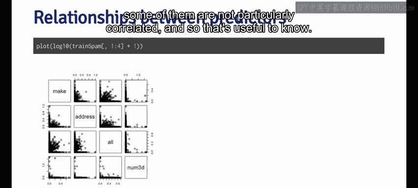

## 统计预测与建模 📈

完成数据探索后，我们可以开始构建统计模型。建模方法取决于具体的研究问题，并应参考探索性分析的结果，同时考虑数据是否经过处理或变换。

在本例中，我们将尝试一个基础的建模方法：为数据集中的每一个预测变量单独拟合一个逻辑回归模型，看看仅凭一个变量能多好地预测邮件是否为垃圾邮件。

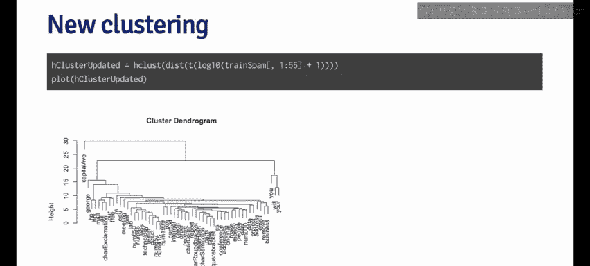

以下是实现这一过程的代码框架：

```r
# 初始化一个向量来存储交叉验证误差
cv_errors <- numeric(ncol(training_set) - 1) # 假设最后一列是响应变量‘type’
predictor_names <- names(training_set)[-ncol(training_set)]

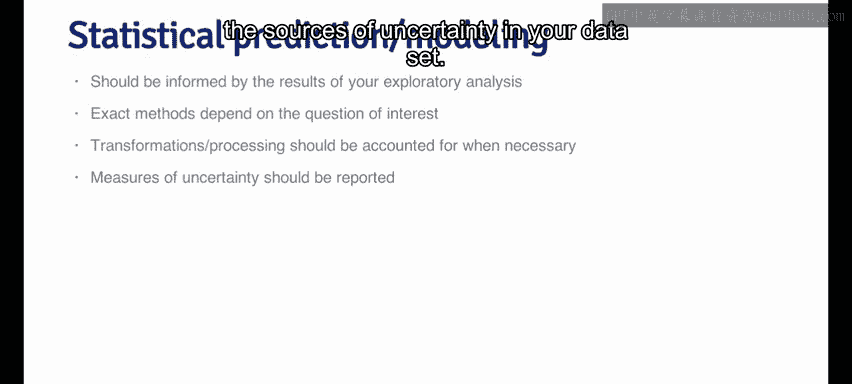

for (i in seq_along(predictor_names)) {
  # 为每个预测变量构建公式
  formula <- as.formula(paste("type ~", predictor_names[i]))
  # 拟合逻辑回归模型
  model <- glm(formula, data=training_set, family="binomial")
  # 此处应进行交叉验证并计算误差，存储到cv_errors[i]
  # 简化示例：使用训练集自身误差（实际应用中应用交叉验证）
  pred_prob <- predict(model, type="response")
  pred_class <- ifelse(pred_prob > 0.5, "spam", "ham")
  cv_errors[i] <- mean(pred_class != training_set$type)
}

# 找出误差最小的预测变量
best_predictor <- predictor_names[which.min(cv_errors)]
```

运行后发现，单个预测变量中交叉验证误差最小的是 **`char_dollar`**（邮件中美元符号的数量）。我们使用这个“最佳”变量重新拟合一个逻辑回归模型。

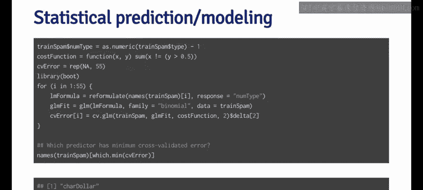

## 结果解释与模型评估 📝

模型拟合后，我们需要解释结果并在测试集上评估其性能。

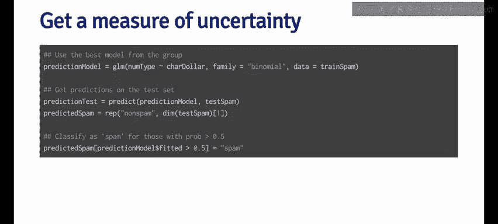

首先，使用拟合好的模型对测试集进行预测。逻辑回归输出的是邮件为垃圾邮件的概率（介于0和1之间）。我们设定一个阈值（例如0.5）将连续概率转化为分类：

```r
# 使用最佳预测变量拟合最终模型
final_model <- glm(type ~ char_dollar, data=training_set, family="binomial")
# 在测试集上进行预测
test_predictions_prob <- predict(final_model, newdata=test_set, type="response")
test_predictions_class <- ifelse(test_predictions_prob > 0.5, "spam", "ham")
```

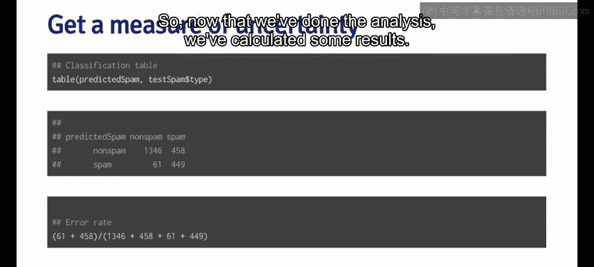

接着，将预测分类与测试集中的真实标签进行比较，生成混淆矩阵并计算错误率：

```r
# 创建混淆矩阵
confusion_matrix <- table(Predicted = test_predictions_class, Actual = test_set$type)
print(confusion_matrix)
# 计算错误率
error_rate <- (confusion_matrix[1,2] + confusion_matrix[2,1]) / sum(confusion_matrix)
cat("测试集错误率：", round(error_rate * 100, 1), "%")
```

在我们的示例中，模型在测试集上的错误率约为22.4%，即准确率为77.6%。

## 挑战你的结果 🤔

在得出最终结论前，主动挑战自己的分析过程和结果至关重要。这能让你提前应对他人可能提出的质疑。

需要审视的方面包括：
*   **问题本身**：这是否是一个有效的问题？
*   **数据来源与处理**：数据从何而来？清洗和处理过程是否合理？
*   **分析方法**：为什么选择这个模型？它是否是最佳或最合适的？如何选择纳入模型的变量？
*   **不确定性度量**：使用的不确定性度量（如误差率）是否恰当？
*   **替代分析**：是否有其他分析方法可能更有效或提供不同视角？

## 综合与撰写成果 📄

分析完成后，需要将结果综合并撰写成文或进行演示。综合意味着从众多分析中提炼出最重要的部分，讲述一个连贯的故事。

讲述故事的典型结构是：
1.  **引出问题**：首先明确要解决的核心问题。
2.  **交代背景与方法**：说明使用了什么数据，以及为什么采用当前的分析方法。
3.  **总结关键分析**：按逻辑顺序呈现支持结论的关键分析，而非按执行的时间顺序。
4.  **展示核心结果**：使用精心设计的图表清晰展示主要发现。
5.  **给出解释与结论**：解释结果的含义，并指出其合理性与局限性。

在我们的例子中，故事线可以是：为了根据量化特征分类垃圾邮件，我们使用了UCI的邮件数据集，通过探索发现美元符号数量与垃圾邮件高度相关；基于此建立的单变量逻辑回归模型在测试集上达到了77.6%的准确率；这个结果直观上合理（垃圾邮件常包含更多美元符号），但准确率仍有很大提升空间，未来可考虑纳入更多变量或使用更复杂的模型。

## 创建可重复的代码 🔄

最后，也是贯穿始终的一点，是确保你的分析是可重复的。这意味着你或他人在未来能够准确地复现整个分析过程。

实现可重复研究的关键是：
*   **使用脚本语言**：如R、Python，所有操作都应记录在脚本中。
*   **利用文档化工具**：例如在R中，可以使用 **R Markdown** 和 **knitr** 包。它们允许你将代码、结果（图表、表格）和文字叙述整合在同一个动态文档中。
*   **保持组织有序**：清晰地组织项目文件夹，区分数据、代码和结果。
*   **记录会话信息**：使用 `sessionInfo()`（R）或类似命令记录软件包版本，这对于重现计算环境非常重要。

一个简单的R Markdown文档结构如下：

    ```r
    ---
    title: "垃圾邮件预测分析"
    author: "你的名字"
    date: "`r Sys.Date()`"
    output: html_document
    ---
    ## 概述
    本次分析旨在...
    ## 数据准备
    ```{r data-prep}
    # 加载和分割数据的代码
    ```
    ## 探索性数据分析
    ```{r eda}
    # 绘制图表和摘要的代码
    ```
    ## 建模与预测
    ```{r model}
    # 建模和评估的代码
    ```
    ```

通过这样的方式，你的整个分析流程就变得透明、可追溯且易于他人验证，从而极大地增强了研究结论的说服力。

## 总结

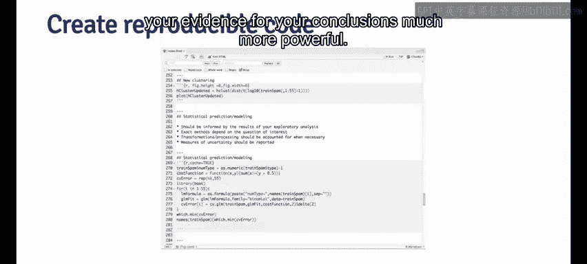

本节课中，我们一起学习了数据分析流程的后半部分。我们从探索性数据分析入手，初步了解了数据特征；随后建立了一个简单的统计预测模型（逻辑回归）并评估其性能；接着我们强调了在解释结果后，必须主动挑战自己的分析；然后，我们探讨了如何将复杂的分析过程综合成一个连贯的故事进行呈现；最后，我们指出了使用像R Markdown这样的工具来创建可重复、可文档化的分析代码的重要性。掌握这个完整的流程，是进行严谨、可信的数据分析的关键。