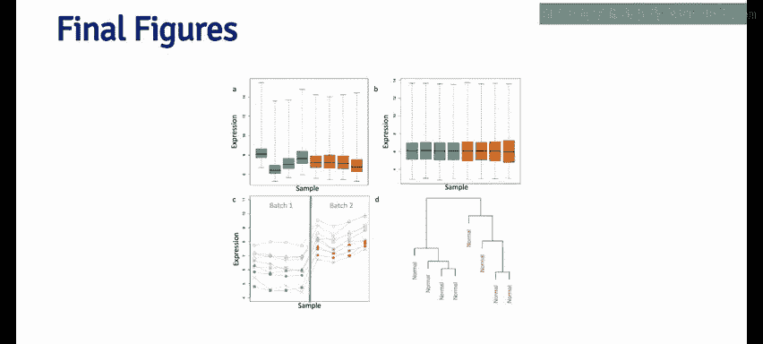
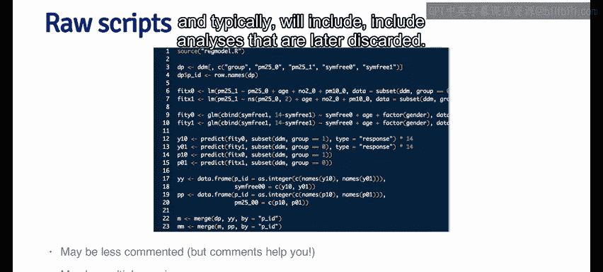
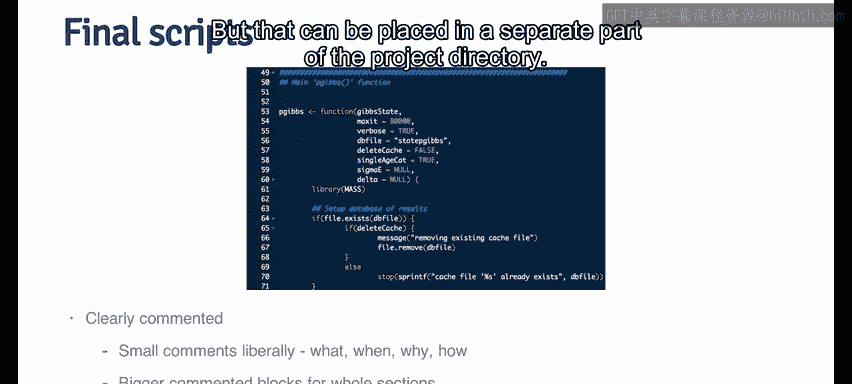
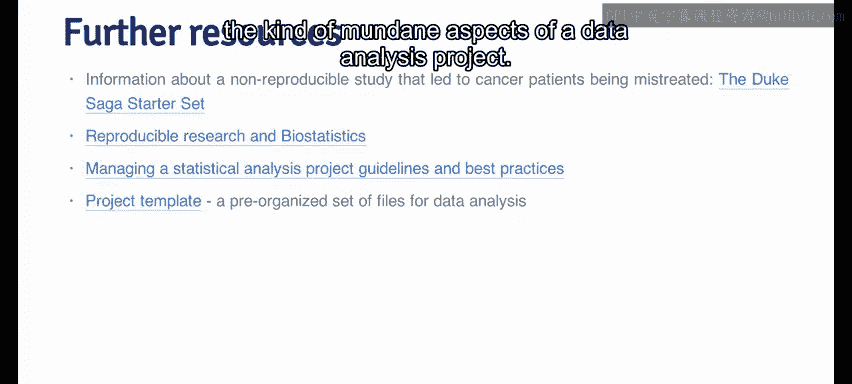

# 009：组织你的数据分析

在本节课中，我们将学习如何有效地组织一个数据分析项目。虽然不存在适用于所有人和所有项目的通用方法，但掌握一些基本原则和实用技巧，可以帮助你将项目文件有条理地放置，并最终确保你的分析工作对你或他人而言都是**可重复**的。

---

## 📊 概述：数据分析的关键文件

一个完整的数据分析项目通常会包含多种类型的文件。理解这些文件的角色和关系，是组织项目的第一步。

以下是你在一个主要项目中可能会保留的关键文件类型：

*   **数据文件**：包括原始数据和经过处理的数据。
*   **图表与表格**：分为探索性图表和最终图表。
*   **代码文件**：包括原始的、未使用的脚本和最终的分析脚本。
*   **R Markdown文件**：用于生成可重复的报告。
*   **文本文件**：如说明文档和最终的报告或论文。

所有这些元素——数据、图表、表格和代码——最终都需要通过文本来整合，讲述一个完整的数据分析故事。

---

## 🗃️ 原始数据与处理数据

上一节我们概述了项目中的各类文件，本节我们来详细看看数据文件。

### 原始数据
原始数据可能以多种形式存在，例如文本记录或特定格式的文件。你需要对这些数据进行处理，使其能被分析程序（如R）使用。例如，进行文本解析或格式转换。

**存储原始数据时，务必记录其来源和获取信息**，这对于可重复性至关重要。建议将这些信息记录在`README`文件中，或如果使用Git等版本控制系统，可以在提交日志中注明。

**记录信息应包括**：
*   数据集的来源网址（URL）
*   数据集的简要描述
*   访问或下载数据的日期

### 处理数据
处理后的数据通常比原始数据更整洁，常以表格形式存储，包含行和列。

**处理数据应遵循以下原则**：
1.  **文件命名清晰**：通过文件名就能看出是由哪个脚本生成的。
2.  **记录处理脚本**：在文档中明确说明是哪个代码文件将原始数据转换成了处理数据。
3.  **保持数据“整洁”**：处理后的数据应是规整的，以便直接用于后续的建模或分析函数。一个“整洁”的数据集通常满足：每个变量一列，每个观测一行。

---

## 📈 探索性图表与最终图表

在数据处理之后，我们通常通过可视化来理解数据。根据目的不同，图表可分为探索性和最终两种。

### 探索性图表
探索性图表是你在分析过程中为初步查看数据而制作的。数据通常是高维的，因此你需要从不同角度、分批次地观察数据。

**探索性图表的特点**：
*   **目的**：快速了解数据的各个方面。
*   **外观**：无需精美，但需清晰可辨，便于理解。
*   **数量**：会制作很多，但大部分不会进入最终报告。

### 最终图表
最终图表是用于报告或论文的成品，它们更加精炼和美观。

**最终图表的特点**：
*   **目的**：清晰、有力地传达核心发现。
*   **外观**：组织良好，标注清晰，可读性强（例如，可能使用多面板图来整合信息）。
*   **数量**：数量很少，是海量探索性图表中的精华。通常一篇论文只有4-5个图，以避免信息过载。

---

## 💻 代码文件：从草稿到终稿

图表源于代码，而代码本身也需要良好的组织。在分析过程中，你会产生大量代码文件。

### 原始/未使用的脚本
这些脚本是分析过程中的“草稿”，可能用于尝试性分析或生成探索性图表。

**它们的特点**：
*   注释较少，结构可能随意。
*   可能存在多个版本。
*   包含了许多最终被弃用的分析路径。

### 最终脚本
这些是构成最终分析的“终稿”代码。

**它们的特点**：
*   **注释清晰**：包含大段的章节说明和解释具体步骤的小注释。
*   **结构完整**：包含从原始数据处理到模型拟合、图表生成的全链条代码。
*   **可追溯**：他人看到最终报告时，应能明确知道是哪些脚本生成了它。

**组织建议**：将最终脚本与未使用的脚本分开存放，例如放在不同的项目子目录中，但保留未使用的脚本以备查考。

---

## 📝 R Markdown 与说明文档

为了将代码、结果和叙述文本整合在一起，我们需要使用特定的工具。

### R Markdown 文件
R Markdown 并非必需，但它极其有用，可以生成**可重复的报告**。

**其优势在于**：
*   能在同一文档中嵌入代码、文本、图表和结果。
*   可一键编译生成网页（HTML）、PDF等格式的友好报告。
*   在RStudio中易于创建和使用，是介于原始代码与精美终稿之间的理想中间产物。

### ReadMe 文件
如果你的项目不使用R Markdown，那么`README`文件就至关重要。它解释了项目目录的结构和内容。

**一个良好的`README`文件应包含**：
*   项目概述。
*   分步指南：说明先运行哪个代码处理数据，再运行哪个代码拟合模型等。
*   文件组织结构说明。

**核心概念**：使用R Markdown是“文学化编程”或“文学化统计分析”的实践，它力求将文档、代码和数据集成在单一文件中，而非彼此分离。

---

## 📄 生成最终报告

所有分析工作的结晶是一份最终的文档或报告，例如一篇论文。

**一份标准的研究报告通常包括以下部分**：
1.  **标题**
2.  **引言**：阐述研究问题和动机。
3.  **方法**：描述所使用的数据和方法。
4.  **结果**：呈现主要发现，并报告不确定性度量。
5.  **讨论/结论**：总结分析结果，指出局限性或潜在问题。

**撰写最终报告的关键**：
*   **讲述连贯的故事**：你需要从所有分析中提炼出一个逻辑清晰、重点突出的叙述，而不是事无巨细地罗列所有尝试。
*   **引用与方法说明**：务必引用所使用的统计方法、软件包和具体实现，这对他人的复现至关重要。

---

## 🔗 延伸阅读与工具

以上是组织数据分析的一些基本要点。每个具体项目都有其特殊性，但以下资源可以提供更深入的指导和自动化帮助：

*   **不可重复研究的案例**：关于癌症数据分析的不可重复案例研究链接。
*   **可重复研究政策**：《生物统计学杂志》上关于可重复研究政策的社论。
*   **项目管理指南**：一些关于管理统计分析项目的指南和最佳实践。
*   **`ProjectTemplate`软件包**：一个R包，可以自动化数据分析项目中许多常规的初始化工作，值得尝试。

---

## ✅ 总结

在本节课中，我们一起学习了如何组织一个可重复的数据分析项目。我们了解了项目中常见的各类文件（原始/处理数据、探索性/最终图表、代码脚本、R Markdown、说明文档和最终报告）及其作用与组织原则。记住，清晰的组织结构、完整的记录和连贯的故事叙述，是确保分析工作对你和他人都具有可重复性的关键。