# 010：R语言编码标准 📝

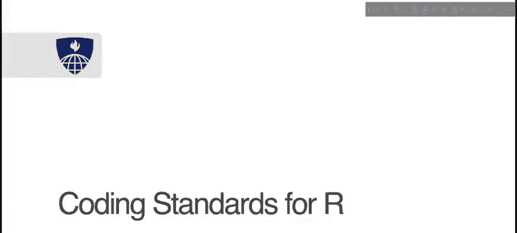

在本节课中，我们将学习R语言中的编码标准。这些标准能帮助你编写可读性更强的代码，让你和他人更容易理解代码的逻辑和结构。

## 概述

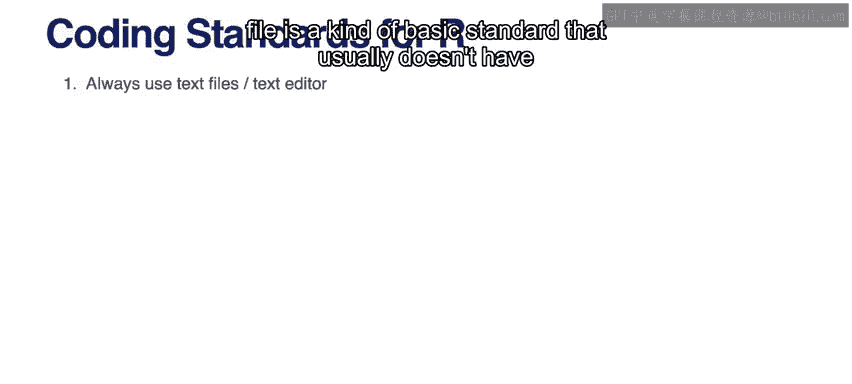

编码标准对于任何编程语言都至关重要，R语言也不例外。遵循一致的编码规范，不仅能提升代码的可读性，还能促进团队协作和代码维护。本节将介绍几个基础的、被广泛接受的R语言编码原则。

## 基本原则

以下是编写R代码时应遵循的几个核心原则。

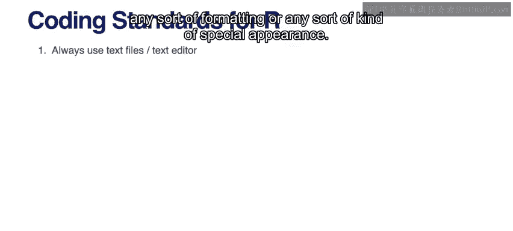

### 1. 使用文本编辑器

在任何编程语言中，包括R，都应始终使用文本编辑器编写代码，并将代码保存为文本文件。

文本文件是一种基础标准，通常不包含任何特殊格式或样式。它只是纯文本，通常是ASCII编码。使用文本编辑器是编写代码的“最小公分母”，它能确保任何人都能访问并改进你的代码。

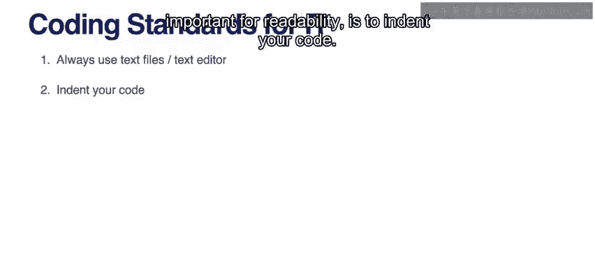

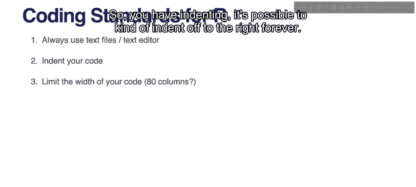

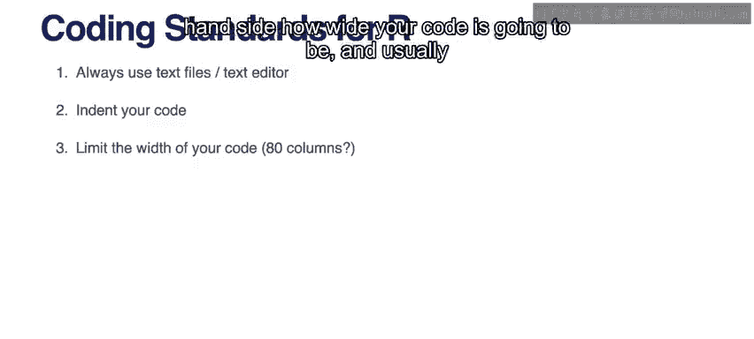

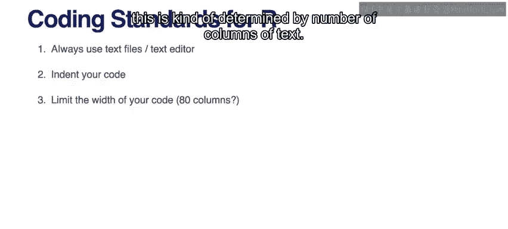

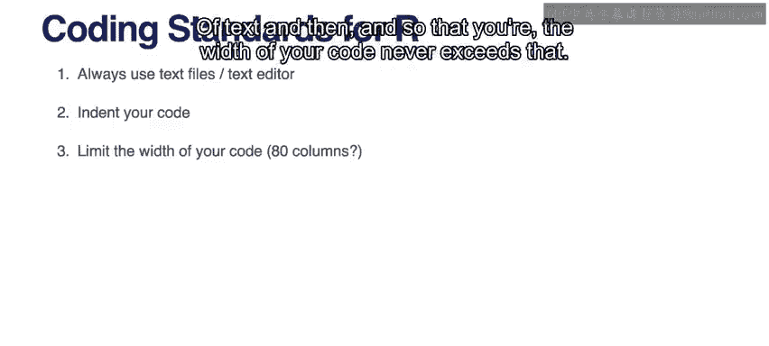

### 2. 缩进你的代码

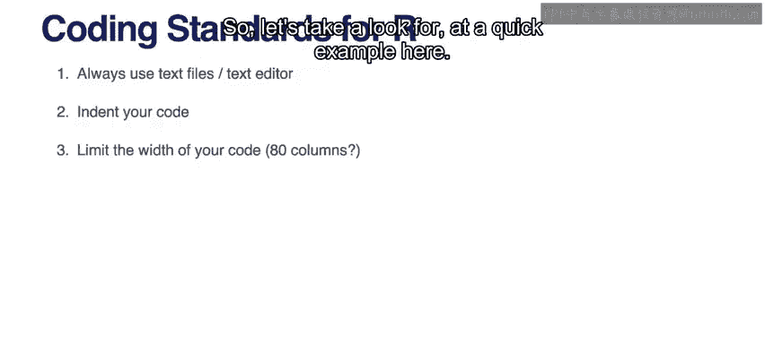

为了提升代码的可读性，缩进是至关重要的。缩进是指将不同的代码块向右移动一定距离，以便通过缩进本身就能看出程序的控制流和结构。

### 3. 限制代码宽度

与缩进原则紧密相关的是限制代码的宽度。如果你无限制地向右缩进，代码会变得难以阅读。因此，需要限制代码行的最大宽度，通常以文本列数来衡量。一个常见的做法是将代码宽度限制在80个字符以内。

### 4. 限制函数的长度

R语言中的函数理论上可以写得很长，但为了逻辑清晰和易于调试，应该限制每个函数的长度。一个函数最好只完成一项基本活动。

## 详细说明与示例

上一节我们介绍了四个基本原则，本节中我们来看看如何具体应用它们，并通过示例加深理解。

### 缩进与代码宽度

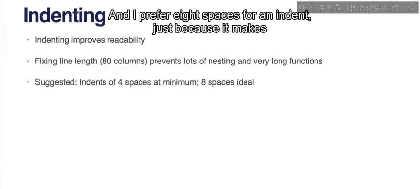

缩进量的大小常引发讨论。虽然具体数量可能因人而异，但关键是理解缩进的重要性。缩进过少会使代码挤在一起，难以区分不同的代码块。

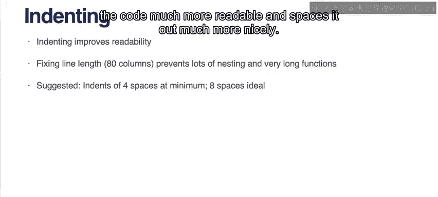

以下是一个缩进不佳的代码示例：

```r
# 缩进不佳的示例
my_function <- function(x) {
if (x > 0) {
print("Positive")
} else {
print("Non-positive")
}
}
```

在RStudio等编辑器中，你可以轻松调整缩进设置。例如，将缩进设置为4个或8个空格，并使用“重新缩进”功能，可以使代码结构一目了然。

```r
# 缩进良好的示例（使用4个空格）
my_function <- function(x) {
    if (x > 0) {
        print("Positive")
    } else {
        print("Non-positive")
    }
}
```

将缩进设置为8个空格，并配合80字符的右侧边距限制，有一个额外的好处：它会促使你以不同的方式思考代码结构。例如，当嵌套多个`for`循环时，过深的缩进会很快触及右侧边界，这提示你可能需要将复杂逻辑拆分成独立的函数，从而避免编写难以阅读的深层嵌套代码。

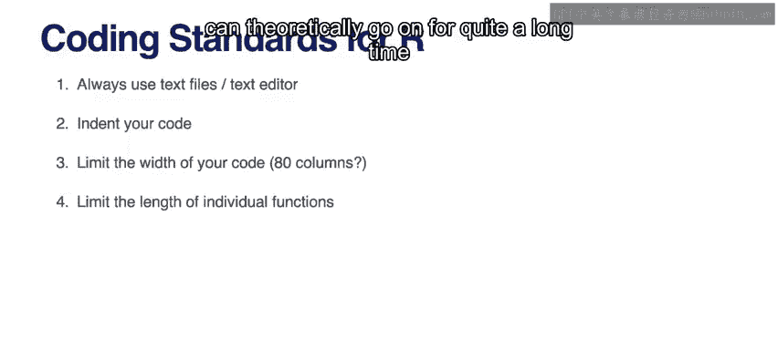

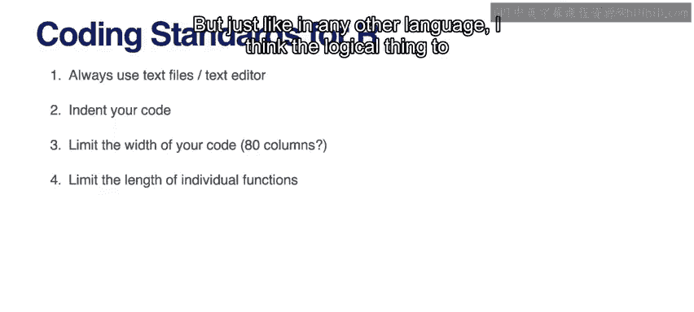

### 函数设计原则

函数应该专注于完成单一、逻辑明确的任务。例如，一个名为`read_data`的函数应该只负责读取数据，而不应同时处理数据、拟合模型和打印输出。

将代码拆分为逻辑清晰的函数有几个优点：
*   **可读性**：单个函数可以完整地显示在一屏编辑器内，便于整体理解。
*   **调试与性能分析**：当使用`traceback`、性能分析器或调试器时，如果函数逻辑划分清晰，这些工具能更精确地指出问题发生在函数调用栈的哪个部分。如果所有逻辑都塞在一个冗长的函数里，调试器只能告诉你这个函数有问题，而难以定位具体位置。

当然，也要避免走向另一个极端，即创建大量只有两三行的微小函数。关键在于确保函数的分离是**逻辑上合理**的，每个函数都**专注于完成一件特定的事情**。

## 总结

本节课中我们一起学习了R语言编码的四个核心标准：
1.  **使用文本编辑器**编写和保存代码。
2.  **对代码进行缩进**（建议至少使用4个空格，个人推荐8个空格以增强结构清晰度）。
3.  **限制代码行的宽度**（例如不超过80个字符）。
4.  **限制函数的长度和复杂度**，确保每个函数职责单一、逻辑清晰。

遵循这些基本原则，你的R代码将变得更具可读性，无论是对你自己还是对他人而言，都能使代码的编写和维护变得更加高效和实用。