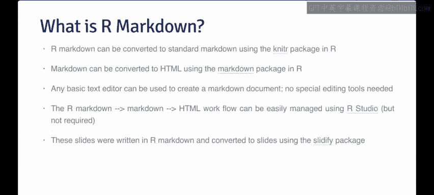

# 012：R Markdown简介 📝

在本节课中，我们将学习R Markdown的基本概念。这是一种将R代码与文档撰写相结合的工具，旨在简化数据分析报告的创建过程，并确保代码的可重复性。

## 什么是Markdown？ ✍️

上一节我们介绍了本课程的主题，本节中我们来看看R Markdown的基础之一——Markdown语言。

Markdown是一种非常简单的标记语言。它的设计哲学是让作者能够专注于写作内容本身，而不是复杂的格式设置。与HTML、LaTeX或XML等语言相比，Markdown的语法直观且易于学习。

以下是Markdown的一些核心特点：
*   **设计目标**：帮助作者专注于内容创作，而非格式。
*   **语法特点**：提供基础的、直观的格式化元素，如**粗体**、章节标题和列表。
*   **灵活性**：允许在文档中直接插入任意的HTML元素，以实现更复杂的格式。
*   **可转换性**：可以轻松地通过工具链转换为HTML等多种格式。

更多关于Markdown的详细信息，可以参考其创始人John Gruber的网站。

## 什么是R Markdown？ 🔗

了解了Markdown之后，本节我们来看看R Markdown是什么。

R Markdown本质上是将R代码嵌入到Markdown文档中。其核心思想是，在一个使用Markdown语法书写的文档里，可以包含可执行的R代码块。

*   一个R Markdown文档看起来像标准的Markdown文档，但其中“点缀”着被称为“代码块”的R代码。
*   这些代码块由特殊的格式标签标识。
*   这类文档通常使用 `.Rmd` 作为文件扩展名。

使用R Markdown的一个主要优点是，它允许你将“活的”R代码插入文档。当处理该文档以生成最终报告（如HTML）时，其中的R代码会被自动执行和评估。这意味着，文档中展示的任何代码，都必须是能够成功运行的，因为生成文档的过程本身就验证了代码的有效性。

因此，R Markdown的基本理念是：**你可以执行R代码，并将代码运行的结果（如图表、表格）直接插入到生成的Markdown文档中**。它是实现“文学化统计编程”的核心工具，我们将在后续讨论可重复研究时深入探讨。

## 如何处理R Markdown文档？ ⚙️

现在我们知道R Markdown是什么了，本节将介绍处理它的基本工作流程。

你可以使用R中的 `knitr` 包来处理R Markdown文档。`knitr` 会读取 `.Rmd` 文件，执行其中所有的R代码，将结果嵌入，并输出一个纯Markdown文件（`.md`）。随后，可以使用R的 `markdown` 包将这个Markdown文件转换为HTML等最终格式。

以下是处理R Markdown文档的关键步骤和工具：
*   **核心工具**：`knitr` 包和 `markdown` 包。
*   **编辑工具**：任何基本的文本编辑器都可以用来创建和编辑R Markdown文档，无需复杂的专用软件。
*   **工作流程**：
    1.  编写核心的 `.Rmd` 源文件（包含Markdown文本和R代码）。
    2.  使用 `knitr` 包将 `.Rmd` 文件转换为 `.md` 文件。
    3.  使用 `markdown` 包将 `.md` 文件转换为最终的 `.html` 文件。
*   **重要原则**：你**只编辑**最初的 `.Rmd` 源文件，而**不编辑**中间生成的 `.md` 文件或最终的 `.html` 文件。

如果你使用RStudio，整个过程会变得非常简单。RStudio集成了 `knitr` 和 `markdown` 的功能，甚至内置了网页浏览器，可以直接预览最终生成的报告。

## 一个简单的例子 🌰

最后，让我们通过一个例子来感受R Markdown的实用性。

你正在观看的这套课程幻灯片，就是用R Markdown编写的。虽然这些幻灯片中没有包含R代码（因此更接近纯Markdown），但它们是利用 `slidify` 包构建的，该包在底层调用了 `knitr` 和 `markdown` 包来将源文件转换为HTML格式的幻灯片。这展示了基于R Markdown（或纯Markdown）的格式语言具有高度的灵活性，能够被转换成多种不同的演示风格和输出格式。

## 总结 📚

本节课中我们一起学习了R Markdown的基础知识。我们了解到，R Markdown是Markdown语言与R代码的结合，它允许我们在撰写文档时直接嵌入并执行R代码，从而创建动态、可重复的数据分析报告。我们介绍了其核心概念、优势以及使用 `knitr` 和 `markdown` 包进行处理的基本工作流程。掌握R Markdown是迈向高效、透明、可重复的数据科学研究的重要一步。