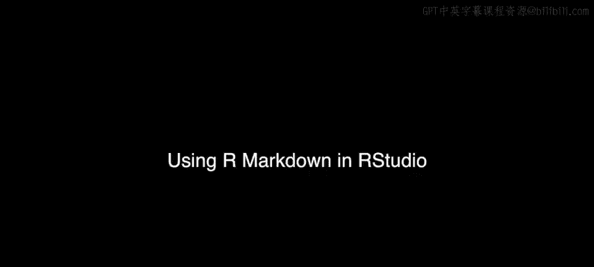
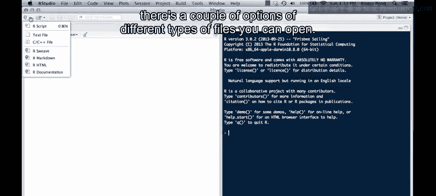
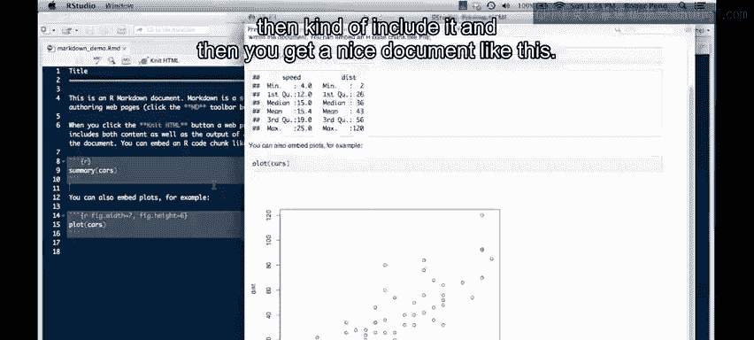
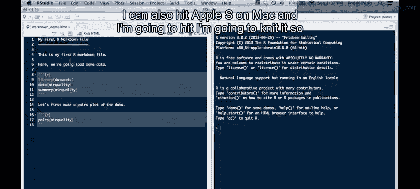
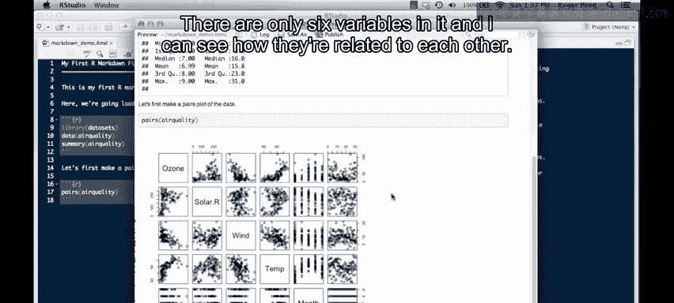
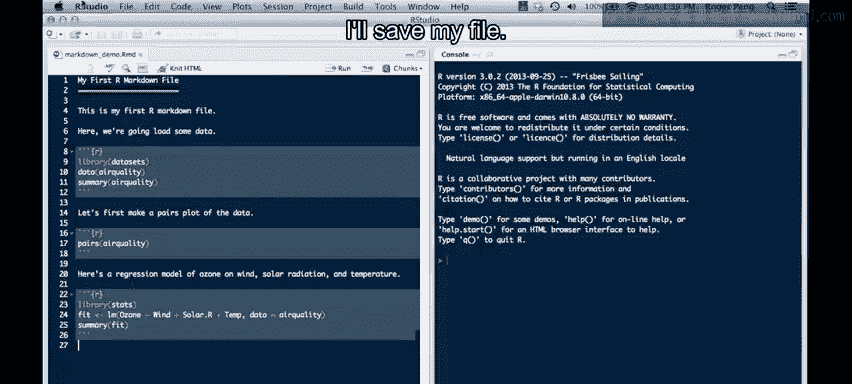
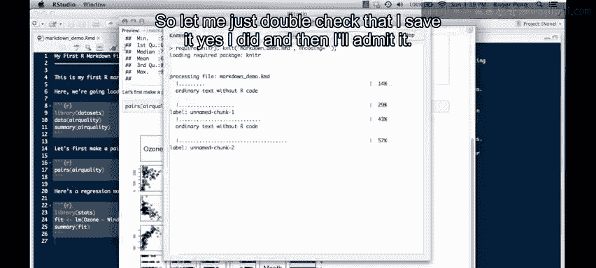
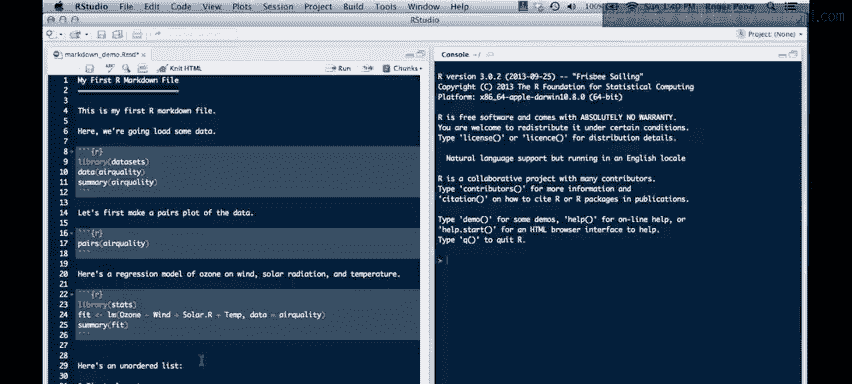
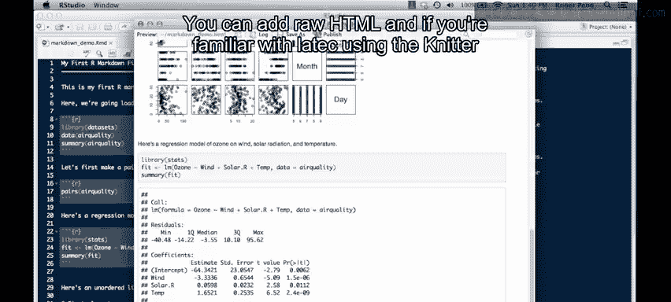

# 013：R Markdown 快速演示 🚀



在本节课中，我们将学习如何创建和编辑一个 R Markdown 文档。我们将从打开 RStudio 开始，逐步创建一个包含文本、R 代码、数据分析和可视化的完整文档，并最终将其编译成格式优美的 HTML 报告。

---



## 创建新文档

首先，在 RStudio 中创建一个新的 R Markdown 文档。你可以通过菜单栏选择 `File` -> `New File` -> `R Markdown...` 来完成。


RStudio 会自动生成一个包含示例内容的文档，这有助于初学者了解 Markdown 的基本结构。

## 编译初始文档

为了查看默认文档的效果，我们可以直接点击 `Knit` 按钮（通常显示为 `Knit to HTML`）来编译它。


在首次编译时，系统会提示你保存文件。将文件命名为 `Markdown_demo.Rmd`（`.Rmd` 是 R Markdown 的标准文件扩展名）。编译过程会执行文档中的所有 R 代码，并将结果（包括文本、代码和输出）嵌入到一个 HTML 文件中。

编译完成后，你会在 RStudio 的内置浏览器中看到一个格式清晰的报告。它包含了标题、文本段落、置于灰色框中的 R 代码，以及代码执行后生成的输出（如文本结果和图表）。这种方式的好处是，所有内容都集成在一个文档中，无需单独生成和插入图表。



## 编辑文档内容

当然，默认生成的文档并非我们最终想要的。接下来，我们将清空示例内容，从头开始构建自己的报告。

首先，我们添加一个标题和介绍性文字。

```markdown
我的第一个 R Markdown 文件
===========================================================

这是我的第一个 R Markdown 文件。下面我们将加载一些数据进行分析。
```

在 Markdown 中，在文本下方添加一行等号（`=`），可以将该文本设置为一级标题。

## 添加第一个 R 代码块

现在，我们添加第一个 R 代码块来加载并查看数据。R 代码块由三个反引号（```）包裹，并在起始反引号后的大括号内注明语言为 `{r}`。

```r
```{r}
# 加载 datasets 包中的 airquality 数据集
library(datasets)
data(airquality)
# 查看数据摘要
summary(airquality)
```
```

当你在编辑器中输入 `{r}` 后，该区域的语法高亮会发生变化，表明你正在编写 R 代码。这个代码块的作用是加载 `airquality` 数据集（一个关于臭氧等环境指标的数据框），并输出其统计摘要。

## 添加第二个 R 代码块与图表

在第一个代码块之后，我们可以添加一些描述性文本，然后插入第二个代码块来创建可视化图表。

以下是创建散点图矩阵的代码块：

```r
```{r}
# 绘制变量间的散点图矩阵
pairs(airquality)
```
```



## 编译并查看结果

保存文件（快捷键 `Cmd+S` 或 `Ctrl+S`），然后再次点击 `Knit` 按钮进行编译。


编译后的报告将依次显示：
1.  我们添加的标题和文本。
2.  第一个代码块及其输出：即 `airquality` 数据集中各变量的摘要统计信息（如中位数、均值、缺失值数量等）。
3.  第二个代码块及其输出：一个展示数据集中所有变量两两之间关系的散点图矩阵。

## 添加回归分析

为了展示更完整的分析流程，我们接下来添加一个线性回归模型。



在图表之后，我们添加第三个 R 代码块来拟合一个模型，探究臭氧浓度与风速、太阳辐射和温度的关系。

```r
```{r}
# 拟合线性回归模型
library(stats)
fit <- lm(Ozone ~ Wind + Solar.R + Temp, data = airquality)
# 查看模型摘要
summary(fit)
```
```

保存并再次编译文档。



在生成的 HTML 报告中，回归模型的代码和详细结果（包括系数、标准误和 P 值等）会紧跟在散点图矩阵之后。结果显示，风速、太阳辐射和温度这三个变量都与臭氧浓度显著相关。




## 其他格式元素

除了标题、段落和代码块，R Markdown 还支持许多其他格式。例如，你可以轻松地创建无序列表。

在文档末尾添加以下 Markdown 语法：

```markdown
**分析要点：**
*   数据加载与概览
*   探索性可视化
*   统计建模
```

保存并编译后，你会在报告底部看到一个带项目符号的列表。



此外，你还可以在 R Markdown 中嵌入原始 HTML、LaTeX 数学公式（通过 knitr 包支持）等高级内容，以满足更复杂的排版需求。


---

## 总结 🎯

本节课我们一起学习了 R Markdown 的基本操作。我们掌握了：
1.  **创建文档**：在 RStudio 中新建 R Markdown 文件。
2.  **基础结构**：编写标题、文本段落。
3.  **嵌入代码**：使用 ` ```{r} ... ``` ` 语法插入并执行 R 代码块。
4.  **生成报告**：通过 `Knit` 功能将 `.Rmd` 文件编译为包含所有结果（文本、代码、图表、表格）的 HTML 报告。
5.  **添加格式**：使用简单的 Markdown 语法（如列表）来增强报告的可读性。

R Markdown 的核心优势在于将数据分析的代码、结果与说明文字无缝整合在一个可重复执行的文档中。你现在可以打开 RStudio，尝试创建和编辑你的第一个 R Markdown 文件了。



