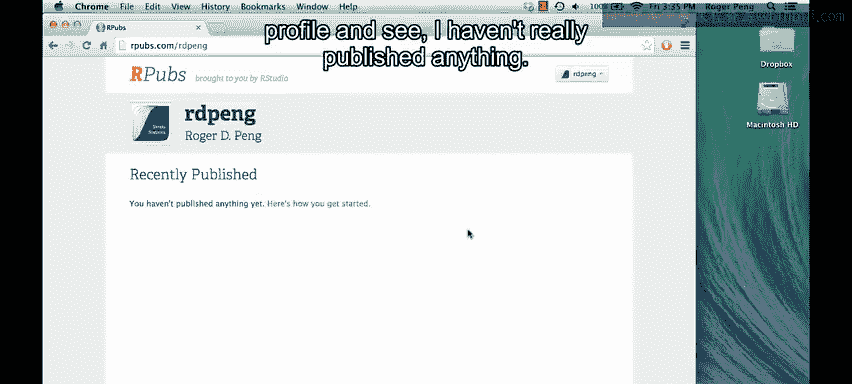
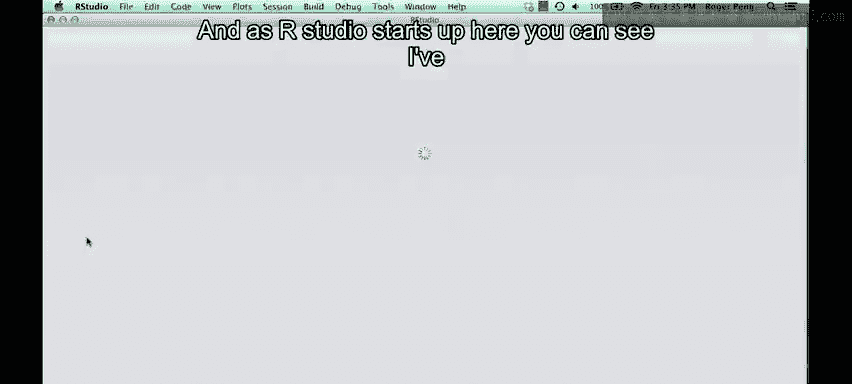
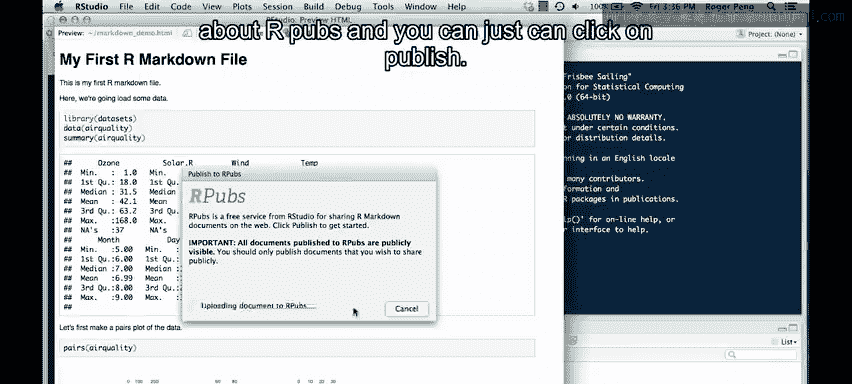
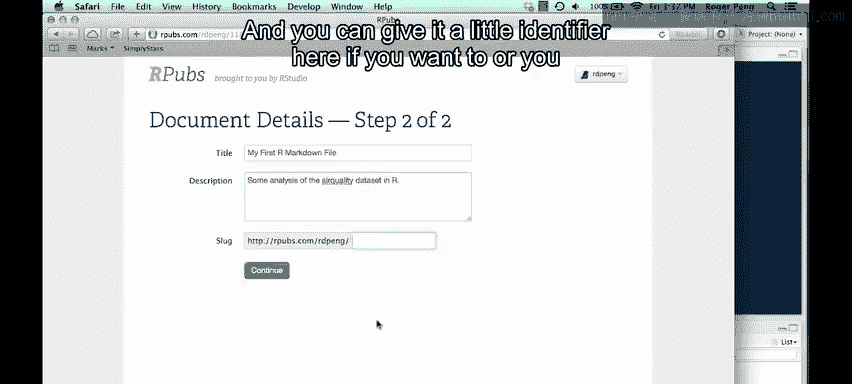
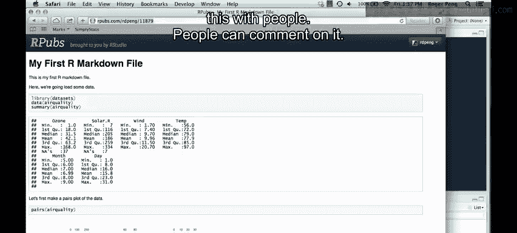
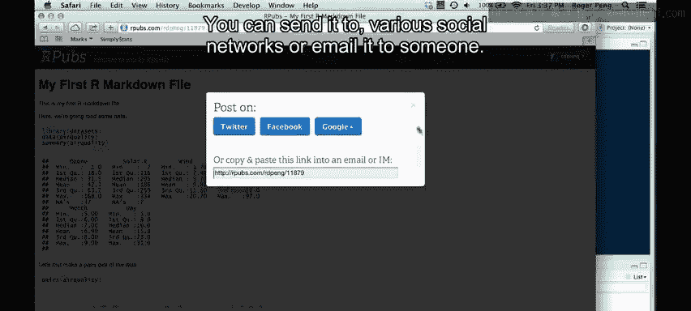
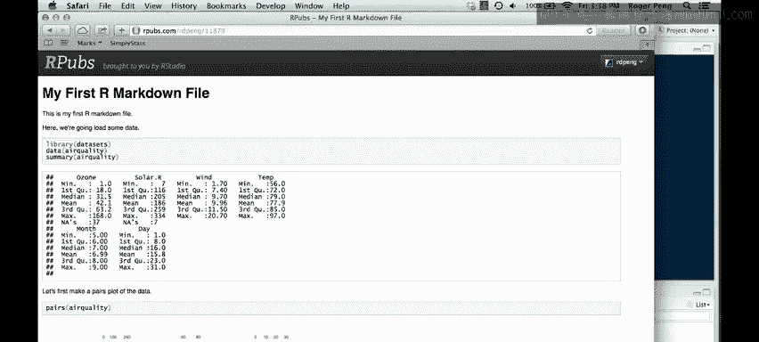

# 020：使用RPubs发布分析报告 📤

在本节课中，我们将学习如何使用RStudio提供的RPubs服务，将R Markdown文档发布为公开的网页，以便与他人分享你的数据分析成果。

---

## 概述

RPubs是RStudio提供的一项免费服务，允许用户将R Markdown文档编译后的HTML结果发布到公共网站。这为分享统计分析、报告和可视化结果提供了便捷的途径。

上一节我们介绍了如何使用R Markdown和knitr生成动态报告。本节中，我们来看看如何将这些报告发布到网上，实现真正的可重复与可分享研究。

---

## 注册RPubs账户



使用RPubs的第一步是注册一个账户。



以下是注册步骤：
1.  访问 [rpubs.com](https://rpubs.com/)。
2.  点击注册，填写姓名、邮箱、用户名和密码。
3.  完成注册后，即可登录并开始发布内容。

---

## 准备并预览R Markdown文档

在发布之前，需要确保你的R Markdown文档能正确编译为HTML。

以下是操作流程：
1.  在RStudio中打开或创建一个R Markdown（`.Rmd`）文件。
2.  点击 **Knit** 按钮，在预览窗口中查看生成的HTML输出。
3.  确认报告内容正确无误，例如包含数据加载、分析和可视化代码及其结果。

例如，一个简单的分析可能包含以下代码块：
```r
# 加载空气质量数据集
data(airquality)
# 绘制变量关系图
pairs(airquality)
# 拟合线性模型
model <- lm(Ozone ~ Wind + Solar.R + Temp, data = airquality)
summary(model)
```

---



## 发布到RPubs

当文档准备就绪后，即可将其发布到RPubs。

以下是发布步骤：
1.  在RStudio的HTML预览窗口顶部，找到并点击 **Publish** 按钮。
2.  系统会弹出RPubs发布提示框，点击 **Publish**。
3.  如果你的浏览器已登录RPubs账户，会直接跳转到发布页面；如果未登录，系统会引导你登录。
4.  在发布页面，为你的报告设置一个标题和描述。
5.  你可以自定义URL标识符，或使用系统自动生成的ID（例如 `11879`）。
6.  点击 **Continue** 完成发布。

发布完成后，你会获得一个永久的公开URL（如 `https://rpubs.com/你的用户名/11879`），任何人都可以通过此链接访问你的报告。

---



## 分享与管理已发布内容

报告发布后，你可以方便地与他人分享或进行管理。

以下是可用的功能：
*   **分享**：使用页面上的分享按钮，可以将报告链接发送到社交媒体或通过邮件分享。
*   **评论**：访客可以在报告页面下方发表评论，便于交流。
*   **删除**：如果你误发布了内容或想撤销分享，可以随时在页面底部找到删除选项将其移除。

**重要提示**：所有发布到RPubs的内容都会**立即公开**，不存在私密期。因此，请务必在发布前仔细检查，确保没有包含任何敏感或不想公开的信息。

---

## 总结



本节课中，我们一起学习了如何使用RPubs服务。我们了解了从注册账户、准备R Markdown文档，到最终发布和分享分析报告的完整流程。RPubs是一个强大且免费的工具，它能将你用R Markdown和knitr创建的可重复分析快速转化为可公开访问的网页，极大地促进了研究结果的传播与协作。





记住，虽然分享很方便，但始终要注意数据的公开性与隐私安全。现在，你可以尝试发布自己的第一个分析报告了。