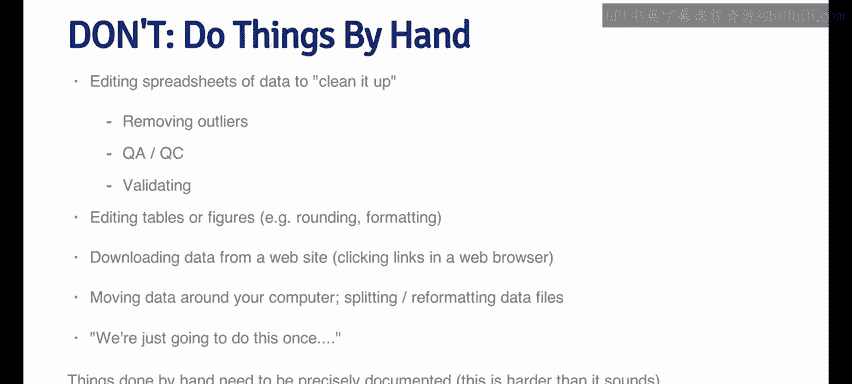

# 021：可重复研究核对表（第一部分）🔍

在本节课中，我们将学习一份简短的核对表，用于指导任何涉及大量数据处理与分析的项目。这份清单基于经验总结，旨在帮助你建立可重复研究的基础实践。

---

## 从好的科学问题开始 🎯

上一节我们介绍了课程目标，本节中我们来看看核对表的第一项：确保你研究的是一个好的科学问题。这是可重复研究的基石。

好的科学意味着你研究的问题本身对你和他人都有意义。如果起点不佳，最终结果很可能也不理想，这正如“垃圾进，垃圾出”的道理。因此，你需要一个相对聚焦和连贯的研究目标或问题。一个更明确的问题能简化你的工作，因为它排除了许多不必要的可能性。反之，一个宽泛模糊的问题会增加问题的复杂性。

此外，与优秀的协作者共事至关重要。良好的合作关系能促进良好实践，而糟糕的关系可能导致不良习惯。最后，确保课题是你感兴趣的，因为兴趣是维持良好研究习惯的重要动力。

**核心要点**：始终从一个好的、有趣的科学问题开始。

---

## 核心规则：避免手动操作 ⚠️

如果要将可重复性浓缩为一条核心规则，那就是：**不要手动处理事务**。手动操作是导致研究不可重复的最常见原因。

以下是几个常见的手动操作示例及其风险：

*   **编辑电子表格**：在Excel等软件中直接清理异常值或修正数据非常方便，但除非你精确记录每一步操作和判断标准（例如，定义异常值的公式），否则这个过程完全不可重复。
*   **修改图表与表格**：例如，手动调整表格中的舍入规则，可能导致他人无法复现相同结果。
*   **从网站下载数据**：手动点击链接下载数据看似简单，但需要向他人提供冗长的网站、链接点击顺序等说明，过程难以精确复现。
*   **移动或拆分文件**：在电脑中手动移动文件或拆分大文件，不会留下任何操作记录，他人无从重复。

在分析初期，人们常认为“这个操作只做一次，不需要自动化或详细记录”。但你必须确保，即使只做一次，其文档也需详细到让一个不了解背景的陌生人能够重复你的操作。

**根本原因**：任何手动操作都必须被精确记录，而这项任务远比听起来困难。许多你认为不重要的细节，对缺乏相同背景的他人而言可能至关重要。

---

## 慎用点击式图形界面软件 🖱️

下一项规则与第一条相关：尽量避免使用点击式的图形用户界面软件。

图形界面通常直观易用，但问题在于，你通过点击菜单和选项执行的操作，很难被他人精确复现。除非你详细记录“点击了A菜单下的B选项”，否则他人无法知晓你的具体操作步骤。

一些带有图形界面的软件会生成记录等效命令的日志文件或脚本。这些文件可以保存供未来查验。因此，对于高度交互式的数据分析或处理软件需要格外小心。交互的便利性可能以牺牲可重复性为代价。

当然，并非所有带图形界面的软件都需避免。例如，用于编写代码或报告的文本编辑器通常没有问题，因为你的分析通常不严格依赖于使用哪个编辑器。但在极少数情况下，如果分析确实依赖于此，则仍需谨慎记录。

**核心建议**：警惕那些不记录操作历史的高度交互式软件。

---

## 本节课总结 📝

本节课我们一起学习了可重复研究核对表的前两部分核心内容：

1.  **始于好的科学**：选择一个你感兴趣、目标聚焦且能与优秀协作者共同推进的问题。
2.  **自动化优于手动**：避免手动编辑数据、下载文件等操作，坚持使用可记录的脚本和程序。
3.  **记录优于点击**：谨慎使用不记录操作历史的图形界面软件，优先选择能生成日志或脚本的工具。

遵循这些原则，能为你的数据分析项目奠定坚实的可重复性基础。