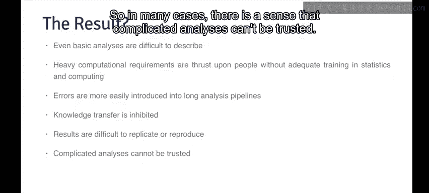

# 024：基于证据的数据分析（第1部分）🔬

在本节课中，我们将探讨科学研究中的两个核心概念：**可重复性**与**可复制性**。我们将明确区分这两个术语，并理解它们各自在验证科学发现中的作用。课程将重点讨论为何在当前数据密集型的研究环境中，可重复性变得尤为重要。

---

## 可复制性与可重复性的区别

上一节我们介绍了本课程的主题。本节中，我们来看看“可复制性”与“可重复性”这两个常被混用的概念有何本质区别。

我认为在很多情况下，人们倾向于互换使用这些词语。但为了本次讨论的目的，并且考虑到接下来基思的演讲，我们需要对它们进行区分。

当我思考“可复制性”时，我想到的是科学中通常发生的情况。在我看来，可复制性的目的是**解决科学主张的有效性问题**。例如，如果你声称X与Y相关，第一个问题就是：这为什么可能是真的？因此，你必须在另一项研究或一系列其他研究中，由新的研究者、收集新的数据、使用不同的分析方法、实验室、仪器等进行复制。如果经过多次复制，没有人能发现相同的结果，那么你会认为这个主张可能不成立。但如果所有独立研究都发现了大致相同的结果，那么你会认为这可能是一个合理的主张。因此，可复制性是我们一直以来做事的方式，并且我认为它仍然是加强科学证据的终极标准。

而“可重复性”，如果你还没听过这个术语，我指的是它**侧重于数据分析的有效性**。这里的情况是：数据已被收集并由某人分析，他们声称X与Y相关。此处的理念是，可以由新的研究者，但**查看相同的数据并使用相同的方法**，来验证他们所声称的结果是否确实能从数据和分析中得出。所以，我认为这里真正的问题不是“主张是否真实”，而是“我们能否信任这项分析”。这就是可重复性试图解决的关键问题：我们能否采用他们的方法，应用于他们的数据，并得到与他们相同的结果？

我认为这一点至关重要，特别是在我的工作领域，可重复性尤为重要，因为在这些领域，可复制性往往**不可能实现**。这就是我讨论的起点。

---

## 当前研究环境下的挑战

理解了核心概念的区别后，我们来看看当前的研究背景，这有助于理解为何可重复性问题日益凸显。

我认为一些背景情况是大家所熟悉的。近年来，关于可重复性的讨论很多。一些趋势表明，许多研究根本无法被复制，或者复制的代价极高。特别是在流行病学中，那些长达25年的队列研究，在合理的时间内根本无法复制。同时，技术极大地影响了数据收集的速度，数据的复杂性也非常高。

人们正疯狂地将各种数据库拼凑在一起——我就是其中之一。我注意到很多数据被“超范围使用”。例如，行政数据集被用于健康研究等。这非常普遍。此外，由于计算能力现在非常强大且复杂，我们可以在小型数据集上进行极其复杂的分析。现在，对于每一个领域X，都有一个“计算X”领域。

现在，即使是基本的分析结果，有时也很难在期刊的标准方法部分进行充分描述。通常，研究者被要求进行非常复杂的计算工作，但接受的培训却很少。结合我来自的背景稍作说明：你可以想象计算能力从低到高的范围。这个房间里的大多数人可能处于高端，而杰夫可能处于更高端。

但在这个光谱的低端，有大量的人无论喜欢与否，都不得不进行计算工作，因为他们手头有海量数据。这可能导致问题，错误可能被引入漫长的分析流程中。如果你无法在合理的篇幅内告诉别人你做了什么，那就会阻碍知识的传递。在许多情况下，人们有一种感觉：复杂的分析**不可信**。

---

## 总结

本节课中，我们一起学习了科学研究中“可复制性”与“可重复性”的关键区别。**可复制性**关注于使用新数据、新方法验证科学主张的真实性，是科学的黄金标准。而**可重复性**则关注于使用**相同数据和相同方法**，验证数据分析过程本身的可靠性与透明度，其核心问题是：“我们能否信任这项分析？”

我们了解到，在当前数据量激增、分析高度复杂、且某些研究（如长期队列研究）难以复制的背景下，确保研究的可重复性变得至关重要。它有助于发现分析流程中的错误，促进知识传播，并建立对复杂分析结果的信任。下一节，我们将继续深入探讨如何在实际研究中实现可重复性。