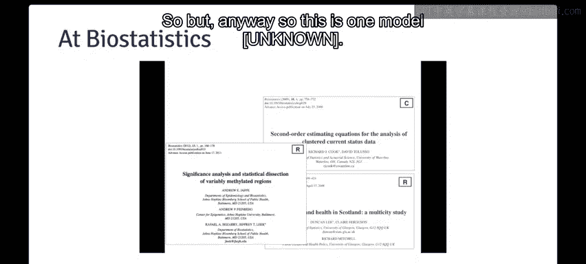
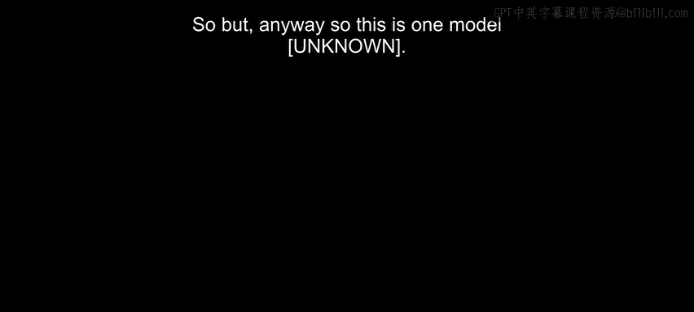

# 026：基于证据的数据分析（第3部分）🔬

在本节课中，我们将探讨如何将“可重复性”的理念从研究过程的末端，提前到更上游的环节。我们将通过一个类比来理解其重要性，并介绍一种在学术出版中实施可重复性检查的实践模型。

上一节我们讨论了研究传播中的潜在问题，本节中我们来看看如何通过流程设计，在早期介入以确保分析的可重复性。

---

## 研究过程的“上游干预”理念

我有时会用哮喘的病理机制来类比。在哮喘的过敏致敏和发病过程中，过敏原暴露会引发一系列反应：特异性免疫球蛋白E附着于肥大细胞，致敏后产生炎症介质，这些介质进而导致支气管收缩等典型症状。

传统的干预方式主要是药物治疗，例如吸入性皮质类固醇、白三烯调节剂或抗免疫球蛋白E药物。这些方法作用于疾病过程的中下游，效果各异。

然而，还有一部分干预作用于最上游。我对许多环境干预研究感到兴奋的原因在于，它们能影响疾病过程的最开端。这不仅作用点更早，而且相对于所有药物治疗，它通常成本更低、效率更高且潜力巨大。

---

## 将类比迁移至研究传播

如果将这个类比迁移到研究传播过程：

1.  研究人员在此进行研究。
2.  研究本身可能在分析上存在问题或错误。
3.  他们将论文提交给期刊，经过流程后发表。
4.  论文发表后，你才能获得数据和代码，并查看他们的具体操作。

传统的保障措施包括：期刊编辑初审（可能拒稿）、送交同行评审（理论上进行核查），通过后得以发表。目前，**可重复研究通常在这个过程的最下游环节才介入**。

现在有很多关于推进此事的讨论。其核心思想是：为何要等到论文发表后才提供数据和代码？为何不将其作为出版过程的一部分？

我认为这是一个崇高的目标，但可能不完全现实。因为期望审稿人重现所有分析是不切实际的。根据我的经验，非统计学领域的研究者可能不习惯通常需要等待6到12个月的评审周期。如果在此基础上，再加上重现整个分析的要求，评审可能会被推迟到40年后。这并不合理，我稍后会举例说明。

因此，关键问题是：**我们能否在这个过程的最上游部分做一些事情？** 这就是我今天想讨论的内容。

---

## 一个上游实践模型

以下是将可重复性部分向同行评审环节（或更上游一点）移动的一个例子。这并非完全在评审时进行，但位置更靠前。

我们在《生物统计学杂志》（这无疑是世界上最好的统计学期刊）有一项政策。我担任“可重复性副编辑”，我们有一项非常宽松且完全自愿的政策。

以下是该政策的操作流程：

*   作者可以将数据和代码提交给可重复性副编辑（也就是我）。
*   我将尝试重现分析。
*   这项政策并非100%万无一失，但至今为止，我还没有遇到无法重现的情况。
*   如果分析可重现，你的论文上会盖上一个漂亮的 **R** 印章。

此外还有两个其他选项：
*   **C**：如果你提交了代码，会获得一个 **C** 标记（我不检查，默认没问题）。
*   **D**：如果你提交了数据，会获得一个 **D** 标记。
*   如果你既提交数据又提交代码，你会获得 **D** 和 **C**。如果我成功重现，你会获得 **R**。

例如，杰夫对此工作的唯一贡献就是获得了一个 **R**。我花了一周时间重现，但过程顺利。

总之，这是一种模型。它并非强制性的威慑手段，因为完全是自愿的，且发生在论文通过同行评审并被接受之后。但这仍然是一种可能的实践模型。

---

本节课中，我们一起学习了通过“上游干预”来提升研究可重复性的理念。我们通过哮喘治疗的类比，说明了在流程早期介入的优势，并介绍了一种在学术期刊中实施的自愿性可重复性检查模型。将可重复性检查整合到出版流程中，是迈向更可靠、更透明科学研究的重要一步。